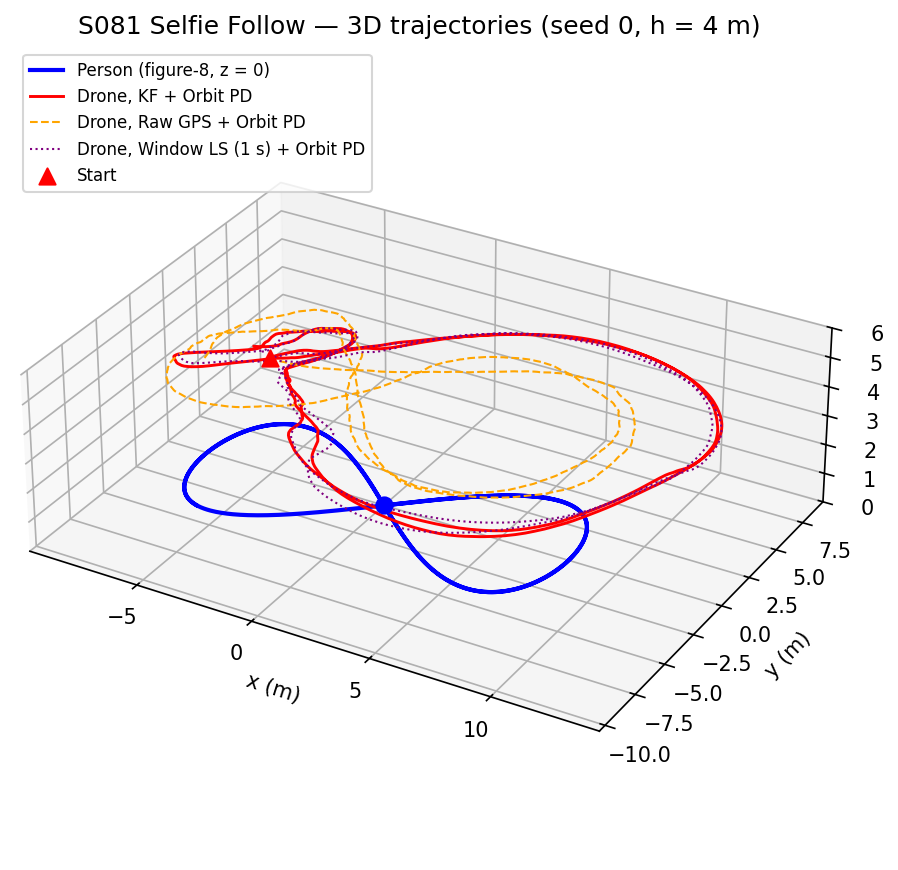
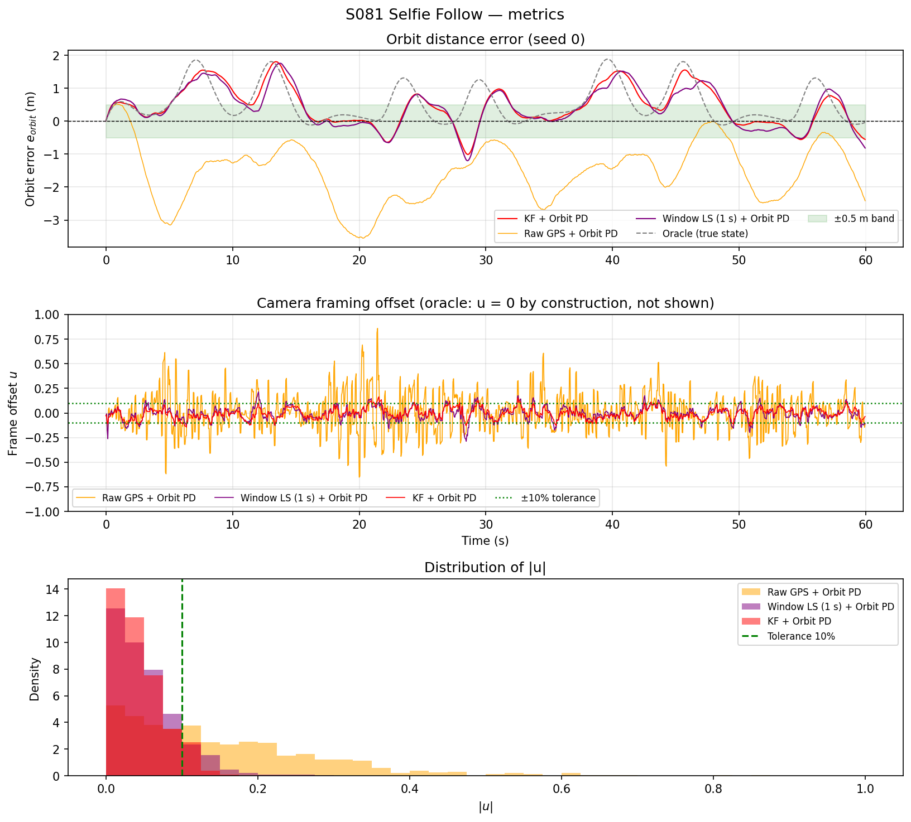
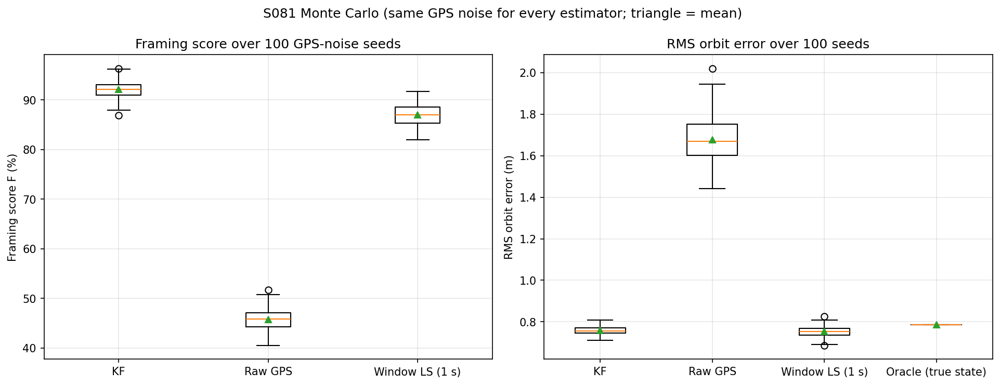
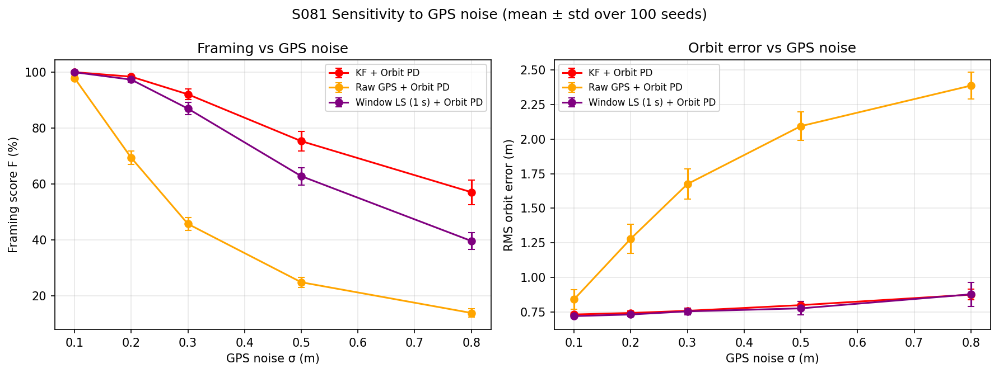
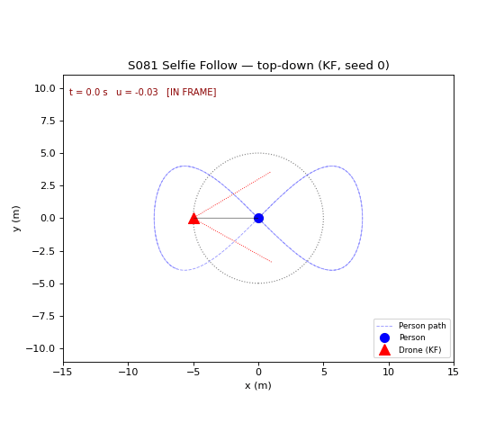

# S081 Selfie Follow Mode

**Domain**: Special Ops & Entertainment | **Difficulty**: ⭐⭐ | **Status**: ✅ Completed

---

## Problem Definition

**Setup**: A person walks a figure-8 (lobe radius $R = 8$ m) at a constant 1.5 m/s. One drone flies at a constant altitude of 4 m and films the person. It receives GPS fixes of the person at 10 Hz with zero-mean Gaussian noise ($\sigma_{GPS} = 0.3$ m per axis). The drone must hold a horizontal standoff of 5 m at a bearing of 135° counter-clockwise from the person's heading (rear-left), and its camera (60° horizontal field of view) must keep the person in the centre of the image.

**Camera model**: the camera yaw points at the drone's **estimate** of the person's position. The framing offset $u$ is the angle between the camera axis and the **true** person, divided by the half field of view (30°). The person counts as centred when $|u| \le 0.10$, i.e. within 3° of the camera axis.

**Objective**: maximise the framing score $F$ (fraction of time with $|u| \le 0.10$) and minimise the RMS orbit error (deviation of the horizontal distance from 5 m).

**Comparison strategies** (same orbit PD controller, same GPS noise for every strategy):
1. **KF + Orbit PD** (card): constant-velocity Kalman filter on the GPS fixes.
2. **Raw GPS + Orbit PD** (card baseline): latest fix as position, one-step finite difference of two fixes as velocity.
3. **Window LS (1 s) + Orbit PD** (added): least-squares straight-line fit through the last 10 fixes (1 s); position = line at the current time, velocity = slope. This is a reasonable filter that does not use a motion model, added so that the KF is not only compared with an unfiltered baseline.
4. **Oracle** (added reference): true position and velocity. Shows how much orbit error the controller produces with perfect information. Its framing score is 100 % by construction (the camera points exactly at the person), so it is not part of the framing comparison.

---

## Mathematical Model Summary

### Person trajectory

$$x = R\sin s, \qquad y = \tfrac{R}{2}\sin 2s, \qquad z = 0$$

with $s(t)$ chosen by arc-length reparametrisation so that the speed is exactly 1.5 m/s. The path is 48.78 m long, one lap takes 32.52 s (1.85 laps in 60 s), and the tightest turns, at (±6.26, ±3.90) m on the outer part of each lobe, have a 1.67 m radius of curvature, so the heading turns at up to 0.898 rad/s. At the lobe tips themselves (x = ±8 m) the radius is 8.00 m.

### Kalman filter

State $[x, y, v_x, v_y]$, constant-velocity model, predict every 0.05 s, update at every GPS fix:

$$F = \begin{bmatrix} I_2 & \Delta t\, I_2 \\ 0 & I_2 \end{bmatrix},\quad Q = q_\sigma^2\,\mathrm{diag}\!\left[\tfrac{\Delta t^3}{3}, \tfrac{\Delta t^3}{3}, \Delta t, \Delta t\right],\quad H = [I_2\;\, 0],\quad R_{gps} = \sigma_{GPS}^2 I_2$$

### Orbit PD control

$$\hat\theta = \operatorname{atan2}(\hat v_y, \hat v_x), \qquad \mathbf{p}_d = \hat{\mathbf{p}} + r\begin{bmatrix}\cos(\hat\theta + \varphi)\\ \sin(\hat\theta + \varphi)\end{bmatrix}$$

$$\mathbf{a}_{cmd} = \operatorname{sat}_{a_{max}}\!\bigl(K_p(\mathbf{p}_d - \mathbf{p}) + K_d(\dot{\mathbf{p}}_d - \mathbf{v})\bigr), \qquad \dot{\mathbf{v}} = \mathbf{a}_{cmd} - c_{drag}\mathbf{v}, \quad \|\mathbf{v}\| \le v_{max}$$

$\dot{\mathbf{p}}_d$ is the finite difference of $\mathbf{p}_d$ over one step, as in the card.

### Metrics

$$u = \frac{\operatorname{wrap}(\beta_{true} - \psi)}{\theta_{FOV}/2},\quad \psi = \operatorname{atan2}(\hat y - y_d,\ \hat x - x_d),\qquad F = \frac{1}{T}\int_0^T \mathbf{1}[|u| \le 0.1]\,dt$$

$$e_{orbit} = \|\mathbf{p}^{xy}_{drone} - \mathbf{p}^{xy}_{person}\| - r, \qquad \bar e_{orbit} = \sqrt{\overline{e_{orbit}^2}}$$

---

## Key Parameters

| Parameter | Value |
|-----------|-------|
| Figure-8 lobe radius $R$ | 8.0 m |
| Person speed $v_{target}$ | 1.5 m/s (constant) |
| GPS noise $\sigma_{GPS}$ / rate | 0.3 m per axis / 10 Hz |
| Standoff $r$ / bearing $\varphi$ | 5.0 m / 135° |
| Cruise altitude $h$ | 4.0 m |
| Camera FOV / framing tolerance | 60° / $\lvert u \rvert \le 0.10$ |
| KF process noise $q_\sigma$ | 0.5 m/s² |
| Orbit PD $K_p$ / $K_d$ | 1.5 / 0.8 |
| Drag $c_{drag}$ | 0.3 s⁻¹ |
| Time step / mission time | 0.05 s / 60 s |
| Acceleration limit $a_{max}$ (added) | 6.0 m/s² |
| Speed limit $v_{max}$ (added) | 10.0 m/s |
| LS window (added) | 10 fixes (1 s) |
| Monte Carlo | 100 GPS-noise seeds (master seed 2026), shared by all strategies |
| GPS noise sweep | σ = 0.1, 0.2, 0.3, 0.5, 0.8 m |
| Acceleration-limit sweep (added) | $a_{max}$ = 4, 6, 10 m/s², unlimited (100 seeds) |

---

## Implementation

```
src/05_special_entertainment/s081_selfie_follow.py   # Main simulation script
```

```bash
conda activate drones
python src/05_special_entertainment/s081_selfie_follow.py
```

Runtime ≈ 1 min on a heavily loaded machine (all 100 seeds run as one vectorised batch per strategy).

---

## Results

Monte Carlo over 100 GPS-noise seeds (mean ± std):

| Strategy | Framing $F$ | RMS $e_{orbit}$ | Max $\lvert e_{orbit}\rvert$ | Position estimate RMSE |
|----------|------------:|----------------:|-----------------------------:|-----------------------:|
| **KF + Orbit PD** | **92.1 ± 1.9 %** | 0.758 ± 0.018 m | 1.751 ± 0.092 m | 0.227 m |
| Raw GPS + Orbit PD | 45.7 ± 2.4 % | 1.676 ± 0.108 m | 3.267 ± 0.361 m | 0.426 m |
| Window LS (1 s) + Orbit PD | 87.0 ± 2.2 % | 0.754 ± 0.025 m | 1.750 ± 0.119 m | 0.265 m |
| Oracle (true state) | n/a (100 % by construction) | 0.785 m | 1.881 m | 0 |

Per-seed comparison: the KF has a higher framing score than raw GPS in 100/100 seeds and than the windowed LS fit in 100/100 seeds. It has a lower RMS orbit error than raw GPS in 100/100 seeds, but than the LS fit in only 42/100 seeds.

Seed 0 (shown in the figures and animation): KF 92.5 % / 0.748 m, raw GPS 42.6 % / 1.771 m, window LS 87.8 % / 0.726 m, oracle 0.785 m.

**Key findings**:
- **The KF frames far better than raw GPS** (92.1 % vs 45.7 % with the 6 m/s² acceleration limit, a factor of 2.01; the factor depends on that added limit, see the next bullet) and is also better than the 1 s least-squares fit (87.0 %), winning on every seed; that margin is against the 1 s window used here (an added parameter that was not tuned), so a better-tuned window would narrow it. Framing depends directly on the position estimate (the camera points at it): at 5 m range the 3° tolerance is about $5\tan 3° = 0.26$ m of lateral error (hand calculation), and the KF position error (RMSE 0.227 m) is smaller than the raw fix error (0.426 m) and the LS error (0.265 m).
- **How badly raw GPS does depends on the acceleration limit I added** (the card has none). The KF and LS results hardly change with the limit (KF 92.1–92.2 %, LS 86.6–87.3 %), but raw GPS gets worse the more freely the drone can chase its jumping set-point:

| $a_{max}$ (m/s²) | 4 | **6 (used)** | 10 | unlimited |
|---|---|---|---|---|
| Raw GPS: $F$ / RMS $e_{orbit}$ / mean $e_{orbit}$ | 54.6 % / 1.148 m / −0.618 m | 45.7 % / 1.676 m / −1.438 m | 34.9 % / 2.466 m / −2.339 m | 21.4 % / 3.480 m / −3.416 m |
| KF: $F$ / RMS $e_{orbit}$ | 92.2 % / 0.813 m | 92.1 % / 0.758 m | 92.1 % / 0.733 m | 92.2 % / 0.744 m |
| Window LS: $F$ / RMS $e_{orbit}$ | 87.3 % / 0.839 m | 87.0 % / 0.754 m | 86.8 % / 0.703 m | 86.6 % / 0.695 m |
| $F_{KF}/F_{raw}$ | 1.69 | 2.01 | 2.64 | 4.30 |

  So the KF's framing advantage over raw GPS is between 1.69× and 4.30× depending on how aggressive the drone is allowed to be; the ranking does not change.
- **Raw GPS also degrades the orbit** (at every tested limit its RMS orbit error is the largest: 1.148–3.480 m vs 0.733–0.813 m for the KF). Differentiating two fixes 0.1 s apart gives velocity noise of about $\sqrt{2}\cdot 0.3/0.1 \approx 4$ m/s (hand calculation), larger than the 1.5 m/s walking speed, so the estimated heading, and with it the desired point $\mathbf{p}_d$ on the 5 m circle, jumps around randomly. The drone cannot follow these jumps (its acceleration command is at the 6 m/s² limit 79.19 % of the time, vs 24.73 % for the KF) and settles near the average of the jumping set-points, which lies inside the circle: its mean orbit error is −1.438 m (too close) and it came within 0.67 m horizontally of the person (it flies 4 m above, so it never collides).
- **The orbit error is set by the controller, not by the estimator, once the estimate is filtered.** KF (0.758 m), LS (0.754 m) and even the oracle with perfect information (0.785 m) have almost the same RMS orbit error, and the KF beats LS on orbit error in only 42/100 seeds. With the oracle the drone is on average 0.544 m too far away. The cause is the PD controller's response to the **accelerating** set-point, not drag: in the tight turns the desired point $\mathbf{p}_d$ swings around the person (the heading turns at up to 0.898 rad/s), and the closed loop from $\mathbf{p}_d$ to the drone, $H(s) = (K_d s + K_p)/(s^2 + (K_d + c_{drag})s + K_p)$, has a gain of 1.378 (phase −29.3°) at 0.898 rad/s, so the drone overshoots the swing outward and lags it. Diagnostic oracle runs (seed 0) confirm this: adding drag feedforward $c_{drag}\dot{\mathbf p}_d$ makes the RMS slightly worse (0.785 → 0.823 m; mean offset +0.544 → +0.432 m), while adding the set-point acceleration $\ddot{\mathbf p}_d$ as feedforward cuts the RMS to 0.212 m (mean +0.067 m), and both together to 0.092 m. The oracle is slightly worse than the KF, probably because the filtered heading swings more smoothly in the turns than the true heading; this was not separately tested.
- **Card expectation only partly holds.** The card expects KF 82.0 % / 0.31 m / 1.12 m and raw GPS 54.0 % / 0.89 m / 2.74 m. The ranking holds (KF far better on both metrics), but the RMS orbit error is about 0.76 m, not 0.31 m, for the KF and even for the oracle, so a 0.31 m orbit error is not reachable with the card's PD gains on this path.
- **Sensitivity to GPS noise**: the KF's advantage in framing grows with the noise. At σ = 0.1 m all three estimators frame well (KF 100.0 %, LS 100.0 %, raw 97.9 %); at σ = 0.8 m the KF still frames 57.1 % of the time vs 39.6 % for LS and 13.9 % for raw GPS. The orbit error of KF and LS stays between 0.72 and 0.88 m over the whole sweep.

| σ_GPS (m) | 0.1 | 0.2 | 0.3 | 0.5 | 0.8 |
|---|---|---|---|---|---|
| KF: $F$ / RMS $e_{orbit}$ | 100.0 % / 0.731 m | 98.4 % / 0.742 m | 92.1 % / 0.758 m | 75.3 % / 0.799 m | 57.1 % / 0.875 m |
| Window LS: $F$ / RMS $e_{orbit}$ | 100.0 % / 0.720 m | 97.3 % / 0.731 m | 87.0 % / 0.754 m | 62.8 % / 0.776 m | 39.6 % / 0.877 m |
| Raw GPS: $F$ / RMS $e_{orbit}$ | 97.9 % / 0.841 m | 69.4 % / 1.280 m | 45.7 % / 1.676 m | 24.9 % / 2.095 m | 13.9 % / 2.388 m |

**Physical checks** (asserted in the code for every step and seed): commanded acceleration ≤ 6 m/s², speed ≤ 10 m/s (peak 5.69 m/s, LS), displacement per step ≤ $v_{max}\Delta t$, altitude fixed at 4 m. The person left the image entirely ($|u| > 1$) 0.04 % of the time with raw GPS and never with KF or LS.

### 3D Trajectories

Person path on the ground (blue) and the drone paths at 4 m for KF (red), raw GPS (orange dashed) and window LS (purple dotted), seed 0. The raw-GPS drone flies a smaller, irregular loop inside the others because it is pulled toward the person:



### Metrics (seed 0)

Top: orbit error over time; the oracle (grey dashed) has the same recurring peaks as KF and LS, and the raw-GPS drone is too close for almost the whole run (largest deviation 3.550 m in this seed). Middle: frame offset $u$; the raw-GPS trace is much noisier. Bottom: distribution of $|u|$ with the 0.10 tolerance:



### Monte Carlo

Framing score and RMS orbit error over the 100 seeds:



### Sensitivity to GPS Noise and to the Acceleration Limit

Top: framing and orbit error vs GPS noise (at $a_{max}$ = 6 m/s²). Bottom: the same vs the acceleration limit (at σ = 0.3 m); only raw GPS depends strongly on it:



### Animation

Top-down view (KF, seed 0): person (blue), drone (red triangle), 5 m standoff circle centred on the person, and the camera's 60° field of view (red dotted lines). The text shows $u$ and whether the person is within the ±10 % tolerance. 301 frames at 12 fps (one frame every 0.2 s):



### Deviations from the scenario card

| Card | Implementation | Reason |
|------|----------------|--------|
| Card code: $x = R\sin(2\pi\omega t)$, $y = \tfrac{R}{2}\sin(4\pi\omega t)$ with $\omega = v/(\pi R)$; the math writes $\lambda = vt/L$ as an "arc-length parameter" | Arc-length reparametrisation, speed exactly 1.5 m/s (lap 32.52 s) | The card's code has a period of 16.76 s, so the person walks 48.78 m in 16.76 s = 2.91 m/s on average, not 1.5 m/s; and $\lambda$ linear in time does not give a constant speed. Card corrected. |
| `framing_score_instant` builds the camera direction from the true target | Camera yaw points at the estimate ($\psi_{drone}$ in the card's math); $u$ is the wrapped bearing error to the true person divided by 30° | With the card's code the lateral offset is $\mathbf{d}\cdot\mathbf{n}_\perp = 0$ for every strategy, so $F = 100\,\%$ for everyone and the comparison is meaningless. Card corrected. |
| No acceleration or speed limit | $\|\mathbf{a}_{cmd}\| \le 6$ m/s², $\|\mathbf{v}\| \le 10$ m/s | The card's $K_d$ term differentiates the set-point $\mathbf{p}_d$ over one step, so every jump of the estimate becomes a velocity spike. Without the limit the PD command peaks at 173.3 m/s² (raw GPS) and 169.4 m/s² (KF) over the Monte Carlo, far beyond what a multirotor can do. With the limit the KF is saturated 24.73 % of the time and raw GPS 79.19 %; the oracle never saturates (peak 4.4 m/s²). The limit is an assumption, so it is swept (4, 6, 10 m/s², unlimited): KF and LS barely change, raw GPS ranges from 54.6 % to 21.4 % framing. |
| Two strategies (KF, raw GPS) | Added window LS (1 s) and an oracle reference | Raw GPS with one-step differencing is a weak baseline; the LS fit is a fair non-model-based filter. The oracle separates controller error from estimation error. |
| Single run, seed 42 | 100-seed Monte Carlo with the same GPS noise for every strategy; per-seed win counts; GPS noise sweep | Results depend on the noise realisation. |
| Outputs `s081_selfie_follow.gif`, figures via `plt.show()` | `animation.gif`, `trajectory_3d.png`, `metrics.png`, `monte_carlo.png`, `sensitivity.png` | Project naming convention. The animation also draws the camera's field of view. |
| Expected KF 82.0 % / 0.31 m / 1.12 m, raw GPS 54.0 % / 0.89 m / 2.74 m | KF 92.1 % / 0.758 m / 1.751 m, raw GPS 45.7 % / 1.676 m / 3.267 m | Not tuned to match; see Key findings. The orbit-error floor of the PD controller on this path (oracle 0.785 m) is above the card's 0.31 m. |

---

## Extensions

1. **Derivative on measurement**: replace $K_d\dot{\mathbf{p}}_d$ (finite difference of a jumping set-point) by a filtered set-point rate, to remove the acceleration spikes that saturate the KF drone 24.73 % of the time.
2. **Set-point acceleration feedforward**: add $\ddot{\mathbf{p}}_d$ (computed from the filtered heading rate) to the command. With perfect information this removes most of the orbit error (oracle 0.785 → 0.212 m); the open question is how much of that survives with a noisy heading estimate.
3. **Curvature-aware bearing**: smooth or rate-limit the desired bearing in tight turns so that $\mathbf{p}_d$ does not swing faster than the drone can follow.
4. **Gimbal dynamics**: give the camera yaw a rate limit (e.g. 90°/s) instead of pointing instantly at the estimate.
5. **Vertical framing**: add camera tilt and a person height so that both image axes count.
6. **GPS latency**: delay the fixes by 0.2 s and compare a KF that predicts forward to the present against one that does not.

---

## Related Scenarios

- Prerequisites: [S003 Low-Altitude Tracking](../../../scenarios/01_pursuit_evasion/S003_low_altitude_tracking.md), [S008 Stochastic Pursuit — Kalman Filter Tracking](../../../scenarios/01_pursuit_evasion/S008_stochastic_pursuit.md)
- Follow-ups: [S085 Drone Light Matrix Positioning](../../../scenarios/05_special_entertainment/S085_light_matrix.md), [S086 Cooperative Multi-Angle Filming](../../../scenarios/05_special_entertainment/S086_multi_angle_cinema.md), [S092 Movie Car Chase Scene](../../../scenarios/05_special_entertainment/S092_movie_chase.md)
- Cross-reference: [S042 Missing Person Localization](../../../scenarios/03_environmental_sar/S042_missing_person.md), [S061 Power Line Inspection](../../../scenarios/04_industrial_agriculture/S061_power_line.md)
