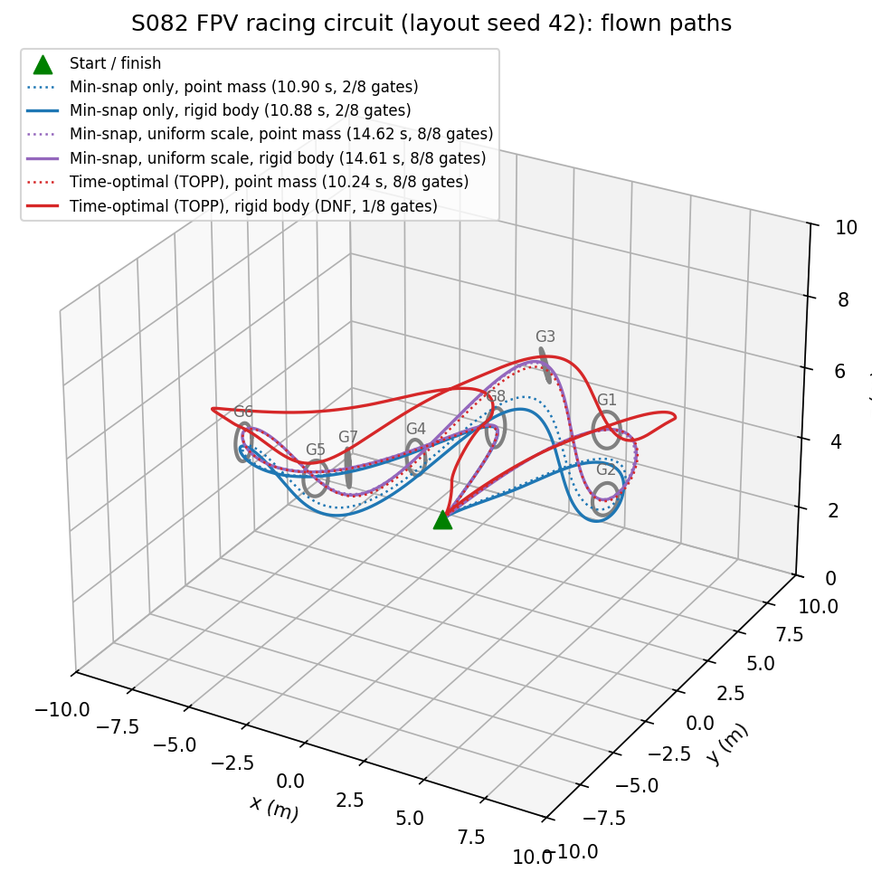
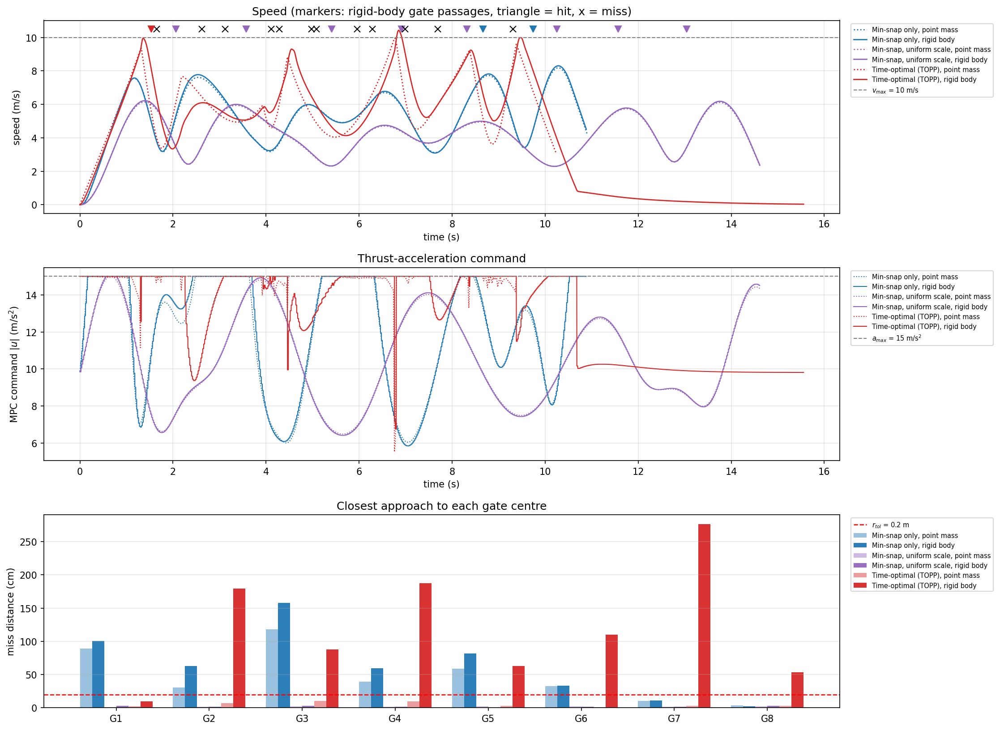
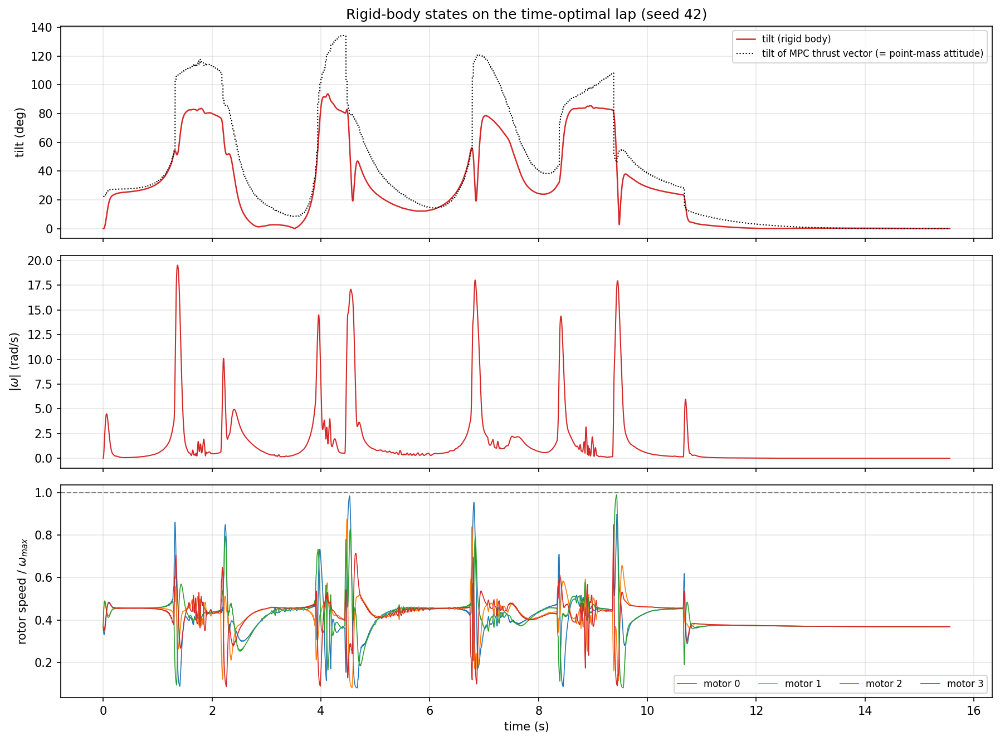
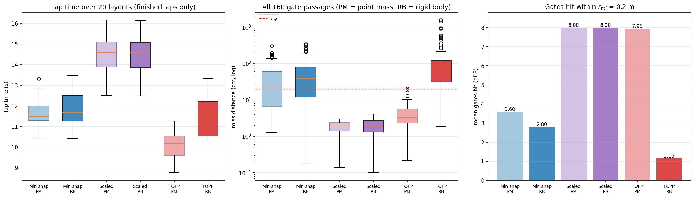
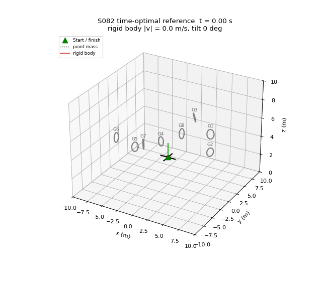

# S082 FPV Racing Circuit

**Domain**: Special Ops & Entertainment | **Difficulty**: ⭐⭐⭐⭐ | **Status**: ✅ Completed

---

## Problem Definition

**Setup**: A racing drone starts at rest at (0, 0, 3) m, flies through 8 gates (ring radius 0.5 m) placed by the card's random generator on a rough circle in a 20 × 20 × 10 m arena, and returns to the start. A gate is **hit** when the drone passes within $r_{tol}$ = 0.2 m of its centre. Limits: speed $v_{max}$ = 10 m/s and thrust acceleration $\|\mathbf{u}\| \le a_{max}$ = 15 m/s².

**Planning pipelines compared** (same gates, same minimum-snap path):
1. **Min-snap only** (card): degree-7 minimum-snap spline, segment times = distance / 5 m/s.
2. **Min-snap, uniform scale** (added baseline): the same spline slowed down uniformly by the smallest factor $k$ that satisfies both limits everywhere.
3. **Time-optimal (TOPP)** (card's proposed method): the same path re-timed by a time-optimal path parameterisation that saturates the limits.

All three references are tracked by the **same MPC** (card weights, horizon 10 × 0.02 s) and flown on **two plant models**:
- **Point mass** (the card's model): $\dot{\mathbf{v}} = \mathbf{u} - \frac{c_D}{m}\mathbf{v} + \mathbf{g}$, Euler at 0.02 s.
- **Rigid body**: the 6-DOF model in [`src/base/rigid_body_drone.py`](../../../src/base/rigid_body_drone.py) (quaternion attitude, first-order motor lag, rotor-speed limits, mixer), `fpv_5inch` preset with the card's mass 0.5 kg. The MPC output $\mathbf{u}$ becomes a thrust-vector command; the attitude and body-rate loops run at 500 Hz.

The headline layout is the card's seed 42. A Monte Carlo over 20 layouts (seeds 42–61) gives the statistics; all six strategy/model combinations fly the same 20 layouts.

---

## Mathematical Model Summary

### Minimum-snap spline

Per axis, the coefficients $\mathbf{c}$ of the 9 degree-7 segments (start → G1 … G8 → start) minimise $\sum_k \int_0^{T_k} (p^{(4)})^2 dt = \mathbf{c}^\top \mathbf{H}(\mathbf{T})\mathbf{c}$ subject to waypoint positions, $C^3$ continuity at the gates and zero velocity and acceleration at both ends. The equality-constrained QP is solved exactly through its KKT system. Initial times $T_k = \|\mathbf{g}_k - \mathbf{g}_{k-1}\| / 5$ m/s.

### Time-optimal path parameterisation (TOPP)

The path is re-parameterised by arc length $\sigma$ on a grid of $N_{arc}$ = 500 points, with unit tangent $\mathbf{p}'$ and curvature vector $\mathbf{p}''$. For squared path speed $x = \dot\sigma^2$ and path acceleration $\ddot\sigma$, the constraints are

$$\dot\sigma \le v_{max}, \qquad \Bigl\|\mathbf{p}''\,\dot\sigma^2 + \mathbf{p}'\,\ddot\sigma + \tfrac{c_D}{m}\mathbf{p}'\,\dot\sigma - \mathbf{g}\Bigr\| \le a_{max}$$

The second constraint is a quadratic inequality in $\ddot\sigma$. It gives the admissible interval $[\ddot\sigma_{lo}(x), \ddot\sigma_{hi}(x)]$ and, where the interval is empty, the maximum-velocity curve (found by bisection). A forward pass at $\ddot\sigma_{hi}$ and a backward pass at $\ddot\sigma_{lo}$ (rest to rest) give $\dot\sigma^*(\sigma) = \min(\dot\sigma_{fwd}, \dot\sigma_{bwd}, \dot\sigma_{mvc})$. The reference is $\mathbf{v} = \mathbf{p}'\dot\sigma$, $\mathbf{a} = \mathbf{p}''\dot\sigma^2 + \mathbf{p}'\ddot\sigma$ and $\mathbf{u}_{ref} = \mathbf{a} + \frac{c_D}{m}\mathbf{v} - \mathbf{g}$.

### Uniform time scaling

$\mathbf{p}_k(t/k)$ has coefficients $c_j / k^j$ and durations $kT$. The smallest $k$ with $\max\|\mathbf{v}\| \le 10$ and $\max\|\mathbf{u}\| \le 15$ on a 4000-point sample is found by bisection.

### MPC

State $\mathbf{x} = (\mathbf{p}, \mathbf{v})$, card discretisation $\mathbf{A}_d, \mathbf{B}_d$ with drag, $\mathbf{d} = \mathbf{B}_d\mathbf{g}$. Over $N$ = 10 steps the condensed cost is

$$J = \sum_{j=1}^{N-1}\left(\|\mathbf{p}_j - \mathbf{p}^{ref}_j\|^2_{Q_p} + \|\mathbf{v}_j - \mathbf{v}^{ref}_j\|^2_{Q_v}\right) + \|\mathbf{p}_N - \mathbf{p}^{ref}_N\|^2_{Q_f} + \sum_{j=0}^{N-1}\|\mathbf{u}_j - \mathbf{u}^{ref}_j\|^2_R$$

subject to $\|\mathbf{u}_j\| \le a_{max}$. This QP is solved by 40 iterations of accelerated projected gradient (FISTA), warm-started from the shifted previous solution. Only $\mathbf{u}_0$ is applied.

### Rigid-body tracking

The rigid-body drone receives $\mathbf{u}_0$ as a desired thrust vector $m\mathbf{u}_0$: desired body $z$ axis $= \mathbf{u}_0/\|\mathbf{u}_0\|$, yaw 0, collective thrust $= m\,\mathbf{u}_0 \cdot \mathbf{z}_b$. Body-rate feed-forward comes from the MPC plan, $\boldsymbol\omega_{ff} = (-\mathbf{y}_b \cdot \dot{\mathbf{z}}, \mathbf{x}_b \cdot \dot{\mathbf{z}}, 0)$ with $\dot{\mathbf{z}} = (\mathbf{I} - \mathbf{z}\mathbf{z}^\top)(\mathbf{u}_1 - \mathbf{u}_0)/(\Delta t\,\|\mathbf{u}_0\|)$. The attitude loop is a quaternion P controller and the rate loop a PI controller with gyroscopic compensation. The airmode mixer maps the result to four rotor-speed commands, which pass through a first-order motor lag (15 ms).

### Metrics

- **Gate passage**: the closest approach of the piecewise-linear path to the gate centre during the first visit within 2 m, searched in gate order. A gate is hit if this distance is ≤ 0.2 m.
- **Lap time**: the first time after the last gate passage that the drone is within 0.5 m of the start. A lap that ends on the ground or never returns is DNF.
- $\eta_v$, $\eta_a$: fraction of the lap with speed above 8 m/s and with $\|\mathbf{u}\|$ above 13.5 m/s².

---

## Key Parameters

| Parameter | Value |
|-----------|-------|
| Gates / ring radius / tolerance | 8 / 0.5 m / 0.2 m |
| Gate layout | card generator, seed 42 (headline); seeds 42–61 (Monte Carlo) |
| Start / finish | (0, 0, 3) m, at rest |
| $v_{max}$ / $a_{max}$ (thrust acceleration) | 10 m/s / 15 m/s² |
| Mass / linear drag $c_D$ | 0.5 kg / 0.05 kg/s |
| Polynomial degree / continuity | 7 / $C^3$, zero end velocity and acceleration |
| Initial segment speed $v_{ref}$ | 5 m/s |
| TOPP grid $N_{arc}$ | 500 points, uniform in arc length |
| MPC step / horizon | 0.02 s / 10 steps |
| MPC weights $Q_p$ / $Q_v$ / $Q_f$ / $R$ | 10 / 2 / 50 / 0.1 (identity matrices) |
| MPC solver | FISTA, 40 iterations, ball constraint $\|\mathbf{u}_j\| \le a_{max}$ |
| Point-mass integration | Euler, 0.02 s (card) |
| Rigid body | `fpv_5inch` preset, mass 0.5 kg, T/W 7.34, motor time constant 15 ms, 500 Hz control and RK4 physics |
| Rigid-body max tilt / max body rate | 89° / 15 rad/s per axis |
| Gate search radius / finish radius | 2 m / 0.5 m |
| Simulated time after the reference ends | 4 s |

---

## Implementation

```
src/base/rigid_body_drone.py                 # 6-DOF rigid-body model (shared)
src/05_special_entertainment/s082_fpv_racing.py
```

```bash
conda activate drones
python src/05_special_entertainment/s082_fpv_racing.py
```

Runtime ≈ 150–240 s with about 10 other simulations sharing the 12-thread machine (measured 127–237 s here, 161–187 s by the reviewer). This includes the two extra rate-clip sensitivity runs.

---

## Results

**References (seed 42)**: path through 8 gates, 9 segments, 56.9 m straight-line length (60.4 m along the spline), snap cost $J$ = 28023.6.

| Reference | $T_{ref}$ | Peak speed | Peak $\|\mathbf{u}\|$ | Peak $\|\mathbf{a}\|$ |
|-----------|----------:|-----------:|----------------------:|----------------------:|
| Min-snap only | 11.38 s | 8.23 m/s | **19.87 m/s²** | 16.96 m/s² |
| Min-snap, uniform scale ($k$ = 1.338) | 15.23 s | 6.15 m/s | 15.00 m/s² | 9.48 m/s² |
| Time-optimal (TOPP) | 10.66 s | 10.00 m/s | 15.49 m/s² | 22.28 m/s² |

The 15.49 m/s² TOPP peak is 3 % above $a_{max}$. The constraint is enforced at the 500 grid points, and the reference interpolates between them.

**Flown laps, seed 42:**

| Strategy | Model | $T_{lap}$ | Gates hit | GMR | $v_{peak}$ | $\eta_v$ | $\eta_a$ | Max miss |
|----------|-------|----------:|:---------:|----:|-----------:|---------:|---------:|---------:|
| Min-snap only | point mass | 10.90 s | 2/8 | 75.0 % | 8.19 m/s | 2.0 % | 43.7 % | 117.9 cm |
| Min-snap only | rigid body | 10.88 s | 2/8 | 75.0 % | 8.31 m/s | 2.5 % | 47.3 % | 158.1 cm |
| Min-snap, uniform scale | point mass | 14.62 s | 8/8 | 0.0 % | 6.14 m/s | 0.0 % | 17.1 % | 2.6 cm |
| Min-snap, uniform scale | rigid body | 14.61 s | **8/8** | 0.0 % | 6.22 m/s | 0.0 % | 17.9 % | 3.2 cm |
| Time-optimal (TOPP) | point mass | **10.24 s** | 8/8 | 0.0 % | 9.95 m/s | 14.3 % | 99.0 % | 10.1 cm |
| Time-optimal (TOPP) | rigid body | DNF | 1/8 | 87.5 % | 10.43 m/s | 12.6 % | 56.8 % | 276.6 cm |

Rigid-body states on the three seed-42 laps:

| Strategy | Max tilt | Max $\|\omega\|$ | Max rotor speed | Max thrust | Shaft energy | Time above $v_{max}$ |
|----------|---------:|----------------:|----------------:|-----------:|-------------:|---------------------:|
| Min-snap only | 92.8° | 7.73 rad/s | 50.8 % | 20.8 % | 794 J | 0.0 % |
| Min-snap, uniform scale | 62.4° | 2.19 rad/s | 45.8 % | 20.8 % | 857 J | 0.0 % |
| Time-optimal (TOPP) | 93.7° | 19.53 rad/s | 98.9 % | 46.1 % | 1262 J | 0.7 % |

Rotor speed and thrust are given as a percentage of their maxima. The mixer had to desaturate in 990, 0 and 4462 control steps respectively; a step is counted once if any of the 20 batched layouts desaturated in it.

**Monte Carlo, 20 layouts (seeds 42–61):**

| Strategy | Model | Finished | Crashed | $T_{lap}$ (finished) | Mean hits | All 8 hit | Miss mean / p95 / max |
|----------|-------|:--------:|:-------:|---------------------:|----------:|:---------:|----------------------:|
| Min-snap only | point mass | 18/20 | 1 | 11.69 ± 0.75 s | 3.60 | 0/20 | 42.5 / 136.0 / 296.7 cm |
| Min-snap only | rigid body | 14/20 | 0 | 11.86 ± 0.94 s | 2.80 | 0/20 | 57.4 / 171.0 / 342.2 cm |
| Min-snap, uniform scale | point mass | 20/20 | 0 | 14.47 ± 0.95 s | 8.00 | 20/20 | 1.8 / 2.7 / 3.0 cm |
| Min-snap, uniform scale | rigid body | 20/20 | 0 | 14.45 ± 0.95 s | 8.00 | **20/20** | 2.0 / 3.5 / 4.0 cm |
| Time-optimal (TOPP) | point mass | 20/20 | 0 | **10.05 ± 0.62 s** | 7.95 | 19/20 | 4.3 / 9.7 / 20.3 cm |
| Time-optimal (TOPP) | rigid body | 11/20 | 2 | 11.50 ± 0.96 s | 1.15 | 0/20 | 126.2 / 513.5 / 1552.9 cm |

Crashes (ground contact): min-snap only, point mass, seed 48 at 10.88 s. TOPP, rigid body: seed 43 at 9.29 s and seed 54 at 4.95 s.

**Key findings**:
- **On the card's point-mass model, TOPP wins clearly.** It is faster than min-snap only on all 18 layouts both finished (lap-time ratio 0.857 ± 0.049). It is faster than the uniformly scaled min-snap on all 20 layouts (ratio 0.695 ± 0.031), and it still hits 7.95 of 8 gates on average. The bang-bang profile keeps $\|\mathbf{u}\|$ above 90 % of $a_{max}$ for 99.0 % of the seed-42 lap.
- **On the rigid body, the same TOPP reference is not flyable.** It hits 1.15 of 8 gates on average and no layout hits all 8. Mean miss rises from 4.3 cm to 126.2 cm, the miss is larger at 159 of 160 gates, and only 11 of 20 laps finish (2 crashes, 3 layouts leave the arena). The script prints the reason. The TOPP reference is bang-bang, so its thrust direction jumps by 50.2–137.2° between consecutive 2 ms reference samples. The controller's 15 rad/s rate-setpoint clip allows 1.7° per sample. Changing that clip does not help (all 20 layouts each):

| Rate-setpoint clip | Mean hits | All 8 hit | Finished | Crashed | Mean miss | Peak $\|\omega\|$ |
|---|---:|---:|---:|---:|---:|---:|
| 15 rad/s (default) | 1.15 | 0/20 | 11/20 | 2 | 126.2 cm | 25.1 rad/s |
| 40 rad/s | 1.20 | 0/20 | 11/20 | 4 | 162.4 cm | 46.8 rad/s |
| 1000 rad/s (effectively unclipped) | 1.10 | 0/20 | 10/20 | 4 | 157.9 cm | 46.2 rad/s |

So the failure is caused by the reference, not by the rate clip. The other controller gains were not varied. The reference also points the thrust downward for 7.2 % of the time, with a maximum thrust tilt of 70–178°. A point mass can redirect $\mathbf{u}$ instantly; a quadrotor must rotate its whole body first. On the seed-42 lap the airframe reaches 93.7° tilt, 19.53 rad/s and 98.9 % rotor speed.
- **The smooth references transfer almost unchanged.** With uniform scaling, the rigid body hits 8/8 gates on all 20 layouts, mean miss 2.0 cm against 1.8 cm on the point mass, with an equal number of hits on every layout. Its thrust direction changes by at most 0.2–0.3° per 2 ms sample. So the rigid-body model adds nothing to a dynamically smooth plan, but it rejects a plan that is only feasible for a point mass.
- **The card's "min-snap only" timing is not conservative.** At 5 m/s per segment the reference needs a peak $\|\mathbf{u}\|$ of 18.0–21.9 m/s², above $a_{max}$ on 20/20 layouts. The MPC saturates and the drone cuts corners on both models: 3.60 and 2.80 mean hits. Making it feasible needs a uniform slow-down of $k$ = 1.168–1.474. TOPP is then 0.905 ± 0.051 of the (infeasible) min-snap reference time.
- **The card's expected table holds only partly.** Point-mass TOPP laps (10.05 s) fall in the expected 10–14 s range. Min-snap only (11.69 s) is not the expected 18–22 s, and it hits 2–4 gates instead of 8/8. On the rigid body none of the expected TOPP numbers holds.
- **Gate orientation is not part of the plan.** The minimum-snap path ignores the gate normals. At the point-mass passages the flight direction is a median of 36–37° off the normal, more than 45° at about a third of the gates and up to 90° (it skims along the gate plane). The plane-crossing test of the card is therefore replaced by closest approach (see Deviations).

### 3D Circuit

Flown paths on layout seed 42. Dotted = point mass, solid = rigid body. Blue = min-snap only, purple = uniform scale, red = TOPP; grey rings = gates. The rigid-body TOPP path (solid red) overshoots most corners:



### Metrics Panel

Top: speed; the markers show rigid-body gate passages (triangle = hit, × = miss). Middle: MPC thrust-acceleration command $\|\mathbf{u}\|$; the TOPP command sits on the 15 m/s² limit almost all the time. Bottom: closest approach per gate for all six combinations, with the 0.2 m tolerance line:



### Rigid-Body States on the Time-Optimal Lap

Top: rigid-body tilt against the tilt of the MPC thrust vector, which is the attitude an ideal point mass would need. The commanded tilt jumps by up to about 100° within one 0.02 s MPC step (read from the figure), while the airframe lags and stays below 93.7°. Middle: body rate, with spikes up to 19.5 rad/s. Bottom: rotor speeds, which hit 98.9 % of $\omega_{max}$ during the flips:



### Monte Carlo

Lap time (finished laps only), miss distance on a log scale and mean gates hit over the 20 layouts. PM = point mass, RB = rigid body:



### Animation

The seed-42 TOPP reference over $T_{ref}$ + 1 s, flown by the point mass (black, dotted) and by the rigid body (red, with body axes; green = thrust axis). 196 frames at 25 fps:



### Deviations from the scenario card

| Card | Implementation | Reason |
|------|----------------|--------|
| 3D point-mass simulation | Point mass (card) **and** 6-DOF rigid body; every strategy is flown on both | This is a hardware-oriented scenario. The rigid body shows what attitude dynamics add, and the point mass remains the card baseline. |
| Min-snap via a least-squares solve with identity rows filling the unconstrained part (card code) | Exact equality-constrained QP solved through its KKT system | The card code does not minimise snap. The KKT solution is the minimum-snap spline the card's text describes. |
| TOPP acceleration bound $\|\mathbf{p}''\dot s^2 + \mathbf{p}'\ddot s\| \le a_{max}$ on a grid in the spline's time parameter | Bound on the thrust acceleration, including gravity and drag; grid uniform in arc length | $a_{max}$ bounds $\mathbf{u}$ in the card's own dynamics, so the old bound ignored gravity (card corrected). With the time-parameter grid, the rest-to-rest end points ($\mathbf{p}' = \mathbf{p}'' = 0$) produced reference acceleration spikes far above $a_{max}$ in development runs. |
| MPC: "greedy single-step proportional control as approximation" (card code) | Full condensed 10-step QP with the ball constraint, solved by FISTA | Implements the MPC described in the card's text. |
| $R$ penalises $\|\mathbf{u}\|^2$ | $R$ penalises $\|\mathbf{u} - \mathbf{u}_{ref}\|^2$ | Penalising $\|\mathbf{u}\|$ pulls the hover thrust (9.81 m/s²) toward zero and causes a steady sag. |
| $\mathbf{d} = (\mathbf{0}, \Delta t\,\mathbf{g})$ | $\mathbf{d} = \mathbf{B}_d\mathbf{g}$ (card corrected) | Gravity acts through the same input matrix as $\mathbf{u}$. The card version drops its $\Delta t^2/2$ effect on position. |
| Min-snap strategy tracked by a PD controller, TOPP by MPC | Both (and the added baseline) tracked by the same MPC | Otherwise the comparison mixes planner and tracker. |
| Two strategies | Added "min-snap, uniform scale" | The card's min-snap-only reference violates $a_{max}$ on 20/20 layouts, so it is not a fair feasible baseline. |
| Point-mass speed clipped to $v_{max}$ every step | No clipping; $v_{max}$ constrains the references; flown peak speed is reported | Clipping the state is a non-physical velocity reset. The rigid body exceeded 10 m/s for 0.7 % of the seed-42 TOPP lap. |
| Gate hit decided at the gate-plane crossing | Closest approach during the first visit within 2 m | The normals (circuit tangent + noise) are not enforced by the planner. Flight directions are up to 90° off the normal, so the path can cross a gate's plane far from the gate while passing through its centre. In development runs the plane test reported misses of more than half a metre on references that were tracked within a few centimetres. |
| Lap ends when all gates are hit and the drone is back at the start | Lap ends at the first return to within 0.5 m of the start after the last gate passage (hit or miss) | Otherwise a single miss gives an endless lap. Gate misses are reported separately as GMR. |
| One layout | Headline seed 42 plus 20-layout Monte Carlo | The result depends on the random layout (X2). |
| Output names `s082_3d_circuit.png`, `s082_metrics_panel.png`, `s082_animation.gif` | `circuit_3d.png`, `metrics_panel.png`, `animation.gif`, plus `rigid_body_states.png` and `monte_carlo.png` | Repository naming convention. |
| Rigid-body parameters not in the card | `fpv_5inch` preset (estimates) with the card's mass 0.5 kg; tilt limit raised to 89° for racing | See the Sim2Real notes. |

---

## Sim2Real Notes

**Model assumptions.** The rigid body uses linear drag (0.05 kg/s, isotropic, in the body frame) and thrust $k_f\omega^2$ and reaction torque $k_m\omega^2$ per rotor. Each rotor follows a first-order lag of 15 ms toward its commanded speed, saturating between 8 % and 100 % of $\omega_{max}$. The model has no blade flapping or rotor drag beyond the linear term, no ground effect, no battery sag and no propeller gyroscopic torque. The controller sees the true state (no estimator, no latency). All `fpv_5inch` numbers are typical-value estimates, not measurements: $m$ 0.6 kg (0.5 kg here, from the card), $J$ = diag(1.4, 1.4, 2.4)·10⁻³ kg m², $k_f$ from 9 N at 30 krpm, and $k_m$ from an assumed hover figure of merit of 0.6.

**What must be measured on the real airframe.**
- **Thrust stand**: thrust and torque against rotor speed (or throttle) for $k_f$, $k_m$, $\omega_{max}$ and idle speed, and the throttle-to-rotor-speed map with battery voltage.
- **Motor step response** with bidirectional DShot telemetry, for the time constant (assumed 15 ms) and any asymmetry between spin-up and spin-down.
- **Inertia**: bifilar or trifilar pendulum for $J_{xx}$, $J_{yy}$, $J_{zz}$.
- **Drag**: coast-down or wind-tunnel data. Above about 10 m/s the drag of a 5-inch quad is closer to quadratic than linear.
- **Maximum sustained body rate** and the rate-loop bandwidth, from logged step inputs.

The key result, that TOPP fails on the rigid body, does not hinge on the controller's rate clip: raising it from 15 to 40 rad/s, or removing it (1000 rad/s), gives the same picture. How badly a real airframe misses still depends on its body-rate capability and motor lag, so measure those two first.

**Path to PX4 / Betaflight SITL.**
1. Export the planner: the minimum-snap spline (and, if used, a jerk-limited TOPP) as a time-stamped setpoint table $(\mathbf{p}, \mathbf{v}, \mathbf{a}, \text{yaw})$.
2. For PX4, stream it as `TRAJECTORY_SETPOINT` (position, velocity and acceleration feed-forward) in offboard mode from a ROS 2 / uXRCE-DDS node. The PX4 multicopter position and attitude controllers replace the MPC and cascade used here. Replace the SITL airframe parameters (`CA_ROTOR*`, `MPC_*`, motor constants in the Gazebo model) with the measured values above.
3. For Betaflight, use Betaflight SITL with an external simulator bridge and send acro-mode body-rate and throttle commands. Generate them with the same thrust-vector to attitude to rate chain as `RigidBodyDrone.step_acc`, run off-board at 250–500 Hz.
4. Before flying, check the reference with the rigid-body model: the thrust direction must change continuously and slower than the measured body-rate limit, and the thrust must never point downward. The TOPP reference fails both checks. A jerk- or attitude-rate-limited time parameterisation is needed before it can be flown.

---

## Extensions

1. **Attitude-aware TOPP**: add a thrust-cone constraint ($\mathbf{u}$ within 70° of vertical) and a bound on the thrust-direction rate, and measure how much of the 30 % point-mass gain survives on the rigid body.
2. **Gate orientation**: enforce $\hat{\mathbf{v}}(t_k) \cdot \hat{\mathbf{n}}_k \ge \cos\theta_{max}$ (card extension 2), as in [S090 Racing Drone Optimal Path](../../../scenarios/05_special_entertainment/S090_racing_optimal.md).
3. **MPC with attitude dynamics**: replace the point-mass MPC with a nonlinear MPC on the rigid-body model (thrust and body rates as inputs).
4. **Wind and sensor noise**: Dryden crosswind and IMU noise (the base model supports both); compare the MPC with open-loop replay.
5. **Multi-drone race**: two drones on delayed time-optimal references with soft repulsion in the MPC.

---

## Related Scenarios

- Prerequisites: [S083 Light Show Single-Drone Test](../../../scenarios/05_special_entertainment/S083_light_show_single.md), [S094 Aerial Ball Catching](../../../scenarios/05_special_entertainment/S094_ball_catching.md)
- Follow-ups: [S098 Swarm Synchronized Dance](../../../scenarios/05_special_entertainment/S098_synchronized_dance.md), [S096 Drone Relay Race](../../../scenarios/05_special_entertainment/S096_relay_race.md)
- Same rigid-body model: [S084 Extreme Weather Wind Resistance Test](../../../scenarios/05_special_entertainment/S084_wind_endurance.md), [S090 Racing Drone Optimal Path](../../../scenarios/05_special_entertainment/S090_racing_optimal.md), [S091 Aerial Acrobatic Maneuvers](../../../scenarios/05_special_entertainment/S091_acrobatics.md)
- Algorithmic cross-reference: [S009 Differential Game 1v1 (Differential Game — Lion & Man)](../../../scenarios/01_pursuit_evasion/S009_differential_game.md), [S004 Obstacle-Course Chase](../../../scenarios/01_pursuit_evasion/S004_obstacle_chase.md), [S066 Cooperative Crane Simulation](../../../scenarios/04_industrial_agriculture/S066_cooperative_crane.md)
