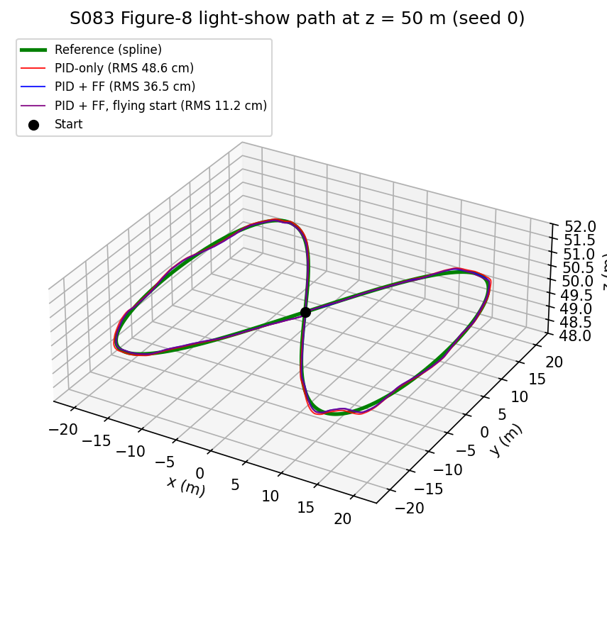
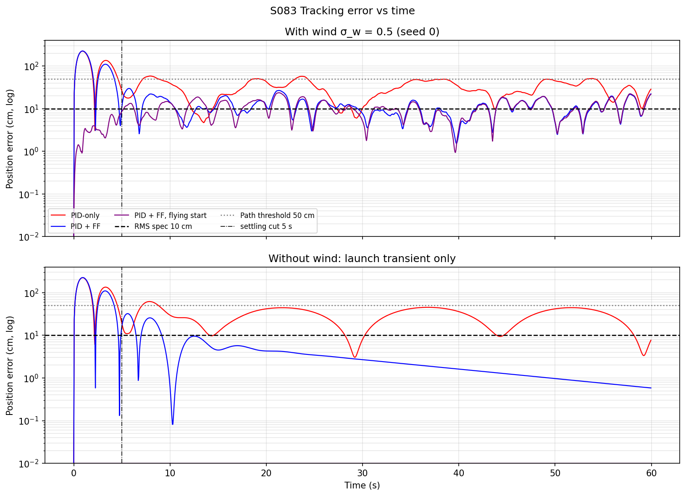
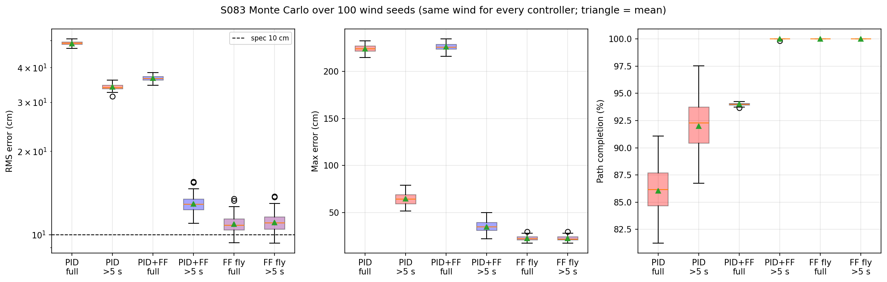
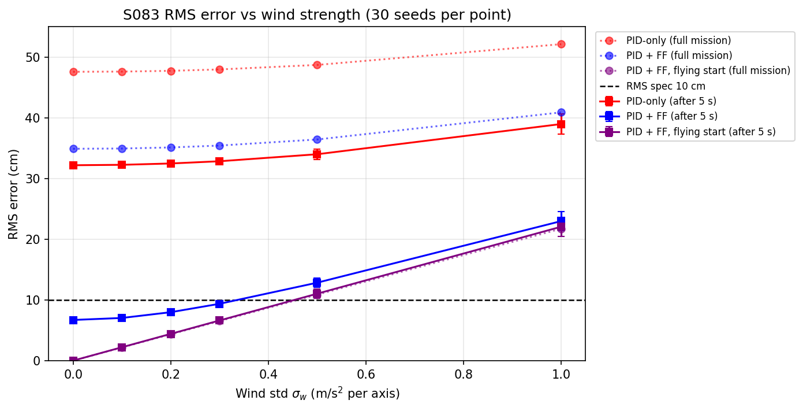
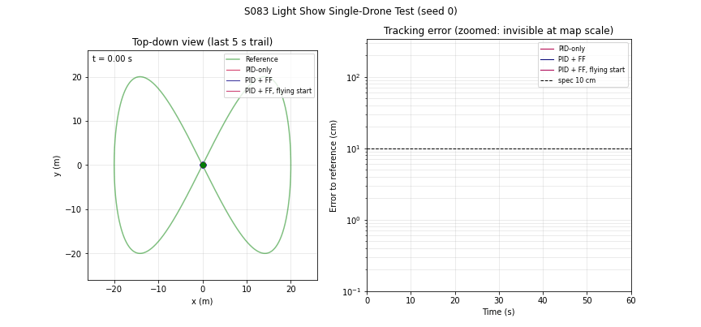

# S083 Light Show Single-Drone Test

**Domain**: Special Ops & Entertainment | **Difficulty**: ⭐ | **Status**: ✅ Completed

---

## Problem Definition

**Setup**: One show drone flies a scripted figure-8 at $z = 50$ m in $T = 60$ s. The script is 200 waypoints of a Lissajous curve ($A_x = A_y = 20$ m) spaced uniformly in time, interpolated with a cubic spline. A PID position controller tracks the spline while random wind (independent Gaussian acceleration on each axis, $\sigma_w = 0.5$ m/s², re-sampled every 0.05 s) pushes the drone.

**Objective**: report, for each controller, the RMS tracking error (light-show spec: ≤ 10 cm), the maximum error, and the path completion (fraction of time within 50 cm of the reference).

**Comparison configurations** (same wind samples for every configuration):
1. **PID-only** (card): $K_p = 2.0$, $K_i = 0.1$, $K_d = 0.8$.
2. **PID + FF** (card): the same PID plus the spline's reference acceleration as feedforward.
3. **PID + FF, flying start** (added): the same as 2, but the drone already moves at the reference velocity at $t = 0$. In 1 and 2 the drone starts at rest while the script starts at 4.68 m/s, and this variant shows how much of the error comes from that launch.

---

## Mathematical Model Summary

Reference (spline through the waypoints, not-a-knot, closed with the first waypoint at $t = 60$ s):

$$\mathbf{p}_{ref}(\tau) = \bigl(A_x\sin 2\pi\tau,\ A_y\sin 4\pi\tau,\ 50\bigr), \qquad \tau = t/T$$

Point-mass dynamics with PID and optional feedforward:

$$\dot{\mathbf{p}} = \mathbf{v}, \qquad \dot{\mathbf{v}} = K_p\mathbf{e} + K_i\!\int\!\mathbf{e}\,dt + K_d(\mathbf{v}_{ref} - \mathbf{v}) + [\mathbf{a}_{ref}] + \mathbf{w}_k, \qquad \mathbf{e} = \mathbf{p}_{ref} - \mathbf{p}$$

$\mathbf{w}_k \sim \mathcal{N}(0, \sigma_w^2 I_3)$ is held constant over step $k$. The state $[\mathbf{p}, \mathbf{v}, \int\mathbf{e}]$ is integrated with `scipy.integrate.odeint` once per 0.05 s step (all Monte Carlo seeds in one vectorised call).

Without feedforward the error obeys $\ddot{\mathbf e} + K_d\dot{\mathbf e} + K_p\mathbf e + K_i\!\int\!\mathbf e = \mathbf a_{ref} - \mathbf w$; with feedforward the $\mathbf a_{ref}$ forcing disappears. The closed-loop poles of $s^3 + K_d s^2 + K_p s + K_i$ are $-0.3745 \pm 1.3497j$ and $-0.0510$: one slow real pole with a 19.6 s time constant, coming from the integral term.

Metrics: $\varepsilon_{RMS} = \sqrt{\overline{\|\mathbf e_k\|^2}}$, $\varepsilon_{max} = \max_k\|\mathbf e_k\|$, completion $= $ share of steps with $\|\mathbf e_k\| \le 0.5$ m. They are reported for the full 60 s (the card's definition) and, in addition, after the first 5 s.

---

## Key Parameters

| Parameter | Value |
|-----------|-------|
| Show altitude $z_{show}$ | 50 m |
| Figure-8 amplitudes $A_x = A_y$ | 20 m |
| Duration / waypoints | 60 s / 200 |
| Spline | `CubicSpline`, not-a-knot, closed at $t = 60$ s |
| Time step | 0.05 s |
| Wind $\sigma_w$ (per axis) | 0.5 m/s² |
| PID $K_p$ / $K_i$ / $K_d$ | 2.0 / 0.1 / 0.8 |
| RMS spec / completion threshold | 10 cm / 50 cm |
| Monte Carlo (added) | 100 wind seeds (seed 83), shared by all configurations |
| Settling cut for the "after 5 s" metrics (added) | 5 s |
| Wind sweep (added) | $\sigma_w$ = 0, 0.1, 0.2, 0.3, 0.5, 1.0 m/s², 30 seeds each |
| Acceleration sanity bound (asserted) | 15 m/s² |
| `odeint` tolerances | rtol 1e-7, atol 1e-8 |

---

## Implementation

```
src/05_special_entertainment/s083_light_show_single.py   # Main simulation script
```

```bash
conda activate drones
python src/05_special_entertainment/s083_light_show_single.py
```

Runtime ≈ 4–6 min on a heavily loaded machine (about 10 other simulations running in parallel); most of it is the 18 wind-sweep batches.

---

## Results

The spline differs from the analytic Lissajous curve by at most 0.001 mm, so the reference is effectively exact. The reference starts at 4.68 m/s (also its maximum speed) and needs at most 0.891 m/s² of acceleration.

Monte Carlo over 100 wind seeds (mean ± std; "spec pass" = seeds with RMS ≤ 10 cm):

| Configuration | RMS, full 60 s | Max, full 60 s | Completion, full | Spec pass (full) | RMS after 5 s | Max after 5 s | Spec pass (after 5 s) |
|---|---:|---:|---:|---:|---:|---:|---:|
| PID-only | 48.84 ± 0.75 cm | 224.41 ± 3.72 cm | 86.05 ± 2.19 % | 0/100 | 34.05 ± 0.80 cm | 64.57 ± 5.85 cm | 0/100 |
| PID + FF | 36.59 ± 0.81 cm | 226.26 ± 3.76 cm | 94.03 ± 0.13 % | 0/100 | 12.93 ± 0.92 cm | 34.95 ± 5.65 cm | 0/100 |
| PID + FF, flying start | **10.92 ± 0.78 cm** | **22.40 ± 2.41 cm** | **100.00 ± 0.00 %** | **11/100** | 11.08 ± 0.83 cm | 22.37 ± 2.43 cm | 9/100 |

Per seed: PID + FF has a lower RMS than PID-only in 100/100 seeds (full and after 5 s) and a lower maximum after 5 s in 100/100 seeds, but a lower full-mission maximum in 0/100 seeds (both maxima are the launch transient). The flying start beats PID + FF on RMS and maximum in 100/100 seeds.

Seed 0 (figures): PID-only RMS 48.59 cm (FAIL), PID + FF 36.45 cm (FAIL), flying start 11.20 cm (FAIL).

**Key findings**:
- **No configuration meets the 10 cm spec at the card's wind level.** With the card's start from rest, PID-only and PID + FF fail in every seed. Even the flying start, which removes the launch, passes in only 11/100 seeds (mean 10.92 cm): $\sigma_w = 0.5$ m/s² of white-noise wind alone produces about 11 cm of error with these gains.
- **The launch dominates the card's full-mission metric.** The drone starts at rest while the script starts at 4.68 m/s, so in seed 0 the error grows to 221.3 cm (PID-only) and 223.5 cm (PID + FF) after 1 s. This sets the maximum error (≈ 2.2 m for both) and most of the full-mission RMS. Feedforward does not help here; the flying start keeps the error at 1.4 / 2.0 / 3.9 cm at t = 0.5 / 1 / 2 s.
- **The launch error decays slowly because of the integral term.** Without wind, PID + FF has an RMS of 118.86 cm in the first 5 s, then 19.70, 5.80, 3.54, 1.92 and 0.90 cm in the windows 5–10, 10–20, 20–30, 30–45 and 45–60 s. This matches the slow closed-loop pole at −0.051 s⁻¹ (19.6 s time constant). The flying start has 0.00 cm in every window: with feedforward and no wind the spline is tracked exactly.
- **Feedforward removes the curvature lag.** Without wind, PID-only never settles: its window RMS after the launch is 42.05 / 25.51 / 32.71 / 32.54 / 31.70 cm, and its error peaks (bottom panel of the error plot) are close to the steady lag $a_{ref}/K_p = 0.891/2.0 = 0.446$ m expected at the most curved part of the path. After 5 s with wind, PID + FF reduces the RMS from 34.05 to 12.93 cm and raises completion from 91.99 % to 100.00 %.
- **Wind level at which the spec can be met** (30-seed sweep, RMS after 5 s; seeds passing on the full mission / after 5 s):

| $\sigma_w$ (m/s²) | 0.0 | 0.1 | 0.2 | 0.3 | 0.5 | 1.0 |
|---|---|---|---|---|---|---|
| PID-only | 32.19 cm (0 / 0) | 32.26 (0 / 0) | 32.48 (0 / 0) | 32.85 (0 / 0) | 34.01 (0 / 0) | 38.98 (0 / 0) |
| PID + FF | 6.70 cm (0 / 30) | 7.03 (0 / 30) | 7.98 (0 / 30) | 9.37 (0 / 27) | 12.84 (0 / 0) | 22.99 (0 / 0) |
| PID + FF, flying start | 0.00 cm (30 / 30) | 2.21 (30 / 30) | 4.41 (30 / 30) | 6.62 (30 / 30) | 11.03 (2 / 2) | 22.06 (0 / 0) |

  With a flying start the error grows linearly with $\sigma_w$ (about 2.2 cm per 0.1 m/s²), and the spec holds up to $\sigma_w = 0.3$ m/s². PID + FF from rest never passes on the full mission, whatever the wind.
- **Path completion is not very discriminative**: once the launch is excluded, both feedforward variants are at 100.00 %. RMS and maximum error are the useful metrics.

**Physical checks** (asserted): altitude stays above ground, no step moves more than 0.5 m (10 m/s × 0.05 s), and the commanded acceleration stays below 15 m/s² (peaks: PID-only 5.58, PID + FF 5.51, flying start 1.43 m/s²).

### 3D Trajectory

Reference (green) and the three drone paths for seed 0. At this scale the 10–50 cm errors are barely visible:



### Tracking Error vs Time

Top: seed 0 with wind. Bottom: the same configurations without wind, which isolates the launch transient and its slow decay (log scale):



### Monte Carlo

RMS error (log scale), maximum error and path completion over the 100 seeds, for the full mission and after 5 s:



### Wind Sweep

RMS error vs wind strength (dotted = full mission, solid = after 5 s; error bars = std over 30 seeds):



### Animation

Left: top-down view with the last 5 s of each drone's path. Right: the error of each configuration building up over time (log scale), since the errors are too small to see on the map. 241 frames at 20 fps (one frame every 0.25 s):



### Deviations from the scenario card

| Card | Implementation | Reason |
|------|----------------|--------|
| `odeint` over the whole mission; wind re-sampled and $\int\mathbf e$ accumulated (`+= e*DT`) inside the derivative function | Wind held constant per 0.05 s step; $\int\mathbf e$ is part of the ODE state; one `odeint` call per step | `odeint` evaluates the derivative many times per step, so the card's integral would be wrong and the number of wind draws would depend on the solver. Card corrected. |
| $\sigma_w = 0.5$ m/s | 0.5 m/s² | The wind is added to $\dot{\mathbf v}$, so it is an acceleration. Card corrected. |
| Two configurations, single seed 42 | Added "PID + FF, flying start"; 100-seed Monte Carlo with the same wind for every configuration; metrics also after 5 s; wind-free runs; wind sweep | The card's start from rest makes the launch transient dominate the card's metrics; the added runs separate launch, curvature lag and wind. |
| Card text: feedforward leaves the PID "to correct only the residual error caused by wind" | Holds only after the launch transient has decayed (19.6 s time constant) | Added to the card. |
| Outputs `s083_3d_trajectory.png`, `s083_error_timeseries.png`, `s083_animation.gif` (one drone) | `trajectory_3d.png`, `error_timeseries.png`, `monte_carlo.png`, `wind_sweep.png`, `animation.gif` (all three configurations plus an error panel) | Project naming convention; errors are invisible on the map without the error panel. |
| Expected: 10 cm RMS spec as the pass criterion | No configuration passes at the card's wind level (best: flying start, 11/100 seeds) | Reported as found; gains not retuned. |

---

## Extensions

1. **Lead-in segment**: script a 5 s acceleration ramp before the show so the drone joins the figure-8 at speed, instead of assuming a flying start.
2. **Anti-windup**: freeze or clamp the integral during the launch to remove the 19.6 s decay.
3. **Gain tuning for wind**: raise $K_p$/$K_d$ until the wind-driven error drops below 10 cm at $\sigma_w = 0.5$ m/s², and check the acceleration margin.
4. **Coloured wind**: replace white noise with a Dryden gust model; low-frequency gusts are what the integral term can actually reject.
5. **Thrust limit**: saturate $\|\mathbf a_{cmd}\|$ at 15 m/s² and re-time the path in the tight turns.

---

## Related Scenarios

- Follow-ups: [S085 Drone Light Matrix Positioning](../../../scenarios/05_special_entertainment/S085_light_matrix.md), [S088 Formation Geometric Shape Morphing](../../../scenarios/05_special_entertainment/S088_formation_morphing.md)
- Cross-reference: [S063 Single-Plant Precision Spraying](../../../scenarios/04_industrial_agriculture/S063_precision_spraying.md), [S048 Full-Area Coverage Scan (Lawnmower)](../../../scenarios/03_environmental_sar/S048_lawnmower.md)
