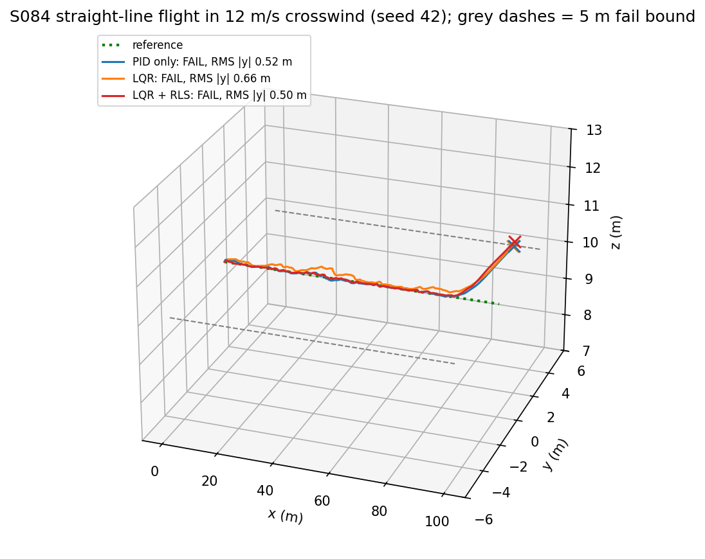
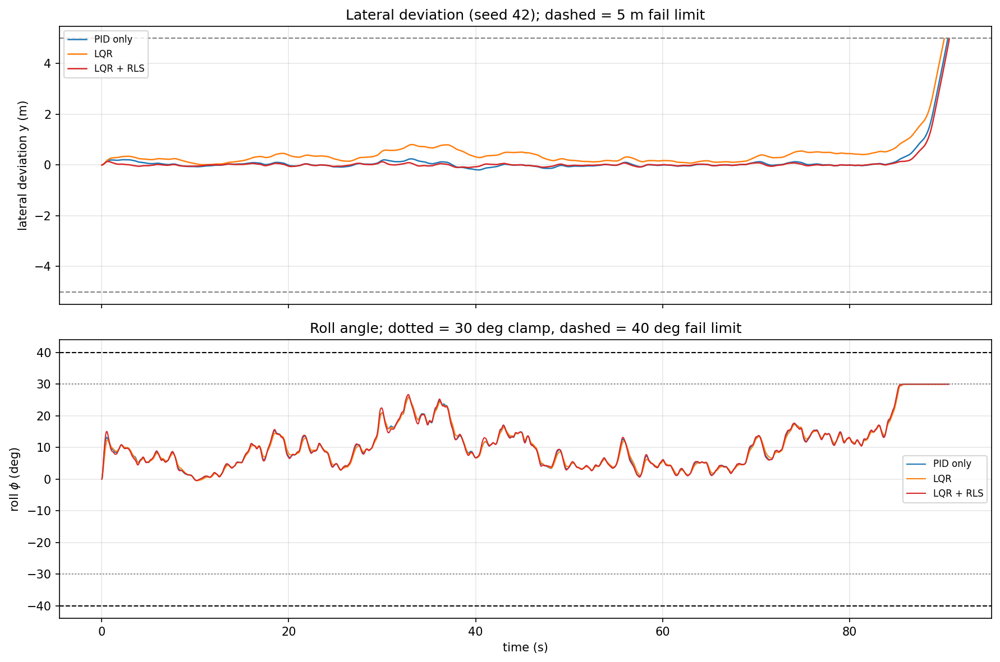
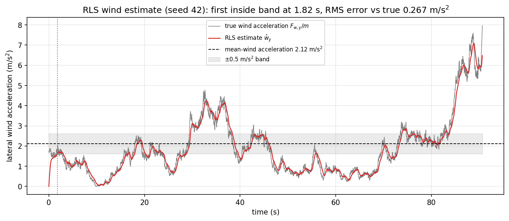
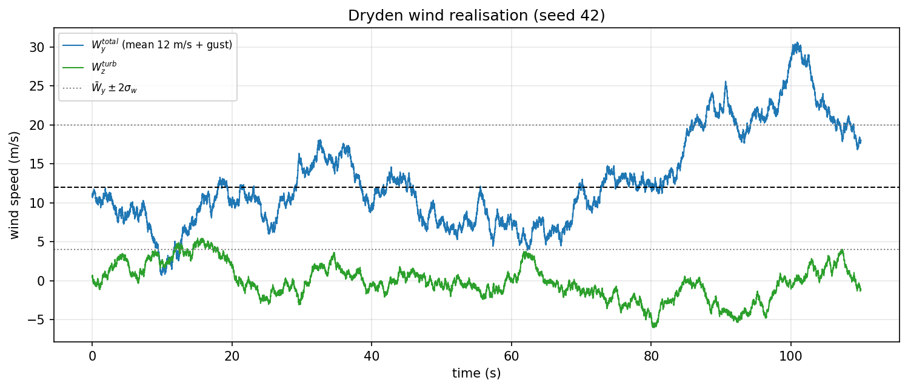
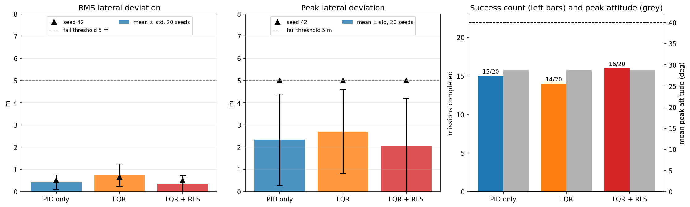
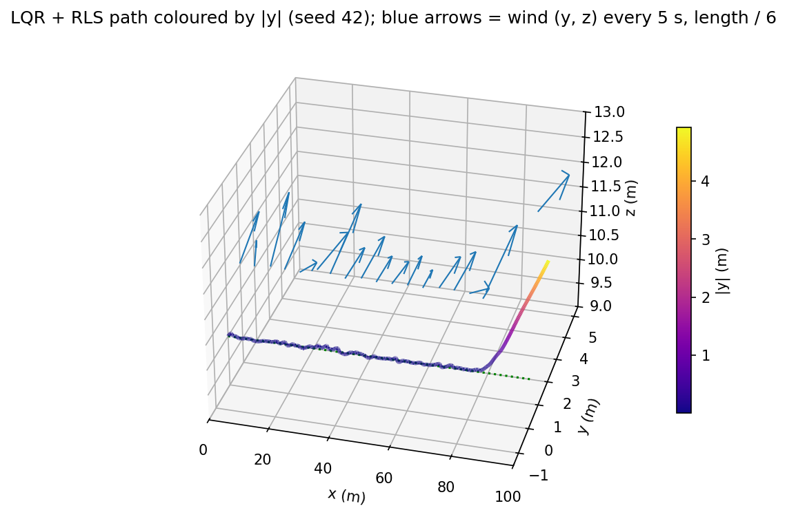
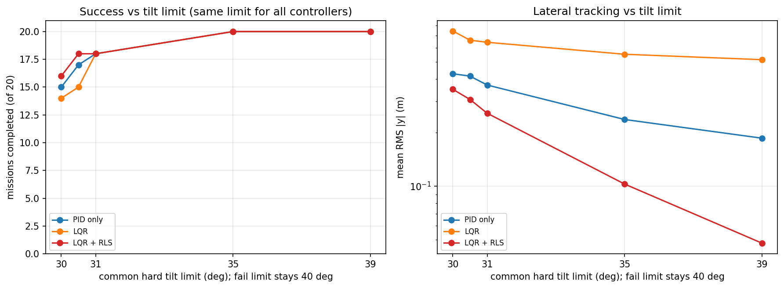
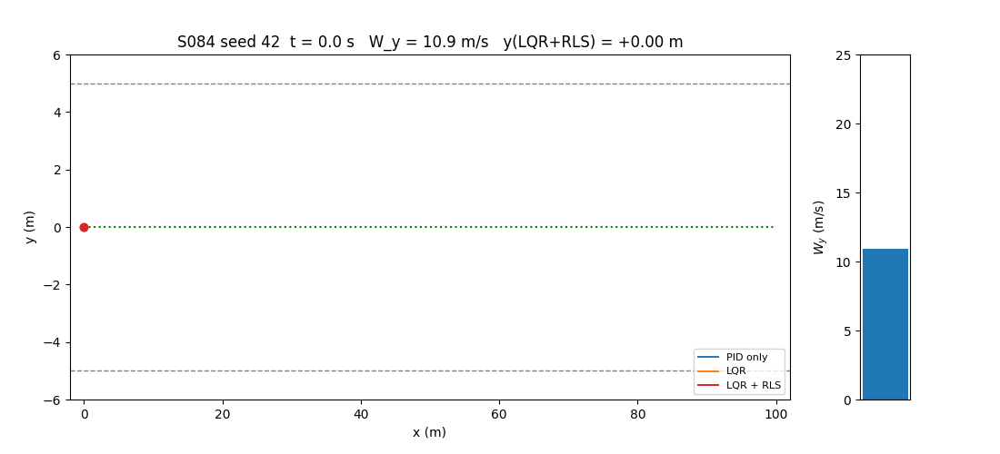

# S084 Extreme Weather Wind Resistance Test

**Domain**: Special Ops & Entertainment | **Difficulty**: ⭐⭐⭐ | **Status**: ✅ Completed

---

## Problem Definition

**Setup**: A 1 kg validation quadrotor flies 100 m along $x$ at 1 m/s and a height of 10 m. A crosswind blows in $+y$: a 12 m/s mean plus Dryden turbulence (σ 4 m/s lateral, 2 m/s vertical). The wind pushes the drone through quadratic drag $\mathbf{F}_w = \tfrac12\rho C_D A\,(\mathbf{V}_w - \mathbf{v})\odot|\mathbf{V}_w - \mathbf{v}|$. The mission **fails** at the first instant that $|y| > 5$ m or that roll or pitch exceeds 40°. It succeeds when $x \ge 100$ m within 120 s.

**Controllers compared** (same wind realisation per seed, common random numbers):
1. **PID only**: the cascaded controller of the base model (position P, velocity PI, attitude P, body-rate PI), no wind knowledge.
2. **LQR**: the card's LQR on a 10-state linearisation about hover. It commands thrust and roll/pitch torques directly; there is no wind estimate.
3. **LQR + RLS** (proposed): the same LQR, linearised around an equilibrium shifted by the RLS estimate $\hat{\mathbf{w}}$ of the wind acceleration. The shift supplies a feed-forward tilt and thrust that cancel $-m\hat{\mathbf{w}}$.

**Common flight envelope**: as the card specifies, every controller is hard-clamped to a commanded tilt of $\theta_{lim}$ = 30°. The clamp shapes differ slightly. The PID clips the total tilt of its thrust vector (a cone). The LQR clips its roll and pitch commands separately (a per-axis box, as in the card), so its total tilt can slightly exceed 30°: up to 30.29° (LQR) and 30.53° (LQR + RLS). A check with a cone clip on the LQR gives the same success counts and paired wins (see the sensitivity table). Sensitivity runs repeat all 60 missions with common limits of 30.5°, 31°, 35° and 39°; the fail limit stays at 40°.

**Plant**: the 6-DOF rigid body in [`src/base/rigid_body_drone.py`](../../../src/base/rigid_body_drone.py) (quaternion attitude, motor lag, mixer). It uses the `fpv_5inch` rotors with the card's mass of 1.0 kg and roll/pitch inertia of 0.01 kg m². The quadratic wind drag is applied as an external force. The headline run is seed 42; a 20-seed Monte Carlo (seeds 42–61) gives the statistics.

---

## Mathematical Model Summary

### Dryden turbulence

Lateral gust: $H(s) = \sigma_w\sqrt{\tau}\,\dfrac{1 + \sqrt3\,\tau s}{(1 + \tau s)^2}$ with $\tau = L_w/V$ = 16.67 s. It is driven by unit-intensity white noise ($n_k = \xi_k/\sqrt{\Delta t}$) and discretised exactly (zero-order hold) at 5 ms. Each series starts from the stationary distribution, so the output standard deviation is $\sigma_w$. The vertical gust uses the same filter with σ = 2 m/s and $L$ = 100 m. Total wind: $\mathbf{V}_w = (0,\ 12 + W_y,\ W_z)$.

### Aerodynamic force

$$\mathbf{F}_w = \tfrac12\rho C_D A\,(\mathbf{V}_w - \mathbf{v}) \odot |\mathbf{V}_w - \mathbf{v}|,\qquad \tfrac12\rho C_D A = 0.0147\ \text{kg/m}$$

The mean wind gives 2.117 N, which needs a 12.2° tilt to cancel. A 20 m/s gust gives 5.88 N and needs 30.9°, already above the 30° clamp.

### LQR (card)

State $(p_x, p_y, p_z, v_x, v_y, v_z, \phi, \theta, \dot\phi, \dot\theta)$, input $(\delta T, \tau_\phi, \tau_\theta)$, with $\dot v_x = g\theta$, $\dot v_y = -g\phi$, $\dot v_z = \delta T/m$ and $\ddot\phi = \tau_\phi/I_{xx}$. The gain $K$ comes from the continuous algebraic Riccati equation (CARE) with $Q$ = diag(1, 20, 20, 0.5, 4, 4, 8, 8, 1, 1) and $R$ = diag(0.1, 1, 1). The applied thrust is $T = (T_0 + \delta T)/(\cos\phi\cos\theta)$, with $T_0 = mg$ (LQR) or $T_0 = \|\mathbf{f}_{ff}\|$ (LQR + RLS). Yaw is held by a separate PD loop (16, 8). Closed-loop eigenvalue real parts run from −1.698 to −99.96. For the linear model under the mean wind the steady-state offset is $y$ = 0.436 m at a roll of 12.36°: LQR has no integral action.

### RLS wind estimator (card, 50 Hz)

$$\hat{\mathbf{w}}_{k+1} = \hat{\mathbf{w}}_k + \Gamma\bigl(\mathbf{a}_{meas,k} - \mathbf{a}_{model,k} - \hat{\mathbf{w}}_k\bigr),\qquad \Gamma = 0.05\ \ (\text{time constant } 0.40\ \text{s})$$

Here $\mathbf{a}_{meas} = \Delta\mathbf{v}/\Delta t$ plus accelerometer noise of 0.1 m/s², and $\mathbf{a}_{model} = R\mathbf{e}_3 T/m - g\mathbf{e}_3$ uses the actual rotor thrust. The feed-forward is $\mathbf{f}_{ff} = m(g\mathbf{e}_3 - \hat{\mathbf{w}})$. It gives the reference attitude $\phi_{ff} = \arcsin(-f_y/\|\mathbf{f}\|)$ and $\theta_{ff} = \operatorname{atan2}(f_x, f_z)$, clipped to ±30°, and the thrust $\|\mathbf{f}_{ff}\|$.

### Hard tilt clamp (same limit for all controllers)

PID: the commanded thrust vector is tilt-limited to $\theta_{lim}$. LQR: the roll row of $u = -K(\mathbf{x} - \mathbf{x}_{ref})$ is written as $\tau_\phi = -K_{\phi}(\phi - \phi_{cmd}) - K_{\dot\phi}\dot\phi$, where $\phi_{cmd} = \phi_{ref} - (\text{all other terms of the row})/K_\phi$. Then $\phi_{cmd}$ is clipped to $\pm\theta_{lim}$. This is exactly the LQR law while $|\phi_{cmd}| < \theta_{lim}$, and a hard limit on the commanded roll otherwise. Pitch is handled the same way. The RLS feed-forward attitude is clipped to the same limit. This per-axis box allows a total tilt of up to about $\sqrt2\,\theta_{lim}$ if roll and pitch both saturate. In practice pitch stays small (forward speed 1 m/s), so the measured maximum is 30.53°. The "cone" check instead scales $(\phi_{cmd}, \theta_{cmd})$ so that its norm is at most $\theta_{lim}$.

### Metrics

- RMS and peak $|y|$ and peak attitude up to mission end or failure. The peaks are taken at the 200 Hz control rate, RMS from the 50 Hz log.
- Clamp binding: the time during which the total tilt is within 0.5° of the limit, and the longest continuous such interval.
- RLS convergence: the first time $|\hat w_y - \bar W_{eff}| < 0.5$ m/s², where $\bar W_{eff}$ = 2.117 m/s². The RMS error of $\hat w_y$ against the true instantaneous wind acceleration after 2 s is also reported.
- Shaft energy until the end of the mission.

---

## Key Parameters

| Parameter | Value |
|-----------|-------|
| Mass / $I_{xx}$, $I_{yy}$ / $I_{zz}$ | 1.0 kg / 0.01 kg m² (card) / 0.018 kg m² (estimate) |
| Rotors | `fpv_5inch` preset: 9 N per motor, T/W = 3.67, motor time constant 15 ms |
| Mean wind / σ lateral / $L_w$ / $V$ | 12 m/s / 4 m/s / 200 m / 12 m/s (card) |
| Vertical gust σ / $L$ | 2 m/s / 100 m (card code) |
| $\rho$ / $C_D$ / $A_{ref}$ | 1.225 kg/m³ / 0.6 / 0.04 m² (card) |
| Reference | $x = t$ (1 m/s) to 100 m, $y$ = 0, $z$ = 10 m |
| Fail limits | $|y| > 5$ m, $\max(|\phi|, |\theta|) > 40°$ |
| Common hard tilt limit $\theta_{lim}$ | 30° (card; headline and Monte Carlo); sensitivity at 35° and 39° |
| LQR $Q$ / $R$ | diag(1, 20, 20, 0.5, 4, 4, 8, 8, 1, 1) / diag(0.1, 1, 1) (card) |
| RLS gain Γ / update rate | 0.05 / 50 Hz (card Δt = 0.02 s) |
| Accelerometer noise | 0.1 m/s² (added) |
| PID gains (base model, `fpv_5inch`) | position P (2, 2, 2.5); velocity PI (4, 4, 5) / (2, 2, 2.5), integrating only while the error is below 0.3 m/s; attitude P (12, 12, 4); rate PI (40, 40, 20) / (30, 30, 8) |
| Control / physics step | 5 ms (200 Hz), RK4 |
| Mission timeout | 120 s |
| Monte Carlo | 20 seeds (42–61), same wind for all three controllers |

---

## Implementation

```
src/base/rigid_body_drone.py                 # 6-DOF rigid-body model (shared)
src/05_special_entertainment/s084_wind_endurance.py
```

```bash
conda activate drones
python src/05_special_entertainment/s084_wind_endurance.py
```

Runtime ≈ 100–180 s with about 10 other simulations sharing the 12-thread machine (measured 104–126 s here for the 360-mission batch that includes all sensitivity groups; 90–177 s for an earlier 180-mission version).

---

## Results

**Dryden check**: over a 2000 s sample, the card's gain $\sigma\sqrt{2V/(\pi L)}$ gives a gust standard deviation of only 0.184 m/s (theory 0.191 m/s). The corrected gain $\sigma\sqrt{\tau}$ gives 3.842 m/s for σ = 4 m/s (card corrected). The 100 s missions are short compared with the 16.7 s correlation time, so individual realisations vary widely: the per-seed standard deviation of $W_y$ is 2.53–5.22 m/s. Seed 42 is the harshest one (mean 11.73, std 5.22, maximum 28.76 m/s).

**Headline seed 42 (common 30° limit):**

| Controller | Result | End | RMS $\|y\|$ | Peak $\|y\|$ | Peak attitude | Mean attitude | RMS $z$ error | Shaft energy | RLS convergence | RLS RMS error |
|------------|--------|----:|-----:|-----:|-----:|-----:|-----:|-----:|-----:|-----:|
| PID only | FAIL: $\|y\|$ = 5.01 m | 90.50 s | 0.521 m | 5.007 m | 30.00° | 10.62° | 0.005 m | 13700 J | — | — |
| LQR | FAIL: $\|y\|$ = 5.01 m | 90.11 s | 0.661 m | 5.007 m | 30.00° | 10.48° | 0.008 m | 13616 J | — | — |
| LQR + RLS | FAIL: $\|y\|$ = 5.00 m | 90.66 s | 0.501 m | 5.004 m | 30.00° | 10.62° | 0.032 m | 13725 J | 1.82 s | 0.267 m/s² |

**Monte Carlo, 20 seeds, common 30° limit:**

| Controller | Success | RMS $\|y\|$ | Peak $\|y\|$ | Peak attitude | Energy (successful missions) |
|------------|:-------:|-----:|-----:|-----:|-----:|
| PID only | 15/20 | 0.428 ± 0.334 m | 2.338 ± 2.052 m | 28.82 ± 2.10° | 15274 J |
| LQR | 14/20 | 0.744 ± 0.500 m | 2.701 ± 1.891 m | 28.70 ± 2.36° | 15263 J |
| **LQR + RLS** | **16/20** | **0.350 ± 0.372 m** | **2.077 ± 2.119 m** | 28.85 ± 2.13° | 15280 J |

All failures are lateral ($|y|$ > 5 m); no run exceeds 40°:
- **PID only**: seeds 42, 51, 52, 55, 58 (at 90.5, 39.5, 74.3, 45.6, 39.2 s).
- **LQR**: seeds 42, 49, 51, 52, 55, 58 (at 90.1, 6.9, 38.8, 73.7, 44.8, 38.9 s).
- **LQR + RLS**: seeds 42, 51, 55, 58 (at 90.7, 40.0, 46.1, 39.3 s).

Head-to-head on the same seeds: LQR + RLS has the lower RMS $|y|$ on 19/20 seeds against LQR and on 17/20 against PID. LQR beats PID on 0/20.

Peak attitude over successful missions: PID 28.42 ± 2.29°, LQR 28.14 ± 2.64°, LQR + RLS 28.56 ± 2.29° (max 30.00° for all three). Only 2/15, 2/14 and 2/16 of these runs stay below 25°.

**Clamp binding at 30°** (total tilt within 0.5° of the limit):

| Controller | Peak tilt ≥ 29.5°: successful / failed runs | Longest continuous binding: max over successes / min over failures | Total binding time, median over successes |
|------------|------|------|------|
| PID only | 10/15 / 5/5 | 9.71 s / 3.74 s | 1.19 s |
| LQR | 9/14 / 6/6 | 6.36 s / 3.02 s | 1.01 s |
| LQR + RLS | 11/16 / 4/4 | 9.66 s / 4.93 s | 1.47 s |

Maximum total tilt: PID 30.00°, LQR 30.29°, LQR + RLS 30.53°.

RLS: first within 0.5 m/s² of the mean-wind acceleration after 2.99 ± 5.94 s (max 25.78 s; never on 0 seeds). RMS error against the true instantaneous wind acceleration: 0.268 ± 0.030 m/s².

**Tilt-limit sensitivity** (same limit for all three controllers, 20 seeds each, fail limits unchanged):

| Limit (LQR clamp) | Controller | Success | RMS $\|y\|$ | Mean peak $\|y\|$ | Mean peak attitude | Failed seeds | Paired RMS wins |
|------:|------------|:-------:|-----:|-----:|-----:|------|------|
| 30° box | PID only | 15/20 | 0.428 ± 0.334 m | 2.338 m | 28.82° | 42, 51, 52, 55, 58 | |
| 30° box | LQR | 14/20 | 0.744 ± 0.500 m | 2.701 m | 28.70° | 42, 49, 51, 52, 55, 58 | LQR < PID: 0/20 |
| 30° box | LQR + RLS | 16/20 | 0.350 ± 0.372 m | 2.077 m | 28.85° | 42, 51, 55, 58 | < PID 17/20, < LQR 19/20 |
| 30° cone | PID only | 15/20 | 0.428 ± 0.334 m | 2.338 m | 28.82° | 42, 51, 52, 55, 58 | |
| 30° cone | LQR | 14/20 | 0.744 ± 0.499 m | 2.701 m | 28.70° | 42, 49, 51, 52, 55, 58 | LQR < PID: 0/20 |
| 30° cone | LQR + RLS | 16/20 | 0.353 ± 0.376 m | 2.085 m | 28.84° | 42, 51, 55, 58 | < PID 17/20, < LQR 19/20 |
| 30.5° box | PID only | 17/20 | 0.415 ± 0.324 m | 2.163 m | 29.19° | 42, 51, 58 | |
| 30.5° box | LQR | 15/20 | 0.661 ± 0.272 m | 2.581 m | 29.07° | 42, 51, 52, 55, 58 | LQR < PID: 2/20 |
| 30.5° box | LQR + RLS | 18/20 | 0.307 ± 0.322 m | 1.853 m | 29.20° | 42, 58 | < PID 20/20, < LQR 20/20 |
| 31° box | PID only | 18/20 | 0.370 ± 0.262 m | 1.951 m | 29.56° | 42, 58 | |
| 31° box | LQR | 18/20 | 0.643 ± 0.242 m | 2.415 m | 29.44° | 42, 58 | LQR < PID: 0/20 |
| 31° box | LQR + RLS | 18/20 | 0.257 ± 0.258 m | 1.623 m | 29.58° | 42, 58 | < PID 20/20, < LQR 20/20 |
| 35° box | PID only | 20/20 | 0.237 ± 0.161 m | 1.004 m | 31.67° | — | |
| 35° box | LQR | 20/20 | 0.551 ± 0.181 m | 1.534 m | 31.54° | — | LQR < PID: 0/20 |
| 35° box | LQR + RLS | 20/20 | 0.103 ± 0.143 m | 0.622 m | 31.99° | — | < PID 20/20, < LQR 20/20 |
| 39° box | PID only | 20/20 | 0.186 ± 0.084 m | 0.633 m | 32.99° | — | |
| 39° box | LQR | 20/20 | 0.513 ± 0.108 m | 1.158 m | 32.89° | — | LQR < PID: 0/20 |
| 39° box | **LQR + RLS** | **20/20** | **0.048 ± 0.011 m** | **0.239 m** | 33.48° | — | < PID 20/20, < LQR 20/20 |

**Key findings**:
- **The card's 30° clamp, not the control law, decides most failures.** With a 30° limit on all three controllers, every failure is lateral. A 20 m/s gust already needs 30.9° of tilt, and seed 42 reaches 28.76 m/s. The clamp binds on most seeds, including many successful ones: peak tilt reaches 29.5° or more on 10/15, 9/14 and 11/16 successful runs. A drone survives short binding (up to 6.4–9.7 s here) but is blown past 5 m when a gust holds it on the clamp for long enough (at least 3.0–4.9 s in the failed runs). The failed seeds are largely the same for all three controllers (42, 51, 55, 58). Raising the common limit to 31° leaves only seeds 42 and 58, and at 35° and 39° all three controllers succeed on 20/20. The fail rule stays at 40°, and no run exceeds it.
- **Within the same envelope, RLS feed-forward tracks best; the success-count ranking is not robust.** At 30° LQR + RLS has 16/20 successes against 15 (PID) and 14 (LQR). This margin of 1–2 seeds is within the clamp sensitivity: at 30.5° the counts are 18 / 17 / 15, and at 31° all three have 18/20. LQR + RLS has at least as many successes as the PID at every limit. The robust evidence is the paired RMS comparison. LQR + RLS has the lower RMS $|y|$ than the PID on 17/20 seeds at 30° and on 20/20 at every larger limit, and than LQR on 19–20/20. At 39°, where nothing fails, it reaches 0.048 m, against 0.186 m for PID and 0.513 m for LQR. The estimator follows the gusts themselves, not only the mean: RMS error 0.268 m/s² against the instantaneous wind acceleration, with a 0.40 s time constant against a 16.7 s gust correlation time.
- **The clamp shape does not matter.** Clipping the LQR's roll and pitch commands per axis (card) or on their norm (cone, like the PID) gives the same successes and failed seeds. The paired wins are identical, and the RLS RMS changes by only 0.003 m (0.350 against 0.353 m).
- **Pure LQR is the weakest**, because it has no integral action. Its offset matches the linear model's prediction (0.436 m under the mean wind; flown RMS 0.513 m at 39°). It has a higher RMS $|y|$ than the PID on every seed at 30° (0/20 wins) and a higher mean RMS at every limit. It is the only controller that fails seed 49, at 6.9 s, early in the run.
- **The PID does not drift as the card expects.** The base model's velocity loop has integral action, which removes the steady wind offset. At 35° and 39° it succeeds on 20/20 seeds with RMS $|y|$ of 0.237 m and 0.186 m. At 30° it fails on 5/20 seeds, but the card's "RMS > 5 m" cannot occur: a mission ends as soon as $|y|$ exceeds 5 m. Even the failed seed-42 run has an RMS of only 0.521 m.
- **Card targets for LQR + RLS** (RMS < 0.5 m, peak < 1 m, success): at the card's 30° limit the mean RMS (0.350 m) meets the target, but the mean peak (2.077 m) and the success rate (16/20) do not. At 35° and 39° all three targets hold. Convergence (2.99 s mean, < 15 s) holds. The "< 25° peak attitude" target holds on only 2/16 successful runs at 30°, because the gusts themselves need 25–30°.
- **Energy is the same for all three** (15263–15280 J per successful mission of about 100 s, i.e. roughly 150 W). The thrust needed to hold against the wind dominates; how well the drone tracks hardly matters. The values are estimates: see the Sim2Real notes.

### 3D Trajectory

The three paths on seed 42 (reference = green dotted line, grey dashes = the 5 m fail bound, × = failure):



### Lateral Deviation and Roll

Top: $y(t)$ with the ±5 m fail limits. Bottom: roll angle with the 30° clamp (dotted) and the 40° fail limit (dashed). The final gust (from about 82 s) pushes all three controllers onto the 30° clamp, and all three are then blown out past 5 m:



### RLS Convergence

$\hat w_y$ (red) against the true lateral wind acceleration $F_{w,y}/m$ (grey), the mean-wind acceleration of 2.12 m/s² and the ±0.5 m/s² band:



### Dryden Gust Realisation

$W_y^{total}$ and $W_z^{turb}$ for seed 42, with the $\bar W_y \pm 2\sigma_w$ lines:



### Performance Metrics

Bars: mean ± std over 20 seeds; triangles: seed 42. Right: success counts and mean peak attitude (the dashed line is 40°):



### 3D Path Coloured by Deviation

LQR + RLS on seed 42, coloured by $|y|$, with the wind $(W_y, W_z)$ drawn every 5 s at 1/6 scale. The path ends where the final gust blows it past $|y|$ = 5 m:



### Tilt-Limit Sensitivity

Success count and mean RMS $|y|$ (log scale) against the common hard tilt limit:



### Animation

Top-down view of all three controllers on seed 42. The side bar shows the lateral wind speed. 92 frames at 12 fps:



### Deviations from the scenario card

| Card | Implementation | Reason |
|------|----------------|--------|
| Linearised 10-state plant integrated by Euler | 6-DOF rigid body (motors, mixer, quaternion attitude); the card's linear model is used only to design the LQR | Hardware-oriented scenario; the controller is tested on dynamics it was not designed on. |
| Dryden gain $\sigma\sqrt{2V/(\pi L)}$ | $\sigma\sqrt{L/V}$ (card corrected) | The card's gain gives a std of 0.184 m/s instead of 4 m/s (printed check). |
| Vertical gust "same filter with scale $L_w$" (text) | σ = 2 m/s, $L$ = 100 m (card code) | The card's text and code disagree; the code values are more realistic near the ground. |
| LQR thrust command $u_0 = -K e$ used as total thrust (card code) | $T = (mg + \delta T)/(\cos\phi\cos\theta)$ | The card code leaves out the hover thrust, so the drone would start by falling. |
| PID maps acceleration to "pseudo torques" (×5) | Base-model cascaded PID (position P, velocity PI, attitude, rate PI) | A standard, reasonable PID baseline (X2). The card's map has no physical meaning. |
| Feed-forward $u_{ff} = -m\hat{w}$ mapped to torques (×5) | LQR linearised around the equilibrium tilt and thrust that cancel $-m\hat{\mathbf{w}}$ | A torque does not cancel a force; the equilibrium shift does. |
| $a_{meas}$ = model + true force (card code) | Finite-difference velocity plus 0.1 m/s² noise, against a model using the actual rotor thrust | The card code hands the estimator the exact answer. |
| "Hard-clamped to 30°", implemented in the card code as torque scaling whenever $\|\phi\| > 30°$ | A true hard clamp of the commanded roll and pitch at the same 30° as the PID's tilt limit. LQR: per-axis box (card); PID: cone on the total tilt. A cone check for the LQR, and common limits of 30.5°, 31°, 35° and 39° for all controllers | Torque scaling is not a hard clamp. An earlier version of this scenario used a soft variant and let the LQR position loop push the tilt past 40° while the PID was hard-limited, which compared different flight envelopes rather than control laws (X2). The box allows up to 30.53° of total tilt; the cone check shows that this does not change the results. |
| One run, Δt = 0.02 s | 20-seed Monte Carlo with common wind, control at 5 ms, RLS at the card's 0.02 s | X2; the rigid-body inner loops need a faster step. |
| RLS convergence "within 0.5 m/s of the mean wind" | Within 0.5 m/s² of the mean-wind acceleration (the card's metric table) | $\hat w$ is an acceleration. |
| Peaks taken from the sampled log | Peaks at the 200 Hz control rate | The 50 Hz log can miss the failing sample. |

---

## Sim2Real Notes

**Model assumptions.** Wind acts only through the card's quadratic drag on the airframe: one $C_D A$, isotropic, independent of attitude. Rotor-induced drag (which grows with airspeed and rotor speed), blade flapping and the change of thrust with inflow in a 12–29 m/s crosswind are not modelled. Above about 15 m/s these effects change both the force and the available thrust. The motors are the `fpv_5inch` estimates (9 N each, T/W 3.67 at 1 kg). The energy figures use $k_m\omega^3$ with an assumed hover figure of merit of 0.6, so they are order-of-magnitude only. The estimator gets velocity differences plus white noise; there is no GPS/IMU fusion, latency or accelerometer vibration.

**What must be measured on the real airframe.**
- **Thrust stand**: $k_f$, maximum thrust (it sets the tilt available in gusts) and the thrust loss at high inflow speed (a wind-tunnel sweep, or a moving thrust stand).
- **Motor time constant** (DShot telemetry step response).
- **Inertia** (trifilar pendulum); the card's 0.01 kg m² is large for 1 kg.
- **Airframe drag**: $C_D A$ against airspeed and attitude, in a wind tunnel or from free-flight coast-downs. The whole wind force scales with this one number.
- **Accelerometer noise and vibration spectrum** in hover. This sets how far Γ can be raised before $\hat w$ becomes noisy.

**Path to PX4 / Betaflight SITL.**
1. **PX4** already contains the PID baseline (its multicopter position controller) and an integrator that plays the RLS role. The fair test is PX4 SITL in Gazebo. Gazebo-classic's wind plugin only provides a mean wind plus simple gusts, not Dryden turbulence, so drive the wind from the Dryden time series generated here (for example a small custom plugin or a ROS 2 node that publishes the wind velocity). Fly the same 100 m mission through MAVLink and compare `vehicle_local_position` against this model.
2. Add the LQR + RLS as a custom module that publishes `VehicleAttitudeSetpoint` and thrust, with the estimator fed by `vehicle_acceleration`. PX4's rate controller then replaces the torque-level LQR inner loop, so re-design the LQR on the rate-loop closed dynamics.
3. **Betaflight** is not a natural target: it has no position loop. Run the outer loops on a companion computer and send angle-mode commands through MSP.
4. Set the tilt limit and fail limits as in PX4 (`MPC_TILTMAX_AIR` = 30°, geofence 5 m) and check against flight logs whether the gust level at which the 30° clamp starts to bind (above about 20 m/s here) matches. The sensitivity table predicts that `MPC_TILTMAX_AIR` = 35° removes all failures on these 20 wind realisations.

---

## Extensions

1. **Variable-gain RLS** (card extension 1): raise Γ when the innovation is large. The current Γ = 0.05 already tracks gusts with an RMS error of 0.268 m/s².
2. **Joint state and wind EKF** with GPS-rate position updates and IMU-rate prediction.
3. **Gust-scheduled tilt limit**: use 30° in calm air and open the limit toward 39° only while $\hat w$ is large. The sensitivity table shows 35° is already enough for 20/20 seeds.
4. **Rotor-drag model**: add $-k_d\,\omega\,\mathbf{v}_{rel,\perp}$ per rotor and check whether the RLS absorbs it.
5. **Larger Monte Carlo** (card extension 4: 500 seeds) for a certification-style success rate.

---

## Related Scenarios

- Prerequisites: [S058 Typhoon Eye Probing](../../../scenarios/03_environmental_sar/S058_typhoon.md)
- Algorithmic cross-reference: [S001 Basic Intercept](../../../scenarios/01_pursuit_evasion/S001_basic_intercept.md), [S024 Wind Compensation](../../../scenarios/02_logistics_delivery/S024_wind_compensation.md)
- Same rigid-body model: [S082 FPV Racing Circuit](../../../scenarios/05_special_entertainment/S082_fpv_racing.md), [S090 Racing Drone Optimal Path](../../../scenarios/05_special_entertainment/S090_racing_optimal.md), [S091 Aerial Acrobatic Maneuvers](../../../scenarios/05_special_entertainment/S091_acrobatics.md)
