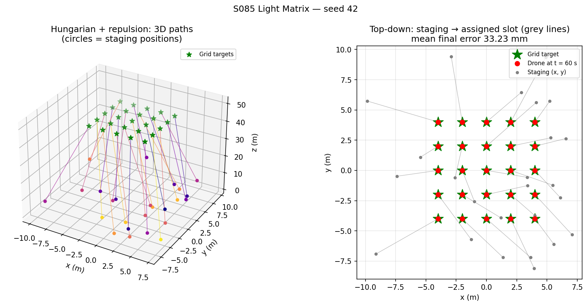
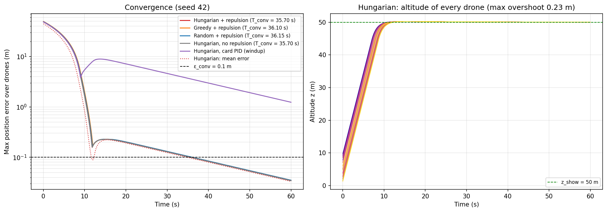
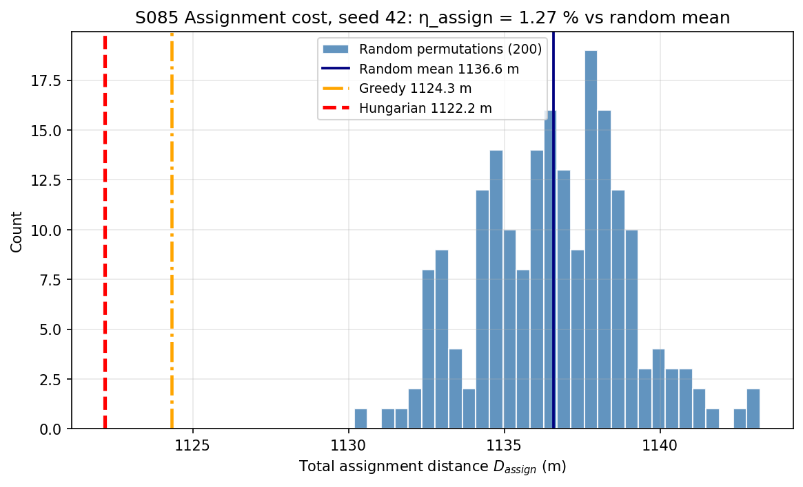
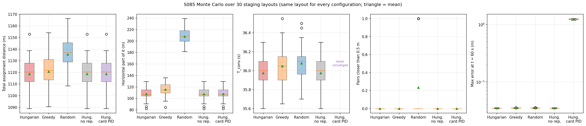
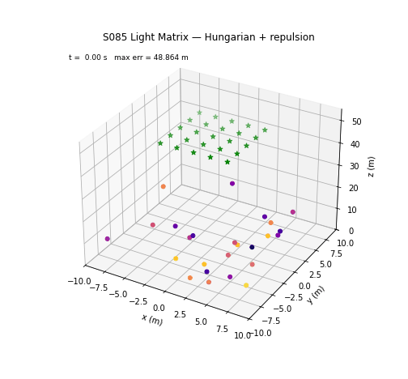

# S085 Drone Light Matrix Positioning

**Domain**: Special Ops & Entertainment | **Difficulty**: ⭐⭐ | **Status**: ✅ Completed

---

## Problem Definition

**Setup**: 25 LED drones start from random positions in a 20 × 20 × 10 m staging volume near the ground ($z \in [1, 10]$ m) and must form a 5 × 5 grid with 2 m spacing at $z = 50$ m, centred above the pad. Before take-off every drone is assigned one grid slot. Each drone then flies to its slot with an independent three-axis PID velocity command clipped to 5 m/s. A pairwise repulsion acts on drones closer than $r_{safe} = 0.8$ m.

**Objective**: minimise the convergence time $T_{conv}$ (first instant at which all 25 drones are within 0.1 m of their slots) with zero collisions (pairs closer than 0.5 m), and quantify the benefit of the Hungarian assignment over a random one.

**Configurations** (each Monte Carlo layout uses the same staging positions for every configuration):
1. **Hungarian + repulsion** (card).
2. **Greedy + repulsion** (added): repeatedly pair the closest free drone and free slot, a simple non-optimal assignment.
3. **Random + repulsion** (card's assignment baseline; the card only compares its cost, here it is also flown).
4. **Hungarian, no repulsion** (added): shows what the repulsion contributes.
5. **Hungarian, card PID (windup)** (added): the card's integral law, i.e. the integral keeps accumulating while the command is clipped. Two small differences from the card's code remain, as in all configurations: the derivative starts from `prev_err = e(0)` (no derivative kick at $t = 0$) and $T_{conv}$ is recorded as $(k+1)\Delta t$. Configurations 1–4 use conditional integration (see Deviations).

---

## Mathematical Model Summary

Grid slots: $\mathbf g_{ij} = \bigl((i-2)d,\ (j-2)d,\ 50\bigr)$, $i, j \in \{0..4\}$, $d = 2$ m.

Assignment: $\min_\sigma \sum_k \|\mathbf p_k(0) - \mathbf g_{\sigma(k)}\|$ with `scipy.optimize.linear_sum_assignment`; random baseline $D_{rand}$ = mean over 200 permutations; $\eta_{assign} = 1 - D_{assign}/D_{rand}$.

Controller (per drone, velocity command, $\mathbf e_k = \mathbf g_k - \mathbf p_k$):

$$\mathbf u_k = K_p\mathbf e_k + K_i\sum \mathbf e_k\Delta t + K_d\frac{\mathbf e_k(t) - \mathbf e_k(t-\Delta t)}{\Delta t} + \sum_{j:\,d_{kj} < r_0} k_{rep}\Bigl(\frac{1}{d_{kj}} - \frac{1}{r_0}\Bigr)\frac{\hat{\mathbf n}_{kj}}{d_{kj}^2}, \qquad \|\mathbf u_k\| \le v_{max}, \qquad \mathbf p_k \mathrel{+}= \mathbf u_k\Delta t$$

Conditional integration (configurations 1–4): a drone's integral is not updated in a step where its PID command exceeds $v_{max}$.

Away from saturation each axis obeys $(1 + K_d)\,s^2 + K_p\,s + K_i = 0$ (from $\dot e = -u$ and the discrete derivative), with poles at −0.8132 and −0.0439 s⁻¹. The slow pole (22.8 s time constant) comes from the integral and sets how fast the last centimetres disappear.

---

## Key Parameters

| Parameter | Value |
|-----------|-------|
| Drones / grid | 25 / 5 × 5, spacing 2.0 m, at $z = 50$ m |
| Staging volume | $x, y \in [-10, 10]$ m, $z \in [1, 10]$ m (uniform) |
| PID $K_p$ / $K_i$ / $K_d$ | 1.2 / 0.05 / 0.4 |
| Speed limit $v_{max}$ | 5.0 m/s |
| Repulsion $k_{rep}$ / $r_{safe} = r_0$ | 1.5 / 0.8 m |
| Collision radius | 0.5 m |
| Convergence threshold $\varepsilon_{conv}$ | 0.1 m |
| Time step / cut-off | 0.05 s / 60 s |
| Random permutations for $D_{rand}$ | 200 |
| Showcase layout | seed 42 |
| Monte Carlo (added) | 30 staging layouts (seeds 0–29) |

---

## Implementation

```
src/05_special_entertainment/s085_light_matrix.py   # Main simulation script
```

```bash
conda activate drones
python src/05_special_entertainment/s085_light_matrix.py
```

Runtime ≈ 2.5 min on a heavily loaded machine.

---

## Results

**Showcase layout (seed 42)**:

| Configuration | $D_{assign}$ | Longest path | $T_{conv}$ | Pairs < 0.5 m | Min separation | Final mean error |
|---|---:|---:|---:|---:|---:|---:|
| **Hungarian + repulsion** | **1122.2 m** | 48.9 m | **35.70 s** | 0 | 1.457 m | 33.227 mm |
| Greedy + repulsion | 1124.3 m | 49.9 m | 36.10 s | 0 | 1.178 m | 33.341 mm |
| Random + repulsion | 1136.7 m | 49.4 m | 36.15 s | 0 | 0.552 m | 33.382 mm |
| Hungarian, no repulsion | 1122.2 m | 48.9 m | 35.70 s | 0 | 1.457 m | 33.227 mm |
| Hungarian, card PID (windup) | 1122.2 m | 48.9 m | never | 0 | 0.760 m | 1012.443 mm |

Random permutations: mean 1136.6 m (min 1130.2 m), so $\eta_{assign}$ = 1.27 %; greedy costs 0.19 % more than Hungarian.

**Monte Carlo over 30 staging layouts** (mean ± std):

| Configuration | $D_{assign}$ | Horizontal part | $T_{conv}$ | Pairs < 0.5 m | Min separation | Max error at 60 s | Converged |
|---|---:|---:|---:|---:|---:|---:|---:|
| **Hungarian + repulsion** | 1118.7 ± 14.9 m | 107.8 ± 10.7 m | 35.98 ± 0.18 s | 0.00 | 1.315 ± 0.378 m | 0.035 m | 30/30 |
| Greedy + repulsion | 1120.8 ± 14.8 m | 115.7 ± 11.3 m | 36.05 ± 0.19 s | 0.00 | 0.892 ± 0.313 m | 0.035 m | 30/30 |
| Random + repulsion | 1135.5 ± 14.2 m | 207.9 ± 13.9 m | 36.08 ± 0.18 s | 0.23 ± 0.42 | 0.566 ± 0.076 m | 0.035 m | 30/30 |
| Hungarian, no repulsion | 1118.7 ± 14.9 m | 107.8 ± 10.7 m | 35.98 ± 0.18 s | 0.00 | 1.315 ± 0.378 m | 0.035 m | 30/30 |
| Hungarian, card PID (windup) | 1118.7 ± 14.9 m | 107.8 ± 10.7 m | never | 0.00 | 0.883 ± 0.158 m | 1.242 ± 0.023 m | 0/30 |

Per layout, Hungarian vs greedy: lower $D_{assign}$ in 30/30, faster $T_{conv}$ in 14/30 (ties 10). Hungarian vs random: lower $D_{assign}$ in 30/30, faster $T_{conv}$ in 20/30 (ties 3), fewer close pairs in 7/30 (ties 23). Random assignment has at least one pair closer than 0.5 m in 7 of 30 layouts (23/30 collision-free), despite the repulsion; Hungarian and greedy are collision-free in 30/30.

**Key findings**:
- **With the card's integral law the swarm never forms the grid.** The integral keeps growing during the climb at the 5 m/s limit (8–10 s for 40–49 m, hand calculation), the drones overshoot the grid by 8.89 m, and after 60 s the worst drone is still 1.242 ± 0.023 m from its slot in every layout (0/30 converged). Freezing the integral while the command is saturated fixes this: overshoot drops to 0.23 m and all 30 layouts converge.
- **$T_{conv}$ is set by the controller, not by the assignment.** All configurations with conditional integration converge at about 36 s (35.98 / 36.05 / 36.08 s for Hungarian / greedy / random) and end with the same 0.035 m error. The climb takes about 10 s; the remaining ~26 s are the slow integral mode (22.8 s time constant) removing the last ~0.2 m (timings and the 0.2 m read from the convergence plot). The Hungarian assignment is faster than random in 20/30 layouts, but only by 0.1 s on average.
- **The Hungarian saving looks small because the climb dominates.** Every drone must climb 40–49 m, and the total vertical climb in the showcase layout is 1117.5 m out of 1122.2 m. Above that climb, the Hungarian assignment adds only 4.7 m, random adds 19.2 m. In horizontal distance, the part the assignment actually controls, Hungarian (107.8 m) is about half of random (207.9 m) and about 7 % below greedy (115.7 m) (ratios by hand from the table).
- **The Hungarian paths never come close to each other**, so the repulsion never acts: in the showcase it is active in 0 steps, and "Hungarian, no repulsion" gives exactly the same results as "Hungarian + repulsion" in all 30 layouts. The minimum separation (1.315 m on average) stays above $r_{safe}$. Random assignment creates crossing paths, the repulsion has to act, and it still lets a pair get within 0.5 m in 7/30 layouts.
- **ε_f is not a useful comparison metric** here: once converged, every configuration with conditional integration ends at the same 0.035 m maximum error, because the residual is the common slow integral mode.

**Physical checks** (asserted): speed ≤ 5 m/s for every drone and step, altitude > 0 at all times.

### 3D Trajectories and Final Formation

Left: 3D paths of the Hungarian + repulsion run (showcase layout). Right: top-down view; grey lines connect each staging position to its assigned slot, red dots are the drones at 60 s:



### Convergence

Left: maximum error over the swarm for every configuration (log scale). The card's integral law (purple) climbs back to 8.9 m after the overshoot and decays slowly; the others drop to about 0.2 m at 12 s and then cross 0.1 m at about 36 s. Right: altitude of every drone (Hungarian + repulsion):



### Assignment Cost

Showcase layout: histogram of 200 random permutations, with the greedy and Hungarian costs:



### Monte Carlo

Total and horizontal assignment distance, $T_{conv}$, pairs closer than 0.5 m and the maximum error at 60 s, over the 30 layouts:



### Animation

3D view of the Hungarian + repulsion run (showcase layout) from take-off until 2 s after $T_{conv}$: 190 frames at 25 fps, one frame every 0.2 s of simulated time:



### Deviations from the scenario card

| Card | Implementation | Reason |
|------|----------------|--------|
| PID integral accumulates every step | Conditional integration (integral frozen while the PID command exceeds $v_{max}$); the card's integral law kept as configuration 5 | With the card's integral the grid is never reached within 60 s (0/30 layouts). Card corrected. |
| `prev_err = 0` at start | `prev_err = e(0)` | Avoids a derivative kick of $K_d\,\mathbf e(0)/\Delta t$ in the first step. Card corrected. |
| `T_conv = t` recorded before the time is advanced | $T_{conv} = (k+1)\Delta t$, the time at which the position is reached | Off by one step in the card's code. |
| Collision count = number of (pair, step) events | Number of distinct pairs that ever came within 0.5 m, plus the (pair, step) events for the showcase | Counting every step of one long close approach inflates the number. |
| One run (seed 42); Hungarian vs random compared by cost only | Five configurations flown; 30-layout Monte Carlo with the same layout for every configuration; per-layout win counts | Needed to compare assignments on time and safety, not only on distance. |
| Assignment benefit reported only as total distance | Also the horizontal part of the distance | The vertical climb is the same for every assignment and hides the difference. |
| Output names `s085_*.png`, `s085_light_matrix.gif` | `trajectories.png`, `convergence.png`, `assignment_comparison.png`, `monte_carlo.png`, `animation.gif` | Project naming convention. |

---

## Extensions

1. **Remove the integral**: with no disturbance in this model, a PD velocity command converges without the 22.8 s slow mode; add wind to show when the integral is needed.
2. **Synchronised arrival**: scale each drone's speed so all arrive together (like S087's morph timing).
3. **Bottleneck assignment**: minimise the longest path instead of the sum, and compare $T_{conv}$ when the controller is fast.
4. **Squared-distance cost**: the assignment that minimises the sum of squared distances gives non-crossing straight paths; check whether it lowers the close-approach count further.
5. **Drone failure**: drop one drone mid-flight and re-run the assignment on the remaining 24 slots.

---

## Related Scenarios

- Prerequisites: [S083 Light Show Single-Drone Test](../../../scenarios/05_special_entertainment/S083_light_show_single.md)
- Follow-ups: [S087 Aerial Light Show Text Display](../../../scenarios/05_special_entertainment/S087_led_text.md), [S088 Formation Geometric Shape Morphing](../../../scenarios/05_special_entertainment/S088_formation_morphing.md), [S098 Swarm Synchronized Dance](../../../scenarios/05_special_entertainment/S098_synchronized_dance.md)
- Cross-reference: [S018 Multi-Target Intercept](../../../scenarios/01_pursuit_evasion/S018_multi_target_intercept.md), [S070 Swarm Weeding Task](../../../scenarios/04_industrial_agriculture/S070_swarm_weeding.md), [S049 Dynamic Zone Search](../../../scenarios/03_environmental_sar/S049_dynamic_zone.md)
