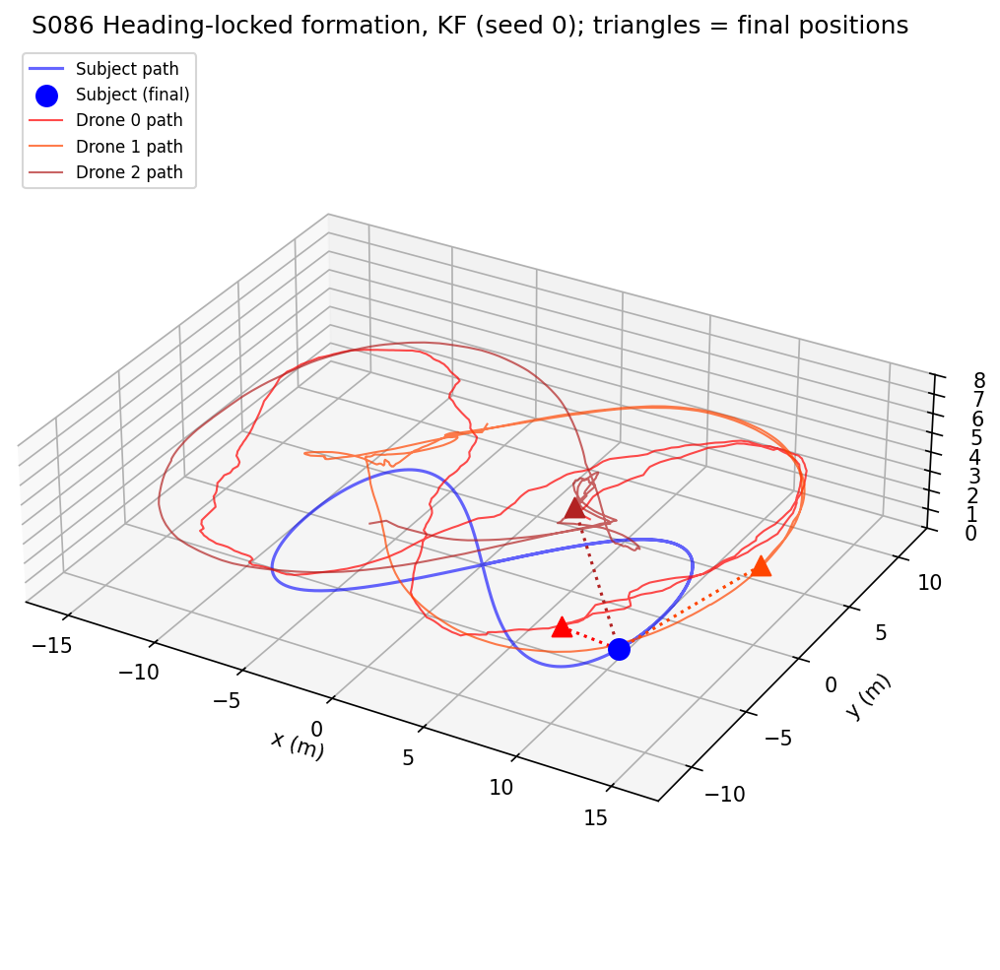
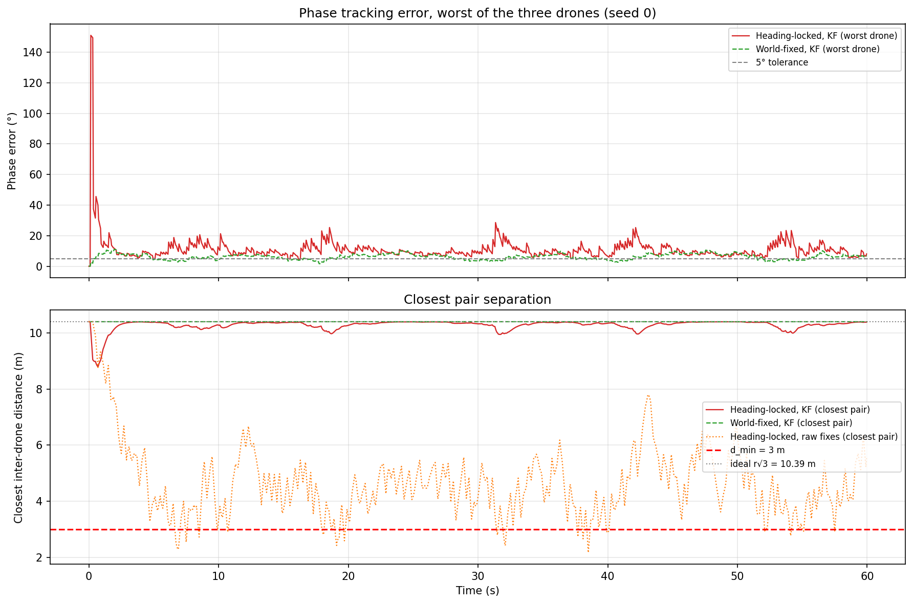
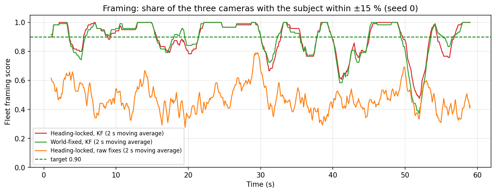
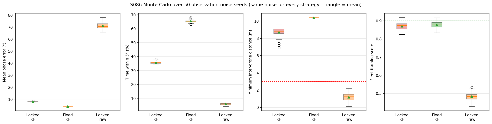
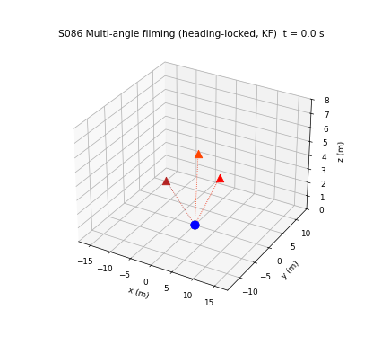

# S086 Cooperative Multi-Angle Filming

**Domain**: Special Ops & Entertainment | **Difficulty**: ⭐⭐ | **Status**: ✅ Completed

---

## Problem Definition

**Setup**: A subject walks a figure-8 ($a = 10$ m, $b = 6$ m) at an RMS speed of 1.5 m/s. Three camera drones fly at 4 m altitude on a 6 m orbit around the subject, 120° apart, so that the subject is always filmed from three evenly spaced angles. A shared Kalman filter (KF) receives a noisy position fix of the subject every 0.2 s ($\sigma_{obs} = 0.3$ m) and gives every drone the same estimate. Each drone follows its orbit set-point with a proportional velocity command limited to 4 m/s, and points its camera at the estimated subject.

**Objectives** (card): phase error ≤ 5° per drone, all inter-drone distances ≥ 3 m, fleet framing score $\bar F \ge 0.90$ (subject within ±15 % of the image centre).

**Strategies compared** (same observation noise for every strategy):
1. **Heading-locked, KF** (card): the formation rotates with the subject's estimated heading, so drone 0 always films from the same side relative to the walking direction.
2. **World-fixed, KF** (added): base phase fixed at 0, so the formation translates with the subject but does not rotate. This shows the cost of rotating the formation with the heading.
3. **Heading-locked, raw fixes** (added): no filter; the latest fix is the position and the difference of the last two fixes the velocity. This shows what the KF contributes.

The card gives a single method and no baseline; strategies 2 and 3 are added to make the results comparable.

---

## Mathematical Model Summary

Subject: $\mathbf q(t) = (a\sin\omega t,\ b\sin 2\omega t,\ 0)$ with $\omega = 1.5/\sqrt{(a^2 + 4b^2)/2} = 0.1358$ rad/s (lap 46.3 s, speed 0.92–2.12 m/s).

KF: constant velocity, discrete Wiener process noise ($\sigma_a = 0.8$ m/s²), predicted every 0.05 s, updated every 0.2 s. As in the card it starts at the true position with zero velocity.

Formation set-point and control:

$$\varphi_k^{des} = \varphi_{base} + \tfrac{2\pi k}{3}, \quad \varphi_{base} = \operatorname{atan2}(\hat v_y, \hat v_x)\ \text{(locked) or } 0\ \text{(world-fixed)}$$

$$\mathbf p_k^{des} = (\hat x + r\cos\varphi_k^{des},\ \hat y + r\sin\varphi_k^{des},\ z_{fly}), \qquad \dot{\mathbf p}_k = \operatorname{sat}_{v_{max}}\bigl(K_p(\mathbf p_k^{des} - \mathbf p_k)\bigr)$$

Phase error $\Delta\varphi_k = |\varphi_k^{act} - \varphi_k^{des}|_{wrap}$ with $\varphi_k^{act}$ measured around the KF estimate (card definition). Pair separation error $|\varphi_j^{act} - \varphi_i^{act} - 2\pi(j - i)/3|_{wrap}$.

Framing: the camera of each drone points at $(\hat x, \hat y, 0)$. The true subject is projected into the camera frame (right, up, forward); $\delta_k = (\text{right}, \text{up})/\text{forward} \cdot r/r_{fov}$, so $|\delta| = 1$ is the image edge (half-width 2 m at 6 m). A camera frames the subject when $\|\delta_k\|_\infty \le 0.15$.

---

## Key Parameters

| Parameter | Value |
|-----------|-------|
| Drones / orbit radius / altitude | 3 / 6.0 m / 4.0 m |
| Figure-8 $a$ / $b$ / $\omega$ | 10 m / 6 m / 0.1358 rad/s (card: 0.18) |
| Subject RMS speed | 1.5 m/s |
| KF $\sigma_a$ / $\sigma_{obs}$ / observation interval | 0.8 m/s² / 0.3 m / 0.2 s |
| Controller $K_p$ / $v_{max}$ | 2.0 s⁻¹ / 4.0 m/s (Euclidean norm) |
| Time step / duration | 0.05 s / 60 s |
| Phase tolerance / $d_{min}$ / framing threshold | 5° / 3.0 m / 0.15 |
| FOV half-width at orbit radius | 2.0 m |
| Monte Carlo (added) | 50 observation-noise seeds (master seed 86) |
| Phase statistics also after (added) | 5 s |

---

## Implementation

```
src/05_special_entertainment/s086_multi_angle_cinema.py   # Main simulation script
```

```bash
conda activate drones
python src/05_special_entertainment/s086_multi_angle_cinema.py
```

Runtime ≈ 1 min on a heavily loaded machine.

---

## Results

Monte Carlo over 50 seeds (mean ± std; "max" = mean over seeds of the worst value in a run):

| Strategy | Mean phase error | Max phase error | Time within 5° | Pair-separation error | Min inter-drone distance | Framing $\bar F$ | Estimate RMSE |
|---|---:|---:|---:|---:|---:|---:|---:|
| **Heading-locked, KF** (card) | 7.95 ± 0.24° | 84.3° | 35.7 ± 0.8 % | 7.32 ± 0.15° | 8.71 ± 0.57 m | 0.870 ± 0.021 | 0.325 m |
| World-fixed, KF | 4.14 ± 0.02° | 11.0° | 65.4 ± 0.9 % | 7.15 ± 0.03° | 10.39 ± 0.00 m | 0.878 ± 0.019 | 0.325 m |
| Heading-locked, raw fixes | 71.14 ± 2.58° | 179.8° | 6.0 ± 0.7 % | 62.72 ± 7.89° | 1.18 ± 0.50 m | 0.484 ± 0.021 | 0.447 m |

After the first 5 s (KF start-up excluded) the mean / max phase errors are 7.44 ± 0.09° / 32.6° (heading-locked KF), 4.09 ± 0.02° / 10.7° (world-fixed KF) and 72.40 ± 2.75° / 179.8° (raw).

Per seed: the world-fixed formation has a lower mean phase error than the heading-locked one in 50/50 seeds, and the heading-locked one frames better in only 9/50 seeds. The KF beats raw fixes on phase error, framing and minimum distance in 50/50 seeds.

**Card expectations vs results**:

| Metric | Card expects | Heading-locked KF (card method) | Holds? |
|---|---|---|---|
| Mean phase error | ≤ 3° | 7.95° (0/50 seeds ≤ 3°) | No |
| Minimum inter-drone distance | ≥ 8 m | 8.71 m on average, 6.90 m in the worst seed | Only on average; always ≥ $d_{min}$ = 3 m |
| Fleet framing score | ≥ 0.92 (target ≥ 0.90) | 0.870 (2/50 seeds ≥ 0.90) | No |
| KF position RMSE | ≤ 0.5 m | 0.325 m | Yes |

**Key findings**:
- **Rotating the formation with the heading costs phase accuracy.** The subject turns at up to 0.500 rad/s at the ends of the figure-8, which alone asks the set-points on the 6 m orbit to move at up to 3.00 m/s. With $K_p = 2$ the drones lag, and the heading estimate is noisy, so the heading-locked formation is within 5° only 35.7 % of the time. The world-fixed formation only translates; its error (4.14°) comes from the steady lag of the P controller behind the moving subject. Neither meets the card's ≤ 3°.
- **The KF start-up gives the large maxima.** The KF starts with zero velocity, so the heading is undefined for the first fixes; in seed 0 the worst drone's phase error reaches 151.0° in the first second (see the sync plot). After 5 s the mean of the per-run maxima drops from 84.3° to 32.6°.
- **Separation is safe with the KF in both formations.** The closest pair stays at 8.71 m on average (6.90 m worst seed) when heading-locked and exactly at the ideal 10.39 m when world-fixed (all three drones lag by the same vector, so the triangle stays rigid). Without the filter, the raw heading jumps around and the drones cut across the circle: the closest pair comes within 0.12 m in the worst seed (1.18 m on average), far below $d_{min}$ = 3 m.
- **Framing misses the target because of the estimate, not the formation.** The camera points at the estimate, so framing depends on the 0.325 m estimate error: at 6 m the ±15 % tolerance is ±0.3 m (0.15 × 2 m). The formation choice changes the framing score by less than 0.01, while dropping the KF halves it (0.484). The card's ≥ 0.90 would need a better estimate, e.g. a smaller $\sigma_a$ or faster fixes.

**Physical checks** (asserted): drone speed ≤ 4 m/s at every step, altitude > 0.

### 3D Formation

Subject path (blue) and the three drone paths for the heading-locked KF formation, seed 0, with the final positions (triangles) and sight lines:



### Phase Synchronisation and Separation

Top: worst phase error of the three drones for the heading-locked and world-fixed formations (seed 0). Bottom: closest-pair distance for all three strategies against $d_{min}$ = 3 m and the ideal 10.39 m:



### Framing Score

Share of the three cameras that frame the subject (2 s moving average, seed 0):



### Monte Carlo



### Animation

Rotating 3D view of the heading-locked KF formation following the subject (seed 0), with the last 5 s of each drone's path and dotted sight lines. 151 frames at 10 fps, one frame every 0.4 s:



### Deviations from the scenario card

| Card | Implementation | Reason |
|------|----------------|--------|
| $\omega = 0.18$ rad/s "tuned to hit ~1.5 m/s RMS" | $\omega = 0.1358$ rad/s | 0.18 rad/s gives 1.99 m/s RMS. Card corrected. |
| `framing_score`: world-frame drone-to-subject vector divided by 2 m | Pinhole projection of the true subject into a camera aimed at the KF estimate | The card's version is about 6 m / 2 m ≈ 3 > 0.15 at every step, so $\bar F$ would be 0. Card corrected. |
| $\|\mathbf u_k\|_\infty \le v_{max}$ in the text | Euclidean norm (as in the card's code) | The code and text disagree; the code's version is the stricter one. |
| $\Delta\varphi_{ij} = |\varphi_i - \varphi_j - 2\pi/3|$ | $|\varphi_j - \varphi_i - 2\pi(j - i)/3|$ | The card's formula only fits adjacent pairs in one order; pair (0, 2) is 240° apart. |
| One method, one run (seed 42) | Added world-fixed and raw-fix strategies; 50-seed Monte Carlo with the same noise for every strategy; phase errors also after 5 s | The card has no baseline; results depend on the noise. |
| Animation at 20 fps, every 5th step | 10 fps, every 8th step (0.4 s) | Keeps the rotating-view GIF under 5 MB. |
| Output names `s086_*.png`, `s086_animation.gif` | `3d_formation.png`, `sync_separation.png`, `framing_score.png`, `monte_carlo.png`, `animation.gif` | Project naming convention. |
| Expected: phase ≤ 3°, min distance ≥ 8 m, $\bar F \ge 0.92$, RMSE ≤ 0.5 m | 7.95°, 8.71 m (worst 6.90 m), 0.870, 0.325 m | Reported as found (see table above); nothing retuned. |

---

## Extensions

1. **Rate-limited base phase**: low-pass the heading before it drives the formation; trade off "same side of the subject" against phase error.
2. **Feedforward of the set-point velocity**: add $\dot{\mathbf p}_k^{des}$ to the command to remove the P-controller lag behind the subject.
3. **Better subject estimate**: lower $\sigma_a$ or 10 Hz fixes; find what estimate error is needed for $\bar F \ge 0.90$.
4. **KF initialisation**: start the filter after two fixes (velocity from their difference) to avoid the start-up spike.
5. **Altitude-staggered cameras** at 3, 4 and 5 m for vertical parallax.

---

## Related Scenarios

- Prerequisites: [S081 Selfie Follow Mode](../../../scenarios/05_special_entertainment/S081_selfie_follow.md), [S082 FPV Racing Circuit](../../../scenarios/05_special_entertainment/S082_fpv_racing.md)
- Follow-ups: [S098 Swarm Synchronized Dance](../../../scenarios/05_special_entertainment/S098_synchronized_dance.md), [S092 Movie Car Chase Scene](../../../scenarios/05_special_entertainment/S092_movie_chase.md)
- Cross-reference: [S046 Multi-Drone 3D Trilateration](../../../scenarios/03_environmental_sar/S046_trilateration.md), [S007 Jamming & Blind Pursuit](../../../scenarios/01_pursuit_evasion/S007_jamming_blind_pursuit.md)
