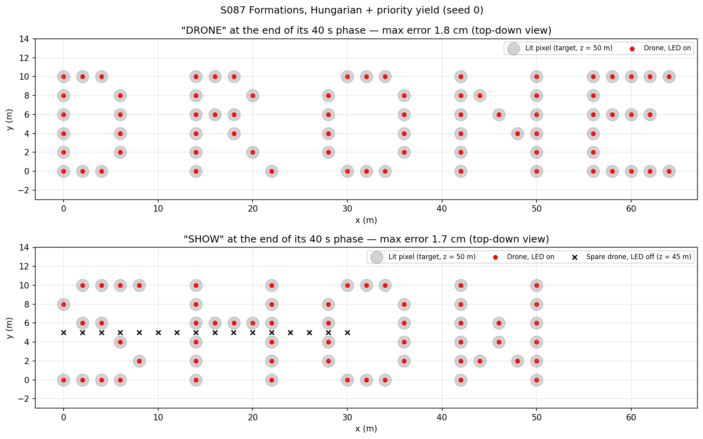
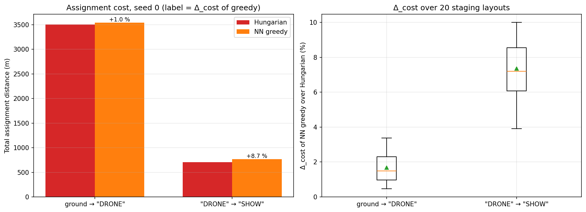
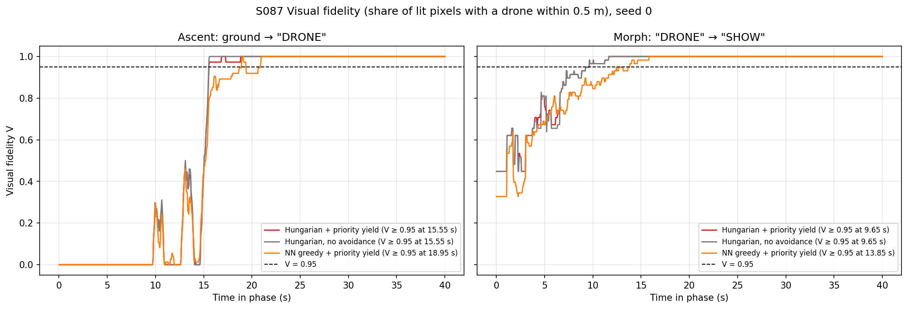
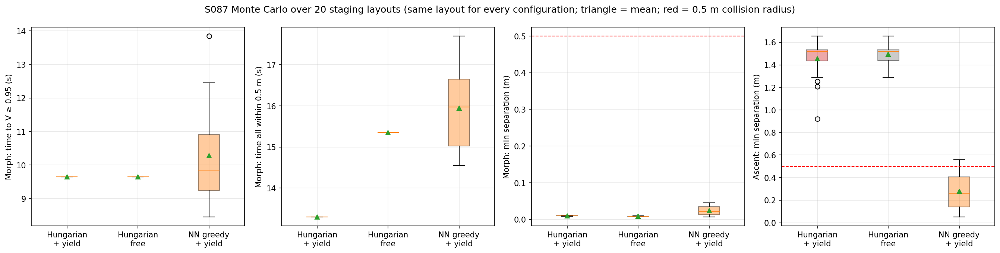
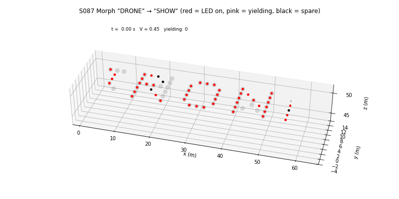

# S087 Aerial Light Show Text Display

**Domain**: Special Ops & Entertainment | **Difficulty**: ⭐⭐ | **Status**: ✅ Completed

---

## Problem Definition

**Setup**: A drone swarm takes off from the ground and spells "DRONE" at $z = 50$ m in a 6 × 5 bitmap font (one drone per lit pixel, 2 m pixel pitch, 2 blank columns between characters), then morphs into "SHOW". Before each transition the drones are matched to the lit pixels with the Hungarian algorithm (minimum total distance). Each drone flies to its pixel with a PID acceleration command limited to 3 m/s² and 5 m/s. During a transition a priority rule gives the drone with the longer remaining path right of way: a drone within $r_{sep} = 1.5$ m of a higher-priority drone is limited to 50 % speed.

**Fleet size**: the card's font gives 74 lit pixels for "DRONE" and 58 for "SHOW", not 30 for each (verified by the script). The fleet therefore has 74 drones. For "SHOW" the 16 spare drones switch their LEDs off and park in a row 5 m below the display.

**Objective**: maximise the visual fidelity $V$ (share of lit pixels with their drone within 0.5 m) quickly, with low travel cost and without collisions.

**Configurations** (the same staging layout for every configuration in each seed):
1. **Hungarian + priority yield** (card).
2. **Hungarian, no avoidance** (added): shows what the priority rule contributes.
3. **NN greedy + priority yield**: the card's cost baseline (each drone in index order takes the nearest free pixel), here also flown.

---

## Mathematical Model Summary

Pixel $(i, j)$ of character $c$: $\mathbf p = \bigl((c(W + g) + j)\,d_{px},\ (H - 1 - i)\,d_{px},\ z_{show}\bigr)$ with $W = 5$, $H = 6$, $g = 2$, $d_{px} = 2$ m. "DRONE" is 64 m wide, "SHOW" 50 m.

Assignment: $\sigma^* = \arg\min_\sigma \sum_k \|\mathbf q_k - \mathbf p_{\sigma(k)}\|$ (`linear_sum_assignment`), for the ascent (from the staging positions) and again for the morph (from the hover positions after the ascent). Cost penalty of greedy: $\Delta_{cost} = (D_{greedy} - D_{Hungarian})/D_{Hungarian}$.

Dynamics per drone (double integrator):

$$\mathbf a = \operatorname{sat}_{a_{max}}\bigl(K_p\mathbf e + K_i\!\int\!\mathbf e\,dt - K_d\mathbf v\bigr), \qquad \mathbf v \leftarrow \operatorname{sat}_{v_{cap}}(\mathbf v + \mathbf a\Delta t), \qquad \mathbf q \leftarrow \mathbf q + \mathbf v\Delta t$$

The integral is frozen while $\|\mathbf a\|$ would exceed $a_{max}$. $v_{cap} = 5$ m/s, or 2.5 m/s for a yielding drone. Priority: rank drones by remaining distance (largest first); drone $k$ yields if any higher-ranked drone is within 1.5 m.

Metrics per transition (40 s simulated each): $V(t)$ and the first time $V \ge 0.95$; the first time all drones are within 0.5 m; minimum pairwise separation; number of drone pairs that ever come within the 0.5 m collision radius; share of drone-steps spent yielding.

---

## Key Parameters

| Parameter | Value |
|-----------|-------|
| Fleet size | 74 (card: 30, see Deviations) |
| Words / lit pixels | "DRONE" 74, "SHOW" 58 (+ 16 dark spares at z = 45 m, y = 5 m, 2 m apart) |
| Glyph / pixel pitch / gap | 6 × 5 / 2.0 m / 2 columns |
| Display altitude | 50 m |
| PID $K_p$ / $K_i$ / $K_d$ | 2.0 / 0.05 / 0.8 |
| $v_{max}$ / $a_{max}$ | 5.0 m/s / 3.0 m/s² |
| $r_{sep}$ / yield speed | 1.5 m / 50 % |
| Fidelity tolerance / acceptance | 0.5 m / V = 0.95 |
| Collision radius (domain constant) | 0.5 m |
| Time step / phase length | 0.05 s / 40 s |
| Staging volume (added) | x ∈ [0, 64], y ∈ [−2, 12], z ∈ [0.5, 5] m, pads ≥ 1.5 m apart |
| Monte Carlo (added) | 20 staging layouts (seeds 0–19); showcase seed 0 |

---

## Implementation

```
src/05_special_entertainment/s087_led_text.py   # Main simulation script
```

```bash
conda activate drones
python src/05_special_entertainment/s087_led_text.py
```

Runtime ≈ 1 min on a heavily loaded machine.

---

## Results

**Showcase layout (seed 0)**:

| Configuration | Phase | Cost | $V \ge 0.95$ at | All within 0.5 m at | Min separation | Pairs < 0.5 m | Yielding |
|---|---|---:|---:|---:|---:|---:|---:|
| Hungarian + yield | ascent | 3505.8 m | 15.55 s | 16.85 s | 1.436 m | 0 | 0.23 % |
| Hungarian + yield | morph | 708.0 m | 9.65 s | 13.30 s | **0.010 m** | **13** | 1.52 % |
| Hungarian, no avoidance | ascent | 3505.8 m | 15.55 s | 15.60 s | 1.437 m | 0 | — |
| Hungarian, no avoidance | morph | 708.0 m | 9.65 s | 15.35 s | 0.007 m | 16 | — |
| NN greedy + yield | ascent | 3540.8 m | 18.95 s | 19.00 s | 0.557 m | 0 | 1.38 % |
| NN greedy + yield | morph | 771.8 m | 13.85 s | 16.10 s | 0.013 m | 39 | 3.22 % |

At the end of each 40 s phase every drone is within 2.12 cm of its pixel (worst case: greedy ascent), so the final fidelity is $V = 1$ for every configuration.

$\Delta_{cost}$ of NN greedy: 1.00 % (ascent) and 8.71 % (morph) for seed 0; over 20 layouts 1.68 % (0.47–3.38 %) for the ascent and 7.35 % (3.91–10.00 %) for the morph.

**Monte Carlo over 20 staging layouts** (mean ± std):

| Configuration | Ascent $V \ge 0.95$ | Ascent all within 0.5 m | Ascent min sep | Ascent pairs < 0.5 m | Morph $V \ge 0.95$ | Morph all within 0.5 m | Morph min sep | Morph pairs < 0.5 m |
|---|---:|---:|---:|---:|---:|---:|---:|---:|
| Hungarian + yield | 15.54 ± 0.04 s | 15.96 ± 0.72 s | 1.454 ± 0.164 m | 0.00 | 9.65 ± 0.00 s | 13.30 ± 0.00 s | 0.010 ± 0.001 m | 12.50 ± 0.50 |
| Hungarian, no avoidance | 15.54 ± 0.03 s | 15.63 ± 0.08 s | 1.495 ± 0.082 m | 0.00 | 9.65 ± 0.00 s | 15.35 ± 0.00 s | 0.009 ± 0.001 m | 16.00 ± 0.00 |
| NN greedy + yield | 18.55 ± 1.18 s | 20.09 ± 1.19 s | 0.278 ± 0.139 m | 2.40 ± 1.80 | 10.28 ± 1.43 s | 15.95 ± 0.96 s | 0.024 ± 0.013 m | 27.95 ± 4.59 |

All configurations converge in all 20 layouts. Layouts with at least one pair closer than 0.5 m: Hungarian + yield 0 (ascent) / 20 (morph), Hungarian free 0 / 20, greedy 19 / 20. Per layout, the Hungarian ascent reaches $V \ge 0.95$ before the greedy one in 20/20 layouts. With the Hungarian assignment, the yield rule gives a larger morph separation than no avoidance in 15/20 layouts (ties 5) and a faster morph (all within 0.5 m) in 20/20.

**Key findings**:
- **The card's word sizes are wrong**: its own font gives 74 and 58 lit pixels, so the show needs 74 drones and 16 of them are dark during "SHOW".
- **The Hungarian assignment pays off mainly in the ascent's safety and speed.** Its ascent is collision-free in every layout (closest pair 1.454 m on average), while the naive greedy assignment brings a pair within 0.5 m in 19/20 layouts and reaches $V \ge 0.95$ about 3 s later (18.55 vs 15.54 s). The distance saving is small for the ascent (1.68 %) because every drone must climb 45–49.5 m (from the staging heights), and larger for the morph (7.35 %).
- **The morph is not collision-free with any configuration.** In "DRONE" → "SHOW", 13 drone pairs (Hungarian + yield) come within 0.5 m, the closest to 0.010 m: drones whose straight paths cross in the display plane meet at nearly the same time. The priority rule only slows the lower-priority drone; it does not steer it away. It reduces the number of close pairs from 16 to 12.50 on average and slightly raises the minimum separation (0.009 → 0.010 m), which is not a meaningful safety margin. A real show needs time-separated or altitude-layered transitions (see Extensions).
- **The yield rule makes the morph faster, not slower**: all drones are within 0.5 m after 13.30 s with yielding vs 15.35 s without. Slowing the lower-priority drones in the crowded areas reduces overshoot in this underdamped PID ($\zeta \approx 0.28$, hand calculation from $K_p$, $K_d$) — this explanation was not separately tested.
- **The morph result does not vary between layouts** for the Hungarian configurations (std 0.00): the ascent always ends in the same "DRONE" formation, so the morph starts from the same state.
- **Final visual fidelity is not a discriminating metric**: $V = 1$ for every configuration once the formation has settled, so the comparison uses the time to $V \ge 0.95$ instead.

**Physical checks** (asserted): speed ≤ 5 m/s, acceleration ≤ 3 m/s², altitude > 0 at every step. Close approaches are counted, not prevented, because preventing them is the controller's job.

### Formations

Top-down view of the drones at the end of each phase (Hungarian + yield, seed 0): grey discs = lit pixels, red = drones with LED on, black crosses = the 16 dark spares 5 m below "SHOW":



### Assignment Cost

Left: total distance of the Hungarian and greedy assignments for both transitions (seed 0). Right: $\Delta_{cost}$ over the 20 layouts:



### Visual Fidelity

$V(t)$ during the ascent and the morph (seed 0) for the three configurations:



### Monte Carlo

Morph time to $V \ge 0.95$, morph time until all drones are within 0.5 m, and the minimum separation in the morph and the ascent (red line = 0.5 m collision radius):



### Animation

3D view of the "DRONE" → "SHOW" morph (Hungarian + yield, seed 0) until 2 s after all drones are within 0.5 m: red = LED on, pink = yielding, black = spare drone; grey = target pixels. 78 frames at 20 fps, one frame every 0.2 s:



### Deviations from the scenario card

| Card | Implementation | Reason |
|------|----------------|--------|
| $N = 30$; "DRONE" and "SHOW" each have 30 lit pixels | $N = 74$; "SHOW" uses 58 drones and 16 dark spares parked 5 m below | The card's font gives 74 and 58 lit pixels (printed by the script). Card corrected. |
| `pid_step`: per-axis clipping, a derivative term mixing `err/dt` and velocity; integral always accumulates | $\mathbf a = K_p\mathbf e + K_i\int\mathbf e - K_d\mathbf v$, norm-clipped; integral frozen while saturated | The card's derivative term is ill-formed; without anti-windup the long saturated climb winds up the integral (as in S085). |
| Yield implemented as a half time step in the PID update | Speed cap halved (2.5 m/s) for yielding drones | A half time step is not half speed. Card note added. |
| Straight-line interpolation $\tau_k(t)$ in the math; PID in the code | PID-driven flight (as in the code) | The text and code disagree; PID with limits is the more physical choice. |
| Fidelity $V$ at display time | $V(t)$, time to $V \ge 0.95$, and time until all drones are within 0.5 m | $V$ at display time is 1 by construction. |
| Staging uniform in [0, 60] × [0, 12] × [0, 5] m | [0, 64] × [−2, 12] × [0.5, 5] m with pads ≥ 1.5 m apart | Room for 74 drones; no drone starts on the ground plane or inside another. |
| One run (seed 42) | 20-layout Monte Carlo, three configurations flown with the same layouts | The card asks for a comparison; results depend on the layout. |
| Output names not fixed; GIF of the morph | `formations.png`, `assignment_cost.png`, `fidelity.png`, `monte_carlo.png`, `animation.gif` | Project naming convention. The formation figure is a top-down 2D view (the display is planar); the animation is 3D. |
| Collision avoidance by the priority queue | Same rule, but close approaches are measured: 13 pairs < 0.5 m in the showcase morph | Reported as found: the rule does not prevent collisions in the morph. |

---

## Extensions

1. **Altitude-layered morph**: send each drone through its own altitude layer (e.g. ±1 m by priority) during the transition, then descend into the display plane.
2. **Time-staggered launch**: start the morph of lower-priority drones only when higher-priority paths no longer intersect theirs.
3. **Squared-distance assignment**: minimising the sum of squared distances gives non-crossing straight-line paths for synchronised constant-speed motion; combine it with synchronised arrival times.
4. **Font with a fixed pixel count**: design glyphs or use a dot-matrix that pads every word to the same $N$.
5. **Vertical display plane** facing the audience instead of a horizontal one.

---

## Related Scenarios

- Prerequisites: [S083 Light Show Single-Drone Test](../../../scenarios/05_special_entertainment/S083_light_show_single.md), [S085 Drone Light Matrix Positioning](../../../scenarios/05_special_entertainment/S085_light_matrix.md)
- Next: [S088 Formation Geometric Shape Morphing](../../../scenarios/05_special_entertainment/S088_formation_morphing.md)
- Cross-reference: [S018 Multi-Target Intercept](../../../scenarios/01_pursuit_evasion/S018_multi_target_intercept.md), [S019 Dynamic Target Reassignment](../../../scenarios/01_pursuit_evasion/S019_dynamic_reassignment.md), [S040 Fleet Load Balancing](../../../scenarios/02_logistics_delivery/S040_fleet_load_balancing.md)
