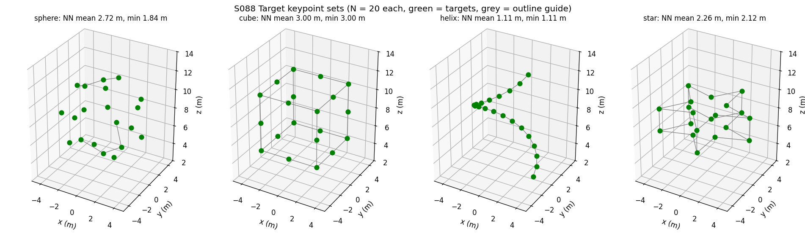
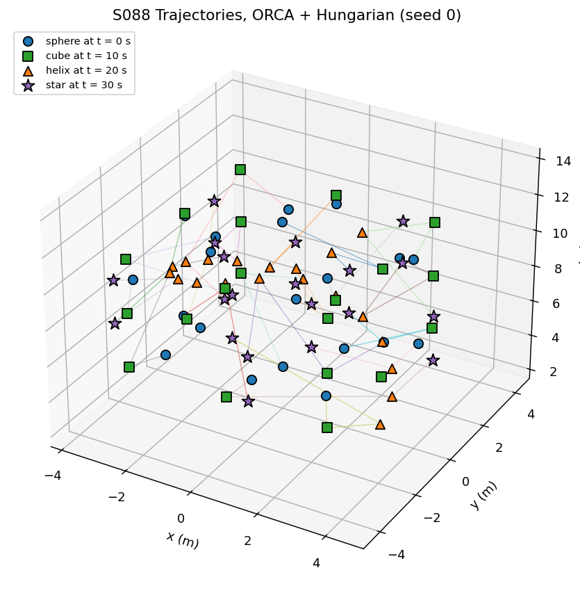
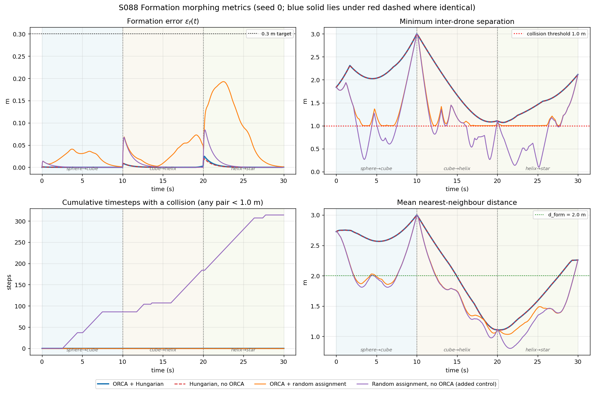
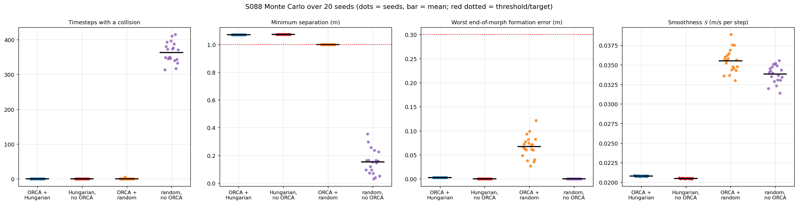
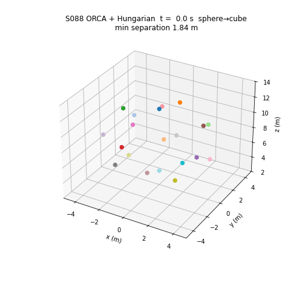

# S088 Formation Geometric Shape Morphing

**Domain**: Special Ops & Entertainment | **Difficulty**: ⭐⭐⭐ | **Status**: ✅ Completed

---

## Problem Definition

**Setup**: Twenty drones fly a light-show sequence through four 3D shapes, **sphere → cube → helix → star**, with 10 s per transition (30 s in total). At the start of each transition every drone is assigned one keypoint of the next shape and tracks a target that moves in a straight line from its current position to that keypoint. A collision-avoidance layer may modify the commanded velocity. Two drones collide when they are closer than $2 r_{coll} = 1.0$ m.

**Objective**: finish all three transitions with (1) no collisions, (2) mean formation error below 0.3 m at the end of each morph, and (3) speeds within $v_{max} = 3$ m/s.

**Conditions** (all use the same random numbers per seed):
1. **ORCA + Hungarian** (proposed): cost-minimising assignment, ORCA velocity filter.
2. **Hungarian, no ORCA**: same assignment, no avoidance layer.
3. **ORCA + random assignment**: random permutation at each transition, ORCA active.
4. **Random assignment, no ORCA** (added control, not in the card): shows what ORCA has to fix when the assignment is poor.

---

## Mathematical Model Summary

### Shapes (N = 20 keypoints each)

| Shape | Construction | Mean / min nearest-neighbour spacing |
|-------|--------------|--------------------------------------|
| Sphere | Fibonacci sphere, $R = 4$ m | 2.722 / 1.835 m |
| Cube | 8 corners + 12 edge midpoints, half-side $a = 3$ m | 3.000 / 3.000 m |
| Helix | one turn, $R_h = 3$ m, rise 0.6 m per drone | 1.114 / 1.114 m |
| Star | five-pointed star outline (10 vertices, $R_{out} = 4.5$, $R_{in} = 1.8$ m) on two layers $z = \pm 1.2$ m | 2.258 / 2.116 m |

### Assignment and interpolation

Hungarian assignment minimises $\sum_i \|\mathbf{p}_i^{curr} - \mathbf{p}_{\sigma(i)}^{tgt}\|$ (`scipy.optimize.linear_sum_assignment`). The target of drone $k$ moves linearly:

$$\mathbf{p}_k^{des}(t) = (1-\tau)\,\mathbf{p}_k^A + \tau\,\mathbf{p}_k^B, \qquad \tau = (t - t_s)/T_{morph}$$

The preferred velocity is the nominal velocity plus a proportional correction toward the moving target:

$$\mathbf{v}_k^{pref} = \frac{\mathbf{p}_k^B - \mathbf{p}_k^A}{T_{morph}} + K_P\,(\mathbf{p}_k^{des}(t) - \mathbf{p}_k), \qquad K_P = 1\ \text{s}^{-1}$$

### ORCA (3D)

For each neighbour $j$ within $r_{sense} = 4$ m, drone $i$ gets the half-space $\{\mathbf{v} : \hat{\mathbf{n}}_{ij} \cdot (\mathbf{v} - \mathbf{v}_i - \tfrac12 \mathbf{u}_{ij}) \ge 0\}$, where $\mathbf{u}_{ij}$ is the smallest change of relative velocity that leaves the truncated velocity-obstacle cone (combined radius 1.0 m, horizon $T_h = 2$ s). The new velocity is the point closest to $\mathbf{v}_i^{pref}$ inside all half-spaces and the ball $\|\mathbf{v}\| \le v_{max}$, solved with the exact incremental 3D linear program of RVO2-3D (linearProgram 1–3). If it is infeasible, linearProgram 4 minimises the largest violation.

### Vehicle limits

The velocity change per step is clipped to $a_{max}\,\Delta t$ with $a_{max} = 5$ m/s², and the speed is checked against $v_{max}$ with `assert`, for every condition.

### Metrics

- Collision timesteps: number of steps where any pair is closer than 1.0 m (pair-steps are also reported).
- Formation error $\varepsilon_f(t) = \frac1N \sum_k \|\mathbf{p}_k - \mathbf{p}_k^{des}\|$, evaluated at the end of each morph.
- Smoothness $\mathcal{S} = \sqrt{\frac{1}{N T_{steps}} \sum_k \sum_t \|\Delta \mathbf{v}_k(t)\|^2}$ (m/s per step).
- Mean nearest-neighbour distance $\bar d_{nn}(t)$.

---

## Key Parameters

| Parameter | Value |
|-----------|-------|
| Drones $N$ | 20 |
| Shape sequence | sphere → cube → helix → star |
| Morph time $T_{morph}$ / total | 10 s / 30 s |
| Time step $\Delta t$ | 0.05 s (200 steps per morph) |
| Speed limit $v_{max}$ | 3.0 m/s |
| Acceleration limit $a_{max}$ (added) | 5.0 m/s² |
| Collision radius $r_{coll}$ / pair threshold | 0.5 m / 1.0 m |
| ORCA sensing radius $r_{sense}$ | 4.0 m |
| ORCA time horizon $T_h$ | 2.0 s |
| Target feedback gain $K_P$ (added) | 1.0 s⁻¹ |
| Sphere radius $R$ | 4.0 m |
| Cube half-side $a$ | 3.0 m |
| Helix radius / rise per drone | 3.0 m / 0.6 m |
| Star outer / inner radius / layers | 4.5 m / 1.8 m / $z = \pm 1.2$ m |
| Reference formation distance $d_{form}$ | 2.0 m (plot reference only) |
| Formation centre altitude (added) | 8.0 m; drones fly between 2.19 and 13.80 m (all seeds and conditions), $z \ge 0$ asserted |
| Initial position noise | N(0, 0.05 m) per axis around the sphere keypoints |
| Formation-error target | < 0.3 m |
| Monte Carlo | 20 seeds (0–19); seed 0 for the time-series figures |

---

## Implementation

```
src/05_special_entertainment/s088_formation_morphing.py   # Main simulation script
```

```bash
conda activate drones
python src/05_special_entertainment/s088_formation_morphing.py
```

Runtime ≈ 35 s on a quiet machine (78–107 s measured in the latest three runs while other jobs shared the CPU).

---

## Results

### Seed 0

| Condition | Collision timesteps (of 600) | Min separation | End-of-morph $\varepsilon_f$ (3 morphs) | Max $\varepsilon_f$ | Smoothness $\mathcal{S}$ | Max speed | Flown path |
|-----------|---:|---:|---|---:|---:|---:|---:|
| **ORCA + Hungarian** | **0** | 1.0706 m | 0.000, 0.003, 0.001 m | 0.025 m | 0.0208 | 0.660 m/s | 161.3 m |
| Hungarian, no ORCA | 0 | 1.0727 m | 0.000, 0.000, 0.000 m | 0.019 m | 0.0205 | 0.660 m/s | 161.3 m |
| ORCA + random assignment | 0 | 1.0000 m | 0.001, 0.049, 0.001 m | 0.193 m | 0.0336 | 1.633 m/s | 322.1 m |
| Random, no ORCA (control) | 314 (1023 pair-steps) | 0.0944 m | 0.000, 0.000, 0.000 m | 0.084 m | 0.0320 | 1.287 m/s | 319.4 m |

ORCA changed the velocity in 164 agent-steps with Hungarian assignment and in 2553 agent-steps with random assignment (no infeasible LP in either run).

### Monte Carlo, 20 seeds (mean ± std)

| Condition | Collision timesteps | Seeds with ≥ 1 collision | Min separation (worst seed) | Worst end-of-morph $\varepsilon_f$ | Smoothness $\mathcal{S}$ | Assigned travel (3 morphs) | ORCA-active agent-steps |
|-----------|---:|---:|---:|---:|---:|---:|---:|
| **ORCA + Hungarian** | **0.0 ± 0.0** | **0/20** | 1.0706 m (1.0706) | 0.003 ± 0.000 m | 0.0208 ± 0.0000 | 160.7 ± 0.3 m | 164.1 ± 0.3 |
| Hungarian, no ORCA | 0.0 ± 0.0 | 0/20 | 1.0727 m (1.0727) | 0.000 ± 0.000 m | 0.0205 ± 0.0000 | 160.7 ± 0.3 m | — |
| ORCA + random assignment | 0.3 ± 1.3 | 1/20 (max 6) | 1.0000 m (0.9998) | 0.067 ± 0.022 m | 0.0355 ± 0.0014 | 348.9 ± 18.7 m | 3373.7 ± 438.3 |
| Random, no ORCA (control) | 363.2 ± 28.3 | 20/20 (max 415) | 0.1528 ± 0.0853 m (0.0295) | 0.000 ± 0.000 m | 0.0338 ± 0.0011 | 348.7 ± 18.6 m | — |

Paired per seed (common random numbers): ORCA + random has fewer collision steps than random without ORCA in 20/20 seeds; ORCA + Hungarian has fewer than ORCA + random in 1/20 seeds and the same (zero) in 19/20; the worst end-of-morph error is lower with Hungarian than with random assignment in 20/20 seeds. For the two Hungarian conditions the 20 seeds are effectively **one case repeated** (see below), so these counts compare one Hungarian outcome with 20 random-assignment outcomes. The largest speed over all seeds and conditions is 1.752 m/s, so $v_{max} = 3$ m/s never binds.

**Key findings**:
- **The proposed method meets every card target**: zero collisions (one effective case, see the last finding), minimum separation 1.0706 m, worst end-of-morph error 0.003 m (< 0.25 m), smoothness 0.0208 m/s per step (< 0.05).
- **The card's claim that the "no ORCA" condition shows why ORCA is necessary does not hold here.** With Hungarian assignment the straight-line paths never come closer than 1.0727 m, so the no-ORCA run is collision-free and slightly smoother (0.0205 vs 0.0208). ORCA only nudges velocities (164 agent-steps, path length unchanged at 161.3 m). In the seed-0 metrics panel the closest approach of both Hungarian runs (1.0706 / 1.0727 m) occurs just after t = 20 s, next to the helix formation, whose own keypoint spacing is only 1.114 m.
- **ORCA matters when the assignment is poor.** Random assignment more than doubles the planned travel (348.9 vs 160.7 m) and makes the paths cross. Without ORCA this gives collisions in 20/20 seeds (363.2 ± 28.3 collision timesteps, closest pair 0.0295 m). With ORCA the drones slide around each other along the 1.0 m boundary: minimum separation 1.0000 m, except in one seed where the separation dipped to 0.9998 m for 6 timesteps (a 0.2 mm violation, counted as collisions). The LP was infeasible in 0.7 ± 1.8 agent-steps per run; there linearProgram 4 only minimises the violation.
- **Hungarian assignment is the cheaper safety measure.** Compared with ORCA + random, it halves the travel, needs ORCA in 164 instead of 3373.7 agent-steps, and lowers the worst formation error from 0.067 to 0.003 m.
- **The formation-error target is not discriminative.** Every condition stays well below 0.3 m at every morph end (largest 0.121 m, ORCA + random; see the Monte Carlo figure), because the $K_P$ term pulls each drone back onto its moving target. It is reported for completeness; the comparison rests on collisions, separation, travel and ORCA activity.
- **The Monte Carlo is degenerate for the Hungarian conditions.** Their only randomness is the 0.05 m initial noise, which never changes the assignment, so all 20 seeds give practically the same run (std 0.0000 for separation and smoothness). The Hungarian rows therefore report **one case**, not 20 independent wins. Only the random-assignment rows carry real seed-to-seed variation, because the permutations change with the seed.

### Target Shapes

The four keypoint sets (green) with grey outline guides (cube edges, helix polyline, star outlines):



### 3D Trajectories

Seed 0, ORCA + Hungarian: thin coloured trails and the formation at t = 0, 10, 20 and 30 s:



### Metrics Panel

Seed 0, all four conditions. The blue ORCA + Hungarian curve lies under the red dashed Hungarian-only curve almost everywhere. Only the random-assignment control (purple) drops below the 1.0 m threshold:



### Monte Carlo

Per-seed values (dots) and means (bars) over 20 seeds:



### Animation

ORCA + Hungarian, seed 0, 3D view with 2 s trails, 201 frames at 20 fps (every 3rd step of 601 states):



### Deviations from the scenario card

| Card | Implementation | Reason |
|------|----------------|--------|
| Shapes "normalised so that the mean inter-point spacing equals $d_{form} = 2.0$ m", while also giving fixed radii | Fixed radii from the card; spacings printed (2.722 / 3.000 / 1.114 / 2.258 m) | The two statements contradict each other; the radii are the more specific values. Card text corrected. |
| Cube: card code builds 24 face points and keeps the first 20 | 8 corners + 12 edge midpoints | The truncation leaves the $+z$ face empty (verified: the first 20 points are 8 on ±x, 8 on ±y, 4 on −z). Card corrected. |
| Helix: "$N$ turns" | One full turn ($2\pi k/N$) | The formula itself gives one turn; the text was wrong. Card corrected. |
| Star: "10-pointed star", angle $\pi k/10$ | Five-pointed star outline, angle $2\pi k/10$ (as in the card code) | With $\pi k/10$ the 10 vertices span only a half circle. Card corrected. |
| ORCA LP solved greedily (sequential projection) in the card code | Exact RVO2-3D incremental LP (linearProgram 1–4), neighbours ordered by distance | The greedy projection can violate earlier constraints; the card's maths specifies the LP. |
| Preferred velocity = constant nominal velocity | Nominal velocity + $K_P(\mathbf{p}^{des} - \mathbf{p})$, $K_P = 1$ s⁻¹ | Without feedback, any ORCA detour leaves a permanent offset from the moving target. Applied to all conditions. |
| No acceleration limit | $\|\Delta\mathbf{v}\| \le a_{max}\Delta t$, $a_{max} = 5$ m/s², all conditions | Physical sanity (no instantaneous velocity jumps); the card asks for bounded acceleration changes. It binds in 57.5 ± 1.4 (ORCA + Hungarian) to 199.8 ± 14.7 (random, no ORCA) of the 12 000 agent-steps per run. |
| Three conditions, single run | Added a fourth control (random assignment, no ORCA); 20-seed Monte Carlo with common random numbers | Hungarian without ORCA turned out collision-free, so the card's comparison could not show what ORCA prevents. |
| Smoothness: card code takes the RMS over vector components | RMS of $\|\Delta\mathbf{v}\|$ as in the card's formula | The code value is $1/\sqrt{3}$ of the formula value. |
| Shapes centred at the origin (the flown minimum would be z = −5.81 m) | Formation centre at 8.0 m altitude; $z \ge 0$ asserted | No flight below ground; the geometry and all separations are unchanged by the shift. |
| Output names `s088_3d_trajectories.png`, `s088_metrics_panel.png`, `s088_animation.gif` | `3d_trajectories.png`, `metrics_panel.png`, `animation.gif`, plus `shapes.png` and `monte_carlo.png` | Repository naming convention. |

---

## Extensions

1. **CAPT assignment**: minimise the sum of *squared* distances (Turpin et al.), which guarantees collision-free synchronised straight-line paths when keypoints are far enough apart. The helix spacing (1.114 m) is near the limit, so test when the guarantee holds.
2. **Dynamic obstacles**: let balloons cross the swarm during helix → star and treat them as non-reciprocal ORCA agents with an inflated radius.
3. **Wind**: add a uniform 1.5 m/s wind and compare the $K_P$ feedback with feedforward compensation.
4. **N = 50 scaling**: regenerate the shapes for 50 drones and measure ORCA cost per step and collision margin as $N$ grows.
5. **Smooth-step timing**: replace linear $\tau$ with $3\tau^2 - 2\tau^3$ and compare smoothness and acceleration-limit saturation.
6. **Communication delay**: run ORCA on neighbour states delayed by 0.1–0.5 s and find where the zero-collision result breaks.

---

## Related Scenarios

- Prerequisites: [S085 Drone Light Matrix Positioning](../../../scenarios/05_special_entertainment/S085_light_matrix.md), [S087 Aerial Light Show Text Display](../../../scenarios/05_special_entertainment/S087_led_text.md)
- Follow-ups: [S089 Large-Scale Swarm Collision Avoidance Test](../../../scenarios/05_special_entertainment/S089_collision_avoidance.md), [S098 Swarm Synchronized Dance](../../../scenarios/05_special_entertainment/S098_synchronized_dance.md)
- Cross-reference: [S028 Cargo Escort Formation](../../../scenarios/02_logistics_delivery/S028_cargo_escort_formation.md), [S011 Swarm Encirclement](../../../scenarios/01_pursuit_evasion/S011_swarm_encirclement.md), [S066 Cooperative Crane Simulation](../../../scenarios/04_industrial_agriculture/S066_cooperative_crane.md)
