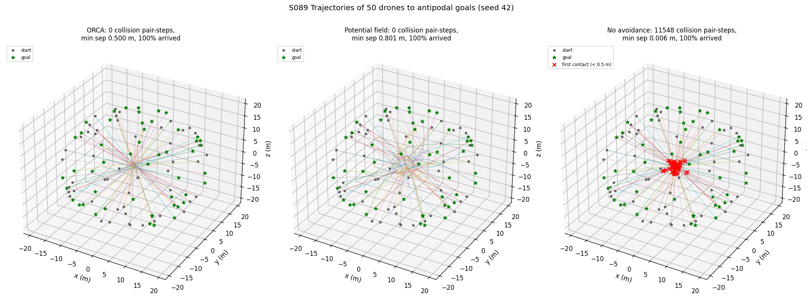
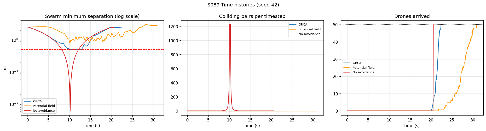
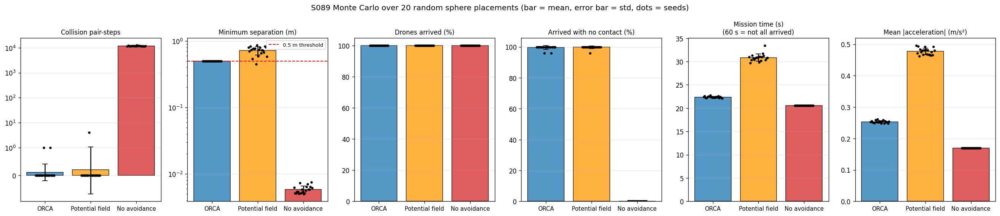
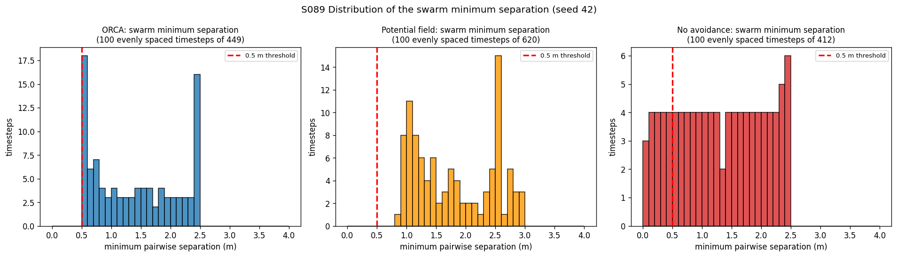
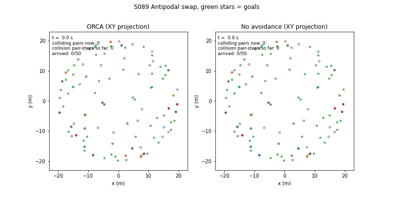

# S089 Large-Scale Swarm Collision Avoidance Test

**Domain**: Special Ops & Entertainment | **Difficulty**: ⭐⭐⭐⭐ | **Status**: ✅ Completed

---

## Problem Definition

**Setup**: 50 drones start at random points on a sphere of radius 20 m and each flies to its **antipodal** point. Every straight path goes through the centre, and at the preferred speed of 2 m/s all drones reach the centre at about t = 10 s: the worst possible traffic jam. A drone has a body radius of 0.25 m, so two drones collide when they are closer than 0.5 m. A drone has arrived when it is within 0.5 m of its goal.

**Strategies** (same start positions for each strategy, 20 random placements):
1. **No avoidance**: fly straight to the goal.
2. **Potential field**: goal attraction plus inverse-distance repulsion from neighbours within 5 m.
3. **ORCA**: Optimal Reciprocal Collision Avoidance in 3D (RVO2-3D half-planes and linear program).

**Objective**: all drones arrive with zero collisions. Secondary metrics: mission time, mean acceleration (smoothness), ORCA activity.

---

## Mathematical Model Summary

### Shared vehicle model

Point mass with velocity commands. Every strategy produces a commanded velocity; the change per step is limited to $a_{max}\,\Delta t$ and the speed to $v_{max}$ (both checked with `assert`). The goal-seeking preferred velocity is the same for all strategies:

$$\mathbf{v}_i^{goal} = \min\!\left(v_{pref},\ \frac{d_i}{T_{arr}}\right) \frac{\mathbf{g}_i - \mathbf{p}_i}{d_i}, \qquad d_i = \|\mathbf{g}_i - \mathbf{p}_i\|,\ T_{arr} = 1 \text{ s}$$

Drones that have arrived stay in the simulation and keep holding their goal (they remain neighbours for the others).

### ORCA

For each neighbour within $R_{nb} = 10$ m, the velocity obstacle with horizon $\tau = 3$ s is a cone with apex $\mathbf{v}_B$, half-angle $\arcsin(2r/\|\mathbf{p}_A - \mathbf{p}_B\|)$, truncated by the sphere of radius $2r/\tau$ around $\mathbf{v}_B + (\mathbf{p}_B - \mathbf{p}_A)/\tau$. With $\mathbf{u}$ the smallest relative-velocity change that leaves it and $\hat{\mathbf{n}}$ its direction, drone $A$ must satisfy

$$\hat{\mathbf{n}}_{A|B} \cdot \bigl(\mathbf{v} - \mathbf{v}_A - \tfrac12 \mathbf{u}_{A|B}\bigr) \ge 0 .$$

The new velocity is the point nearest $\mathbf{v}^{goal}$ that satisfies all half-spaces and $\|\mathbf{v}\| \le v_{max}$, found with the exact incremental LP of RVO2-3D; when it is infeasible, linearProgram 4 minimises the largest violation.

### Potential field

$$\mathbf{a}_i = k_{att}\,(\mathbf{v}_i^{goal} - \mathbf{v}_i) + \sum_{j:\,d_{ij} < d_{rep}} k_{rep}\left(\frac{1}{d_{ij}} - \frac{1}{d_{rep}}\right)\frac{1}{d_{ij}^2}\,\frac{\mathbf{p}_i - \mathbf{p}_j}{d_{ij}}$$

then $\mathbf{v} \leftarrow \mathbf{v} + \mathbf{a}\,\Delta t$, with $|\mathbf{a}| \le a_{max}$ and $|\mathbf{v}| \le v_{max}$.

### Metrics

- **Collision pair-steps**: number of (unordered pair, timestep) combinations with separation < 0.5 m. Drones are not destroyed by a collision, so the count keeps growing while two drones overlap.
- **Arrived with no contact**: share of drones that reach the goal before ever being closer than 0.5 m to another drone (a crash-aware arrival rate).
- **Mission time**: last arrival time (60 s if some drone has not arrived).
- **Mean |acceleration|**: $\frac{1}{N T_{steps}} \sum \|\Delta\mathbf{v}\|/\Delta t$ over the mission.
- **ORCA active rate**: share of agent-steps in which the LP had to change $\mathbf{v}^{goal}$.

---

## Key Parameters

| Parameter | Value |
|-----------|-------|
| Drones $N$ | 50 |
| Sphere radius $R_{sphere}$ | 20 m |
| Body radius $r$ / collision distance $2r$ | 0.25 m / 0.5 m |
| Minimum start separation (`FORMATION_DIST`) | 2.0 m (rejection sampling, also between goals) |
| Preferred speed $v_{pref}$ / speed cap $v_{max}$ | 2.0 / 3.0 m/s |
| Acceleration limit $a_{max}$ | 5.0 m/s² (all strategies) |
| Arrival taper $T_{arr}$ (added) | 1.0 s |
| ORCA horizon $\tau$ | 3.0 s |
| Neighbour radius $R_{nb}$ | 10 m |
| Time step $\Delta t$ / limit $T_{max}$ | 0.05 s / 60 s |
| Goal radius $d_{goal}$ | 0.5 m |
| PF repulsion radius $d_{rep}$ / gain $k_{rep}$ | 5.0 m / 5.0 m³/s² |
| PF attraction gain $k_{att}$ | 1.0 s⁻¹ (velocity tracking) |
| Seeds | 42 (figures); Monte Carlo 42–61 (20 placements) |

---

## Implementation

```
src/05_special_entertainment/s089_collision_avoidance.py   # Main simulation script
```

```bash
conda activate drones
python src/05_special_entertainment/s089_collision_avoidance.py
```

Runtime ≈ 3–3.5 min (183 and 209 s measured while other jobs shared the CPU).

---

## Results

Seed 42: the closest pair of start points is 2.500 m apart (8 candidate points were rejected for being closer than 2.0 m). A straight flight takes 20.0 s at $v_{pref}$, and the straight paths all pass the centre at t ≈ 10.0 s.

### Seed 42

| Strategy | Collision pair-steps | Drones ever in contact | Min separation | Arrived (no contact) | Mission time | Mean time-to-goal | Mean \|accel\| |
|----------|---:|---:|---:|---:|---:|---:|---:|
| **ORCA** | **0** | 0/50 | 0.50000 m | 100.0% (100.0%) | 22.40 s | 21.42 s | 0.252 m/s² |
| Potential field | 0 | 0/50 | 0.80074 m | 100.0% (100.0%) | 30.95 s | 27.48 s | 0.495 m/s² |
| No avoidance | 11548 (80 timesteps) | 50/50 | 0.00625 m | 100.0% (0.0%) | 20.55 s | 20.55 s | 0.170 m/s² |

ORCA changed the preferred velocity in 23.9% of agent-steps; the LP was infeasible in 654 agent-steps. The acceleration limit bound in 1.7% of agent-steps for ORCA and no avoidance and in 0.0% for the potential field.

### Monte Carlo, 20 placements (mean ± std)

| Strategy | Collision pair-steps | Seeds with 0 | Min separation (worst) | Arrived / no contact | Mission time | Mean time-to-goal | Mean \|accel\| |
|----------|---:|---:|---:|---:|---:|---:|---:|
| **ORCA** | **0.1 ± 0.3** | 18/20 (max 1) | 0.50000 ± 0.00000 m (0.49999) | 100.0% / 99.6 ± 1.2% | **22.38 ± 0.17 s** | 21.32 ± 0.08 s | **0.253 ± 0.004** |
| Potential field | 0.2 ± 0.9 | 19/20 (max 4) | 0.71605 ± 0.10557 m (0.44818) | 100.0% / 99.8 ± 0.9% | 30.86 ± 0.75 s | 27.04 ± 0.41 s | 0.477 ± 0.010 |
| No avoidance | 11796.9 ± 252.9 | 0/20 (max 12504) | 0.00585 ± 0.00075 m (0.00501) | 100.0% / 0.0 ± 0.0% | 20.55 ± 0.00 s | 20.55 ± 0.00 s | 0.170 ± 0.000 |

ORCA: active in 23.7 ± 0.8% of agent-steps, infeasible LP in 754.1 ± 97.9 agent-steps per run. Paired per seed: ORCA has fewer collision pair-steps than the potential field in 1/20 seeds and the same in 18/20; both have fewer than no avoidance in 20/20 seeds; ORCA finishes earlier than the potential field in 20/20 seeds.

**Key findings**:
- **ORCA almost meets the zero-collision goal.** 18 of 20 placements have no collision at all. In each of the other two, one pair was at 0.49999 m for one timestep (about 0.01 mm inside the threshold). ORCA holds the swarm right on the 0.5 m boundary while it crosses the centre, so these are discretisation and infeasible-LP effects of that size, not real crashes. A small safety margin in the ORCA radius should remove them; this was not tested (Extension 1).
- **No avoidance is a mass collision.** All 50 drones touch another drone (11796.9 ± 252.9 pair-steps, closest pair 0.005 m). In this ghost-through kinematic model they still reach the goal in 20.55 s, but none of them without contact.
- **The potential field is safer than the card expects, but slow.** With the shared acceleration limit and velocity-tracking attraction it had collisions in only 1 of 20 placements (4 pair-steps, closest 0.448 m) and every drone arrived. It pays in time and smoothness: mission time 30.86 vs 22.38 s for ORCA, and almost twice the mean acceleration (0.477 vs 0.253 m/s²). Repulsion spreads the jam out in time: in the seed-42 timeline (read from the figure) the potential-field minimum separation stays around 1 m from about 9 to 24 s, and arrivals are spread over roughly 22–31 s (last arrival 30.95 s, printed).
- **ORCA costs only 1.83 s over a straight flight** (22.38 vs 20.55 s mission time) and is smoother than the potential field, matching the card's "ORCA smoothest among the avoiding strategies".

**Card expectations that did not hold**:

| Card expectation | Result |
|------------------|--------|
| ORCA collision count 0 | 0 in 18/20 placements; 1 pair-step (0.49999 m) in 2/20 |
| ORCA mission time ~25–35 s | 22.38 ± 0.17 s |
| Potential field ~15–40 collisions, min separation ~0.1–0.4 m, ~60–85% arrived | 0.2 ± 0.9 pair-steps, min separation 0.71605 ± 0.10557 m, 100% arrived |
| No avoidance ~200–500 collisions, < 0.05 m, mission ~10 s, ~20–50% arrived | 11796.9 ± 252.9 pair-steps, 0.00585 m, 20.55 s, 100% arrived but 0% without contact. A 40 m flight at 2 m/s cannot take 10 s (card note added). |
| Mean \|accel\|: no avoidance lowest, ORCA lowest among avoiders | Holds: 0.170 < 0.253 < 0.477 m/s² |

The potential-field gap is partly the baseline design: this version shares the acceleration limit, the speed cap of the goal term ($v_{pref}$) and a damped (velocity-tracking) attraction with the other strategies. The card's undamped spring $k_{att}(\mathbf{g} - \mathbf{p})$ at 40 m distance would saturate at $a_{max}$, cruise at $v_{max} = 3$ m/s and oscillate around the goal, which is a weaker but also unfair baseline (see Deviations).

### 3D Trajectories

Seed 42. Grey dots = start, green stars = goals, red crosses = where a drone first came within 0.5 m of another:



### Time Histories

Seed 42: swarm minimum separation (log scale, red dashed = 0.5 m), colliding pairs per timestep, and number of drones arrived:



### Monte Carlo Comparison



### Separation Histogram

Swarm minimum separation at 100 evenly spaced timesteps of each seed-42 run. No avoidance spends roughly a fifth of its samples below 0.5 m (the 80 collision timesteps out of 412); ORCA piles up just above the threshold while the drones pass the centre:



### Animation

Seed 42, XY projection, ORCA (left) and no avoidance (right) side by side, 113 frames at 20 fps (every 4th step, until the ORCA run ends at 22.4 s):



### Deviations from the scenario card

| Card | Implementation | Reason |
|------|----------------|--------|
| ORCA LP: greedy constraint processing, falls back to zero velocity when a candidate violates an earlier constraint | Exact RVO2-3D incremental LP (linearProgram 1–3) with the linearProgram 4 relaxation when infeasible; neighbours ordered by distance | Matches the card's maths; the card code's zero-velocity fallback is not ORCA. |
| No acceleration limit for ORCA and no avoidance | $a_{max} = 5$ m/s² for every strategy | Physical sanity and a fair comparison (the card already limits the potential field). |
| PF attraction $k_{att}(\mathbf{g} - \mathbf{p})$ | $k_{att}(\mathbf{v}^{goal} - \mathbf{v})$ | The spring form is undamped: it saturates at $a_{max}$, cruises at 3 m/s while the others fly at 2 m/s, and oscillates around the goal. The velocity-tracking form is the same attraction with damping and the same cruise speed. |
| Preferred velocity $v_{pref}\,\hat{\mathbf{e}}_{goal}$; arrived drones set to zero velocity and dropped from the neighbour sets | Speed tapers as $d/T_{arr}$ near the goal; arrived drones keep holding their goal and stay neighbours | Avoids instantaneous stops and drones that become invisible to the others. |
| Random start points | Rejection sampling with 2.0 m minimum separation (`FORMATION_DIST`, unused in the card) between starts and between goals | With uniform sampling the expected number of start pairs closer than 0.5 m is about 0.19 (1225 pairs × cap fraction 1.6·10⁻⁴), so some placements would start in collision. |
| Single run | 20 placements with common random numbers | Results depend on the placement. |
| Collision count over "ordered pairs" (maths) vs unordered pairs (code) | Unordered pairs, plus "arrived with no contact" | Card maths corrected to match its code. Collided drones are not removed, so arrival alone cannot show crashes. |
| VO "apex at $\mathbf{v}_B + (\mathbf{p}_A - \mathbf{p}_B)/\tau$" | Apex $\mathbf{v}_B$; truncation sphere centred at $\mathbf{v}_B + (\mathbf{p}_B - \mathbf{p}_A)/\tau$ | From the VO definition, $(\mathbf{v}_A - \mathbf{v}_B)t$ must reach $\mathbf{p}_B - \mathbf{p}_A$; card corrected. |
| Start = green dots, goals = red stars; separate `trajectories_orca.png` / `trajectories_none.png`, `orca_animation.gif` | Start grey, goals green (repository colour convention: target green); one three-panel `trajectories_3d.png`; side-by-side `animation.gif`; added `timeline.png` | Conventions and a direct visual comparison. |

---

## Extensions

1. **Safety margin**: inflate the ORCA radius by 1–5 cm and measure the cost in mission time of removing the residual 10 µm contacts.
2. **Density scaling**: sweep $N \in \{10, 20, 50, 100, 200\}$ at $R = 20$ m and find where infeasible LPs turn into real collisions.
3. **K-nearest neighbours**: limit ORCA to the $K$ nearest drones ($K = 3, 5, 10, 20$) to trade communication for safety.
4. **Static pillars** in the centre as non-reciprocal agents (full instead of half responsibility).
5. **Deadlock test**: put all drones on a circle in one plane, where ORCA can deadlock, and add random perturbations.

---

## Related Scenarios

- Prerequisites: [S085 Drone Light Matrix Positioning](../../../scenarios/05_special_entertainment/S085_light_matrix.md), [S088 Formation Geometric Shape Morphing](../../../scenarios/05_special_entertainment/S088_formation_morphing.md)
- Follow-ups: [S098 Swarm Synchronized Dance](../../../scenarios/05_special_entertainment/S098_synchronized_dance.md)
- Cross-reference: [S009 Differential Game 1v1 (Differential Game — Lion & Man)](../../../scenarios/01_pursuit_evasion/S009_differential_game.md), [S070 Swarm Weeding Task](../../../scenarios/04_industrial_agriculture/S070_swarm_weeding.md), [S008 Stochastic Pursuit — Kalman Filter Tracking](../../../scenarios/01_pursuit_evasion/S008_stochastic_pursuit.md)
