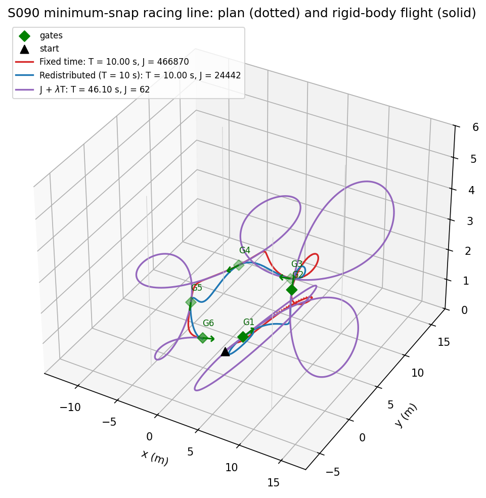
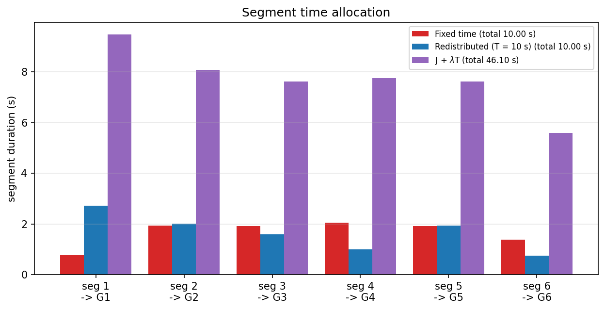
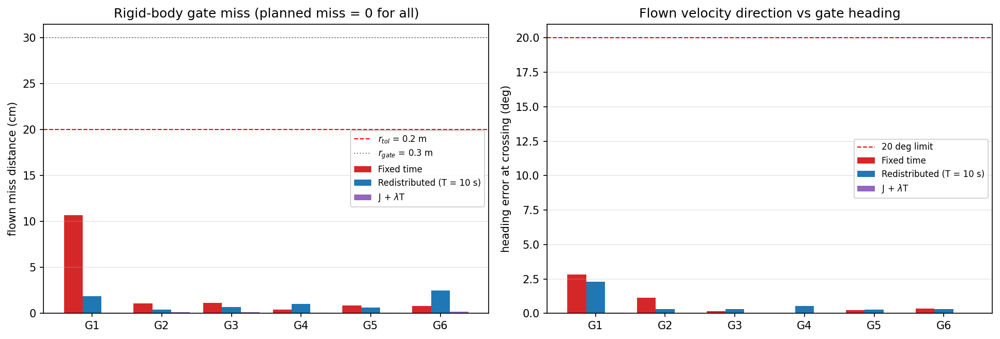
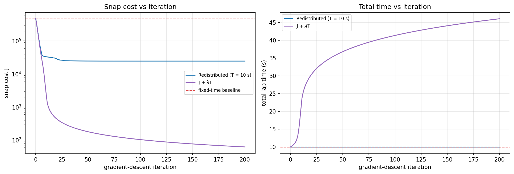
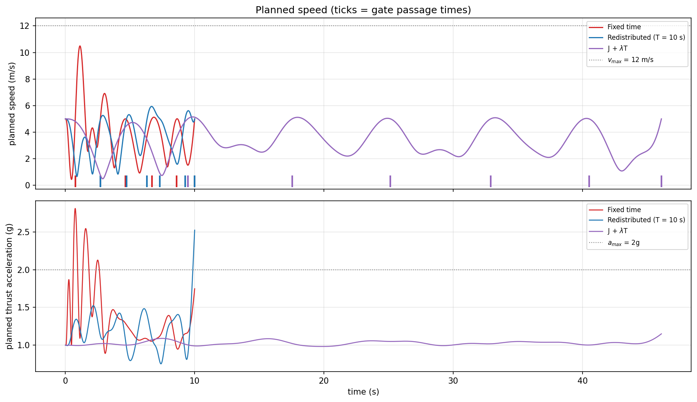
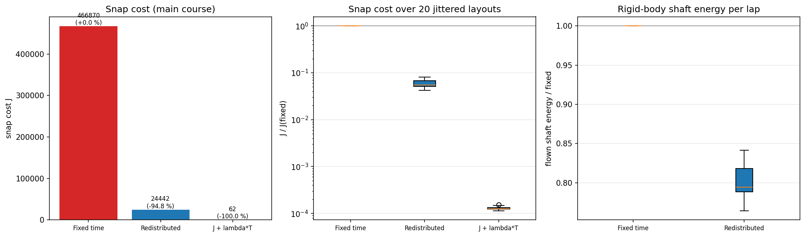
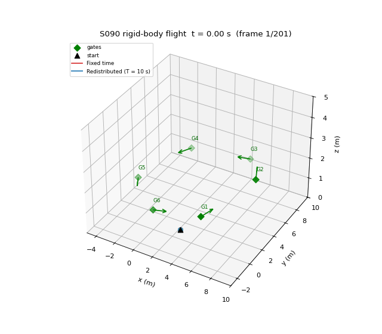

# S090 Racing Drone Optimal Path

**Domain**: Special Ops & Entertainment | **Difficulty**: ⭐⭐⭐⭐ | **Status**: ✅ Completed

---

## Problem Definition

**Setup**: A racing drone must pass 6 gates in order (the card's fixed layout). It must cross each gate centre at $v_{gate}$ = 5 m/s along the gate heading $\hat{\mathbf{h}}_i$. It starts 2 m in front of gate 1, already flying at 5 m/s along $\hat{\mathbf{h}}_1$. The path is a degree-7 minimum-snap polynomial per segment, $C^3$ at the gates. A gate is **passed** if the drone crosses the gate plane within $r_{tol}$ = 0.2 m of the centre with its velocity within 20° of the heading. Limits: $v_{max}$ = 12 m/s and thrust acceleration ≤ 2g.

**Time allocations compared** (the card's three):
1. **Fixed time**: segment durations proportional to distance, total 10 s.
2. **Redistributed** (proposed): projected gradient descent on the snap cost $J$ with the total held at 10 s.
3. **J + λT**: gradient descent on $J + \lambda T_{total}$ with λ = 0.5.

**How the plans are judged.** Every plan passes every gate exactly by construction: the gate positions and velocities are equality constraints, so the planned miss is about 10⁻¹² m. Planned gate miss is therefore not a useful comparison (X3). Each plan is instead **flown** by the 6-DOF rigid body ([`src/base/rigid_body_drone.py`](../../../src/base/rigid_body_drone.py), `fpv_5inch` preset) with a differential-flatness feed-forward cascade. The flights measure gate miss, heading error, tracking error, shaft energy and rotor activity, which tests the card's claim that snap is "a proxy for rotor wear and battery consumption". The ideal point mass is the baseline: it would fly every plan with zero error. A 20-layout robustness study, with gates jittered by up to 0.5 m per axis, checks that the conclusions are not specific to one course.

---

## Mathematical Model Summary

### Minimum-snap QP

Per axis, minimise $J = \sum_i \mathbf{c}_i^\top\mathbf{Q}(T_i)\mathbf{c}_i$ with $Q_{jk}(T) = \frac{j!\,k!}{(j-4)!(k-4)!}\frac{T^{j+k-7}}{j+k-7}$ ($j, k \ge 4$), subject to:
- position and velocity ($v_{gate}\hat{\mathbf{h}}_i$) fixed at both ends of every segment;
- acceleration and jerk continuous at the 5 interior gates;
- zero acceleration and jerk at the start; free acceleration and jerk at the last gate.

The QP is solved exactly through its KKT system: 48 unknowns and 36 constraints per axis.

### Time-allocation gradient

The exact $\partial J/\partial T_i$ comes from central differences ($\epsilon = 10^{-6}$ s, 12 QP solves per gradient). The card's "dominant" explicit term $\mathbf{c}^\top\partial\mathbf{Q}/\partial T\,\mathbf{c}$ is printed for comparison.

- Redistribution: $\nabla^\perp J = \nabla J - \overline{\nabla J}$; then $T \leftarrow \max(T - s\nabla^\perp J, T_{min})$, renormalised to 10 s.
- Joint: $T \leftarrow \max(T - s(\nabla J + \lambda), T_{min})$.

The step $s$ starts at the card's $\eta = 10^{-3}$. It is capped so that no segment changes by more than 20 % per iteration, then halved until the Armijo condition $f_{new} \le f - 10^{-4}s\|g\|^2$ holds. Both modes run for 200 iterations.

### Flatness-based tracking (rigid body)

The reference $(\mathbf{p}, \mathbf{v}, \mathbf{a}, \mathbf{j})$ comes analytically from the polynomials. The cascade is a position P loop plus a velocity PI loop with velocity and acceleration feed-forward, followed by a thrust vector, a quaternion attitude P loop and a body-rate PI loop. Body-rate feed-forward comes from the jerk: $\dot{\mathbf{z}} = (\mathbf{I} - \mathbf{z}\mathbf{z}^\top)\mathbf{j}/\|\mathbf{a} + g\mathbf{e}_3\|$, $\omega_x = -\mathbf{y}_b\cdot\dot{\mathbf{z}}$, $\omega_y = \mathbf{x}_b\cdot\dot{\mathbf{z}}$. Control and RK4 physics run at 500 Hz with a 15 ms motor lag. The drone starts on the reference at 5 m/s.

### Flown metrics

- **Gate miss and heading error**: the first forward crossing of the gate plane within 1 m of the centre (the first one inside the 0.3 m opening if there are several). Miss is the distance from the centre; heading error is the angle between the velocity and $\hat{\mathbf{h}}_i$.
- **Tracking error**: RMS and maximum.
- **Shaft energy**: $\int k_m\sum\omega_i^3\,dt$.
- **Rotor activity**: the RMS of $d\omega_i/dt$ (rad/s²), a wear proxy.
- **Snap as a predictor**: the Spearman rank correlation of $J$ with mean shaft power, rotor activity and tracking error, computed both pooled over all 40 robustness flights and within each allocation group (20 layouts each). The two groups differ in $J$ by about 17×, so a pure group split already produces a large pooled correlation. Its baseline (effort ranked by group only, random within groups, 2000 permutations) is printed.

---

## Key Parameters

| Parameter | Value |
|-----------|-------|
| Gates | 6, card positions and headings |
| Gate radius / tolerance / heading limit | 0.3 m / 0.2 m / 20° |
| Gate speed $v_{gate}$ | 5 m/s |
| Start | 2 m before gate 1, at 5 m/s along $\hat{\mathbf{h}}_1$ |
| $v_{max}$ / thrust-acceleration limit | 12 m/s / 2g (checked on the plans) |
| Initial total time | 10 s, split proportionally to segment length |
| $T_{min}$ / η / iterations / λ | 0.2 s / 10⁻³ / 200 / 0.5 (card) |
| Line search | trust region 20 % per segment, Armijo constant 10⁻⁴ |
| Gradient | central differences, ε = 10⁻⁶ s |
| Rigid body | `fpv_5inch` (0.6 kg, T/W 6.12, motor time constant 15 ms), tilt limit 89°, rate-setpoint clip 15 rad/s, 500 Hz |
| Plane-crossing search radius | 1 m |
| Robustness | 20 layouts, gates jittered by U(−0.5, 0.5) m per axis (gate height ≥ 0.8 m), seeds 0–19 |

---

## Implementation

```
src/base/rigid_body_drone.py                 # 6-DOF rigid-body model (shared)
src/05_special_entertainment/s090_racing_optimal.py
```

```bash
conda activate drones
python src/05_special_entertainment/s090_racing_optimal.py
```

Runtime ≈ 260–400 s with about 10 other simulations sharing the 12-thread machine (measured 262–354 s here, 321–399 s by the reviewer); below the 8 min risk mark.

---

## Results

**Gradient check at the fixed allocation** (segments 1–6):

| | seg 1 | seg 2 | seg 3 | seg 4 | seg 5 | seg 6 |
|---|---:|---:|---:|---:|---:|---:|
| Fixed segment times (s) | 0.762 | 1.943 | 1.924 | 2.058 | 1.924 | 1.387 |
| Exact $\partial J/\partial T_i$ | −1298026.7 | −133030.7 | −15318.4 | −4046.5 | −6186.1 | −2893.4 |
| Card's "dominant" term | 461014.7 | 16448.8 | 2461.5 | 1210.9 | 315.6 | −0.0 |

The card's term has the opposite sign to the exact gradient on 5 of 6 segments. On segment 6 it is about 0 (−8.4·10⁻¹¹), because the snap vanishes at the free end of the trajectory. With the card's step η = 10⁻³ the first projected step would change a segment by 1054.776 s.

**Plans and rigid-body flights (main course):**

| | Fixed time | **Redistributed** | J + λT |
|---|---:|---:|---:|
| Total time $T$ | 10.000 s | 10.000 s | 46.100 s |
| Snap cost $J$ | 466870.1 | **24442.0 (−94.8 %)** | 61.8 (−100.0 %) |
| Segment times (s) | 0.762, 1.943, 1.924, 2.058, 1.924, 1.387 | 2.723, 2.005, 1.592, 0.996, 1.943, 0.742 | 9.466, 8.070, 7.610, 7.748, 7.611, 5.596 |
| Plan: max speed | 10.49 m/s | 5.94 m/s | 5.15 m/s |
| Plan: max thrust acceleration | **2.81 g** | **2.53 g** | 1.15 g |
| Plan: min height | 1.00 m | 1.00 m | 0.82 m |
| Flown: gates passed | 6/6 | 6/6 | 6/6 |
| Flown: miss per gate (cm) | 10.7, 1.1, 1.2, 0.4, 0.9, 0.8 | 1.9, 0.4, 0.7, 1.1, 0.7, 2.5 | 0.1, 0.1, 0.1, 0.1, 0.1, 0.2 |
| Flown: heading error (deg) | 2.8, 1.1, 0.2, 0.0, 0.2, 0.3 | 2.3, 0.3, 0.3, 0.5, 0.3, 0.3 | 0.0 at all gates |
| Tracking RMS / max | 3.2 / 12.7 cm | 1.0 / 2.7 cm | 0.2 / 0.6 cm |
| Shaft energy | 1143.0 J | **901.5 J** | 3246.8 J |
| Rotor-speed rate RMS | 1934 rad/s² | 666 rad/s² | 43 rad/s² |
| Max rotor speed / max $\|\omega\|$ / max tilt | 70.3 % / 15.69 rad/s / 69.4° | 65.2 % / 3.84 rad/s / 47.7° | 43.7 % / 0.52 rad/s / 29.9° |

The redistribution needed 1270 backtracking halvings over its 200 iterations. The J + λT objective went from 466875.1 to 84.8; at the end λT contributes 23.05 of the 84.8, and the objective is still falling by 0.204 per iteration after 200 iterations. The mixer had to desaturate in 14 control steps.

**When does J + λT shorten the lap?** Along uniform time scaling, $dJ/dT_{total}$ is −130174 per second for the fixed allocation and −9715 per second for the redistributed one. J + λT prefers a shorter lap only if λ is larger than these values. The card's λ = 0.5 is 4–5 orders of magnitude too small.

**Robustness, 20 jittered layouts:**

| Allocation | $J/J_{fixed}$ | $T$ | Flown gates | Miss mean / max | Energy / fixed | Rotor-rate RMS |
|------------|---:|---:|---:|---:|---:|---:|
| Fixed time | 1.000 ± 0.000 | 10.00 s | 6.00/6 (all 20) | 2.5 / 10.9 cm | 1.000 | 1944 rad/s² |
| **Redistributed** | **0.059 ± 0.011** (lower on 20/20) | 10.00 s | 6.00/6 (all 20) | 1.2 / 4.1 cm | **0.803 ± 0.021** (lower on 20/20) | 723 rad/s² |
| J + λT | 0.0001 ± 0.0000 | 46.1 ± 0.1 s | planned only | — | — | — |

Spearman rank correlation of $J$ with flown effort:

| | Mean shaft power | Rotor-speed rate RMS | Tracking RMS |
|---|---:|---:|---:|
| Pooled, 40 flights ($J$ differs about 17× between the groups) | +0.80 | +0.94 | +0.92 |
| Within fixed time (20 layouts) | −0.29 | +0.85 | +0.79 |
| Within redistributed (20 layouts) | +0.68 | +0.63 | +0.61 |

The pooled baseline from the group split alone is +0.75 (95th percentile +0.82, 2000 permutations).

**Key findings**:
- **Redistribution is a large, free improvement.** At the same 10 s lap it lowers $J$ by 94.8 % on the main course and by 94.1 % on average over 20 layouts (lower on 20/20), far beyond the card's "≥ 15 %". The uniform allocation gives the first, 2 m segment only 0.762 s while it must bend onto gate 1's heading. The optimiser stretches it to 2.723 s and takes the time from the straighter runs to G4 and G6.
- **Lowering snap saves energy here, but snap is a reliable proxy only for rotor activity and tracking error.** The paired comparison is clear. Flown on the rigid body, the redistributed plan uses 19.7 % less shaft energy per lap (0.803 ± 0.021, lower on 20/20 layouts). It also cuts the rotor-speed rate RMS from 1944 to 723 rad/s² and the tracking error from 3.2 to 1.0 cm RMS. The pooled correlations (+0.80 power, +0.94 rotor activity, +0.92 tracking) mostly reflect the 17× gap in $J$ between the two groups; the group split alone already gives +0.75. Within each group, $J$ still ranks rotor activity (+0.85 / +0.63) and tracking error (+0.79 / +0.61). For power the within-group correlation is inconsistent: −0.29 among the fixed-time laps and +0.68 among the redistributed ones. The card's "rotor wear" motivation holds; its "battery consumption" motivation holds for this paired comparison but not as a general ranking.
- **Planned gate miss cannot tell the plans apart; flown miss shows only small differences.** Both 10 s plans pass all 6 gates on all 20 layouts. The fixed plan's worst miss is 10.7 cm at G1 on the main course (10.9 cm over the layouts), still inside $r_{tol}$. The rigid body follows the fixed plan through a 2.81 g, 15.69 rad/s entry without missing a gate, because the `fpv_5inch` airframe has T/W 6.12.
- **Neither 10 s plan respects the card's 2g limit** (2.81 g and 2.53 g). The redistributed plan's peak is the free end acceleration at the last gate (speed profile below). The card's expectation that both stay within the limits does not hold. Both stay under $v_{max}$ = 12 m/s (10.49 and 5.94 m/s).
- **J + λT does the opposite of what the card claims.** With λ = 0.5 the descent lengthens the lap from 10 s to 46.100 s after 200 iterations, and it is still lengthening it. It removes almost all snap ($J$ = 61.8), but at 4.6× the lap time and 2.8× the energy (3246.8 J, mostly hover power). The slow plan also loops around between gates (3D plot). A shorter lap needs λ > 9715–130174 (card corrected).
- **The card's gradient formula would not work.** The "dominant" explicit term has the opposite sign to the exact gradient on 5 of 6 segments (on the sixth it is about 0), because the coefficients change with $T_i$ and that dependence dominates. The fixed step η = 10⁻³ would move a segment by about 1000 s in one iteration. The exact gradient and a line search are required (card corrected).

### 3D Trajectory

Plans (dotted) and rigid-body flights (solid). Green diamonds and arrows mark the gates and their headings. The J + λT plan (purple) makes large loops to spend 46 s while still crossing every gate at 5 m/s:



### Segment Time Allocation



### Gate Miss and Heading Error (flown)



### Snap Cost Convergence

Left: $J$ against iteration (log scale) with the fixed-time baseline. Right: total lap time. The redistribution converges within about 50 iterations (read from the figure); J + λT keeps lengthening the lap:



### Speed Profile

Planned speed (ticks = gate passage times) and planned thrust acceleration against the 2g line:



### Snap Summary

Left: $J$ on the main course. Centre: $J/J_{fixed}$ over the 20 jittered layouts (log scale). Right: flown shaft energy relative to the fixed plan:



### Animation

Rigid-body flights of the fixed-time plan (red) and the redistributed plan (blue), shown together. 201 frames at 20 fps:



### Deviations from the scenario card

| Card | Implementation | Reason |
|------|----------------|--------|
| "3D point-mass with quadrotor dynamics" | Plans flown by the 6-DOF rigid body; the ideal point mass (zero error) is the baseline | Planned gate miss is zero by construction (X3). Flying the plans tests the snap-as-effort claim. |
| Per-segment solve with acceleration and jerk fixed to 0 at every gate (card code) | One QP per axis: position and velocity fixed, acceleration and jerk free and continuous (the card's text: $C^3$ continuity, minimum snap) | With all 8 boundary values fixed there is nothing left to optimise, so the card code is not minimum-snap. |
| Gradient = explicit $\partial\mathbf{Q}/\partial T$ term (finite differences in the card code) | Exact central-difference gradient; the explicit term is printed only for comparison (card corrected) | The explicit term has the opposite sign on 5 of 6 segments and is about 0 on the sixth (printed). |
| Fixed step η = 10⁻³ | η is the initial step, capped by a 20 % trust region and halved by Armijo backtracking | The card step would move a segment by 1054.776 s in the first iteration. For J + λT it jumped straight to an absurdly long lap in a development run. |
| λ = 0.5 shortens the lap (card note) | Kept λ = 0.5 and reported that the lap gets longer; printed the λ needed to shorten it (card corrected) | X6/X7: verified numerically ($dJ/dT_{total}$ = −130174 and −9715 per s). |
| Gate miss = endpoint distance of the plan | Flown miss at the first forward gate-plane crossing within 1 m (inside the opening if possible), plus heading error | The planned miss is about 10⁻¹² m for every plan. The slow J + λT plan crosses some gate planes beside the gate before flying through it. |
| A 2g thrust limit (checked) | Reported as a planning check; the fpv airframe (T/W 6.12) can fly both 10 s plans | The card has no feasibility step. Adding one would change the card's comparison (see Extensions). |
| Single course | Added a 20-layout jitter study (seeds 0–19); J + λT is planned but not flown there | Generality check (X2); the 46 s laps would triple the runtime without adding information. |
| Animation of both drones, colours red/blue | Same; flown rigid-body trajectories | — |

---

## Sim2Real Notes

**Model assumptions.** The rigid body uses the `fpv_5inch` estimates: 0.6 kg, J = diag(1.4, 1.4, 2.4)·10⁻³ kg m², 9 N per motor at 30 krpm, a 15 ms motor lag, 8 % idle, and $k_m$ set from an assumed hover figure of merit of 0.6. Drag is linear at 0.05 kg/s. The model has no ground effect, no blade flapping, no battery sag and no state estimator; tracking uses the true state. The shaft-energy comparison is relative. A 19.7 % saving survives a wrong $k_m$ scale, but the absolute joules do not.

**What must be measured on the real airframe.**
- **Thrust stand**: $k_f$, $k_m$, $\omega_{max}$ and idle speed, and the electrical power against thrust, to turn shaft energy into battery mAh.
- **Motor time constant**: the fixed plan's 2.81 g entry is what stresses it, as shown by its 70.3 % rotor speed and 1934 rad/s² rotor activity.
- **Inertia** (trifilar pendulum) and **rate-loop bandwidth**, which set the 12.7 cm tracking error on the aggressive plan.
- **Gate geometry**: the 0.3 m opening against the measured miss distribution (1.2 cm mean, 4.1 cm worst for the redistributed plan).

**Path to PX4 / Betaflight SITL.**
1. Sample the polynomial at 100–250 Hz into $(\mathbf{p}, \mathbf{v}, \mathbf{a}, \mathbf{j}, \psi)$. In PX4, stream `TRAJECTORY_SETPOINT` in offboard mode (position, velocity, acceleration feed-forward; jerk enters as the body-rate feed-forward of the attitude controller). The flatness cascade used here matches PX4's position and attitude structure.
2. For Betaflight, compute the body-rate and collective-thrust sequence off-board from the same flatness map (`rate_ff` and thrust in `fly()`) and replay it in acro mode through MSP, closing the position loop on the companion computer.
3. In SITL, compare the flown rotor-speed rate RMS and energy of the fixed and redistributed plans with these numbers before flight. The ranking (redistributed better on 20/20 layouts) is the claim to verify, not the absolute values.

---

## Extensions

1. **Feasibility-constrained allocation** (card extension 1): add penalties for $\|\mathbf{a} + g\mathbf{e}_3\| \le 2g$ and $v \le v_{max}$ so that the redistributed plan also respects the card's thrust limit.
2. **Pareto front with a meaningful λ**: sweep λ from 10³ to 10⁶ to trace lap time against snap cost and flown energy.
3. **Free gate speeds**: let $v_{gate,i}$ be optimised too (card extension 6), which removes the loops of long plans.
4. **Gate-order search** (card extension 2) using the fast KKT solve (about 1 ms per plan).
5. **Online re-planning** in wind using the base model's gust model (card extension 4).

---

## Related Scenarios

- Prerequisites: [S085 Drone Light Matrix Positioning](../../../scenarios/05_special_entertainment/S085_light_matrix.md), [S091 Aerial Acrobatic Maneuvers](../../../scenarios/05_special_entertainment/S091_acrobatics.md)
- Follow-ups: [S091 Aerial Acrobatic Maneuvers](../../../scenarios/05_special_entertainment/S091_acrobatics.md), [S096 Drone Relay Race](../../../scenarios/05_special_entertainment/S096_relay_race.md)
- Same rigid-body model: [S082 FPV Racing Circuit](../../../scenarios/05_special_entertainment/S082_fpv_racing.md), [S084 Extreme Weather Wind Resistance Test](../../../scenarios/05_special_entertainment/S084_wind_endurance.md)
- Algorithmic cross-reference: [S077 Precision Pollination Flight Pattern](../../../scenarios/04_industrial_agriculture/S077_pollination.md), [S021 Point Delivery](../../../scenarios/02_logistics_delivery/S021_point_delivery.md)
