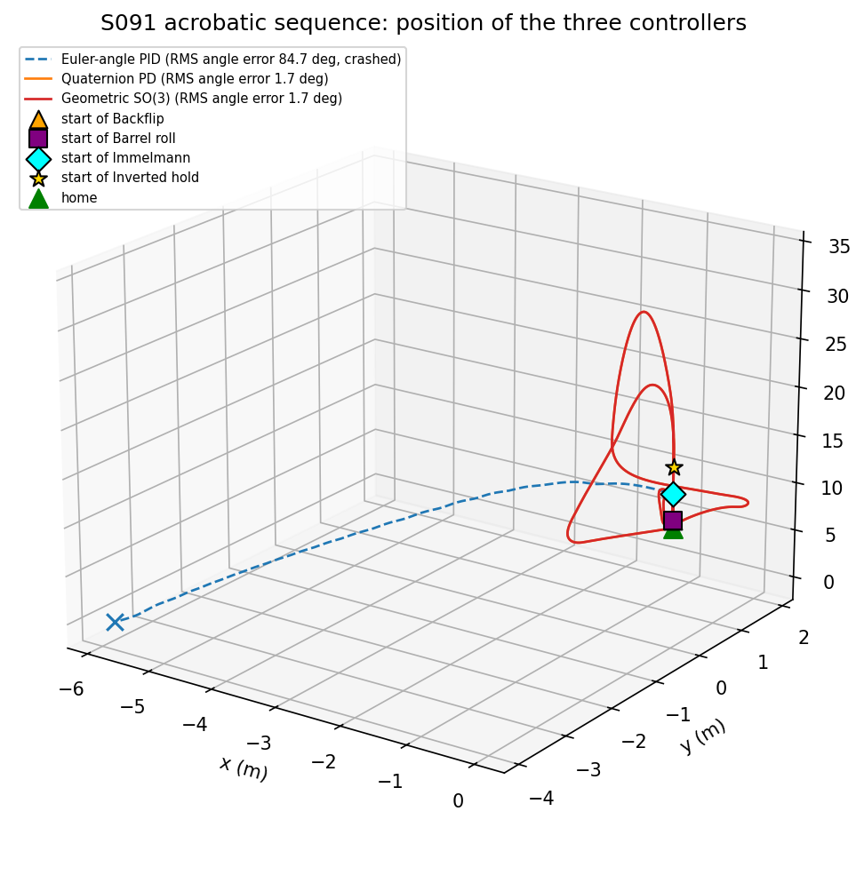
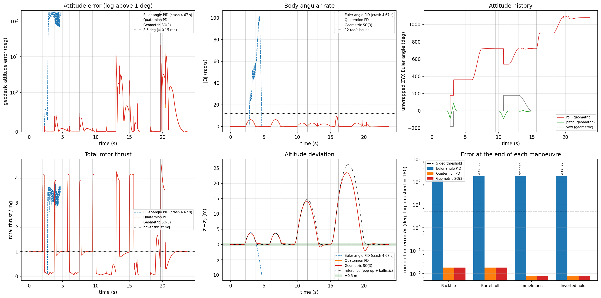
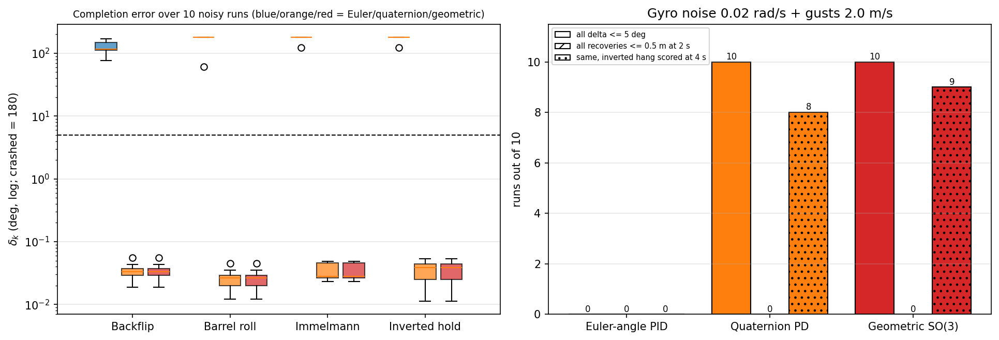
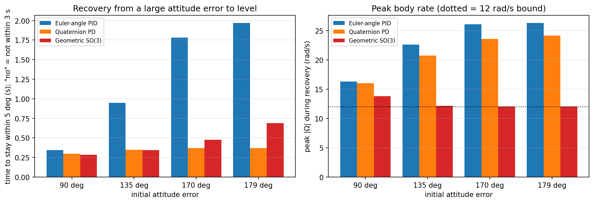
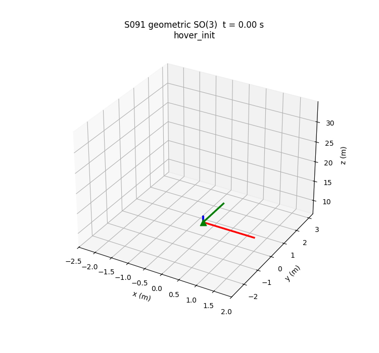

# S091 Aerial Acrobatic Maneuvers

**Domain**: Special Ops & Entertainment | **Difficulty**: ⭐⭐⭐⭐ | **Status**: ✅ Completed

---

## Problem Definition

**Setup**: A 0.5 kg quadrotor flies a timed aerobatic sequence around a home point at 10 m. The sequence is a **backflip** (360° pitch, 1.5 s), a **barrel roll** (360° roll, 1.5 s), an **Immelmann** (180° pitch-up half loop and 180° roll, 1.5 s each) and an **inverted hold** (flip to inverted in 0.5 s, hold 2 s, roll back in 1.5 s). A 2 s stabilisation pause follows each manoeuvre. All three controllers track the same attitude reference and share the same position controller, thrust law and rotor allocation:

1. **Euler-angle PID** (baseline): ZYX roll/pitch/yaw errors through a PID with a small-angle torque law.
2. **Quaternion PD**: error quaternion with shortest-path sign selection, plus the SO(3) feed-forward.
3. **Geometric SO(3)** (proposed): the Lee–Leok–McClamroch controller with attitude error $e_R$ and rate error $e_\Omega$.

**Plant**: the 6-DOF rigid body in [`src/base/rigid_body_drone.py`](../../../src/base/rigid_body_drone.py), with quaternion attitude, a first-order motor lag of 15 ms, rotor-speed limits and an airmode mixer. Mass, inertia and arm length are the card's. The rotor constants come from the `fpv_5inch` preset, because the card's rotor constants cannot lift the drone (see below).

**Targets (card)**: RMS attitude error ≤ 0.15 rad, peak body rate ≤ 12 rad/s, completion error $\delta_k$ ≤ 5° at the end of each manoeuvre, and position error ≤ 0.5 m after each pause.

---

## Mathematical Model Summary

### Dynamics

$$\dot p = v,\quad m\dot v = f R e_3 - mg\,e_3 + F_{drag},\quad \dot R = R\hat\Omega,\quad I\dot\Omega = \tau - \Omega\times I\Omega$$

Each rotor gives thrust $k_f\omega_i^2$ and reaction torque $k_m\omega_i^2$. Rotor speeds follow commands with time constant 15 ms and are limited to [8 %, 100 %] of $\omega_{max}$. The equations are integrated with RK4 at 5 ms, and the quaternion is renormalised every step.

### Attitude reference

Each manoeuvre is a rotation by a total angle $\theta$ about a body axis $\hat a$:

$$q_{ref}(t) = q_0 \otimes \bigl(\cos\tfrac{s\theta}{2}, \sin\tfrac{s\theta}{2}\hat a\bigr),\quad s = 3u^2 - 2u^3,\quad \Omega_{ref} = \dot s\,\theta\,\hat a,\quad \dot\Omega_{ref} = \ddot s\,\theta\,\hat a$$

The manoeuvres are: backflip $-2\pi$ about $y$ (nose up), barrel roll $+2\pi$ about $x$, Immelmann $-\pi$ about $y$ then $+\pi$ about $x$, and inverted hold $+\pi$ about $x$, hold, then $+\pi$ about $x$. After the Immelmann the drone faces backwards, and the geodesic back to level (a 180° yaw) runs during the pause. In the upright pauses the desired attitude comes from the position controller: $b_3 = a_{des}/\|a_{des}\|$ with the reference yaw. Here $a_{des}$ is limited to a minimum upward component of $0.3g$ and a tilt of at most 60°.

### Position controller and thrust (card)

$$a_{des} = -K_x(p - p_{ref}) - K_v(v - v_{ref}) + g e_3 + \ddot p_{ref},\qquad f = \mathrm{clip}(m\,a_{des}\cdot Re_3,\ 0,\ f_{max})$$

### The inverted hold is a ballistic hang

Rotors only push along $+z_b$. When inverted, $a_{des}\cdot Re_3 < 0$, so $f$ is clipped to 0 and the drone falls freely. Over 2 s it would drop 19.6 m. Any 2 s zero-thrust arc spans at least $gT^2/8$ = 4.91 m of altitude. Each manoeuvre is therefore flown as an FPV-style "punch-out and flip". A pop-up at $A_{pop}$ = 3g lasting $v_{up}/A_{pop}$ gives $v_{up} = gT_b/2$. The position reference then follows a zero-thrust arc for the manoeuvre duration $T_b$, falls back through the launch height at $v_{up}$, and brakes at 3g to rest exactly at home.

### Controllers (same $K_R$, $K_\Omega$ for all)

- **Geometric**: $e_R = \tfrac12(R_d^\top R - R^\top R_d)^\vee$, $e_\Omega = \Omega - R^\top R_d\Omega_d$,
  $\tau = -K_R e_R - K_\Omega e_\Omega + \Omega\times I\Omega - I(\hat\Omega R^\top R_d\Omega_d - R^\top R_d\dot\Omega_d)$.
- **Quaternion PD**: $q_e = q_d^{-1}\otimes q$, $\tau = -K_R\,2\,\mathrm{sgn}(q_{e,w})\,q_{e,v} - K_\Omega e_\Omega + $ the same feed-forward.
- **Euler PID**: $\eta$ = ZYX angles of $R$, and $\dot\eta = W(\eta)\Omega$, which is singular at pitch ±90°. The torque is
  $\tau = -K_R\,\mathrm{wrap}(\eta - \eta_d) - K_\Omega(\dot\eta - \dot\eta_d) - K_I\int\mathrm{wrap}(\eta - \eta_d) + \Omega\times I\Omega$.

### Metrics

- $\|e_R\|$ (card). Note that $\|e_R\| = \sin\theta_{err}$, so it saturates at 90° and returns to 0 at 180°. The script therefore also reports the geodesic angle $\theta_{err}$ between the commanded and actual attitude.
- $\delta_k$: geodesic angle at the last sample of manoeuvre $k$.
- Position error: distance from home 2 s after the manoeuvre ends.
- Crash: first ground contact. Later manoeuvres are not scored.

---

## Key Parameters

| Parameter | Value |
|-----------|-------|
| Mass / inertia | 0.5 kg / diag(4.9, 4.9, 8.8)·10⁻³ kg m² (card) |
| Arm length | 0.17 m (card) |
| Rotor constants | $k_f$ = 9.119·10⁻⁷ N s², $k_m$ = 8.24·10⁻⁹ N m s², $\omega_{max}$ = 3142 rad/s, idle 8 % (`fpv_5inch` estimates); T/W = 7.34 |
| Motor time constant | 15 ms |
| $K_R$ / $K_\Omega$ | diag(6, 6, 3) / diag(0.5, 0.5, 0.3) (card) |
| $K_x$ / $K_v$ | 4 / 3 (card) |
| Euler PID integral gain / clamp | diag(1, 1, 0.5) N m/(rad s) / 0.5 rad s |
| Time step | 0.005 s (card) |
| Home | (0, 0, 10) m |
| Manoeuvre durations | backflip 1.5 s, barrel roll 1.5 s, Immelmann 1.5 + 1.5 s, inverted 0.5 + 2.0 + 1.5 s |
| Pauses | 2 s (final hover simulated for 4 s, scored at 2 s) |
| Pop-up acceleration / ballistic durations | 3g / 1.5, 1.5, 3.0, 4.0 s |
| Upright-hold limits | $a_{des,z} \ge 0.3g$, tilt ≤ 60° |
| Targets | RMS $e_R$ ≤ 0.15 rad, $\|\Omega\|$ ≤ 12 rad/s, $\delta_k$ ≤ 5°, position ≤ 0.5 m |
| Robustness study | 10 seeds; gyro noise 0.02 rad/s; Gauss–Markov gusts 2 m/s, correlation time 1 s (same per seed for all controllers) |
| Large-error recovery test | initial error 90°, 135°, 170°, 179° about (1, 1, 0.3)/‖·‖, desired level, thrust $mg$ projected on body $z$, 3 s |

---

## Implementation

```
src/base/rigid_body_drone.py                 # 6-DOF rigid-body model (shared)
src/05_special_entertainment/s091_acrobatics.py
```

```bash
conda activate drones
python src/05_special_entertainment/s091_acrobatics.py
```

Runtime ≈ 80–140 s with about 10 other simulations sharing the 12-thread machine (measured 79–125 s here, 96–136 s by the reviewer).

---

## Results

**Card parameter check**: $k_f$ = 3.16·10⁻¹⁰ N s² at $\omega_{max}$ = 2000 rad/s gives a maximum total thrust of 5.06·10⁻³ N against a weight of 4.905 N (ratio 1.0·10⁻³). The card's $k_f$ is the Crazyflie value per RPM², so the `fpv_5inch` rotor constants are used instead (card corrected).

**Pop-ups**: the reference peaks at 3.68 m (backflip, barrel roll), 14.71 m (Immelmann) and 26.16 m (inverted hold) above home. The drone falls back through home altitude at 7.36, 7.36, 14.71 and 19.62 m/s respectively. Reference peak body rate 9.42 rad/s; sequence length 23.66 s.

**Nominal run (no noise):**

| Controller | Backflip $\delta$ | Barrel roll $\delta$ | Immelmann $\delta$ | Inverted $\delta$ | RMS $\|e_R\|$ | RMS angle error | Peak $\|\Omega\|$ | All targets |
|------------|-------:|-------:|-------:|-------:|------:|------:|------:|:---:|
| Euler-angle PID | 118.813° | crashed | crashed | crashed | 0.440 rad* | 84.69°* | 101.88 rad/s* | ✗ (crash at 4.67 s) |
| Quaternion PD | 0.018° | 0.018° | 0.008° | 0.008° | 0.029 rad | 1.68° | 9.42 rad/s | ✓ |
| **Geometric SO(3)** | **0.018°** | **0.018°** | **0.008°** | **0.008°** | **0.029 rad** | **1.68°** | **9.42 rad/s** | ✓ |

\* Before the crash.

Per manoeuvre, quaternion PD and geometric give the same numbers to the printed precision:

| Manoeuvre | RMS $\|e_R\|$ | RMS / max angle error | Peak $\|\Omega\|$ | Position error after 2 s | Max $\|z - z_0\|$ | Max $\|z - z_{ref}\|$ |
|-----------|------:|------:|------:|------:|------:|------:|
| Backflip | 0.001 rad | 0.04° / 0.40° | 6.28 rad/s | 0.015 m | 3.79 m | 0.27 m |
| Barrel roll | 0.001 rad | 0.04° / 0.47° | 6.28 rad/s | 0.015 m | 3.77 m | 0.25 m |
| Immelmann | 0.008 rad | 0.46° / 11.32° | 3.14 rad/s | 0.058 m | 14.14 m | 1.77 m |
| Inverted hold | 0.002 rad | 0.10° / 0.72° | 9.42 rad/s | 0.243 m (geometric 0.244 m) | 23.50 m | 6.46 m |

Peak thrust 4.56 mg; mean thrust during the inverted hold 0.062 mg (idle plus airmode). Altitude range 7.99–33.50 m.

**Robustness (10 seeds, gyro noise + gusts, common random numbers):**

| Controller | Crashed | Mean $\delta$ per manoeuvre | Worst $\delta$ | Position after inverted hang, 2 s | Same, 4 s | RMS angle error |
|------------|:-------:|------|------:|------|------|------:|
| Euler-angle PID | 10/10 (t = 4.43–17.46 s) | — | — | — | — | — |
| Quaternion PD | 0/10 | 0.034°, 0.026°, 0.034°, 0.035° | 0.055° | 4.24 ± 1.11 m (≤ 0.5 m: 0/10) | 0.28 ± 0.29 m (8/10) | 3.880 ± 0.201° |
| Geometric SO(3) | 0/10 | 0.034°, 0.026°, 0.034°, 0.035° | 0.055° | 3.98 ± 1.04 m (≤ 0.5 m: 0/10) | 0.21 ± 0.21 m (9/10) | 3.904 ± 0.198° |

The geometric controller has the lower RMS angle error on 2/10 seeds. No controller meets every target on any noisy run, because the 2 s recovery after the inverted hang fails on all of them (worst recovery error 6.282 m for quaternion PD, 5.895 m for geometric).

**Large-error recovery** (time until the attitude stays within 5° of level, and peak body rate):

| Initial error | Euler-angle PID | Quaternion PD | Geometric SO(3) |
|---------------|-----------------|---------------|-----------------|
| 90° | 0.35 s, 16.3 rad/s | 0.30 s, 16.0 rad/s | 0.29 s, 13.8 rad/s |
| 135° | 0.95 s, 22.6 rad/s | 0.35 s, 20.8 rad/s | 0.35 s, 12.1 rad/s |
| 170° | 1.78 s, 26.1 rad/s | 0.37 s, 23.6 rad/s | 0.48 s, 12.1 rad/s |
| 179° | 1.97 s, 26.4 rad/s | 0.37 s, 24.2 rad/s | 0.69 s, 12.1 rad/s |

**Key findings**:
- **The Euler-angle PID fails exactly where the card predicts.** During the backflip the pitch passes ±90°, where roll and yaw are undefined and $\dot\eta = W(\eta)\Omega$ blows up. The controller spins up to 101.88 rad/s, ends the backflip 118.813° off, and hits the ground at 4.67 s. In all 10 noisy runs it crashes (4.43–17.46 s). The card's expectation (> 15° backflip error) holds.
- **Quaternion PD and geometric SO(3) are indistinguishable on the nominal sequence.** Every manoeuvre ends within 0.018°, RMS $\|e_R\|$ is 0.029 rad (target ≤ 0.12–0.15 rad), and peak body rate is 9.42 rad/s (≤ 12). Every attitude metric matches to the printed precision. With full SO(3) feed-forward, the tracking errors stay below 12° (Immelmann maximum 11.32°). In that range $2q_{e,v}$ ($2\sin\frac{\theta}{2}$) and $e_R$ ($\sin\theta$) differ by less than 1 %, so the card's predicted advantage of geometric control over quaternion PD does not appear in tracking.
- **They differ only for large errors, and in opposite directions.** Recovering from a 179° error, the quaternion law ($\propto \sin(\theta/2)$) stays strong and returns in 0.37 s. The geometric law ($\propto \sin\theta$) vanishes near 180° and needs 0.69 s. In exchange it keeps the body rate at 12.1 rad/s, inside the card's 12 rad/s bound, while quaternion PD peaks at 24.2 rad/s. Neither unwinds; the sign selection removes the double-cover problem the card mentions.
- **The inverted-hold target is physically impossible.** A quadrotor cannot produce upward force while inverted, so "thrust doubled to compensate gravity" (card) cannot happen. The script measured 0.062 mg during the hold. The altitude target of ≤ 1.0 m cannot be met either: the minimum altitude band of any 2 s zero-thrust arc is 4.91 m. The pop-up design gives 23.50 m above home (card corrected).
- **Position recovery is the weak point, not attitude.** In the nominal run every recovery is within 0.243 m. Even in the nominal run the drone ends the inverted hang up to 6.46 m off the ballistic reference: the rolls tilt the thrust sideways, and airmode thrust while inverted pushes the drone down. With gyro noise and gusts the braking that follows overshoots. It then needs more than the card's 2 s pause (3.98 ± 1.04 m error at 2 s for geometric). After 4 s, 9/10 geometric runs and 8/10 quaternion runs are within 0.5 m.

### 3D Trajectory

Positions of the three controllers. The markers show the start of each manoeuvre on the geometric run, and × marks the Euler PID crash. The vertical excursions are the pop-up arcs:



### Metrics Panel

Top: geodesic attitude error (symmetric log scale; quaternion PD lies under the geometric curve), body rate, and the unwrapped ZYX Euler angles of the geometric run. Bottom: total thrust (idle during the inverted hold, 4.56 mg pop-ups), altitude deviation against the pop-up and ballistic reference, and $\delta_k$ per manoeuvre (crashed = 180°). The Euler curves end at the crash:



### Robustness

Left: $\delta_k$ over the 10 noisy runs (Euler PID: crashed = 180°). Right: number of runs that meet the attitude targets, the 2 s recovery targets, and the recovery targets when the inverted hang is scored at 4 s:



### Large-Error Recovery



### Animation

The geometric controller through the whole sequence. The body axes are drawn as x red, y green and z blue (the thrust axis), with a grey trail of the last 300 steps. 238 frames at 12 fps:



### Deviations from the scenario card

| Card | Implementation | Reason |
|------|----------------|--------|
| $k_f$ = 3.16·10⁻¹⁰ N s², $k_m$ = 7.94·10⁻¹² N m s², $\omega_{max}$ = 2000 rad/s | `fpv_5inch` estimates: $k_f$ = 9.119·10⁻⁷, $k_m$ = 8.24·10⁻⁹, $\omega_{max}$ = 3142 rad/s, idle 8 % (card corrected) | The card values give 5.06·10⁻³ N of thrust for a 4.905 N weight (printed check). |
| Slerp between Euler-angle waypoints such as [0,0,0] → [0,360,0] | Axis–angle geodesic with total angle $\theta$; equals slerp for $\theta$ ≤ 180° (card corrected) | A 360° rotation has the same start and end quaternion up to sign, so slerp would produce no flip. |
| Ω_ref by finite differences | Analytic $\Omega_{ref} = \dot s\theta\hat a$, $\dot\Omega_{ref} = \ddot s\theta\hat a$ | Exact, and needed for the feed-forward term. |
| Inverted hover at home with doubled thrust; altitude deviation ≤ 1.0 m | Ballistic hang after a 3g pop-up; reference apex 26.16 m (card corrected) | Upward force is impossible while inverted (thrust is clipped to 0). The minimum altitude band for a 2 s hold is 4.91 m. |
| Manoeuvres flown at a fixed position | Every manoeuvre is preceded by a 3g pop-up (0.25–0.67 s, added segments) and flown on a zero-thrust arc | Without it the Immelmann hit the ground in development runs, because the drone spends about 2 s with little vertical thrust, and the flips also lost several metres. |
| Attitude reference fixed (identity) during the pauses | In upright pauses and pop-ups the desired attitude comes from the position controller ($b_3 = a_{des}/\|a_{des}\|$, $a_{des,z} \ge 0.3g$, tilt ≤ 60°) | With a level reference the drone cannot correct horizontal drift after a flip (the error kept growing from one manoeuvre to the next in development runs). This is the standard Lee position/attitude cascade. |
| Final hover 2.0 s | Simulated for 4.0 s; recovery still scored at 2 s, and 4 s also reported | Shows whether the noisy runs recover at all. |
| Two strategies in the plots (geometric vs Euler PID) | All three controllers, plus a robustness study and a large-error recovery test | Quaternion and geometric are identical on the nominal sequence (X3), so the comparison needs tests that separate them. |
| Euler PID gains not given | Same $K_R$, $K_\Omega$ as the others, plus $K_I$ = diag(1, 1, 0.5) with a ±0.5 rad s clamp | A fair baseline with the same stiffness. |
| Rotor speeds clipped | Airmode mixer (collective shift, then yaw, then roll/pitch reduction) | Keeps attitude authority at zero collective thrust (inverted hold). |
| No ground | Ground at z = 0; first contact counts as a crash | Physical invariant (X4). |
| Output names `s091_3d_trajectory.png`, `s091_metrics_panel.png`, `s091_animation.gif` | `trajectory_3d.png`, `metrics_panel.png`, `animation.gif`, plus `robustness.png` and `recovery_test.png` | Repository naming convention. |

---

## Sim2Real Notes

**Model assumptions.** Thrust and torque are quadratic in rotor speed, with a first-order 15 ms motor lag and hard rotor-speed limits. Drag is linear at 0.05 kg/s. The model has no blade flapping, no propeller gyroscopic torque during fast rolls, and no thrust loss when the props ingest their own wake in descent. That last effect matters most here, because the drone falls through its own downwash at up to 19.6 m/s after the hang. The airmode mixer is idealised. Attitude and position are taken from the true state, plus gyro noise in the robustness runs; there is no estimator latency or vibration.

**What must be measured on the real airframe.**
- **Thrust stand**: $k_f$, $k_m$, maximum and idle rotor speed, and the voltage-sag effect on maximum thrust during the 3g pop-ups.
- **Motor step response** (DShot telemetry): the time constant, including spin-down with and without active braking. The flips need fast deceleration of the inner motors.
- **Inertia**: trifilar pendulum for $J_{xx}$, $J_{yy}$, $J_{zz}$. The card's 4.9·10⁻³ kg m² is high for 0.5 kg and sets the torque available per rad/s².
- **Maximum body rate** and gyro saturation range: some IMUs saturate at 2000°/s = 35 rad/s, and the Euler PID reached 101.88 rad/s.
- **Descent-through-wake thrust loss**, from logged throttle against vertical speed.

**Path to PX4 / Betaflight SITL.**
1. **Betaflight** (the natural target for acro flight): stream the reference body rates $\Omega_{ref}$ plus attitude-error feedback from a companion computer, or pre-compute the rate profile, as acro-mode RC rate commands through MSP. Betaflight's own rate loop then replaces the inner loop of `RigidBodyDrone`. The pop-ups map to throttle punches. Test first in Betaflight SITL with Gazebo, using measured $k_f$, $k_m$, motor time constant and inertia.
2. **PX4**: the geometric attitude controller can run as an external module that sends `VehicleRatesSetpoint` and thrust in offboard mode through uXRCE-DDS, with `MC_ACRO_*` rate limits raised above 10 rad/s. Note that PX4's own attitude controller is a quaternion P controller with reduced yaw priority, which is close to the "quaternion PD" variant here.
3. In both cases, check the reference with this model first: the thrust-axis rate, the peak rotor-speed fraction, and the braking distance after each arc. Shorten the hold or lower $A_{pop}$ until the braking stays above a safe altitude with the measured thrust.

---

## Extensions

1. **Disturbance observer** on the body rates during flips (card extension 4), and how it changes the 2 s recovery after the inverted hang.
2. **Minimum-snap attitude planning** (Mellinger & Kumar) instead of the smooth-step profile, comparing peak torque and rotor saturation.
3. **Hybrid attitude law**: quaternion gain far from the target (fast recovery) and the geometric law near it (bounded rate), with hysteresis switching.
4. **Wake model**: thrust loss in vertical descent, and its effect on the braking after each ballistic arc.
5. **Formation aerobatics**: three drones flying the same sequence ±2 m apart, with a formation-keeping term.

---

## Related Scenarios

- Prerequisites: [S083 Light Show Single-Drone Test](../../../scenarios/05_special_entertainment/S083_light_show_single.md), [S082 FPV Racing Circuit](../../../scenarios/05_special_entertainment/S082_fpv_racing.md), [S088 Formation Geometric Shape Morphing](../../../scenarios/05_special_entertainment/S088_formation_morphing.md)
- Same rigid-body model: [S084 Extreme Weather Wind Resistance Test](../../../scenarios/05_special_entertainment/S084_wind_endurance.md), [S090 Racing Drone Optimal Path](../../../scenarios/05_special_entertainment/S090_racing_optimal.md)
- Algorithmic cross-reference: [S001 Basic Intercept](../../../scenarios/01_pursuit_evasion/S001_basic_intercept.md), [S003 Low-Altitude Tracking](../../../scenarios/01_pursuit_evasion/S003_low_altitude_tracking.md), [S058 Typhoon Eye Probing](../../../scenarios/03_environmental_sar/S058_typhoon.md)
- Follow-ups: [S098 Swarm Synchronized Dance](../../../scenarios/05_special_entertainment/S098_synchronized_dance.md), [S097 Aerial Puzzle Assembly](../../../scenarios/05_special_entertainment/S097_aerial_puzzle.md)
