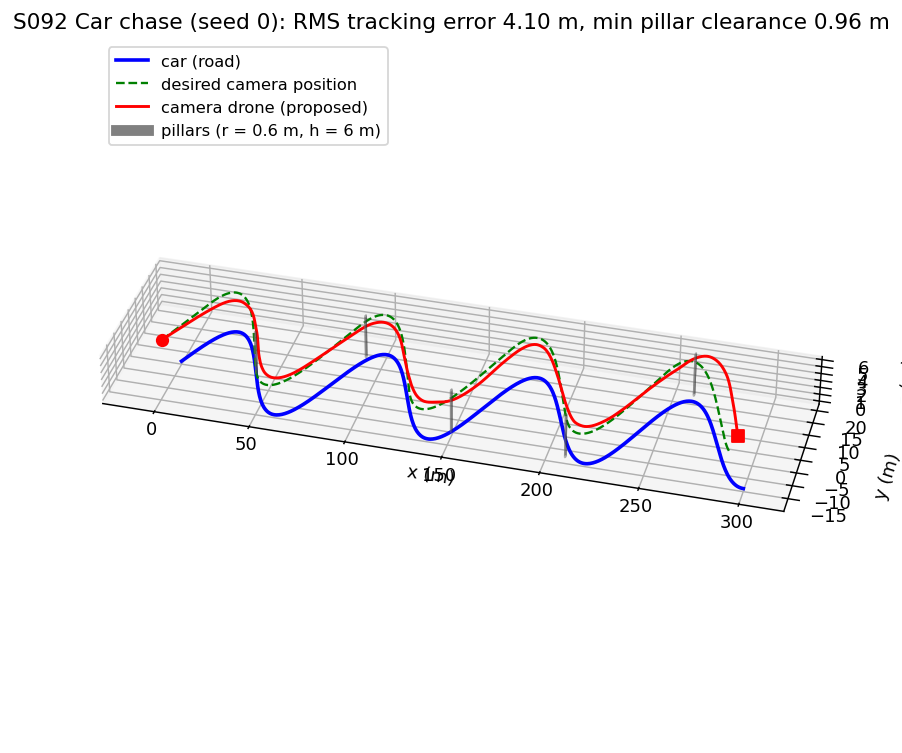
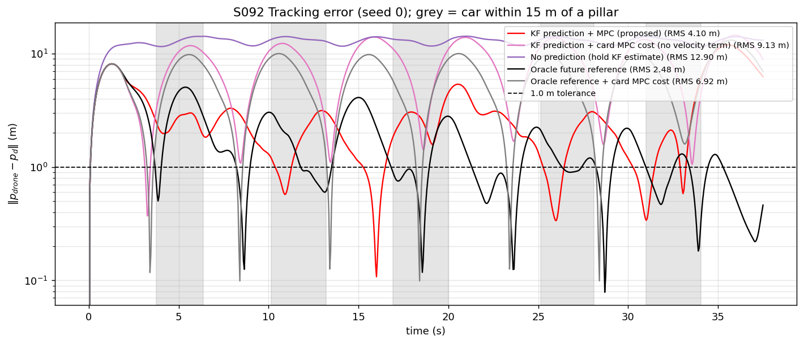
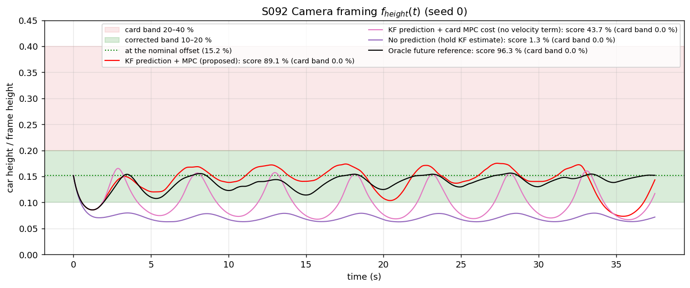
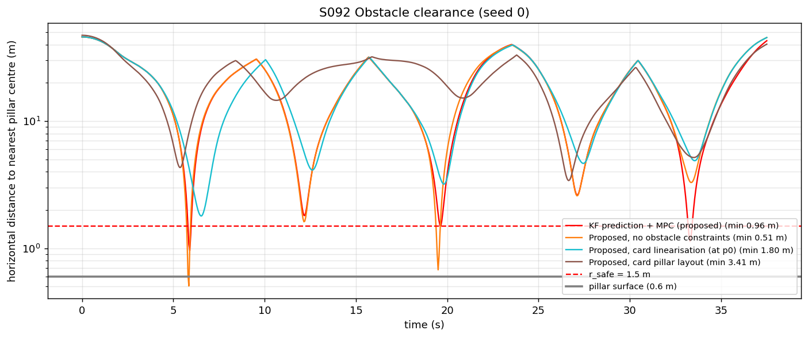
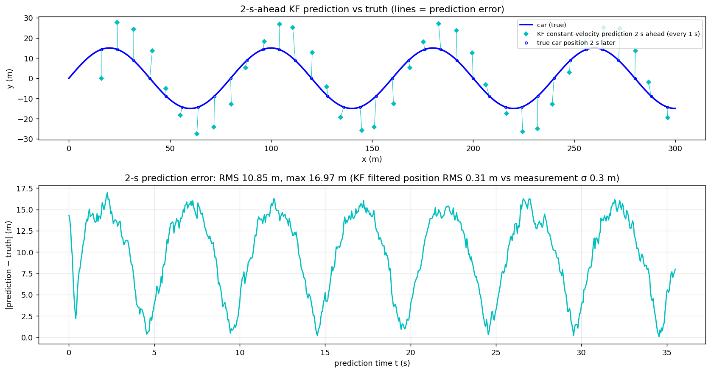
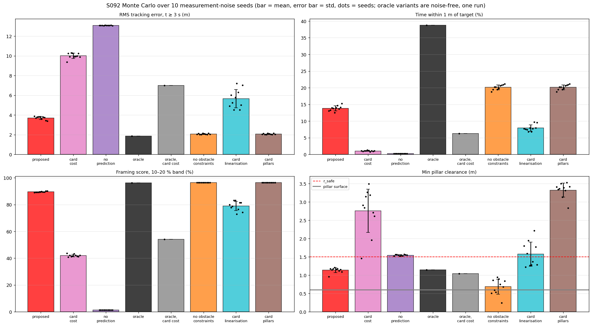
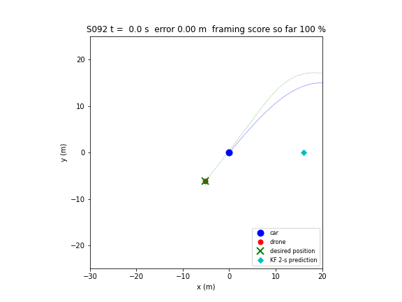

# S092 Movie Car Chase Scene

**Domain**: Special Ops & Entertainment | **Difficulty**: ⭐⭐⭐ | **Status**: ✅ Completed

---

## Problem Definition

**Setup**: A camera drone films a stunt car on a winding road ($x = 8t$, $y = 15\sin(2\pi x/80)$, x from 0 to 300 m, 37.5 s). The drone should stay 8 m behind and 5 m above the car while flying around five concrete pillars (radius 0.6 m, height 6 m) with a safety clearance of 1.5 m. It only receives noisy car positions (σ = 0.3 m at 20 Hz), filters them with a constant-velocity Kalman filter (KF), and plans with a 10-step model predictive controller (MPC, 0.2 s steps, 2 s horizon).

**Objective**: keep the drone near the desired offset point, keep the car at a fixed size in the frame, keep 1.5 m from every pillar.

**Variants** (same measurement noise per seed, 10 seeds):

| Variant | Reference over the horizon | MPC cost | Obstacles |
|---------|----------------------------|----------|-----------|
| **Proposed** | KF constant-velocity prediction, 0–2 s ahead | position + velocity tracking | pillars on the camera path, normals from the previous plan |
| Card cost | KF prediction | position only (card) | same |
| No prediction | current KF estimate, held constant | position + velocity | same |
| Oracle | true future desired positions | position + velocity | same |
| Oracle, card cost | true future | position only | same |
| No obstacle constraints | KF prediction | position + velocity | none |
| Card linearisation | KF prediction | position + velocity | one normal per pillar from the current position (card) |
| Card pillar layout | KF prediction | position + velocity | the card's pillar positions |

An **offline optimum** (one QP over the whole 37.5 s with the true future, same limits, no pillars) gives a lower bound on what any controller could achieve.

---

## Mathematical Model Summary

**Car**: $\mathbf{p}_{car} = (8t,\ 15\sin(2\pi \cdot 8t/80),\ 0)$, heading $\psi = \operatorname{atan2}(\dot y, \dot x)$. Its speed along the road varies from 8.00 to 12.36 m/s and the heading swings ±49.7°.

**Desired camera position**: $\mathbf{p}_d = \mathbf{p}_{car} + R(\psi)\,(-8, 0)^\top + (0, 0, 5)^\top$, i.e. 9.43 m from the car. This point needs up to 12.36 m/s and lateral accelerations up to $|a_y| = 9.79$ m/s², more than the drone's 6 m/s² per axis.

**Kalman filter**: state $(x, y, v_x, v_y)$, $F = \begin{pmatrix} I & \Delta t I \\ 0 & I\end{pmatrix}$, white-noise-acceleration $Q$ with $q = 1$ m²/s³, $R = 0.3^2 I$, $\Delta t = 0.05$ s. Prediction $\hat{\mathbf{p}}(t+\tau) = \hat{\mathbf{p}} + \tau\hat{\mathbf{v}}$; the reference heading is $\operatorname{atan2}(\hat v_y, \hat v_x)$.

**MPC** (condensed QP in the accelerations $\mathbf{u}_0..\mathbf{u}_9$, double integrator with $\Delta t_{mpc} = 0.2$ s):

$$J = \sum_{i=1}^{N-1} Q\|\mathbf{p}_i - \mathbf{r}_i\|^2 + P_f\|\mathbf{p}_N - \mathbf{r}_N\|^2 + \sum_{i=0}^{N-1} R\|\mathbf{u}_i\|^2 + \underbrace{\sum_{i=1}^{N} Q_v\|\mathbf{v}_i - \dot{\mathbf{r}}_i\|^2}_{\text{added}} + \sum_k \left(w_q s_k^2 + w_l s_k\right)$$

subject to $|v_{i,a}| \le 12$ m/s and $|u_{i,a}| \le 6$ m/s² per axis, and for each pillar $k$ within 40 m

$$\hat{\mathbf{n}}_{k,i}^\top(\mathbf{p}_i^{xy} - \mathbf{o}_k) + s_k \ge r_{safe}, \quad s_k \ge 0, \qquad \hat{\mathbf{n}}_{k,i} = \frac{\bar{\mathbf{p}}_i^{xy} - \mathbf{o}_k}{\|\bar{\mathbf{p}}_i^{xy} - \mathbf{o}_k\|}$$

where $\bar{\mathbf{p}}_i$ is the previous plan shifted by one step. $\dot{\mathbf{r}}_i$ is the finite difference of the reference. The QP is solved by a dense primal-dual interior-point method (Mehrotra predictor–corrector); all 1880 solves per variant converged except 7 in the card-linearisation variant. The first acceleration is held for 0.2 s while the drone is integrated at 20 Hz.

**Framing**: $f_{height} = 2\arctan\!\big(h_{car}/(2d)\big)/60°$ with $h_{car} = 1.5$ m. At the nominal $d = 9.43$ m this is 15.2 %, so the score uses the band 10–20 % (d = 7.14–14.31 m). The card's 20–40 % band (d = 3.53–7.14 m) is also reported.

**Metrics**: RMS of $\|\mathbf{p}_{drone} - \mathbf{p}_d\|$ (also for t ≥ 3 s, after the start from rest), share of time within 1 m, framing score, minimum horizontal distance to a pillar centre.

---

## Key Parameters

| Parameter | Value |
|-----------|-------|
| Road | $x = 8t$, amplitude 15 m, wavelength 80 m, x = 0–300 m (arc length 386.2 m), 37.5 s |
| Camera offset (body frame) | 8 m behind, 5 m above: (−8, 0, 5) m |
| Pillars | radius 0.6 m, height 6 m, $r_{safe}$ = 1.5 m; moved onto the camera path at the card's x stations, 0.5 m to the side: (40.4, −0.1), (90.4, 12.9), (149.7, −10.9), (209.6, −13.6), (260.1, 17.5) m |
| Measurement noise / rate | σ = 0.3 m, 20 Hz |
| KF process noise $q$ / prediction horizon | 1.0 m²/s³ / 2.0 s |
| MPC horizon / step | 10 / 0.2 s |
| Weights $Q$, $P_f$, $R$ | 10, 20, 0.1 (card) |
| Velocity-tracking weight $Q_v$ (added) | 10 |
| Slack weights $w_q$, $w_l$ (added) | $10^4$, $10^3$ |
| Pillars added to the QP | within 40 m |
| Speed / acceleration limit | 12 m/s / 6 m/s² per axis |
| Camera FoV / car height | 60° / 1.5 m |
| Drone start | at the desired point, at rest |
| Monte Carlo | 10 noise seeds (0–9); seed 0 for figures |

---

## Implementation

```
src/05_special_entertainment/s092_movie_chase.py   # Main simulation script
```

```bash
conda activate drones
python src/05_special_entertainment/s092_movie_chase.py
```

Runtime ≈ 3 min (177 s measured twice while other jobs shared the CPU).

---

## Results

### Monte Carlo, 10 noise seeds (mean ± std; oracle rows are noise-free single runs)

| Variant | RMS error | RMS, t ≥ 3 s | Within 1 m | Framing 10–20 % (card 20–40 %) | Min pillar clearance (worst) | Runs < $r_{safe}$ / inside a pillar |
|---------|---:|---:|---:|---:|---:|---:|
| **Proposed** | **3.943 ± 0.141 m** | **3.704 ± 0.162 m** | 13.8 ± 0.7 % | **89.5 ± 0.4 %** (0.0 %) | 1.138 ± 0.067 m (0.960) | 10/10 / **0/10** |
| Card cost | 9.739 ± 0.253 m | 10.010 ± 0.268 m | 1.1 ± 0.1 % | 42.0 ± 0.9 % (0.0 %) | 2.758 ± 0.592 m (1.461) | 1/10 / 0/10 |
| No prediction | 12.895 ± 0.015 m | 13.093 ± 0.015 m | 0.3 ± 0.0 % | 1.3 ± 0.0 % (0.0 %) | 1.545 ± 0.017 m (1.521) | 0/10 / 0/10 |
| Oracle | 2.480 m | 1.876 m | 38.7 % | 96.3 % (0.0 %) | 1.147 m | 1/1 / 0/1 |
| Oracle, card cost | 6.916 m | 7.005 m | 6.3 % | 54.2 % (0.0 %) | 1.043 m | 1/1 / 0/1 |
| No obstacle constraints | 2.623 ± 0.031 m | 2.075 ± 0.050 m | 20.1 ± 0.7 % | 96.4 ± 0.0 % (0.0 %) | 0.685 ± 0.208 m (0.242) | 10/10 / **4/10** |
| Card linearisation | 5.697 ± 0.846 m | 5.659 ± 0.925 m | 7.9 ± 0.9 % | 78.9 ± 3.4 % (0.0 %) | 1.574 ± 0.327 m (1.222) | 5/10 / 0/10 |
| Card pillar layout | 2.623 ± 0.031 m | 2.075 ± 0.051 m | 20.1 ± 0.7 % | 96.4 ± 0.0 % (0.0 %) | 3.323 ± 0.191 m (2.838) | 0/10 / 0/10 |

Offline optimum (true future over the whole mission, $Q$/$R$ weights of the card, no pillars): RMS 1.876 m, 0.800 m for t ≥ 3 s, within 1 m 85.6 % of the time with $a_{max}$ = 6 m/s²; with 10 m/s² it is 0.851 m / 0.087 m / 95.2 %.

Paired per seed (steady RMS): proposed beats no prediction in 10/10 seeds and the card cost in 10/10 seeds; the oracle (1.876 m) beats the proposed controller in 10/10 seeds. Maximum speed of the proposed controller: 15.41 m/s (12.00 m/s per axis). KF: filtered position RMS 0.312 m (seed 0, after the first 1 s); the 2-s-ahead prediction RMS is 10.85 ± 0.01 m.

**Key findings**:
- **Prediction is essential.** Holding the current estimate leaves the drone 13.093 m RMS behind its target; the KF-predicted reference cuts this to 3.704 m, in every seed. The 2-s constant-velocity prediction itself is poor on this road (10.85 m RMS, up to 16.97 m, because a straight-line extrapolation over a fifth of a 10 s wave misses the curve), but the near end of the horizon, which drives the first control move, is accurate.
- **The card's MPC cost is the main weakness.** With position-only cost and a 2 s horizon, even perfect knowledge of the future (oracle, card cost) gives 7.005 m steady RMS: the controller builds up speed toward the reference and cannot brake in time. Adding velocity tracking ($Q_v = 10$) lowers the oracle to 1.876 m and the KF version from 10.010 to 3.704 m.
- **The remaining gap to the physical limit** is the KF prediction (3.704 → 1.876 m with the true future) and the short horizon plus pillars (1.876 → 0.800 m for the offline optimum).
- **Obstacle constraints work, but the 1.5 m margin is only soft.** Without them the drone passes through a pillar in 4/10 runs (closest 0.242 m from the centre). With them it never touches a pillar (worst 0.960 m from the centre, 0.36 m from the surface) but dips below $r_{safe}$ in every run, because the slack lets the margin give way when the 6 m/s² limit cannot turn the drone in time. Detouring around pillars that stand on the camera path costs about 1.6 m of steady RMS (3.704 vs 2.075 m).
- **The card's linearisation is too conservative.** One normal per pillar from the current position blocks the whole half-space beyond the pillar, so the drone hangs back: 5.659 m steady RMS, 42 slack-active solves per run and 7 non-converged QPs, yet still below $r_{safe}$ in 5/10 runs.
- **The card's pillar layout never tests avoidance.** Those pillars are 4.61–14.99 m from the desired camera path; the run is identical to the run without constraints (2.075 m) and the clearance never drops below 2.838 m.

**Card targets**:

| Card target | Result (proposed) |
|-------------|-------------------|
| Framing score ≥ 0.80 (20–40 % band) | 0.0 % for every variant: unreachable at 9.43 m (needs 3.53–7.14 m). With the corrected 10–20 % band: 89.5 ± 0.4 % |
| RMS tracking error ≤ 1.5 m | Not met: 3.943 ± 0.141 m. Even the offline optimum reaches only 1.876 m over the whole mission (0.800 m after 3 s), because the start from rest and the 9.79 m/s² lateral demand exceed the 6 m/s² limit |
| Min obstacle clearance ≥ 1.5 m | Not met: 1.138 ± 0.067 m (no pillar contact) |
| Max drone speed ≤ 12 m/s | Met per axis (12.00 m/s, the card's ∞-norm bound); the speed magnitude reaches 15.41 m/s |

### 3D Trajectory

Seed 0, proposed controller: road (blue), desired camera path (green dashed), drone (red), pillars (grey):



### Tracking Error

Seed 0, log scale. Grey bands mark the car within 15 m of a pillar. The card-cost variants (pink, grey) swing up to about 10 m every half wave; the proposed controller stays at a few metres:



### Camera Framing

Seed 0. Every curve stays below the card's 20–40 % band; the proposed controller stays in the corrected 10–20 % band most of the time:



### Obstacle Clearance

Seed 0, horizontal distance to the nearest pillar centre. Without constraints (orange) the drone passes inside the pillar radius at t ≈ 6 s; with constraints (red) it stays outside the pillar but below the 1.5 m margin (read from the figure):



### KF Prediction

Top: 2-s constant-velocity predictions (cyan diamonds) against the true car position 2 s later; bottom: prediction error over time:



### Monte Carlo



### Animation

Seed 0, proposed controller, top view in a window that follows the car: car (blue), drone (red) with a 3 s trail, desired position (green cross), KF 2-s prediction (cyan diamond), pillars (grey, dotted = 1.5 m margin). 189 frames at 10 fps (every 0.2 s):



### Deviations from the scenario card

| Card | Implementation | Reason |
|------|----------------|--------|
| $\mathbf{d}_{offset} = (0, -8, 5)$ "behind and above" | (−8, 0, 5) | With the card's $R_{car}$ (x forward, y left), (0, −8) puts the drone 8 m to the right, at −90.0° to the heading (verified). Card corrected. |
| Car at "constant tangential speed 8 m/s" | $x = 8t$ as in the card's equations and code; along-road speed 8.00–12.36 m/s | The equations, the 37.5 s duration and the code all use constant x speed. Card text corrected. |
| Framing band 20–40 % | 10–20 % (card band also printed) | At the nominal 9.43 m the car fills 15.2 %; 20–40 % needs 3.53–7.14 m. Card corrected. |
| Pillars at (40, 8), (90, −10), (150, 12), (210, −6), (260, 9) | Same x stations, moved onto the camera path (0.5 m to the side); card layout kept as a variant | The card's pillars are 4.61–14.99 m from the camera path, so the constraint never binds (shown by the card-layout variant). Card note added. |
| Obstacle normals from the current position $\mathbf{p}_0$ for all steps | One normal per horizon step from the previous plan; card form kept as a variant | The card form over-constrains and degrades tracking (5.659 vs 3.704 m). |
| Hard obstacle constraints | Soft, one slack per pillar ($w_q = 10^4$, $w_l = 10^3$) | Keeps the QP feasible when the acceleration limit cannot avoid the margin in time. |
| MPC cost: positions and accelerations only | Added velocity tracking $Q_v = 10$; card cost kept as two variants | The card cost overshoots and lags (10.010 m RMS with the KF, 7.005 m even with the oracle). $Q_v$ was picked from {1, 3, 10} in a development run on seed 0. |
| cvxpy + OSQP | Own dense interior-point QP solver | cvxpy is not installed in the `drones` environment. |
| Card code computes the KF prediction but builds the reference from the true future | Reference from the KF prediction; the true future is the oracle variant | The card code silently used ground truth. Card note added. |
| Tolerance-ball objective without a value | 1.0 m (the card's plot line) | Card's expected-output figure. |
| MP4/GIF top view | GIF in a window following the car | Repository convention; the whole 300 m road would make the drone invisible. |
| Single run | 10 noise seeds with common random numbers; offline optimum as a bound | Results depend on the measurement noise. |

---

## Extensions

1. **Coordinated-turn KF**: replace the constant-velocity model with a constant-turn-rate model and measure how much of the 3.704 → 1.876 m prediction gap closes.
2. **Longer horizon** (3–5 s) or a terminal velocity constraint, to approach the 0.800 m offline optimum.
3. **Hard margin**: add a velocity-dependent braking constraint so the 1.5 m margin holds without slack.
4. **Occlusion-aware framing**: penalise lines of sight that pass within a pillar radius.
5. **Moving obstacles**: oncoming cars predicted by their own KFs as time-varying half-planes.

---

## Related Scenarios

- Prerequisites: [S081 Selfie Follow Mode](../../../scenarios/05_special_entertainment/S081_selfie_follow.md), [S086 Cooperative Multi-Angle Filming](../../../scenarios/05_special_entertainment/S086_multi_angle_cinema.md)
- Next: [S094 Counter-Drone Intercept](../../../scenarios/05_special_entertainment/S094_counter_drone.md)
- Cross-reference: [S003 Low-Altitude Tracking](../../../scenarios/01_pursuit_evasion/S003_low_altitude_tracking.md), [S004 Obstacle-Course Chase](../../../scenarios/01_pursuit_evasion/S004_obstacle_chase.md), [S008 Stochastic Pursuit — Kalman Filter Tracking](../../../scenarios/01_pursuit_evasion/S008_stochastic_pursuit.md)
