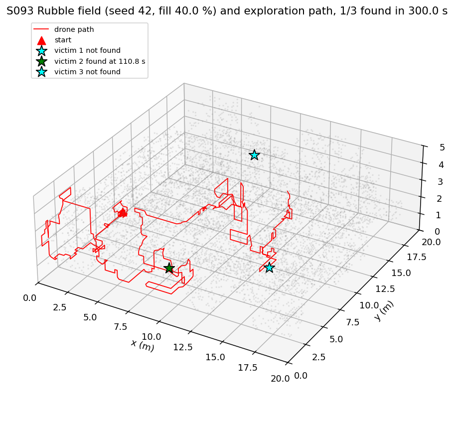
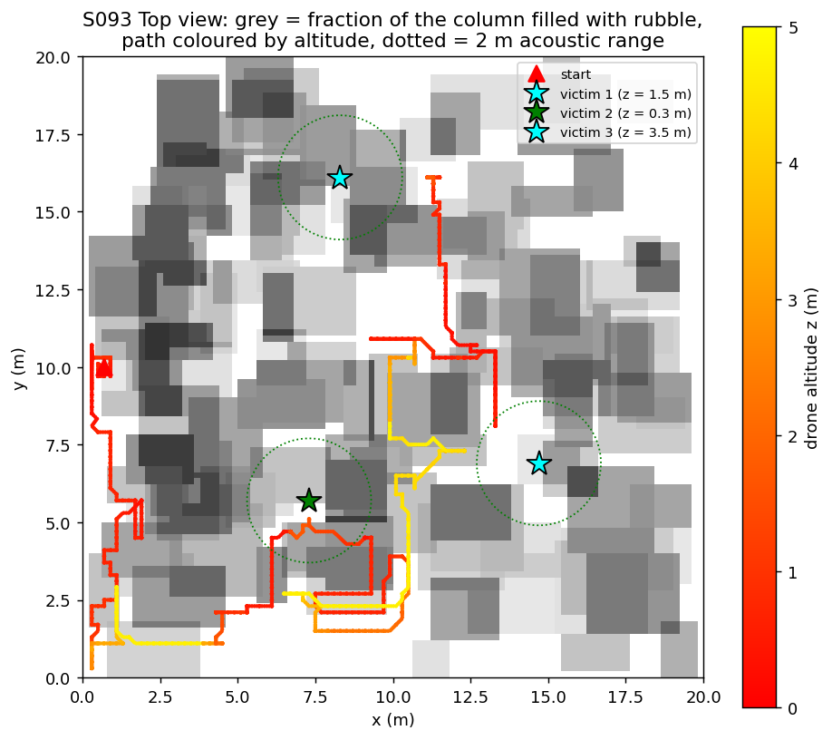
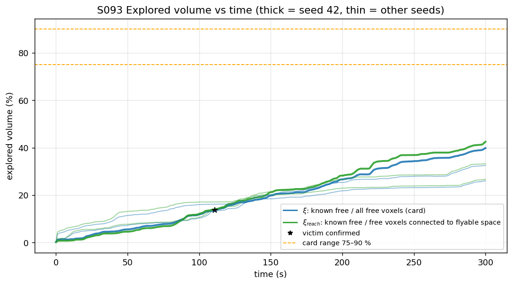
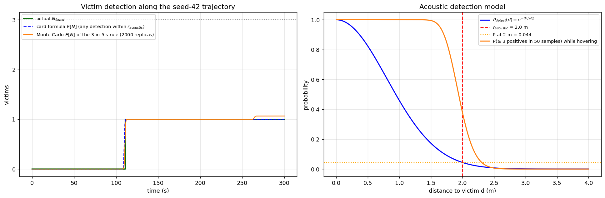
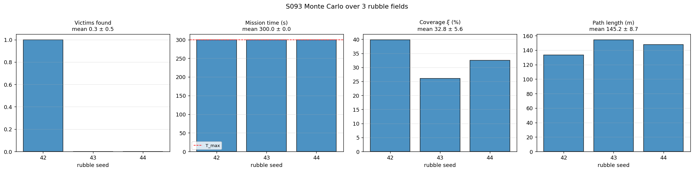
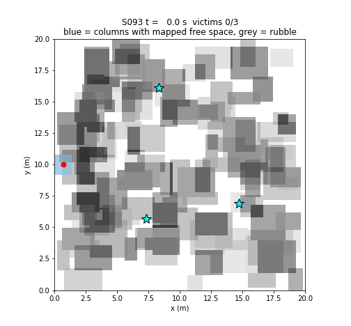

# S093 Earthquake Rubble Search and Rescue

**Domain**: Special Ops & Entertainment | **Difficulty**: ⭐⭐⭐⭐ | **Status**: ✅ Completed

---

## Problem Definition

**Setup**: A 20 × 20 × 5 m rubble field is 40 % filled with concrete chunks. Three victims are buried next to the rubble; each emits a weak acoustic beacon. A micro-drone (body radius 0.15 m, 0.8 m/s) enters from a clear pocket at the edge of the field, maps the rubble with a short-range LiDAR (3 m), and explores autonomously with a 3D frontier policy, flying shortest paths through the obstacle-inflated voxel map. GPS is not available; the drone's own position is assumed known (onboard odometry is not modelled).

**Objective**: confirm all three victims within $T_{max} = 300$ s. Reported: victims found, explored volume $\xi$, mission time, and the expected number of victims found along the flown path (analytic vs simulated).

---

## Mathematical Model Summary

### Rubble field

Random axis-aligned boxes with sides of 1.0–3.0 m (5–15 voxels) are added until 40 % of the volume is filled; a 1.4 × 1.6 × 1.4 m entrance pocket is kept clear. The planner may only use voxels whose centre is more than $r_{inf} + \Delta/2 = 0.35$ m from any obstacle voxel centre (walls, floor and ceiling of the field count as obstacles). Victims are placed in free voxels that touch rubble, within 1 m of flyable space reachable from the entrance, at least 6 m from the entrance and 4 m from each other.

### Occupancy mapping

Voxels of $\Delta = 0.2$ m hold log-odds $\ell$ (start 0). Every 0.1 s, 2400 beams (Fibonacci sphere, mean spacing 4.1°, i.e. 0.22 m at 3 m) are sampled every 0.1 m up to the first rubble hit. Each voxel gets at most one update per scan:

$$\ell_{free} = \ln\frac{0.4}{0.6} = -0.41, \qquad \ell_{occ} = \ln\frac{0.85}{0.15} = +1.73, \qquad \ell \in [-10, 10]$$

The hit range carries $\mathcal{N}(0, 0.03^2)$ noise. A voxel is occupied if $P > 0.7$, free if $P < 0.3$ (three free updates), otherwise unknown.

### Frontiers and planning

- **Frontier voxels**: unknown voxels with a free 26-neighbour; grouped by 26-connectivity; clusters smaller than 10 voxels are ignored.
- **No-fly set**: within 0.35 m of a mapped obstacle, or within 0.30 m of an unknown voxel (a drone at a voxel centre then stays at least 0.17 m from any unknown voxel's box).
- **Viewpoints**: flyable voxels within 1 m of a frontier cluster. A 26-connected Dijkstra search (A* with $h = 0$, edge cost = centre distance $\Delta\sqrt{\delta_x^2+\delta_y^2+\delta_z^2}$) from the drone gives the geodesic distance $g$ to every viewpoint. The cluster chosen minimises the card's score with geodesic distance:

$$c^* = \arg\min_c \frac{\min_{v \in V_c} g(v)}{\sqrt{|\mathcal{F}_c|}}$$

- The drone flies the path at 0.8 m/s, re-checks it every 1 s and replans every 5 s. At a reached viewpoint it hovers 0.2 s (two more scans); unknown voxels still within 1 m are then marked as exhausted.
- **Recovery**: if no viewpoint is reachable, the plan is repeated once with the obstacle inflation reduced to the physical minimum $r_{drone} + \Delta/2 = 0.25$ m. If that fails too, the mission ends.

### Acoustic detection

$$P_{detect}(d) = e^{-d^2/2\sigma_a^2}, \quad \sigma_a = 0.8 \text{ m}$$

At 10 Hz each victim yields a Bernoulli observation; a victim is **confirmed** after 3 positive observations within 5 s (50 samples).

### Expected victims found

Along the flown trajectory, two predictions are computed:
- **Card formula**: $\mathbb{E}N_{found}(t) = \sum_i \bigl[1 - \prod_{\tau \le t,\ d_i(\tau) \le 2\text{ m}} (1 - P_{detect,i}(\tau))\bigr]$, i.e. one detection within $r_{acoustic}$ suffices.
- **Confirmation rule**: Monte Carlo (2000 replicas) of the 3-in-5 s rule on the same trajectory, at every distance.

### Coverage

$\xi = |\text{mapped free}| / |\text{true free}|$ (card) and $\xi_{reach}$, the same ratio restricted to free voxels connected to the reachable flyable space.

### Safety checks

After every mission the exact distance from each trajectory point to the nearest rubble box (and field boundary) is computed and asserted $\ge r_{drone} = 0.15$ m; the speed is asserted $\le 0.8$ m/s.

---

## Key Parameters

| Parameter | Value |
|-----------|-------|
| Field | 20 × 20 × 5 m |
| Voxel size $\Delta$ | 0.2 m (100 × 100 × 25 voxels) |
| Fill rate / chunk sides | 40 % / 1.0–3.0 m boxes |
| Victims | 3; ≥ 6 m from entrance, ≥ 4 m apart, ≤ 1 m from flyable space |
| Drone body radius / speed | 0.15 m / 0.8 m/s |
| Inflation $r_{inf}$ (obstacles) / unknown / recovery | 0.25 m (+Δ/2 = 0.35 m) / 0.30 m / 0.25 m |
| LiDAR | 2400 beams (Fibonacci sphere), 3 m, 10 Hz, range noise 0.03 m, sampling 0.1 m |
| Log-odds $\ell_{occ}$ / $\ell_{free}$ / clamp | +1.73 / −0.41 / ±10 |
| Thresholds $P_{occ}$ / $P_{free}$ | 0.7 / 0.3 |
| Acoustic $\sigma_a$ / $r_{acoustic}$ | 0.8 m / 2.0 m |
| Confirmation | 3 positives in 5 s (50 samples at 10 Hz) |
| Viewpoint radius / min cluster / dwell | 1.0 m / 10 voxels / 0.2 s |
| Replanning | every 5 s; path re-check every 1 s |
| Time step / mission limit | 0.1 s / 300 s |
| Seeds | 42 (figures); rubble fields 42, 43, 44 |

---

## Implementation

```
src/05_special_entertainment/s093_rubble_sar.py   # Main simulation script
```

```bash
conda activate drones
python src/05_special_entertainment/s093_rubble_sar.py
```

Runtime ≈ 4.5–5.6 min (273 s and 336 s measured while other jobs shared the CPU); expect less on an idle machine.

---

## Results

Checks of the card's numbers printed by the script: a 0.25 m-radius ball of 0.1 m voxels contains 81 voxels, so with independent 40 % voxel fill it is entirely free with probability $0.6^{81} = 1.1\cdot10^{-18}$; a 0.4 m gap minus $2 r_{inf}$ leaves −0.10 m; $P_{detect} \ge 0.9$ needs $d \le 0.367$ m; $P_{detect}(2\text{ m}) = 0.0439$.

### Seed 42

The field was generated in 1 attempt (fill 40.0 %); 57.0 % of the free voxels are connected to the flyable space reachable from the entrance.

| Victim | Position (m) | Closest approach | Result | P(confirmed by end \| path) |
|--------|--------------|-----------------:|--------|---:|
| 1 | (14.7, 6.9, 1.5) | 2.01 m | not confirmed | 0.066 |
| 2 | (7.3, 5.7, 0.3) | 1.18 m | **confirmed at 110.8 s** | 1.000 |
| 3 | (8.3, 16.1, 3.5) | 3.23 m | not confirmed | 0.000 |

| Metric | Value |
|--------|-------|
| Victims found | 1/3 (timeout) |
| Mission time | 300.0 s |
| Coverage $\xi$ / $\xi_{reach}$ | 39.9 % / 42.5 % |
| Path length | 133.5 m |
| Replans / viewpoints exhausted / recovery plans | 543 / 529 / 12 |
| Minimum clearance to rubble | 0.178 m (body radius 0.15 m) |
| Max speed | 0.80 m/s |
| Map errors | 0 occupied voxels mapped free; 1264 free voxels mapped occupied (of 12414 mapped occupied) |
| $E[N_{found}]$ at the end | card formula 1.000, 3-in-5 s rule 1.066, actual 1 |

### Three rubble fields (seeds 42–44)

| Seed | Found | Mission time | $\xi$ | $\xi_{reach}$ | Path | Min clearance | $E[N]$ card / rule |
|------|------:|---:|---:|---:|---:|---:|---|
| 42 | 1/3 | 300.0 s (timeout) | 39.9 % | 42.5 % | 133.5 m | 0.178 m | 1.00 / 1.07 |
| 43 | 0/3 | 300.0 s (timeout) | 26.1 % | 26.7 % | 154.5 m | 0.283 m | 0.00 / 0.00 |
| 44 | 0/3 | 300.0 s (timeout) | 32.6 % | 33.2 % | 147.6 m | 0.300 m | 0.00 / 0.00 |
| **Mean ± std** | **0.33 ± 0.47** | **300.0 ± 0.0 s** | **32.8 ± 5.6 %** | | | | 0.33 / 0.36 (actual 0.33) |

**Key findings**:
- **The card's expected result does not hold.** The card expects 3/3 victims, 75–90 % coverage and a 180–270 s mission. Here no field has all three victims found (0.33 ± 0.47 found), coverage reaches only 32.8 ± 5.6 %, and every mission times out at 300 s. In seed 42 the mapped volume grows almost linearly, to 39.9 % at 300 s (coverage figure), so reaching 75 % would need roughly twice the time limit.
- **Why exploration is slow**: (1) a voxel needs three free observations before it counts as free, and the unknown space is kept at 0.3 m distance, so the flyable map trails the LiDAR horizon; (2) 529 of the 543 plans ended at a viewpoint whose frontier the sensor could not resolve (mostly rubble-surface voxels that fall between beams), so the drone spends its time on short hops: 133.5 m flown in 300 s, an average of 0.45 m/s against 0.8 m/s; (3) LiDAR range noise marks free voxels in front of surfaces as occupied (1264 of 12414 mapped-occupied voxels in seed 42), which narrows passages further. These are properties of the card's sensor, log-odds and inflation settings, not of the frontier score.
- **Safety holds.** In seed 42 no truly occupied voxel was mapped free, and in every field the drone stayed at least 0.178 m from the rubble (body radius 0.15 m), including during the 12 recovery plans of seed 42 that use the reduced 0.25 m inflation.
- **Victims are found when the path passes within about 1–2 m.** Victim 2 was approached to 1.18 m and confirmed at 110.8 s; victim 1 was passed at 2.01 m, just outside $r_{acoustic}$, and not confirmed.
- **Both expectation models agree with the outcome**, but differ in a telling way. For victim 1 the card formula gives 0 (the path never entered the 2 m radius), while the Monte Carlo of the real confirmation rule gives 0.066, because detections are also possible beyond 2 m. Summed over the three fields: card 0.33, rule 0.36, actual 0.33.

### 3D Rubble Field and Path

Seed 42: rubble surface voxels (grey, subsampled), drone path (red), victims (green = found, cyan = not found):



### Top View

Grey = fraction of each (x, y) column filled with rubble; path coloured by altitude; dotted circles = 2 m acoustic range:



### Explored Volume

$\xi$ and $\xi_{reach}$ over time for the three fields (thick = seed 42); stars mark confirmations; dashed = the card's 75–90 % range:



### Detection

Left: actual victims found vs the two expectation curves along the seed-42 trajectory. Right: the detection model, with the probability of confirming (≥ 3 positives in 50 samples) while hovering at distance $d$:



### Monte Carlo



### Animation

Seed 42, top view: blue = (x, y) columns that contain mapped free space, red = drone and path, stars turn green when a victim is confirmed. 151 frames at 15 fps (every 2 s of the 300 s mission):



### Deviations from the scenario card

| Card | Implementation | Reason |
|------|----------------|--------|
| 40 % fill of independent random voxels | 40 % fill with random boxes, sides 1.0–3.0 m | Independent voxel fill leaves no passage (probability $1.1\cdot10^{-18}$ that one drone-sized ball is free). Smaller chunks (0.4–1.6 m) were tried first in development: the gaps were so narrow that the inflated map had almost no flyable voxels and the drone was trapped early in the mission. Card corrected. |
| Passages ≥ 0.4 m guaranteed with $r_{inf} = 0.25$ m | Connectivity enforced on the inflated true map | Inflation by 0.25 m closes a 0.4 m gap (−0.10 m). Card corrected. |
| Voxel 0.1 m (200 × 200 × 50 = 2 M voxels) | 0.2 m (250 k voxels) | Runtime: the map is inflated, labelled and searched hundreds of times per mission. |
| LiDAR: 120 beams, horizontal ring | 2400 beams on a sphere, 10 Hz | A horizontal ring never observes other altitude layers, so 3D frontiers cannot be resolved; a first version with five 30°-spaced rings left unobserved stripes that blocked the planner. Card note added. |
| A* to the frontier centroid | Dijkstra (A* with $h = 0$, same optimal paths) to viewpoints within 1 m of the cluster; score uses geodesic distance | Frontier centroids usually lie inside rubble or unknown space; geodesic distance is the real travel cost. |
| Frontier = every unknown voxel next to free space | Clusters < 10 voxels ignored; frontiers left unresolved after a 0.2 s hover at their viewpoint are exhausted | Without this the drone revisits single rubble-surface voxels that the sampled beams never hit. |
| Inflation of occupied voxels only | Unknown voxels also kept at 0.3 m; one recovery plan with 0.25 m obstacle inflation when stuck | Flying next to unknown space can hit unseen rubble; the recovery keeps the drone from being sealed in by noise hits. Safety is verified against the true geometry. |
| Victims found = detections with $P_{detect} \ge 0.9$ | 3 positives in 5 s (the card's own confirmation rule) | $P_{detect} \ge 0.9$ needs $d \le 0.367$ m. Card corrected. |
| Analytic $E[N]$ "equivalent" to the confirmation rule | Card formula plus a Monte Carlo of the real rule | The single-detection formula is not equivalent (card corrected); both are shown. |
| Victims at random free voxels | Free voxels touching rubble, ≤ 1 m from reachable flyable space, ≥ 6 m from the entrance, ≥ 4 m apart | "Buried" victims that can be reached acoustically from flyable space. |
| Single run | Three rubble fields | Results depend on the field (limited by runtime). |
| `s093_analysis.png` (6 panels), `s093_exploration.gif` | Separate figures and `animation.gif` | Repository conventions. |

---

## Extensions

1. **Exact voxel traversal** (Amanatides–Woo) instead of 0.1 m beam sampling, so rubble surfaces are resolved and fewer frontiers are exhausted.
2. **Information-gain frontier score** (expected newly observed voxels per metre) instead of cluster size.
3. **Multi-drone search** with merged log-odds maps.
4. **Acoustic gradient**: steer toward the victim once the first positive detections appear.
5. **Longer missions** or faster scanning to measure the time needed for 75–90 % coverage.

---

## Related Scenarios

- Prerequisites: [S043 Confined Space Exploration](../../../scenarios/03_environmental_sar/S043_confined_space.md), [S074 Mine 3D Mapping](../../../scenarios/04_industrial_agriculture/S074_mine_mapping.md)
- Cross-reference: [S050 Swarm Cooperative Mapping (Distributed EKF-SLAM)](../../../scenarios/03_environmental_sar/S050_slam.md), [S045 Chemical Plume Tracing](../../../scenarios/03_environmental_sar/S045_plume_tracing.md)
