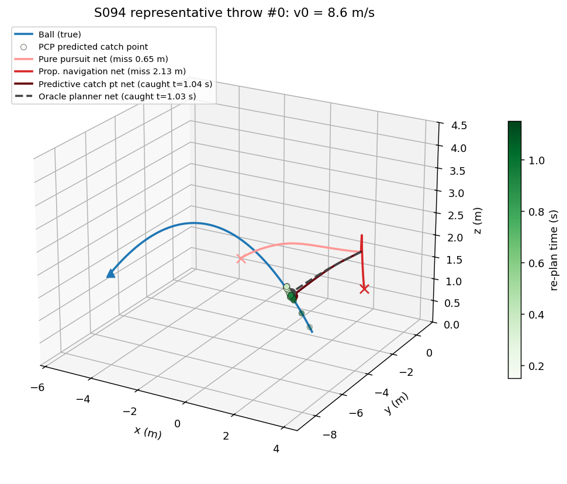
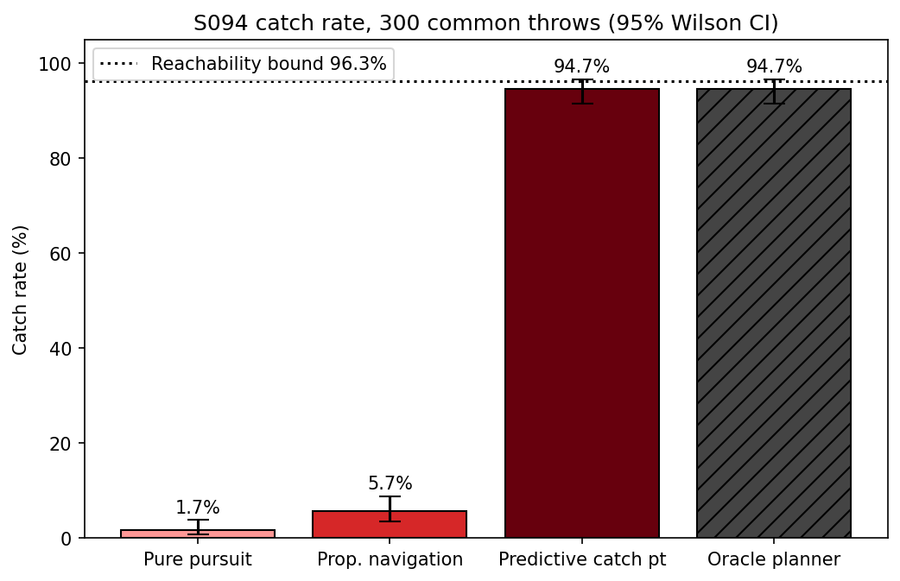
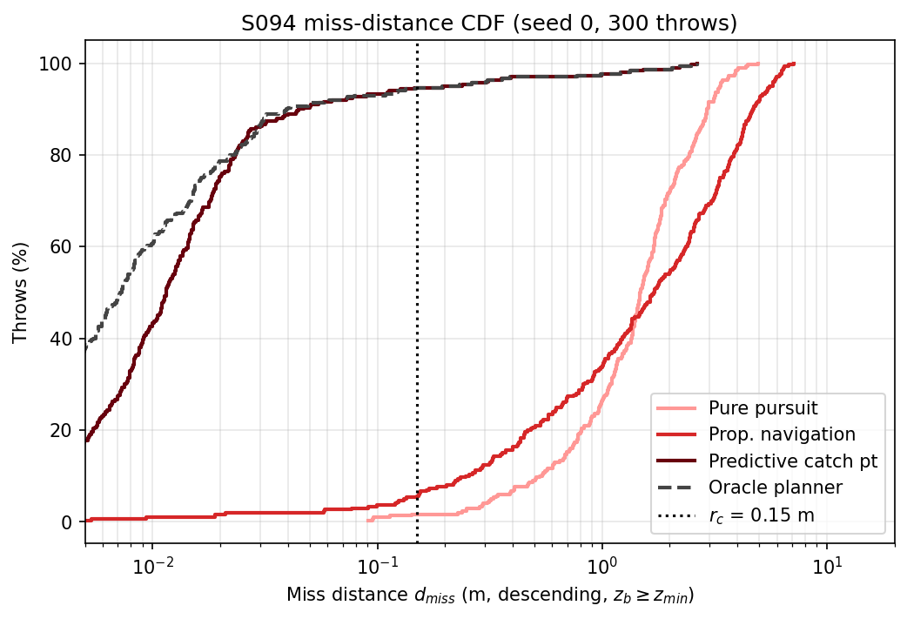
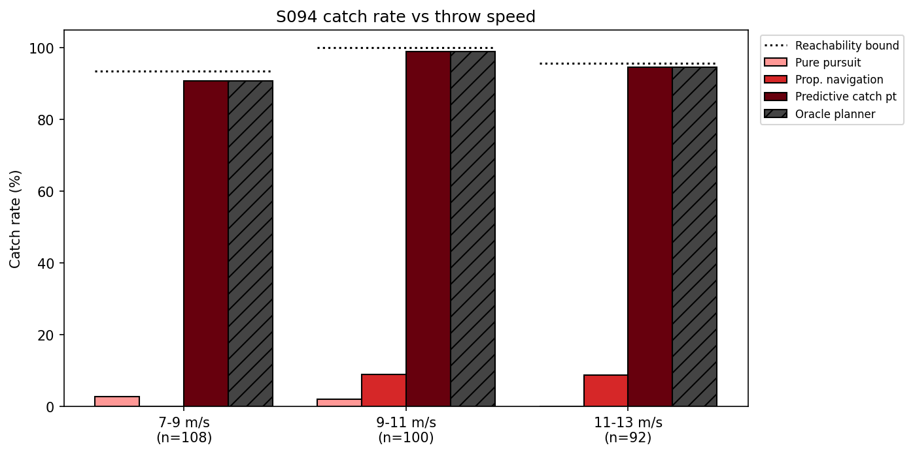
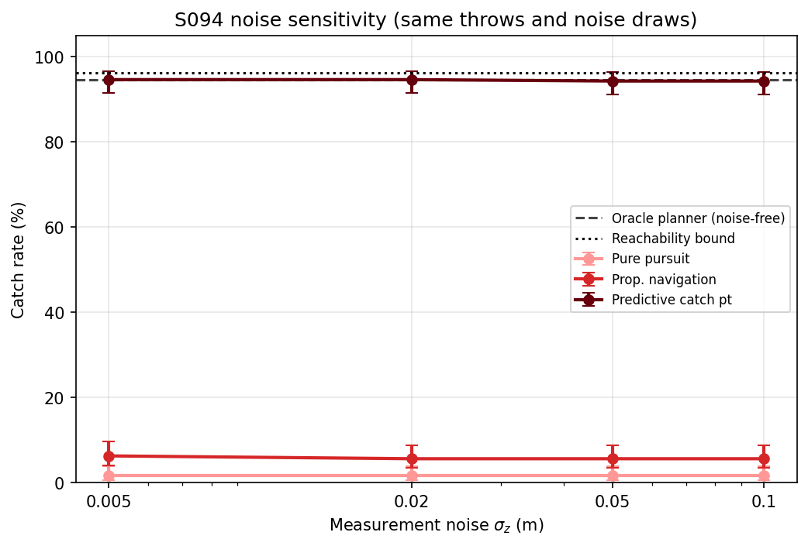
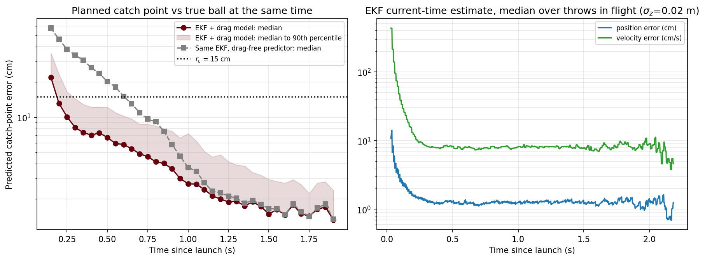
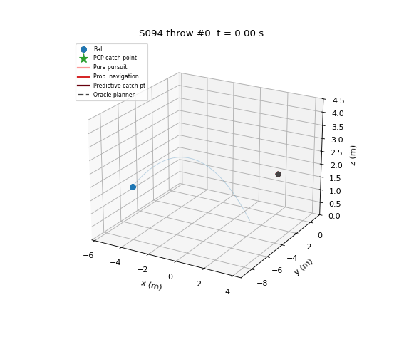

# S094 Aerial Ball Catching

**Domain**: Special Ops & Entertainment | **Difficulty**: ⭐⭐⭐⭐ | **Status**: ✅ Completed

---

## Problem Definition

**Setup**: In a 20 × 20 × 8 m indoor arena, a person standing on a circle of radius 8 m around the centre throws a tennis ball roughly towards the centre (azimuth jitter ±30°, speed U(7, 13) m/s, elevation U(35°, 60°), release height 1.5 m). A drone with a net cup on top starts hovering at a random point within 4 m of the centre at z = 2 m. It reacts 0.15 s after the release and must catch the ball while the ball is **descending** and still above $z_{min} = 0.5$ m. The ball has quadratic air drag. A motion-capture system reports the ball position at 100 Hz with 2 cm Gaussian noise and 20 ms latency, and an EKF estimates the ball state.

**Compared strategies** (all on the **same throws and the same measurement-noise draws**, i.e. common random numbers):

1. **Pure pursuit (PP)**: fly at full speed towards the current estimated ball position.
2. **Proportional navigation (PN)**: 3D PN with $N = 3$; pure pursuit while the closing speed $V_c \le 0$.
3. **Predictive catch point (PCP)**: propagate the EKF estimate with the drag model, pick the earliest reachable point on the descending part of the predicted path, fly to it and re-plan at 20 Hz.

**Non-causal references**:

- **Oracle planner**: PCP with the true trajectory known at launch (the card's oracle).
- **Reachability bound**: a straight-line, from-rest, full-acceleration relaxation that no strategy can beat. The script asserts that every catch of every strategy lies inside it.

---

## Mathematical Model Summary

### Ball

$$\dot{\mathbf{p}}_b = \mathbf{v}_b, \qquad \dot{\mathbf{v}}_b = \mathbf{g} - k\,\|\mathbf{v}_b\|\,\mathbf{v}_b, \qquad k = \frac{\rho C_d \pi r_b^2}{2 m_b} = 0.02022\ \text{m}^{-1}$$

The terminal speed is $\sqrt{g/k} = 22.03$ m/s. The true trajectory is integrated with RK4 at $\Delta t = 2$ ms. Over the 300 throws of seed 0, drag moves the point where the ball crosses $z_{min}$ by 0.38–3.67 m (mean 1.58 m) compared with a drag-free throw. That is far larger than the 0.15 m catch radius.

### Measurements and EKF

$$\mathbf{z}_k = \mathbf{p}_b(t_k - \tau_{lat}) + \boldsymbol{\eta}_k, \quad \boldsymbol{\eta}_k \sim \mathcal{N}(\mathbf{0}, \sigma_z^2 \mathbf{I}_3), \quad f_z = 100\ \text{Hz}$$

State $[\mathbf{p}_b, \mathbf{v}_b]$. The filter is initialised from the first two measurements (finite-difference velocity, matching covariance). Prediction uses RK4 with the drag model, and the covariance uses $F \approx I + A h + (A h)^2/2$ with the drag Jacobian

$$\frac{\partial \dot{\mathbf{v}}_b}{\partial \mathbf{v}_b} = -k\left(\|\mathbf{v}_b\|\mathbf{I}_3 + \frac{\mathbf{v}_b\mathbf{v}_b^\top}{\|\mathbf{v}_b\|}\right)$$

and white-acceleration process noise $q = 0.1$ m²/s³. The update uses the Joseph form. After each update, the estimate is propagated over the 20 ms latency, and then forward step by step until the next measurement. The ball estimate does not depend on what the drone does, so one EKF run per throw set and $\sigma_z$ is shared by PP, PN and PCP. The strategies therefore see exactly the same estimates.

### Drone

Double integrator $\dot{\mathbf{p}}_d = \mathbf{v}_d$, $\dot{\mathbf{v}}_d = \mathbf{u}$ with $\|\mathbf{u}\| \le 10$ m/s², $\|\mathbf{v}_d\| \le 8$ m/s and $0.3 \le z_d \le 4.0$ m (semi-implicit Euler, 2 ms). The altitude window is enforced for every strategy by a velocity barrier: the vertical command is clipped so that the speed towards a limit stays below $\sqrt{2 \cdot 6\ \text{m/s}^2 \cdot d}$, where $d$ is the distance to that limit. The horizontal command is then scaled so that $\|\mathbf{u}\| \le a_{max}$ still holds. The speed, acceleration and altitude limits are asserted at every step.

### Catch condition

The net is at $\mathbf{p}_n = \mathbf{p}_d + [0, 0, 0.1]^\top$. In each 2 ms step, the ball and the net move along straight segments, and the script computes their closest approach:

$$s^* = \mathrm{clip}\!\left(-\frac{\mathbf{r}_0 \cdot \Delta\mathbf{r}}{\|\Delta\mathbf{r}\|^2}, 0, 1\right), \qquad d = \|\mathbf{r}_0 + s^* \Delta\mathbf{r}\|$$

A catch is the first step with $d \le r_c = 0.15$ m, $v_{b,z}(s^*) < 0$ and $z_b(s^*) \ge 0.5$ m. The throw ends when the true ball falls below 0.5 m. The miss distance $d_{miss}$ is the minimum $d$ over the whole descending flight above $z_{min}$. To measure it, the flight continues after a catch as if the ball passed through the cup; otherwise every catch would have $d_{miss} \approx r_c$ by construction. Control effort $\int\|\mathbf{u}\|^2 dt$ and peak speed are counted up to the catch.

### Strategies

- **PP**: $\mathbf{u} = \mathrm{sat}_{a_{max}}\big(K_v(v_{max}\hat{\mathbf{r}} - \mathbf{v}_d)\big)$ with $\mathbf{r} = \hat{\mathbf{p}}_b - \mathbf{p}_n$ and $K_v = 8$ s⁻¹.
- **PN**: $\boldsymbol{\Omega} = \mathbf{r}\times\mathbf{v}_r/\|\mathbf{r}\|^2$, $V_c = -\mathbf{r}\cdot\mathbf{v}_r/\|\mathbf{r}\|$, $\mathbf{u} = N V_c\,\boldsymbol{\Omega}\times\hat{\mathbf{r}}$ when $V_c > 0$, otherwise the PP command. Against a target with constant acceleration $g$, PN with $N = 3$ needs up to $N/(N-2)\,g = 29.43$ m/s², three times $a_{max}$. The diagnostic probes below show that this acceleration budget explains only part of PN's failures.
- **Augmented PN** (diagnostic probe only, the card's extension 2): $\mathbf{u} = N V_c\,\boldsymbol{\Omega}\times\hat{\mathbf{r}} + \tfrac{N}{2}\,\hat{\mathbf{a}}_{b,\perp}$, where $\hat{\mathbf{a}}_{b}$ is the ball acceleration (gravity + drag) evaluated at the EKF estimate and $\perp$ is the component normal to the line of sight. Same PP fallback when $V_c \le 0$.
- **PCP** (re-plan every 50 ms, from $t_{react}$):
  1. Propagate the estimate for 2.5 s in 0.02 s steps. Candidate catch times $t_j$ are those where the predicted ball height is in [0.5, 4.0] m, the ball is descending, and it has not yet fallen below $z_{min}$.
  2. For each candidate, estimate two reach times with a line-of-sight model. $\mathbf{e} = \mathbf{q}_j - \mathbf{p}_d$ is the vector to the drone target $\mathbf{q}_j = \hat{\mathbf{p}}_b(t_j) - [0,0,0.1]^\top$, and $v_\parallel$, $v_\perp$ are the drone velocity components along and across $\mathbf{e}$:
     - $T_{stop}$: a 1D bang–coast–bang along $\mathbf{e}$, starting at $v_\parallel$, accelerating at 10 m/s², braking at 7 m/s² and capped at 8 m/s, ending at rest, plus $\|v_\perp\|/a_{max}$.
     - $T_{free}$: the same with a free arrival speed.
  3. Choose the earliest $t_j$ with $T_{stop} + 0.1 \le t_j - t$ (**hold** mode). If there is none, choose the earliest with $T_{free} + 0.1 \le t_j - t$ (**intercept** mode). If there is still none, choose the $t_j$ that minimises $T_{free} - (t_j - t)$ (**late** mode).
  4. Track the chosen point:
     - Hold mode uses a braking-curve go-to, $\mathbf{v}_{des} = \hat{\mathbf{e}}\min(v_{max}, \sqrt{2 \cdot 7 \cdot D}, 8D)$, with a braking feed-forward term. The drone arrives early and waits on the predicted path.
     - Intercept and late modes fly the straight line at speed $\min(v_{max}, D/(t_j - t))$, so that the drone reaches the point at $t_j$.
- **Oracle planner**: identical to PCP, but the predicted path is the true trajectory.

### Reachability bound

A throw counts as reachable if, for some time $t_n$ on the descending part of the true trajectory with $z_b \in [0.45, 4.25]$ m,

$$T_{lb}\big(\max(\|\mathbf{p}_b(t_n) - \mathbf{p}_{n,0}\| - r_c - 0.1\ \text{m},\ 0)\big) \le t_n - t_{react}$$

Here $T_{lb}(D)$ is the time to cover $D$ from rest at full acceleration, capped at $v_{max}$, with a free arrival speed. Any trajectory under the drone limits covers at most this distance along any direction, so the bound is strict. The extra 0.1 m covers the time discretisation. Efficiency is $\eta = N_{catch}/N_{reachable}$.

---

## Key Parameters

| Parameter | Value |
|-----------|-------|
| Arena | 20 × 20 × 8 m |
| Thrower radius / release height | 8 m / 1.5 m |
| Throw speed / elevation / azimuth jitter | U(7, 13) m/s / U(35°, 60°) / U(−30°, 30°) |
| Ball mass / radius / $C_d$ / air density | 0.057 kg / 0.033 m / 0.55 / 1.225 kg/m³ |
| Drag constant $k$ | 0.02022 m⁻¹ |
| Lowest catchable ball height $z_{min}$ | 0.5 m |
| Drone start | uniform in a 4 m disk, z = 2 m, hovering |
| Drone $v_{max}$ / $a_{max}$ / altitude window | 8 m/s / 10 m/s² / [0.3, 4.0] m |
| Net catch radius / offset | 0.15 m / +0.1 m above the drone |
| Reaction delay $t_{react}$ | 0.15 s |
| Measurement rate / noise / latency | 100 Hz / 0.02 m / 0.02 s |
| PN constant $N$ | 3 |
| PCP re-plan rate / time margin / candidate spacing / horizon | 20 Hz / 0.1 s / 0.02 s / 2.5 s |
| PCP candidate ball-height window | [0.5, 4.0] m |
| Velocity-loop gain $K_v$ (PP and PCP) | 8 s⁻¹ |
| PCP braking deceleration / final-approach gain | 7 m/s² / 8 s⁻¹ |
| Altitude-barrier deceleration (all strategies) | 6 m/s² |
| EKF process-noise density $q$ | 0.1 m²/s³ |
| Reachability-bound slack | 0.1 m |
| Simulation step $\Delta t$ | 0.002 s |
| Monte Carlo | 300 throws (seed 0, main run) + 4 replication seeds × 300 throws |
| Noise sweep $\sigma_z$ | 0.005, 0.02, 0.05, 0.1 m |
| Throw-speed bins | 7–9, 9–11, 11–13 m/s |

---

## Implementation

```
src/05_special_entertainment/s094_ball_catching.py   # Main simulation script
```

```bash
conda activate drones
python src/05_special_entertainment/s094_ball_catching.py
```

The script runs in about 1 minute (41–46 s in two runs with `OMP_NUM_THREADS=1`; up to about 4.5 minutes when the machine is heavily loaded). The Monte Carlo is vectorised across throws.

---

## Results

### Catch rate (seed 0, 300 common throws, $\sigma_z$ = 0.02 m)

| Strategy | Catches | Catch rate | 95 % Wilson CI | $\eta$ vs reachability bound (289) | $\eta$ vs oracle planner (284) |
|----------|--------:|-----------:|:--------------:|------:|------:|
| Pure pursuit | 5 | 1.7 % | [0.7, 3.8] % | 1.7 % | 1.8 % |
| Proportional navigation | 17 | 5.7 % | [3.6, 8.9] % | 5.9 % | 6.0 % |
| **Predictive catch point** | **284** | **94.7 %** | [91.5, 96.7] % | **98.3 %** | 100.0 % |
| Oracle planner | 284 | 94.7 % | [91.5, 96.7] % | 98.3 % | 100.0 % |
| Reachability bound | 289 | 96.3 % | — | — | — |

The card estimated about 92 % of throws to be reachable. Applying the same kind of rough estimate (straight-line reach from rest to the point where the ball crosses $z_{min}$, no catch radius) to seed 0 gives 93.7 %. The strict bound, which also allows catches higher up the descending path, gives 96.3 %.

Misses split into throws outside the bound ("unreachable") and strategy failures:

| Strategy | Unreachable | Strategy failures |
|----------|-----------:|------------------:|
| Pure pursuit | 11 | 284 |
| Proportional navigation | 11 | 272 |
| Predictive catch point | 11 | 5 |
| Oracle planner | 11 | 5 |

**Paired comparison** on the common throws (A wins / ties / B wins, exact McNemar p):

| A vs B | A wins | Ties | B wins | p |
|--------|------:|-----:|------:|---:|
| PCP vs PP | 279 | 21 | 0 | 2.06e-84 |
| PCP vs PN | 267 | 33 | 0 | 8.43e-81 |
| PN vs PP | 17 | 278 | 5 | 1.69e-02 |
| Oracle vs PCP | 0 | 300 | 0 | 1.00 |

**Seed replication** (5 seeds × 300 throws):

| Seed | PP | PN | PCP | Oracle | Bound |
|------|---:|---:|----:|-------:|------:|
| 0 | 1.7 % | 5.7 % | 94.7 % | 94.7 % | 96.3 % |
| 1 | 1.0 % | 5.3 % | 90.7 % | 90.7 % | 92.3 % |
| 2 | 0.7 % | 6.7 % | 93.7 % | 93.7 % | 95.3 % |
| 3 | 0.7 % | 8.0 % | 94.7 % | 94.7 % | 94.7 % |
| 4 | 1.3 % | 8.0 % | 93.7 % | 93.7 % | 94.7 % |
| **Mean ± std** | 1.1 ± 0.4 % | 6.7 ± 1.3 % | **93.5 ± 1.6 %** | 93.5 ± 1.6 % | 94.7 ± 1.5 % |

The order PCP > PN > PP holds in 5 out of 5 seeds.

### Miss distance, effort and speed

| Strategy | $d_{miss}$ 10 % | 25 % | median | 75 % | 90 % |
|----------|------:|------:|------:|------:|------:|
| Pure pursuit | 0.538 m | 0.972 m | 1.474 m | 2.121 m | 2.937 m |
| Proportional navigation | 0.254 m | 0.653 m | 1.702 m | 3.373 m | 4.707 m |
| Predictive catch point | 0.003 m | 0.006 m | 0.012 m | 0.020 m | 0.045 m |
| Oracle planner | 0.002 m | 0.003 m | 0.007 m | 0.017 m | 0.039 m |

| Strategy | Effort per catch (m²/s³) | Peak speed per catch | Mean catch time | Effort, all throws | Peak speed, all throws | Altitude limit touched | Ball–net relative speed at catch (mean / max) |
|----------|------:|------:|------:|------:|------:|------:|------:|
| Pure pursuit | 75.7 ± 11.7 | 6.94 ± 0.93 m/s | 0.98 s | 137.1 | 6.48 m/s | 45.3 % | 11.99 / 13.32 m/s |
| Proportional navigation | 73.2 ± 11.8 | 4.17 ± 0.52 m/s | 1.11 s | 86.2 | 5.11 m/s | 12.7 % | 5.98 / 7.91 m/s |
| Predictive catch point | 53.9 ± 13.7 | 4.77 ± 1.40 m/s | 1.24 s | 55.1 | 4.94 m/s | 0.0 % | 8.60 / 12.44 m/s |
| Oracle planner | 55.1 ± 14.0 | 4.85 ± 1.39 m/s | 1.25 s | 56.2 | 5.02 m/s | 0.0 % | 8.66 / 12.49 m/s |

### Catch rate vs throw speed

| Throw speed | 7–9 m/s (n=108) | 9–11 m/s (n=100) | 11–13 m/s (n=92) |
|------|------:|------:|------:|
| Pure pursuit | 2.8 % | 2.0 % | 0.0 % |
| Proportional navigation | 0.0 % | 9.0 % | 8.7 % |
| Predictive catch point | 90.7 % | 99.0 % | 94.6 % |
| Oracle planner | 90.7 % | 99.0 % | 94.6 % |
| Reachability bound | 93.5 % | 100.0 % | 95.7 % |

### Noise sensitivity (same throws, same standard-normal draws scaled by $\sigma_z$)

| $\sigma_z$ | 0.005 m | 0.02 m | 0.05 m | 0.1 m |
|------|------:|------:|------:|------:|
| Pure pursuit | 1.7 % | 1.7 % | 1.7 % | 1.7 % |
| Proportional navigation | 6.3 % | 5.7 % | 5.7 % | 5.7 % |
| Predictive catch point | 94.7 % | 94.7 % | 94.3 % | 94.3 % |

### Estimator convergence (PCP, $\sigma_z$ = 0.02 m)

This is the error of the planned catch point: the predicted ball position at the planned catch time, compared with the true ball position at that time. The drag-free column uses the same EKF state, propagated without drag. Values are median / 90th percentile in cm:

| Time since launch | Throws in flight | EKF + drag model | Drag-free predictor (median) |
|------|------:|------:|------:|
| 0.15 s | 300 | 21.9 / 35.4 | 57.9 |
| 0.35 s | 300 | 7.4 / 12.9 | 30.7 |
| 0.55 s | 300 | 6.0 / 10.9 | 18.1 |
| 0.75 s | 300 | 4.6 / 8.7 | 9.6 |
| 0.95 s | 300 | 3.0 / 6.7 | 4.7 |
| 1.15 s | 282 | 2.1 / 4.6 | 2.3 |
| 1.35 s | 224 | 1.7 / 3.8 | 1.8 |
| 1.55 s | 133 | 1.6 / 2.8 | 1.6 |
| 1.75 s | 65 | 1.4 / 2.2 | 1.4 |

### PCP planning modes and the ablation

At the first plan ($t = t_{react}$), PCP chose hold mode for 98 throws (98 caught), intercept mode for 158 (158 caught) and late mode for 44 (28 caught). The oracle planner chose 102 / 158 / 40 (caught 102 / 158 / 24).

**Ablation**, restricting the planner to arrive-and-stop (hold) plans: PCP catches 182/300 = 60.7 % and the oracle planner 183/300 = 61.0 %.

### PN diagnostic probes

To find out why PN fails, the script re-runs PN on the seed-0 throws with the same EKF estimates and changes one thing at a time. Most of these probes break the drone limits on purpose (raised a_max, no ceiling), so they are not checked against the reachability bound; augmented PN at a_max = 10 m/s² keeps all drone limits, and all of its catches fall inside the bound:

| Variant | Catches | Rate | Change vs main PN |
|---------|--------:|-----:|------:|
| PN, $a_{max}$ = 10 m/s² (main run) | 17/300 | 5.7 % | +0 |
| PN, $a_{max}$ = 30 m/s² | 75/300 | 25.0 % | +58 |
| PN, $a_{max}$ = 100 m/s² | 75/300 | 25.0 % | +58 |
| Augmented PN, $a_{max}$ = 10 m/s² | 134/300 | 44.7 % | +117 |
| Augmented PN, $a_{max}$ = 30 m/s² | 157/300 | 52.3 % | +140 |
| PN, no 4 m ceiling | 10/300 | 3.3 % | −7 |

### Key findings

- **Hypothesis 1 (PCP highest and close to the oracle): holds.**
  - PCP catches 94.7 % of throws, the same 284 throws as the oracle planner (0 / 300 / 0 paired). That is 98.3 % of the 289 reachable throws.
  - Over 5 seeds, PCP averages 93.5 ± 1.6 % against a bound of 94.7 ± 1.5 %.
  - Estimation costs PCP nothing here. Its predicted catch point is off by a median 7.4 cm by 0.35 s after launch, and re-planning at 20 Hz absorbs the earlier, larger errors. Its median miss distance is 1.2 cm (oracle: 0.7 cm), well inside the 15 cm cup.
  - The planner design matters far more than the estimator. With arrive-and-stop plans only (the ablation), PCP and the oracle drop to 60.7 % and 61.0 %, because stopping at the catch point takes longer than flying through it. The 158 throws where PCP started in intercept mode were all caught.
- **Hypothesis 2 (pure pursuit trails the ball and fails on most long throws): holds, and is stronger than stated.**
  - PP catches 0.0 % of the 11–13 m/s throws, but it also fails on almost all short ones (2.8 % and 2.0 % in the lower bins; 1.7 % overall).
  - Chasing the current ball position makes the drone climb after the rising ball: it hits the 4 m altitude limit in 45.3 % of throws. Its median miss distance is 1.47 m. This fits the "trailing" explanation, but the script does not measure the trailing geometry separately.
- **Hypothesis 3 (PN beats PP but loses to PCP): holds.**
  - PN beats PP: 5.7 % vs 1.7 %, 17 wins / 5 losses, p = 0.017.
  - PN loses to PCP on 267 throws and never wins.
  - The card's two proposed reasons do not hold up equally (see the PN diagnostic probes):
    - **The missing gravity term in the guidance law is the main cause.** Augmented PN, which adds $\tfrac{N}{2}$ times the estimated ball acceleration normal to the line of sight, catches 134/300 with the same 10 m/s² drone (+117 over PN).
    - **The acceleration budget explains only a smaller part.** Plain PN would need up to 29.43 m/s² against a gravity-accelerating target. Giving it 30 m/s² adds 58 catches (75/300), and 100 m/s² adds nothing more (still 75/300). So the budget explains about 58 of PN's 272 strategy failures; plain PN fails on most throws even with unlimited acceleration.
    - **The altitude window is not a cause.** PN touches a limit in 12.7 % of throws, but removing the 4 m ceiling makes it worse (10/300 instead of 17/300).
  - Even augmented PN with 30 m/s² (157/300 = 52.3 %) stays well below PCP (284/300), so the ranking stands.
  - PN's absolute catch rate is so low that "beats PP" is a statement about two failing strategies.
- **Hypothesis 4 (PCP degrades gracefully with $\sigma_z$ up to 0.05 m): holds, and is stronger than stated.**
  - Graceful was defined in advance as a drop of no more than 10 pp from the $\sigma_z$ = 0.005 m value.
  - PCP goes from 94.7 % to 94.3 % at both 0.05 m and 0.1 m.
  - The binding limit is reachability, not estimation. With 100 Hz updates, the EKF converges well before the drone has to commit.
- **Drag matters for prediction, but only early.** Without drag, the predicted catch point is off by a median 57.9 cm at 0.15 s and 30.7 cm at 0.35 s, against 21.9 cm and 7.4 cm with drag. The gap closes after about 1.1 s, when the remaining flight is short.
- **The 11 unreachable throws are physical limits.** They lie outside the strict bound, so no strategy can catch them; the script asserts that none does.
- **Catches are not soft.** The ball hits the cup at a mean of 8.60 m/s relative speed with PCP. Whether a real cup retains the ball is outside the card's catch condition (see the soft-catch extension).

### Representative throw (3D)

Throw #0 (v0 = 8.62 m/s, flight 1.18 s) is the first throw in which PCP catches the ball and both PP and PN miss: PP misses by 0.65 m, PN by 2.13 m, PCP catches at 1.04 s and the oracle at 1.03 s. The green dots are the PCP predicted catch points at each re-plan (darker = later). The paths show the net centre:



### Catch rate

Bars are the catch rate with 95 % Wilson intervals. The dotted line is the reachability bound:



### Miss-distance CDF

The dotted line is $r_c$. PCP and the oracle planner reach 90 % below 5 cm. PP and PN typically miss by 0.5–5 m:



### Catch rate vs throw speed

Dotted segments show the reachability bound for each bin:



### Noise sensitivity



### Estimator convergence

Left: the error of the planned catch point (median, with the band from the median to the 90th percentile), with drag and without drag in the predictor. Right: the EKF's current-time position and velocity errors, as medians over the throws still in flight:



### Animation

Throw #0 in 3D, with all four drones overlaid. The ball is blue and the green star is the current PCP catch point. The GIF has 61 frames, one every 0.02 s:



### Deviations from the scenario card

| Card | Implementation | Reason |
|------|----------------|--------|
| Arena $20 \times 20 \times 6$ m | $20 \times 20 \times 8$ m (card updated) | The card's throw distribution reaches 7.08 m (v0 = 13 m/s, elevation 60°), and 4.0 % of the seed-0 throws peak above 6 m. A 6 m ceiling would block them. No ceiling is modelled. |
| Flight time ≈ 1.1–2.1 s | ≈ 1.0–2.2 s to $z_{min}$ (card updated) | The extreme throws take 1.01 s and 2.23 s; seed 0 spans 1.03–2.18 s. |
| Drag changes the landing point by "tens of centimetres" | 0.38–3.67 m, mean 1.58 m (card updated) | Measured by the script on the seed-0 throws (drag-free vs drag crossing of $z_{min}$). The card's conclusion (drag cannot be ignored) is unchanged. |
| Reach time: per-axis bang–coast–bang bound | Line-of-sight 1D bang–coast–bang ($a$ = 10 m/s² to accelerate, 7 m/s² to brake, ≤ 8 m/s), starting at $v_\parallel$, plus $\|v_\perp\|/a_{max}$, in a stop and a free-arrival version | Matches the tracker, which flies straight lines. The script checks it from rest: the model is conservative by 0.093 to 0.131 s (for example, 1.971 s model vs 1.840 s simulated at 8 m). |
| Track a time-parameterised trajectory (e.g. minimum-jerk) to arrive at $t_j$; if nothing is feasible, take the least-late $t_j$ | Three tiers: earliest **hold** point (arrive early, stop, wait on the predicted path), else earliest **intercept** point (constant-speed line timed to arrive at $t_j$), else **late** (least-late intercept) | A first version with arrive-and-stop plans only caught 60.7 % (oracle 61.0 %; still printed as an ablation), far below the 96.3 % bound, because stopping is much slower than flying through the point. The tiered planner is a direct reading of the card's "arrive at $t_j$" and keeps the robust hold plan whenever there is time. |
| Oracle gives "the fraction of throws reachable at all" | Two references: the oracle planner (PCP with the true trajectory, as the card defines it) and a strict reachability bound; $\eta$ is reported against both | A planner, even with perfect information, is not a bound. The analytic relaxation is, and the script asserts that no catch falls outside it. |
| $d_{miss} = \min_t \|\mathbf{p}_b - \mathbf{p}_n\|$ | Minimum over the whole descending flight above $z_{min}$, with the ball treated as passing through the cup after a catch; effort and peak speed are counted up to the catch | If the flight stopped at the catch, every catch would have $d_{miss}$ just below $r_c$ (seen in a first version), so the metric would not distinguish strategies. |
| Altitude limited to [0.3, 4.0] m (no mechanism given) | Velocity barrier (6 m/s²) applied to every strategy's command | Keeps the limits without teleporting or exceeding $a_{max}$; asserted every step. |
| Gains, EKF tuning and estimator initialisation not specified | $K_v$ = 8 s⁻¹, braking 7 m/s², final-approach gain 8 s⁻¹, $q$ = 0.1 m²/s³, two-point initialisation, 2.5 s prediction horizon | Added parameters, listed in the table above. |
| One Monte Carlo of 300 throws | Seed 0 (the card's 300 throws) for all detailed results, plus 4 more seeds × 300 for replication | Shows the ranking and rates are not specific to one draw. |
| Augmented PN listed as an extension; reasons for PN's failure stated as hypotheses | PN diagnostic probes: PN with $a_{max}$ = 30 and 100 m/s², augmented PN with 10 and 30 m/s², PN without the 4 m ceiling (seed 0 only) | Tests the card's explanation of hypothesis 3 instead of asserting it. Only the main PN run counts in the strategy comparison. |
| "Catch rate vs throw speed (binned)" | Three 2 m/s bins | Bins not specified; about 100 throws per bin. |
| Feasibility "about 92 %" | Strict bound 96.3 % (seed 0) and 94.7 ± 1.5 % (5 seeds); a card-style estimate gives 93.7 % | Computed as the card requires. The card's figure is close to the card-style estimate. |

---

## Extensions

1. **Soft catch**: require a relative speed below 3 m/s at contact. PCP currently catches at a mean of 8.60 m/s, so this needs velocity matching along the ball path.
2. **Augmented PN**: add $\tfrac{N}{2}\mathbf{a}_{b,\perp}$ to give PN the gravity term it lacks.
3. **Chapman's gaze heuristic** (constant rate of change of the tangent of the elevation angle) as a model-free baseline.
4. **Spin and Magnus force** with an estimator that does not know the spin, which would make the drag-free/drag gap in the convergence plot a model-mismatch study.
5. **Two-drone catching** with assignment by earliest feasible catch time and handover when the prediction changes.
6. **Juggling**: catch and re-launch towards a second drone.

---

## Related Scenarios

- Prerequisites: [S001 Basic Intercept](../../../scenarios/01_pursuit_evasion/S001_basic_intercept.md), [S008 Stochastic Pursuit — Kalman Filter Tracking](../../../scenarios/01_pursuit_evasion/S008_stochastic_pursuit.md)
- Algorithmic cross-reference: [S023 Moving Landing Pad](../../../scenarios/02_logistics_delivery/S023_moving_landing_pad.md), [S027 Aerial Refueling Relay](../../../scenarios/02_logistics_delivery/S027_aerial_refueling_relay.md)
- Same domain: [S081 Selfie Follow Mode](../../../scenarios/05_special_entertainment/S081_selfie_follow.md), [S092 Movie Car Chase Scene](../../../scenarios/05_special_entertainment/S092_movie_chase.md), [S099 Cross-Obstacle Relay Pass](../../../scenarios/05_special_entertainment/S099_obstacle_relay.md)
- Scenario card: [S094 Aerial Ball Catching](../../../scenarios/05_special_entertainment/S094_ball_catching.md)
