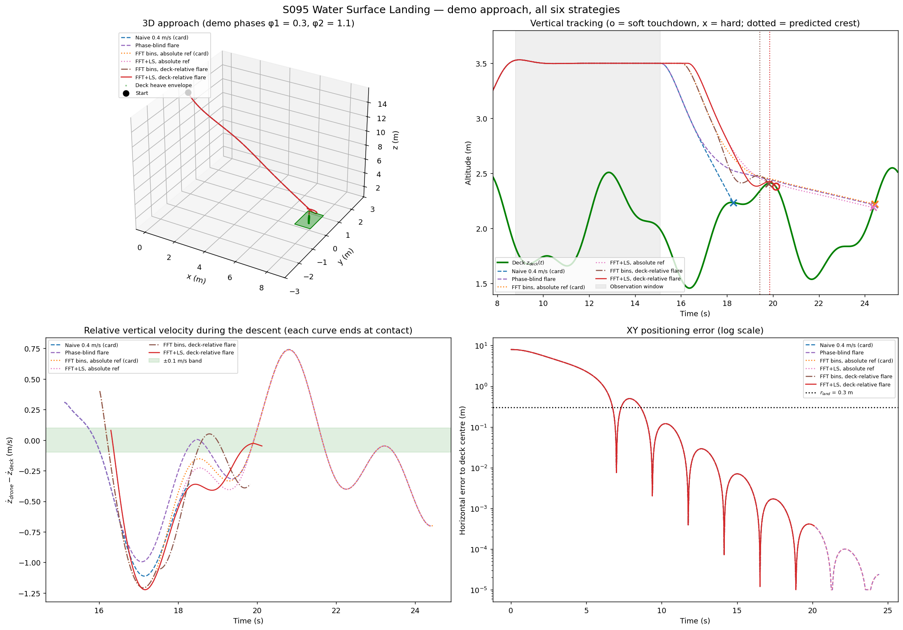
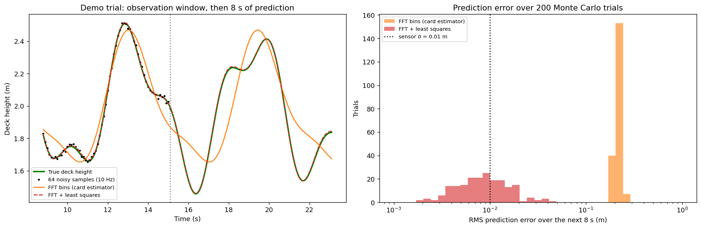
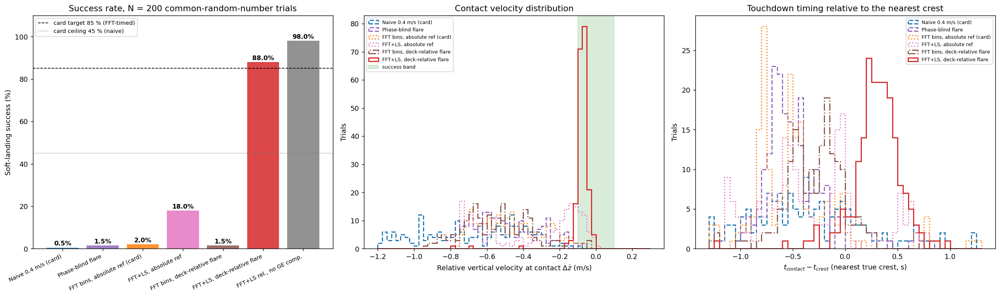
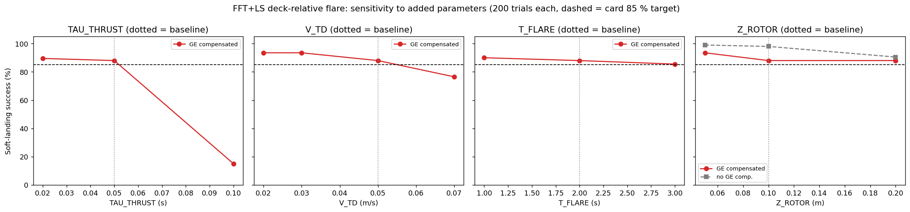
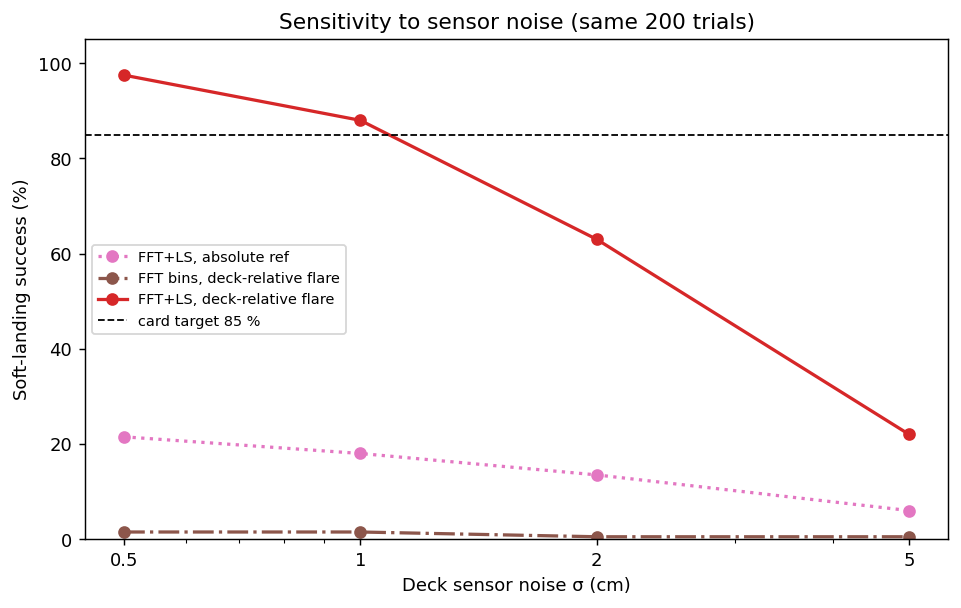
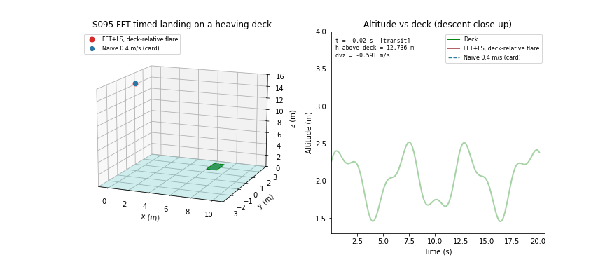

# S095 Water Surface Landing Simulation

**Domain**: Special Ops & Entertainment | **Difficulty**: ⭐⭐⭐ | **Status**: ✅ Completed

---

## Problem Definition

**Setup**: A drone must land on a 1 × 1 m boat deck that heaves with a two-frequency swell. The deck centre is at $(8, 0)$ m with a mean height of 2 m above the sea. The drone starts at $(0, 0, 15)$ m, flies to a hold point 1.5 m above the mean deck height (3.5 m), records 64 deck-height samples at 10 Hz (noise σ = 1 cm), and then descends.

**Success** (soft touchdown): at the first contact with the deck, the horizontal distance to the deck centre is at most $r_{land} = 0.3$ m and the relative vertical speed $|\dot z_{drone} - \dot z_{deck}|$ is at most $v_{land,max} = 0.1$ m/s.

**Comparison strategies** (same 200 random wave-phase pairs and the same sensor noise for every strategy):

1. **Naive 0.4 m/s (card)**: constant 0.4 m/s descent right after the observation window, ignoring the wave phase.
2. **Phase-blind flare**: 0.4 m/s cruise, then a 2 s flare down to a 0.05 m/s creep that ends at the highest deck sample seen; started right away, no timing.
3. **FFT bins, absolute ref (card)**: the card's estimator (64-point FFT, two largest bins) predicts the next crest, and the cruise + flare profile is timed to reach the predicted crest height at the predicted crest time.
4. **FFT+LS, absolute ref**: same timed profile, but the wave is estimated by zero-padded FFT peaks refined with a nonlinear least-squares fit of two sinusoids.
5. **FFT bins, deck-relative flare**: card estimator; during the flare the reference also follows the *predicted deck motion*.
6. **FFT+LS, deck-relative flare** (best): least-squares estimator with the deck-relative flare.

An ablation runs strategy 6 without ground-effect compensation.

---

## Mathematical Model Summary

### Deck heave

$$z_{deck}(t) = 2 + A_1 \sin\!\left(\tfrac{2\pi t}{T_1} + \varphi_1\right) + A_2 \sin\!\left(\tfrac{2\pi t}{T_2} + \varphi_2\right), \qquad \varphi_1, \varphi_2 \sim \mathcal{U}[0, 2\pi)$$

with $A_1 = 0.40$ m, $T_1 = 6$ s, $A_2 = 0.15$ m, $T_2 = 2.5$ s. The maximum deck speed is 0.796 m/s and the maximum deck acceleration 1.386 m/s².

### Wave estimators

*Card (FFT bins)*: rFFT of the 64 mean-removed samples; the two largest non-DC bins give $\hat f_i = k_i f_s / N$, $\hat A_i = 2|\hat Z[k_i]|/N$ and the phase. For $z = A\sin(2\pi f t + \varphi)$ the FFT angle at the first sample $t_0$ is $\varphi_0 - \pi/2$, so

$$\hat\varphi_i = \angle \hat Z[k_i] + \tfrac{\pi}{2} - 2\pi \hat f_i t_0 .$$

The bin spacing is $f_s/N = 0.15625$ Hz, so the swell falls at 1.067 bins and the chop at 2.560 bins. Neither lies on a bin, which causes spectral leakage and frequency errors.

*FFT + least squares*: the 4096-point zero-padded FFT gives two peak frequencies. A linear least-squares fit then gives the starting amplitudes and phases, and Levenberg–Marquardt fits the offset and both sinusoids, with the frequencies free, to the 64 samples.

### Crest timing

The next predicted crest is the first local maximum of $\hat z_{deck}(t)$ that the descent can still reach: $t_{start} = t_{crest} - T_{desc}(\hat z_{crest}) \ge t_{now}$.

### Descent profile (cruise + flare + creep)

The descent cruises at $v_{desc} = 0.4$ m/s, then flares for $T_F = 2$ s with the speed falling linearly to $v_{td} = 0.05$ m/s, then creeps at $v_{td}$. The flare covers $T_F (v_{desc}+v_{td})/2 = 0.45$ m, so

$$T_{desc}(z_c) = \frac{z_{hold} - z_c - 0.45}{v_{desc}} + T_F .$$

This is 3.25 s for a 2.55 m crest and 5.25 s for a 1.75 m crest.

*Deck-relative flare*: during the flare, the absolute reference $z_{abs}(t)$ is blended with the predicted deck motion:

$$z_{ref}(t) = z_{abs}(t) + w(t)\,\bigl(\hat z_{deck}(t) - \hat z_{crest}\bigr), \qquad w = 3u^2 - 2u^3,\ u = \frac{t - (t_{crest} - T_F)}{T_F} \in [0, 1].$$

After the predicted crest, $w = 1$ and the drone follows $\hat z_{deck}(t) - v_{td}(t - t_{crest})$. Velocity and acceleration feedforward use the analytic derivatives of $z_{ref}$.

### Vehicle model (point mass)

$\ddot{\mathbf p} = (a_x, a_y, f\,k_{GE}(h) - g)$. The horizontal accelerations $a_x, a_y$ and the specific thrust $f$ follow the PD commands through a 0.05 s first-order lag. The horizontal acceleration is limited to $g\tan 0.4$, and $0 \le f \le 2g$.

The PD gains are the card's: $K_{p,xy} = 2.0$, $K_{d,xy} = 1.2$, $K_{p,z} = 6.0$, $K_{d,z} = 3.0$, with velocity and acceleration feedforward.

**Ground effect** (Cheeseman–Bennett) acts at the rotor plane, which is 0.10 m above the landing gear:

$$k_{GE}(h) = \frac{1}{1 - \bigl(R/4(h+0.10)\bigr)^2}, \qquad R = 0.12 \text{ m}.$$

Here $h$ is the gear height above the deck. This gives $k_{GE}$ = 1.0057 at 0.30 m, 1.0230 at 0.10 m and 1.0989 at contact. The controller divides its thrust command by $k_{GE}$ measured with a downward rangefinder (compensation).

---

## Key Parameters

| Parameter | Value |
|-----------|-------|
| Swell $A_1$, $T_1$ / chop $A_2$, $T_2$ | 0.40 m, 6.0 s / 0.15 m, 2.5 s |
| Mean deck height, deck size, deck centre | 2.0 m, 1 × 1 m, (8, 0) m |
| Start / hold altitude $z_{hold}$ | (0, 0, 15) m / 3.5 m |
| Transit reference speed (added) | 2.0 m/s, straight line |
| FFT window $N_{obs}$, sample rate $f_s$, sensor noise σ | 64, 10 Hz (6.4 s), 0.01 m |
| Zero-padded FFT length for the LS initialisation (added) | 4096 |
| Crest search window $T_{scan}$ | 8 s after the earliest reachable arrival |
| Descent speed $v_{desc}$ / creep $v_{td}$ (added) / flare $T_F$ (added) | 0.40 m/s / 0.05 m/s / 2.0 s |
| Landing tolerances $r_{land}$ / $v_{land,max}$ | 0.30 m / 0.10 m/s |
| Mass | 1.0 kg |
| PD gains $K_{p,xy}, K_{d,xy}, K_{p,z}, K_{d,z}$ | 2.0, 1.2, 6.0, 3.0 |
| Thrust lag (added) / tilt limit / thrust limit | 0.05 s / 0.4 rad / $2mg$ |
| Rotor radius / rotor height above gear (added) | 0.12 m / 0.10 m |
| $\Delta t$ / $T_{max}$ / Monte Carlo trials | 0.02 s / 60 s / 200 (seed 95) |
| Noise sweep (added) | σ = 0.5, 1, 2, 5 cm |
| Added-parameter sweeps (best strategy, same 200 trials) | thrust lag 0.02 / 0.05 / 0.1 s; creep $v_{td}$ 0.02 / 0.03 / 0.05 / 0.07 m/s; flare 1 / 2 / 3 s; rotor height 0.05 / 0.1 / 0.2 m (with and without GE compensation) |
| Demo phases | $\varphi_1 = 0.3$, $\varphi_2 = 1.1$ (card) |

---

## Implementation

```
src/05_special_entertainment/s095_water_landing.py   # Main simulation script
```

```bash
conda activate drones
python src/05_special_entertainment/s095_water_landing.py
```

Runtime: 6.5–8.8 min, measured while other simulations shared the machine. The parameter sweeps added 11 Monte Carlo sets; the version without them measured 1.7 min (independent review). The script asserts that the thrust stays within its limits, the speed stays below 5 m/s, the drone never goes below sea level, contact happens only in the descent phase, and deck penetration at contact is no more than one step of closing speed.

---

## Results

### Card checks

- The card's phase formula $\hat\varphi = \angle\hat Z[k] + 2\pi f t_{start}$ was tested on a noise-free 0.4 m sinusoid that lies exactly on a bin. With the window starting at $t_0$ = 10 s, its 8 s prediction has an RMS error of **0.2032 m**; the corrected formula gives 8.42e-17 m. The card's error depends on $t_0$ (its phase error grows with $t_0$). Over one 6.4 s period of window start times, it ranges from 0.0000 to 0.5689 m RMS, while the corrected formula stays below 3.7e-16 m.
- A constant 0.4 m/s descent onto a crest, where the deck speed is 0, gives $|\Delta\dot z| = 0.40$ m/s. That is 4× the 0.1 m/s tolerance, so the card's descent can never succeed by design. All profiles here therefore add a flare to 0.05 m/s.

### Demo run ($\varphi_1 = 0.3$, $\varphi_2 = 1.1$; observation window 8.80–15.10 s)

| Strategy | Contact (s) | $\Delta\dot z$ (m/s) | Timing vs nearest crest (s) | Soft? |
|---|---:|---:|---:|:-:|
| Naive 0.4 m/s (card) | 18.28 | −0.355 | +0.072 | no |
| Phase-blind flare | 24.42 | −0.700 | −0.776 | no |
| FFT bins, absolute ref (card) | 24.44 | −0.698 | −0.756 | no |
| FFT+LS, absolute ref | 24.38 | −0.697 | −0.816 | no |
| FFT bins, deck-relative flare | 19.82 | −0.360 | −0.054 | no |
| **FFT+LS, deck-relative flare** | **20.12** | **−0.047** | +0.246 | **yes** |

The card estimator found components (0.373 m, 0.1562 Hz) and (0.109 m, 0.3125 Hz). The least-squares fit found (0.399 m, 0.1670 Hz) and (0.151 m, 0.4008 Hz), against the true (0.40 m, 0.1667 Hz) and (0.15 m, 0.4 Hz). The 8 s prediction RMS error is 0.1864 m for the bins and 0.0054 m for LS. The bin estimate put the crest at 19.44 s and 2.469 m; LS put it at 19.87 s and 2.414 m.

### Monte Carlo (200 trials, σ = 1 cm)

| Strategy | Soft landings | $\|\Delta\dot z\|$ mean ± std (median), m/s | $\|t_{contact} - t_{crest}\|$ mean ± std, s | Mean contact time, s |
|---|---:|---|---|---:|
| Naive 0.4 m/s (card) | 0.5% (1/200) | 0.674 ± 0.279 (0.647) | 0.947 ± 0.768 | 18.72 |
| Phase-blind flare | 1.5% (3/200) | 0.486 ± 0.178 (0.519) | 0.531 ± 0.209 | 21.83 |
| FFT bins, absolute ref (card) | 2.0% (4/200) | 0.465 ± 0.180 (0.490) | 0.604 ± 0.325 | 23.99 |
| FFT+LS, absolute ref | 18.0% (36/200) | 0.343 ± 0.254 (0.230) | 0.534 ± 0.410 | 24.19 |
| FFT bins, deck-relative flare | 1.5% (3/200) | 0.559 ± 0.176 (0.570) | 0.596 ± 0.679 | 21.11 |
| **FFT+LS, deck-relative flare** | **88.0% (176/200)** | **0.081 ± 0.075 (0.073)** | 0.357 ± 0.264 | 21.38 |
| FFT+LS rel., no GE compensation (ablation) | 98.0% (196/200) | 0.040 ± 0.070 (0.028) | 0.992 ± 0.980 | 23.46 |

Every strategy touched down in all 200 trials, and the largest horizontal error at contact was 0.0017 m. No timed strategy fell back to the blind profile. The 8 s prediction RMS error was 0.2136 ± 0.0161 m with the card bins (max 0.2453) and 0.0102 ± 0.0070 m with FFT + LS (median 0.0085, max 0.0467).

**Per-trial comparison of FFT+LS deck-relative** (wins = it lands softly and the other does not):

| Against | Wins | Losses | Both succeed | Both fail |
|---|---:|---:|---:|---:|
| Naive 0.4 m/s (card) | 176 | 1 | 0 | 23 |
| Phase-blind flare | 174 | 1 | 2 | 23 |
| FFT bins, absolute ref (card) | 172 | 0 | 4 | 24 |
| FFT+LS, absolute ref | 140 | 0 | 36 | 24 |
| FFT bins, deck-relative flare | 173 | 0 | 3 | 24 |
| FFT+LS rel., no GE comp. | 0 | 20 | 176 | 4 |

**Noise sensitivity** (same phases; the noise draws are scaled):

| σ | FFT+LS, absolute ref | FFT bins, deck-relative | FFT+LS, deck-relative |
|---|---:|---:|---:|
| 0.5 cm | 21.5% | 1.5% | 97.5% |
| 1.0 cm | 18.0% | 1.5% | 88.0% |
| 2.0 cm | 13.5% | 0.5% | 63.0% |
| 5.0 cm | 6.0% | 0.5% | 22.0% |

**Key findings**:

- **The card's expectation holds only after three fixes, and only near the chosen added parameters.** The best strategy reaches 88.0% with the baseline settings, just above the card's 85% target. It needs:
  - a flare, because the card's constant 0.4 m/s contact is 4× too fast;
  - an estimator that resolves the off-bin frequencies (least-squares refinement);
  - a descent that follows the predicted deck in its last 2 s.

  With the card's own estimator and reference, success is 2.0%. The 85% target also depends on parameters the card does not give (sensitivity table below):
  - **thrust lag**: 0.02 s → 89.5%, 0.1 s → 15.0%;
  - **creep speed $v_{td}$**: 0.02–0.03 m/s → 93.5%, 0.07 m/s → 76.5%;
  - **flare duration**: 1 s → 90.0%, 3 s → 85.5%.

  The strategy ranking is robust, but "≥ 85%" only holds for a responsive vehicle (lag ≤ 0.05 s) with a slow creep.
- **The card's FFT estimator cannot predict this sea.** With 64 samples at 10 Hz, the bins are 0.156 Hz apart. Both wave frequencies fall between bins, and the estimate locks onto 0.156 Hz and 0.3125 Hz instead of 0.1667 Hz and 0.4 Hz. The RMS prediction error (0.2136 m) is about as large as the waves themselves. With this estimator, timing is no better than the phase-blind flare (2.0% vs 1.5%), even when the descent follows the predicted deck (1.5%).
- **Accurate timing alone is not enough.** With an accurate prediction (1 cm RMS) but the card's absolute reference, success is only 18.0%. Once the drone reaches the predicted crest height, it creeps at 0.05 m/s. If it arrives a few millimetres high, the deck falls away, and the next contact is with a rising deck at several tenths of a m/s. Following the predicted deck during the flare removes that sensitivity: the 24 remaining failures have $\Delta\dot z$ mostly between −0.100 and −0.163 m/s, just outside the band, plus three hard cases (−0.423, −0.697, −0.797).
- **Card naive ceiling (≤ 45%) holds**: the naive descent succeeded in 0.5% of trials.
- **Ground effect helps if it is not cancelled.** Without compensation, ground effect cushions the last centimetres. The drone slows and rides the deck, and success rises to 98.0% (20 wins and 0 losses against the compensated version). Touchdown then happens later and farther from the crest (timing error 0.992 s vs 0.357 s). The compensated controller is still the main strategy, because it is the standard design and its result does not depend on an unmodelled aerodynamic effect. The cushion is a real effect, but this quasi-static model of it over a moving deck is approximate. Its size depends on the added rotor height above the gear: without compensation, success is 99.0% at 0.05 m, 98.0% at 0.1 m and 90.5% at 0.2 m. With compensation it is 93.5%, 88.0% and 88.0%.
- **Sensor noise matters**: the best strategy drops from 97.5% at 0.5 cm to 63.0% at 2 cm and 22.0% at 5 cm.

### Approach Analysis

Demo trial: the 3D path, altitude against the deck (o = soft touchdown, x = hard), relative vertical velocity during the descent, and horizontal error. Under the card's PD gains ($\zeta \approx 0.42$), the horizontal error converges with a slowly decaying oscillation. It is below 1 mm well before touchdown.



### Wave Prediction

Left: the 64 noisy samples and the 8 s predictions of both estimators in the demo trial. Right: the distribution of the 8 s RMS prediction error over the 200 trials.



### Monte Carlo

Success rate for each strategy (dashed = card target 85%, dotted = card naive ceiling 45%), the relative velocity at contact, and the touchdown time relative to the nearest true crest:



### Added-Parameter Sensitivity

FFT+LS deck-relative flare, the same 200 trials for every value (baseline in bold):

| Parameter | Values → soft-landing success |
|---|---|
| Thrust lag | 0.02 s → 89.5%, **0.05 s → 88.0%**, 0.1 s → 15.0% |
| Creep speed $v_{td}$ | 0.02 m/s → 93.5%, 0.03 m/s → 93.5%, **0.05 m/s → 88.0%**, 0.07 m/s → 76.5% |
| Flare duration | 1 s → 90.0%, **2 s → 88.0%**, 3 s → 85.5% |
| Rotor height above gear (GE compensated) | 0.05 m → 93.5%, **0.1 m → 88.0%**, 0.2 m → 88.0% |
| Rotor height above gear (no GE compensation) | 0.05 m → 99.0%, **0.1 m → 98.0%**, 0.2 m → 90.5% |

With a slower thrust response (0.1 s) success collapses, most likely because the drone can no longer follow the deck's crest acceleration (up to 1.386 m/s²) during the deck-relative flare (not diagnosed further). A faster creep (0.07 m/s) leaves less margin to the 0.1 m/s limit.



### Noise Sensitivity



### Animation

The demo trial: FFT+LS deck-relative (red) next to the naive descent (blue dashed). The right panel shows altitude against the heaving deck. During the transit, the drone undershoots the 3.5 m hold altitude by a few tenths of a metre (visible in the panel, not printed) before it settles. The naive drone hits the deck at 18.28 s; the timed drone touches down softly at 20.12 s. 102 frames at 20 fps (every 10th of 1006 samples).



### Deviations from the scenario card

| Card | Implementation | Reason |
|------|----------------|--------|
| 10-state linearised quadrotor (attitude angles and rates) | Point mass with a 0.05 s first-order lag on thrust and horizontal acceleration, tilt and thrust limits | Project convention: point-mass model for this scenario. The lag stands in for the attitude loop. |
| No ground effect | Cheeseman–Bennett ground effect at the rotor plane (0.10 m above the gear, R = 0.12 m), cancelled with a rangefinder; ablation without cancellation | Added near-surface aerodynamics. The ablation shows that it changes the result (98.0% vs 88.0%). |
| Phase $\hat\varphi = \angle\hat Z[k] + 2\pi f t_{start}$ | $\hat\varphi = \angle\hat Z[k] + \pi/2 - 2\pi f t_0$ | The card's formula is a sine/cosine mix-up with the wrong sign. On a bin-aligned sinusoid it gives an RMS error of 0.2032 m against 8.42e-17 m for the corrected formula. Card fixed. |
| Card code: samples taken every 0.02 s step; the noise variable is never used | Samples at 10 Hz (every 5 steps) with σ = 1 cm noise | Matches the card's $f_s$ and noise parameter. |
| Constant 0.4 m/s descent until contact | Cruise at 0.4 m/s, a 2 s flare to 0.05 m/s, then a creep (all strategies except the card naive) | Contact at 0.4 m/s gives 0.40 m/s > 0.1 m/s even with perfect timing. Card note added. |
| Success checked at the first $p_z \le z_{deck} + r_{land}$, including $\|p_z - z_{deck}\| \le r_{land}$ | Success checked at physical contact $p_z \le z_{deck}$; the vertical-position condition is dropped | At the card's trigger, $\|p_z - z_{deck}\| = r_{land}$ holds by construction (X3), and the drone has not touched the deck yet. |
| If the crest is too soon, add $T_1$ | Search for the first predicted crest that the descent can still reach | The two-frequency deck is not $T_1$-periodic (its common period is 30 s). |
| Two strategies (naive, FFT-timed) | Six strategies plus one ablation, as listed above | Separates the effects of the estimator, the reference profile and the flare, and adds a fair phase-blind baseline. |
| Transit: PD straight to the hold point | PD tracking of a 2 m/s straight-line reference | Keeps the 14 m transit at a bounded speed. A plain PD step to a point 14 m away commands saturated accelerations at the start. |
| — | Speed bound of 5 m/s asserted | Physical sanity check (X4). |
| Expected: MC success ≥ 85% (FFT), ≤ 45% (naive) | 88.0% (FFT+LS, deck-relative); 2.0% with the card's estimator and reference; naive 0.5% | See the key findings. |

---

## Extensions

1. **Irregular sea state**: JONSWAP spectrum with 20 random components; study how success falls as the significant wave height grows from 0.5 to 2 m.
2. **Online re-estimation**: keep fitting the wave model during the wait and the descent (a sliding window or an EKF on $A_i, f_i, \varphi_i$) and replan the crest time.
3. **Rangefinder feedback flare**: track the measured deck height in the final 0.5 m with a filtered derivative, and compare it with the prediction-based flare under sensor delay.
4. **Unsteady ground effect over a moving surface**: replace the quasi-static cushion with a model that depends on the closing speed, and re-check the ablation.
5. **Retry policy**: abort and climb back to $z_{hold}$ when the predicted relative speed at contact exceeds the tolerance, and measure the success after up to three attempts.

---

## Related Scenarios

- Prerequisites: [S079 Offshore Wind Farm Installation Assistance](../../../scenarios/04_industrial_agriculture/S079_offshore_wind.md), [S027 Aerial Refueling Relay](../../../scenarios/02_logistics_delivery/S027_aerial_refueling_relay.md)
- Cross-reference: [S023 Moving Landing Pad](../../../scenarios/02_logistics_delivery/S023_moving_landing_pad.md), [S058 Typhoon Eye Probing](../../../scenarios/03_environmental_sar/S058_typhoon.md)
- Scenario card: [S095 Water Surface Landing Simulation](../../../scenarios/05_special_entertainment/S095_water_landing.md)
