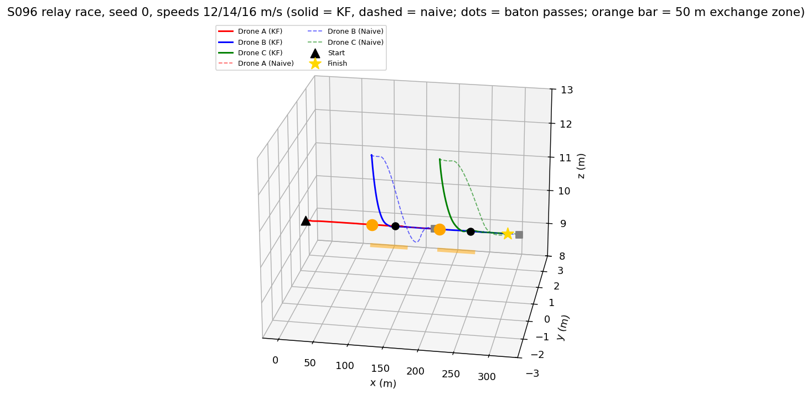
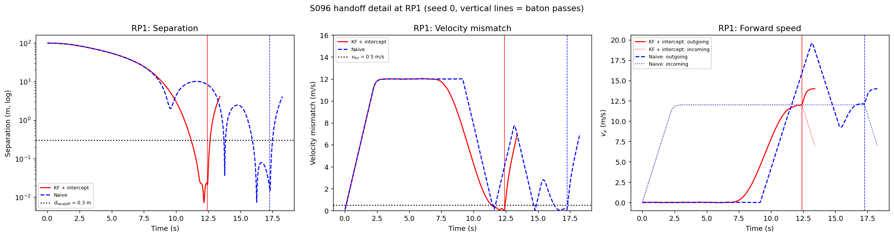
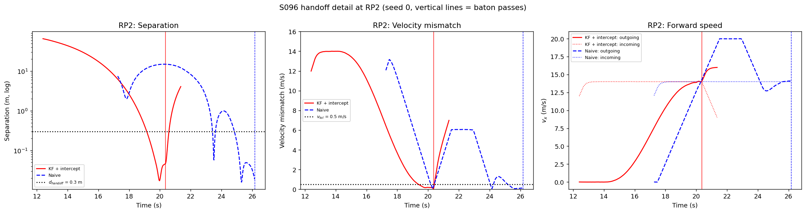
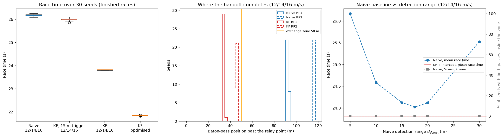
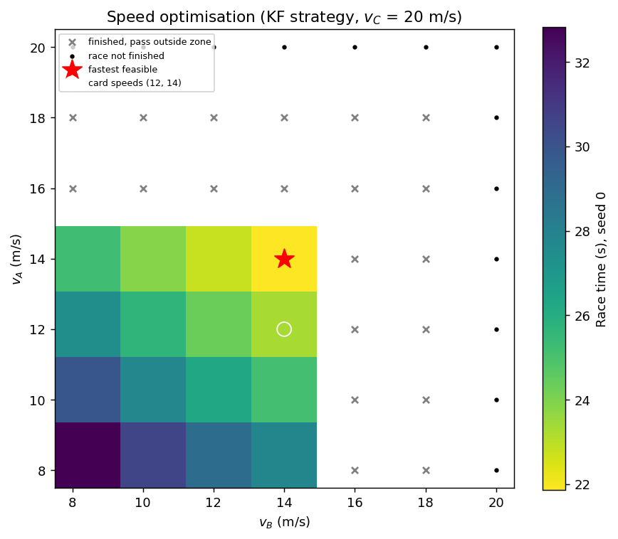
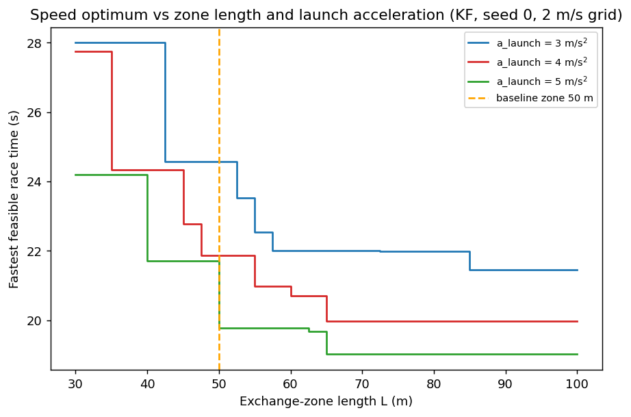
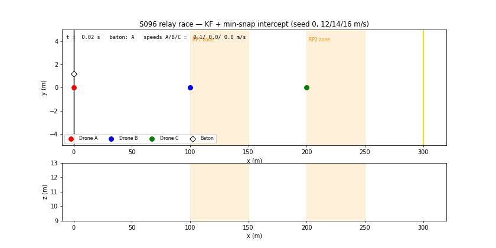

# S096 Drone Relay Race

**Domain**: Special Ops & Entertainment | **Difficulty**: ⭐⭐⭐ | **Status**: ✅ Completed

---

## Problem Definition

**Setup**: Three drones run a 300 m straight relay at 10 m altitude, with legs of 100 m. Drone A starts at rest at $(0, 0, 10)$ m holding the baton. Drones B and C hover at the relay points, $(100, 0, 12)$ m and $(200, 0, 12)$ m.

A baton pass succeeds when the incoming and outgoing drones stay within $d_{handoff} = 0.3$ m and $v_{tol} = 0.5$ m/s of each other for $T_{handoff} = 1$ s continuously. Each outgoing drone tracks the incoming one with a Kalman filter on noisy position measurements ($\sigma_{obs} = 0.05$ m, 50 Hz).

**Objective**: finish the race with both passes successful, in minimum time. Added constraint: each pass must finish within a **50 m exchange zone** past its relay point, so that it does not run into the next leg. Without this zone the speed optimum would trivially be $v_{max}$. The zone length and the launch acceleration are both added parameters; the results are reported for L = 40–60 m and $a_L$ = 3–5 m/s² as well.

**Strategies** (same drones, disturbances and sensor noise; common random numbers):
1. **Naive (card)**: the outgoing drone reacts only once the incoming drone is within $d_{detect} = 5$ m. It then matches the incoming velocity at full acceleration and closes the remaining gap with the formation PD. It uses the current KF estimate, with no prediction.
2. **KF + min-snap intercept** (proposed): the outgoing drone launches at the last moment at which a rest-to-$v_{in}$ min-snap intercept, with peak acceleration $0.8\,a_{max}$, still meets the KF-predicted incoming drone. It replans at 10 Hz and then holds formation with the same PD.
3. **KF, card 15 m trigger** (variant): the same as 2, but launching is only allowed once the incoming drone is within 15 m of the relay point (the card's approach-zone trigger).

A grid search over $(v_A, v_B)$ then finds the fastest feasible race. $v_C$ is fixed at 20 m/s because nothing comes after C.

---

## Mathematical Model Summary

### Dynamics

Each drone is a point mass: $\dot{\mathbf v} = \mathbf u + \mathbf w$ with $\|\mathbf u\| \le 5$ m/s² and $\mathbf w \sim \mathcal N(0, 0.1^2 I)$ m/s². A speed governor keeps $\|\mathbf v\| \le 20$ m/s. Euler integration at 50 Hz.

The cruise command (card) is $\mathbf u = 5(\mathbf v_{des} - \mathbf v)$ with $\mathbf v_{des} = (v_i,\ -2y,\ -2(z - 10))$.

### Kalman filter (card)

Constant-velocity model with 6 states, $Q = \sigma_a^2[\cdot]$ ($\sigma_a = 0.5$ m/s²) and $R = 0.05^2 I$. The filter is re-initialised every time the baton changes hands.

### Minimum-snap intercept

The intercept is a degree-7 polynomial per axis with position, velocity, acceleration and jerk fixed at both ends. The end state is $(\hat{\mathbf p}_{in}(t^*),\ \hat{\mathbf v}_{in})$ with zero acceleration and jerk.

For a rest-to-$v$ transfer with displacement $vT/2$, the velocity follows the quintic smoothstep $10s^3 - 15s^4 + 6s^5$, so the peak acceleration is $1.875\,v/T$. With the peak limited to $a_L = 0.8\,a_{max} = 4$ m/s²:

$$T = 1.875\,v/a_L, \qquad \text{launch when}\quad x_{out} - \hat x_{in} \le v\,T/2 .$$

This is the latest launch for that acceleration, and therefore the earliest rendezvous point. Each 0.1 s replan starts from the current state and the previous reference acceleration and jerk, so the command stays continuous. After $t^*$, a formation PD holds the outgoing drone on the incoming one: $\mathbf u = 8(\hat{\mathbf p}_{in} - \mathbf p) + 4(\hat{\mathbf v}_{in} - \mathbf v)$.

| $v_{in}$ (m/s) | $T$ (s) | Rendezvous past the relay point |
|---:|---:|---:|
| 12 | 5.62 | 33.8 m |
| 14 | 6.56 | 45.9 m |
| 16 | 7.50 | 60.0 m |
| 20 | 9.38 | 93.8 m |

The 1 s pass window does **not** add $v \cdot 1$ s downstream. Distance and speed criteria are already met during the last second of the approach, so the window completes at about the rendezvous point: predicted 33.8 m and 45.9 m, simulated 34.5 m and 45.4 m (seed 0).

The pass position is therefore $x_{pass} \approx 1.875\,v^2/(2a_L)$. The highest incoming speed whose pass fits a zone of length $L$ is

$$v_{lim} = \sqrt{2\,a_L\,L/1.875},$$

which is 14.61 m/s for $a_L = 4$ m/s² and $L = 50$ m. The speed "optimum" below is essentially this bound, so it is set by the two added parameters $a_L$ and $L$ (sensitivity below).

---

## Key Parameters

| Parameter | Value |
|-----------|-------|
| Course / legs / altitude | 300 m / 3 × 100 m / 10 m (B and C wait at 12 m) |
| $d_{handoff}$ / $v_{tol}$ / $T_{handoff}$ | 0.3 m / 0.5 m/s / 1 s |
| Naive detection range $d_{detect}$ | 5 m (sweep 5, 10, 15, 17.5, 20, 30 m) |
| Card cruise speeds $v_A, v_B, v_C$ | 12, 14, 16 m/s |
| $a_{max}$ / speed limit | 5 m/s² / 20 m/s |
| Disturbance $\sigma_d$ | 0.1 m/s² |
| KF $\sigma_a$ / $\sigma_{obs}$ / rate | 0.5 m/s² / 0.05 m / 50 Hz |
| Tracking / formation PD | $K_p = 8$, $K_d = 4$ (card) |
| Cruise gain / altitude gain | 5 / 2 (card) |
| Launch peak acceleration (added) | $0.8\,a_{max}$ = 4 m/s² (sensitivity 3, 4, 5 m/s²) |
| Replanning period (added) | 0.1 s |
| Exchange zone (added) | 50 m past each relay point (sensitivity 40, 50, 55, 60 m) |
| Card approach trigger | 15 m before the relay point; run as a separate variant ("KF, card 15 m trigger"). The main KF strategy may launch as soon as its timing rule says so |
| Speed grid (added) | $v_A, v_B \in \{8, 10, \ldots, 20\}$ m/s, $v_C$ = 20 m/s, seed 0 |
| Monte Carlo | 30 seeds per configuration |
| $T_{max}$ | 120 s |

---

## Implementation

```
src/05_special_entertainment/s096_relay_race.py   # Main simulation script
```

```bash
conda activate drones
python src/05_special_entertainment/s096_relay_race.py
```

Runtime: 4.1–5.9 min, measured while other simulations shared the machine (the independent review measured 1.5 min before the sensitivity runs were added). The script asserts that the speed stays at or below 20 m/s, nothing moves more than $v_{max}\Delta t$ in one step, and every altitude stays above 0.

---

## Results

**Card code check**: when the min-snap is replanned every step and evaluated at $t_{local} = 0$ (as in the card's code), the command is 0.00e+00 m/s². The boundary conditions force $p_{ref} = p$, $v_{ref} = v$ and $a_{ref} = 0$, so in the card's code neither strategy ever moves the outgoing drone.

### Seed 0, card speeds 12 / 14 / 16 m/s

| Strategy | Race time | RP1 pass | RP2 pass | Both in zone |
|---|---:|---|---|:-:|
| **KF + intercept** | **23.82 s** | 12.40 s at +34.5 m; $\|dp\|$ 0.024 m, $\|dv\|$ 0.028 m/s; launched at a 33.7 m gap | 20.36 s at +45.4 m; 0.046 m, 0.046 m/s; launched at a 45.7 m gap | yes |
| Naive (5 m) | 26.16 s* | 17.26 s at +92.8 m; 0.019 m, 0.093 m/s | 26.16 s at +116.9 m; 0.019 m, 0.125 m/s | no |
| KF, card 15 m trigger | 25.92 s* | 14.56 s at +60.4 m; 0.039 m, 0.165 m/s; launched at a 15.1 m gap (peak 7.28 m/s² demanded) | 25.92 s at +118.9 m; 0.033 m, 0.121 m/s; 15.0 m gap (8.18 m/s²) | no |

\* The second pass happens beyond the 300 m finish (x = 316.9 m and 318.9 m). The race counts as finished at the pass instant, so leg 3 is never flown. The naive strategy does this in 30/30 seeds. These times flatter the strategies concerned; a stricter rule (baton must cross 300 m in C's hands) would disqualify them.

### Speed optimisation (KF, seed 0, $v_C$ = 20 m/s)

Of the 49 grid points, 36 races finished and 16 kept both passes inside the zone. The fastest feasible combination is **$v_A = 14$, $v_B = 14$ → 21.86 s**; the card's speeds (12, 14, 20) give 23.28 s. For every $v_A$ up to 14, the largest feasible $v_B$ is 14; $v_A \ge 16$ is never feasible.

Ignoring the zone, the fastest race is (18, 16) → 19.44 s, with passes far downstream. Races with $v_A$ or $v_B$ = 20 m/s never finish: the next drone is also capped at 20 m/s and can never catch up.

**Sensitivity to the added launch acceleration $a_L$ and zone length $L$** (fastest feasible $(v_A, v_B)$ → race time, seed 0, 2 m/s grid):

| $a_L$ | L = 40 m | L = 50 m | L = 55 m | L = 60 m |
|---|---|---|---|---|
| 3 m/s² | (10, 10) 28.00 s | (12, 12) 24.58 s | (12, 16) 22.54 s | (14, 14) 22.00 s |
| **4 m/s²** | (12, 12) 24.34 s | **(14, 14) 21.86 s** | (14, 16) 20.98 s | (16, 14) 20.70 s |
| 5 m/s² | (14, 14) 21.72 s | (16, 16) 19.78 s | (16, 16) 19.78 s | (16, 16) 19.78 s |

The predicted $v_{lim}$ values ($a_L$ = 3/4/5 m/s² at L = 50 m: 12.65 / 14.61 / 16.33 m/s) match the grid optima, up to the 2 m/s grid spacing. Over this range the "optimal" race time moves from 28.00 to 19.78 s.

### Monte Carlo (30 seeds)

| Configuration | Finished | Both passes in zone | Race time (s) | RP1 pass | RP2 pass |
|---|---:|---:|---|---|---|
| Naive @ 12/14/16 | 30/30 | 0/30 | 26.17 ± 0.03 | +92.1 ± 0.4 m | +117.1 ± 0.5 m |
| **KF @ 12/14/16** | 30/30 | **30/30** | **23.81 ± 0.01** | +34.3 ± 0.3 m | +45.2 ± 0.4 m |
| Naive @ optimum (14/14/20) | 0/30 | 0/30 | — | +117.3 ± 0.5 m | never |
| **KF @ optimum (14/14/20)** | 30/30 | 30/30 | **21.84 ± 0.01** | +45.1 ± 0.4 m | +45.1 ± 0.4 m |
| KF, card 15 m trigger @ 12/14/16 | 30/30 | 0/30 | 25.99 ± 0.05* | +60.6 ± 0.5 m | +119.9 ± 0.7 m |

At the card's speeds, KF was faster than naive in **30/30** seeds, by a mean of 2.36 s. With the card's 15 m approach trigger, the KF strategy can only launch 15 m before the relay point, much later than its timing rule wants (33.7 m and 45.7 m). It then demands 7–8 m/s², saturates at 5 m/s², and is +2.18 s slower on average, with both passes outside the zone. At the optimum, KF was faster in 30/30 seeds; naive never finished, because its first pass happens past C's position and C never detects B within 5 m. Over all KF passes at 12/14/16, $|dp| \le 0.071$ m and $|dv| \le 0.230$ m/s.

**Naive detection-range sweep** (12/14/16 m/s, 30 seeds):

| $d_{detect}$ | Race time (s) | RP1 pass | RP2 pass | In zone |
|---:|---|---|---|---:|
| 5 m | 26.17 ± 0.03 | +92.1 m | +117.1 m | 0/30 |
| 10 m | 24.59 ± 0.04 | +57.2 m | +100.7 m | 0/30 |
| 15 m | 24.12 ± 0.03 | +41.5 m | +70.9 m | 0/30 |
| 17.5 m | 24.02 ± 0.00 | +42.4 m | +58.4 m | 0/30 |
| 20 m | 24.12 ± 0.01 | +55.7 m | +51.5 m | 0/30 |
| 30 m | 25.52 ± 0.19 | +93.1 m | +107.9 m | 0/30 |

**Zone verdict against zone length** (seeds out of 30 with both passes inside L):

| L | Naive d = 5 / 10 / 15 / 17.5 / 20 / 30 m | KF |
|---|---|---:|
| 40 m | 0 / 0 / 0 / 0 / 0 / 0 | 0 |
| 50 m | 0 / 0 / 0 / 0 / 0 / 0 | 30 |
| 55 m | 0 / 0 / 0 / 0 / 2 / 0 | 30 |
| 60 m | 0 / 0 / 0 / 30 / 30 / 0 | 30 |

**Key findings**:

- **The card's expectations hold for the KF strategy**: both passes succeed, the pass errors are far inside the tolerances (≤ 0.071 m, ≤ 0.230 m/s), and the race takes 23.81 s against the ≤ 60 s target. The naive strategy also completes its passes, but at about +92 and +117 m past the relay points, well outside any reasonable exchange zone.
- **The gain comes from timing, not from the KF alone.** Both strategies use the same KF. The difference is *when* the outgoing drone leaves. A tuned "check mark" (naive with $d_{detect}$ = 17.5 m) gets within 0.21 s of the KF time (24.02 vs 23.81 s). The KF rule sets the launch point automatically from the predicted speed: 33.7 m at RP1, 45.7 m at RP2. Launching that early is essential: with the card's 15 m trigger, the same KF strategy is 2.18 s slower.
- **The zone verdict (KF 30/30, naive 0/30) depends on the chosen 50 m zone.** The best naive mark misses it by about 8 m (RP2 at +58.4 m). With a 60 m zone, naive at 17.5–20 m keeps both passes inside in 30/30 seeds and is only 0.21–0.31 s slower. With a 40 m zone, neither strategy fits at these speeds.
- **The "optimal" speeds are just the zone bound.** The pass lands at about $1.875\,v^2/(2a_L)$ past the relay point, so the feasible speed is about $\sqrt{2a_L L/1.875}$: 14.61 m/s for the baseline $a_L$ = 4 m/s² and L = 50 m. This gives (14, 14, 20) → 21.84 ± 0.01 s, 2.0 s faster than the card's speeds. Other choices of the two added parameters move the optimum between (10, 10) at 28.00 s and (16, 16) at 19.78 s (table above), so the optimum is a property of those assumptions, not a universal result.
- **The results barely change with the noise** (race-time std ≤ 0.03 s for every configuration that finished): with σ = 0.1 m/s² disturbances and 5 cm sensing, the outcome is set by geometry and timing.

### 3D Trajectories

Seed 0, card speeds. Solid = KF, dashed = naive. Dots are the baton passes (black = KF, grey = naive); the orange bars are the 50 m exchange zones.



### Handoff Detail

Separation (log scale), velocity mismatch and forward speed at each relay point. Vertical lines mark the baton passes. The naive outgoing drone overshoots to nearly 20 m/s (read from the figure) and then oscillates around the incoming one before the 1 s window completes.





### Monte Carlo and Detection-Range Sweep



### Speed Optimisation

Race time over $(v_A, v_B)$. Coloured cells keep both passes inside the zone; × = finished but a pass fell outside; · = race not finished.



### Zone and Launch-Acceleration Sensitivity

Fastest feasible race time against zone length for each launch acceleration (seed 0, 2 m/s grid):



### Animation

KF strategy, seed 0, top-down view with an altitude strip. The white diamond is the baton. 120 frames at 20 fps (every 10th of 1191 samples).



### Deviations from the scenario card

| Card | Implementation | Reason |
|------|----------------|--------|
| Card code replans every step and evaluates the new plan at $t_{local} = 0$ | Replans at 10 Hz from the previous reference acceleration and jerk, evaluated at the elapsed time | At $t_{local} = 0$ the command is exactly 0 (printed check), so the outgoing drone never moves. Card note added. |
| $t^*$ = argmin over τ of the distance to the predicted point | Closed-form latest launch for a rest-to-$v_{in}$ min-snap with peak $0.8\,a_{max}$ | The card's rule does not test feasibility. A "gentlest feasible τ" rule, tried during development (not in the script), always picked the longest τ (10 s) and met the incoming drone far downstream. Card note added. |
| Speed optimiser "subject to rendezvous feasibility" | Seed-0 grid over $(v_A, v_B)$, with a 50 m exchange zone as the feasibility limit | Without a zone, every speed up to 20 m/s is feasible and the optimum is trivial. |
| Naive: card code replans a 0.5 s min-snap toward the measured position every step | Velocity matching at full acceleration, then formation PD, triggered at 5 m | The card's version never moves (see the first row). The replacement is a reasonable reactive baseline, and a detection-range sweep is added. |
| KF at 20 Hz (text) | 50 Hz (the card's code and parameter table) | The card's code and table use the simulation step. |
| KF starts (and planning is allowed) when the incoming drone is 15 m before the relay point | The KF runs from the start of each leg, and the main strategy launches when its timing rule fires (33.7 m and 45.7 m gaps). The card's 15 m trigger is run as a separate variant | With the 15 m trigger the KF strategy launches too late: 25.99 ± 0.05 s, both passes outside the zone (0/30), +2.18 s against the free launch. |
| Race ends when C reaches 300 m | Unchanged, but a second pass beyond 300 m ends the race at the pass | Naive (30/30 seeds) and the 15 m-trigger variant pass beyond the finish, so leg 3 is never flown and their times are flattered; noted in the results. |
| Incoming drone keeps cruising after the pass; idle drones only hold z | After a pass the incoming drone brakes to a hover; idle drones hold their full station; cruise holds $y$ too | Keeps finished drones out of the race and stops the lateral random walk. |
| No speed limit | Speed governor at $v_{max}$ = 20 m/s | Physical limit (card's V_CRUISE_MAX). |
| $T_{total}$ as a sum of legs and handoff times | Time at which C, holding the baton, reaches 300 m | The legs overlap during the passes. |
| Point drones within 0.3 m | Unchanged; collisions are not modelled | A real exchange would need a vertical offset or a hook. |

---

## Extensions

1. **Asymmetric exchange**: let the outgoing drone wait above the course and drop in, and optimise the vertical offset needed for a physical baton exchange.
2. **Adaptive check mark**: a naive strategy that sets $d_{detect} = v_{in}^2/(2a)$ from the measured speed, a KF-free version of the timing rule.
3. **Wind**: a constant crosswind, plus a KF with a wind-acceleration state.
4. **Four-drone relay**: check whether timing errors cascade over three exchanges.
5. **Joint optimisation of the launch acceleration and the zone length**, as a Pareto front of race time against peak acceleration.

---

## Related Scenarios

- Prerequisites: [S082 FPV Racing Circuit](../../../scenarios/05_special_entertainment/S082_fpv_racing.md), [S091 Aerial Acrobatic Maneuvers](../../../scenarios/05_special_entertainment/S091_acrobatics.md)
- Cross-reference: [S081 Selfie Follow Mode](../../../scenarios/05_special_entertainment/S081_selfie_follow.md), [S023 Moving Landing Pad](../../../scenarios/02_logistics_delivery/S023_moving_landing_pad.md)
- Follow-ups: [S099 Cross-Obstacle Relay Pass](../../../scenarios/05_special_entertainment/S099_obstacle_relay.md)
- Scenario card: [S096 Drone Relay Race](../../../scenarios/05_special_entertainment/S096_relay_race.md)
