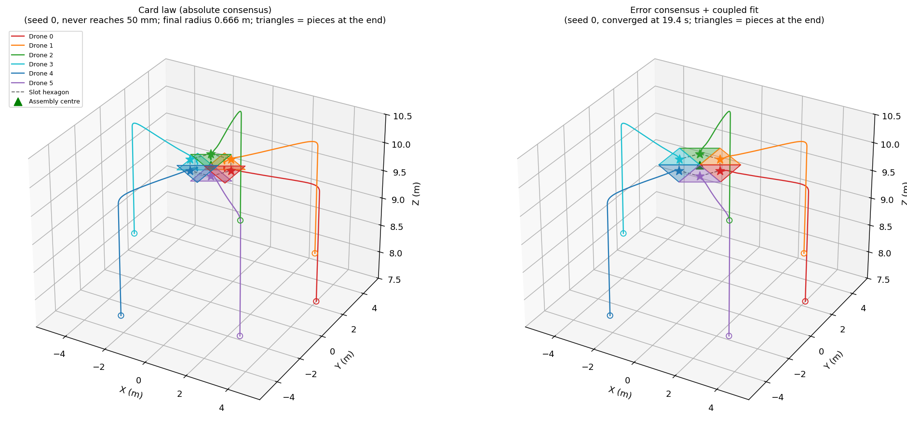
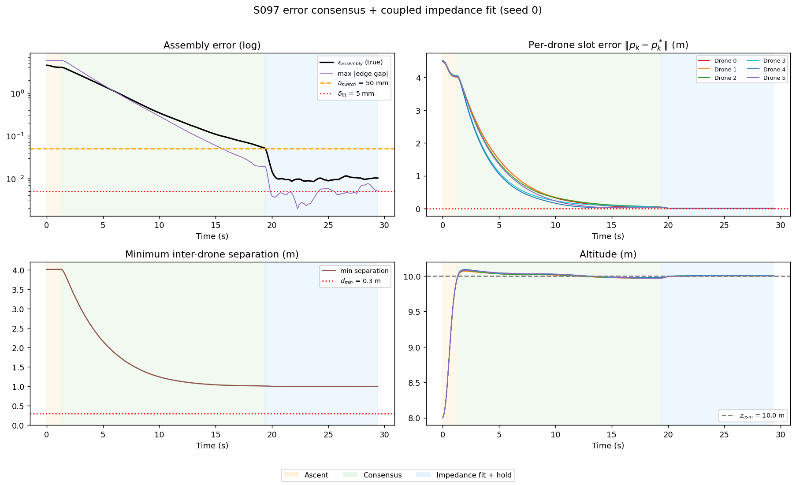
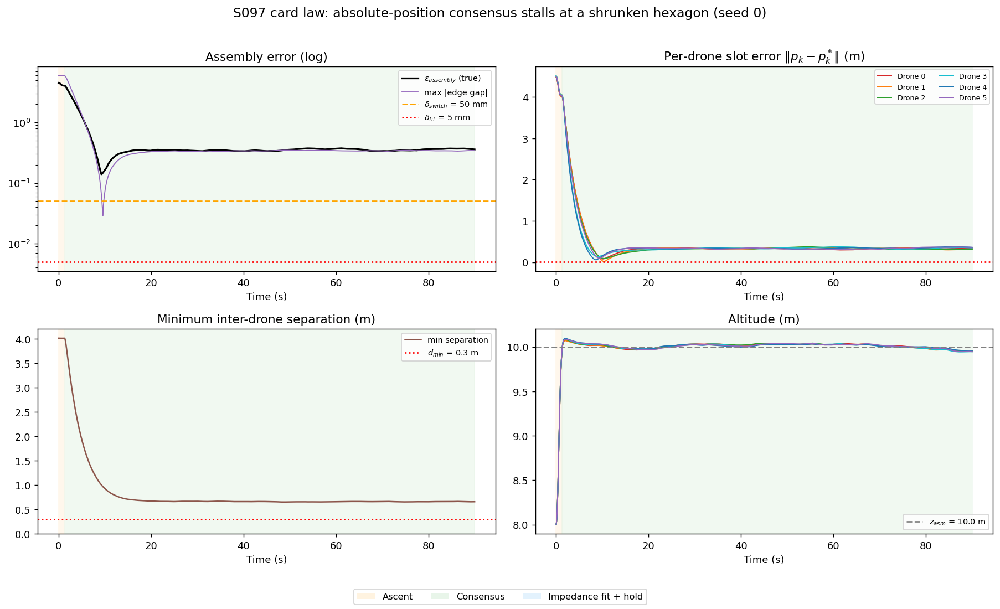
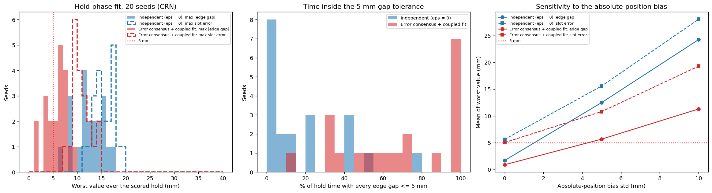
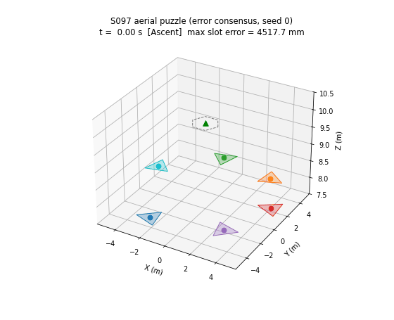

# S097 Aerial Puzzle Assembly

**Domain**: Special Ops & Entertainment | **Difficulty**: ⭐⭐⭐ | **Status**: ✅ Completed

---

## Problem Definition

**Setup**: Six 0.5 kg drones each carry one equilateral-triangle puzzle piece. Assembled, the pieces form a regular hexagon centred at $(0, 0, 10)$ m. The slot centroids lie on a circle of radius $r_{hex} = 1$ m, so each piece has side $\sqrt{3}\,r_{hex} = 1.7321$ m. The drones start on a 5 m staging circle at $z = 8$ m, with ±0.3 rad angular jitter. They talk only to their two ring neighbours.

**Mission phases**:
1. Ascent to 10 m.
2. Consensus convergence toward the slots.
3. Impedance fitting, entered when every drone *measures* itself within $\delta_{switch} = 50$ mm of its slot.
4. A 10 s hold. The last 8 s are scored; the first 2 s are the fitting transient.

**Objective**: the card asks for an assembly error $\varepsilon_{assembly} = \max_k\|\mathbf p_k - \mathbf p_k^*\| \le 5$ mm, with every inter-drone separation at least $d_{min} = 0.3$ m. Because the pieces have to fit each other, the run also scores the **edge gap**: the relative displacement of neighbouring pieces normal to their shared edge (gap tolerance 5 mm).

**Disturbances (added)**: light Ornstein–Uhlenbeck wind with a common part (σ = 0.03 m/s²) and an individual part (σ = 0.01 m/s², τ = 3 s). Each drone's absolute position estimate has a slowly varying bias (σ = 5 mm, τ = 10 s, as with RTK-GNSS), and neighbour-relative measurements have 1 mm noise.

**Strategies** (same wind, bias, noise and start jitter for every strategy):
1. **Card law (absolute consensus)**: $\mathbf p \leftarrow \mathbf p - \varepsilon \mathbf L \mathbf p + \alpha(\mathbf p^* - \mathbf p)$, exactly as written in the card.
2. **Independent** ($\varepsilon = 0$): each drone tracks its own slot, then fits with the card's impedance law.
3. **Error consensus + coupled fit**: consensus on the slot *errors* $\mathbf e_k = \mathbf p_k - \mathbf p_k^*$, computed from neighbour-relative measurements. In the fitting phase the same coupling stays on as virtual springs between neighbours.

---

## Mathematical Model Summary

### Slots

$$\mathbf p_k^* = (0, 0, 10) + r_{hex}\,(\cos\tfrac{2\pi k}{6}, \sin\tfrac{2\pi k}{6}, 0), \qquad \psi_k^* = \tfrac{2\pi k}{6}.$$

### Why the card's consensus law cannot reach the slots

The card's update $\mathbf P \leftarrow (\mathbf I - \varepsilon\mathbf L - \alpha\mathbf I)\mathbf P + \alpha\mathbf P^*$ has the fixed point $\mathbf P_\infty = \alpha(\varepsilon\mathbf L + \alpha\mathbf I)^{-1}\mathbf P^*$, not $\mathbf P^*$.

The hexagon's horizontal coordinates lie in the Laplacian eigenspace with $\lambda_1 = 1$. The fixed point is therefore the hexagon scaled by $\alpha/(\varepsilon\lambda_1 + \alpha) = 0.6667$: a 0.6667 m radius instead of 1 m, an error of 333.3 mm. That is far outside the 50 mm switch, so the card law never reaches the fitting phase.

The ring Laplacian has eigenvalues 0, 1, 1, 3, 3, 4. The factors $|1 - \varepsilon\lambda - \alpha|$ are 0.900, 0.850, 0.850, 0.750, 0.750 and 0.700, so the spectral radius is **0.900**, not the 0.70 the card states (0.70 is the smallest factor).

### Error consensus (used here)

$$\mathbf e \leftarrow \mathbf e - \varepsilon\mathbf L\mathbf e - \alpha\mathbf e, \qquad (\mathbf L\mathbf e)_k = \sum_{j\in\{k\pm1\}}\bigl((\mathbf p_k - \mathbf p_j) - (\mathbf p_k^* - \mathbf p_j^*)\bigr).$$

$(\mathbf L\mathbf e)_k$ uses only relative measurements. This law has the fixed point $\mathbf e = 0$ and the card's convergence factors (spectral radius 0.900). As in the card's code, the one-step update becomes a commanded position, tracked by $\mathbf a = 10(\mathbf p_{cmd} - \mathbf p) - 5\mathbf v$. For Laplacian mode $\lambda$, this is a PD loop with stiffness $10(\varepsilon\lambda + \alpha) = 1 + 0.5\lambda$ s⁻².

### Impedance fitting

$$m_D\ddot{\mathbf p}_k = K_{imp}(\mathbf p_k^* - \hat{\mathbf p}_k) - B_{imp}\dot{\mathbf p}_k\; [\,-\,K_{rel}(\mathbf L\mathbf e)_k\,] + \mathbf F_{contact,k} + m_D\mathbf w_k$$

$K_{imp} = 8$ N/m and $B_{imp} = 4$ N·s/m give $\omega_n = 4.000$ rad/s and $\zeta = 1.000$. The bracketed coupling term is used by the error-consensus strategy only, with $K_{rel} = K_{imp}\,\varepsilon/\alpha = 4.0$ N/m. A 0.03 m/s² gust alone gives a static error of 1.9 mm.

### Edge contact

Pieces $k$ and $k+1$ share the radial edge at angle $2\pi k/6 + 30°$, with in-plane normal $\hat{\mathbf n}_k$. Their gap is

$$g_k = \hat{\mathbf n}_k\cdot(\mathbf e_{k+1} - \mathbf e_k),$$

which is positive when the edges open. If $g_k < 0$ and both pieces are within 50 mm of their slots, a spring-damper pushes the two pieces apart with force $\max(0,\ k_c(-g_k) - b_c\dot g_k)$, with $k_c = 50$ N/m and $b_c = 5$ N·s/m (card extension 6).

### Other

The card's soft repulsion ($K_{rep} = 1.5$ inside $2d_{min}$), an acceleration limit of 5 m/s², and yaw $\dot\psi_k = K_\psi(\psi_k^* - \psi_k)$.

---

## Key Parameters

| Parameter | Value |
|-----------|-------|
| Drones / mass | 6 / 0.5 kg |
| Assembly centre / slot radius / piece side | (0, 0, 10) m / 1.0 m / 1.7321 m |
| Staging radius / altitude / angular jitter | 5.0 m / 8.0 m / ±0.3 rad |
| Consensus gains $\varepsilon$, $\alpha$ | 0.05, 0.10 |
| Consensus tracking (card code) | $\mathbf a = 10(\mathbf p_{cmd} - \mathbf p) - 5\mathbf v$ |
| Ascent PD (card code) | 8, 4 |
| Impedance $K_{imp}$, $B_{imp}$ | 8.0 N/m, 4.0 N·s/m |
| Neighbour coupling in the fit $K_{rel}$ (added) | 4.0 N/m |
| Edge contact $k_c$, $b_c$ (card extension) | 50 N/m, 5 N·s/m |
| $\delta_{switch}$ / $\delta_{fit}$ / $d_{min}$ | 50 mm / 5 mm / 0.30 m |
| Repulsion $K_{rep}$ / yaw gain $K_\psi$ | 1.5 / 1.0 |
| Acceleration limit (added) | 5 m/s² |
| Wind (added) | OU, common σ = 0.03 m/s², individual σ = 0.01 m/s², τ = 3 s |
| Absolute-position bias (added) | OU, σ = 5 mm, τ = 10 s; sweep 0, 5, 10 mm |
| Relative-measurement noise (added) | 1 mm |
| Hold / scored window / time limit | 10 s / last 8 s / 90 s |
| $\Delta t$ / Monte Carlo seeds | 0.02 s / 20 |

---

## Implementation

```
src/05_special_entertainment/s097_aerial_puzzle.py   # Main simulation script
```

```bash
conda activate drones
python src/05_special_entertainment/s097_aerial_puzzle.py
```

Runtime: about 1.5 min (87–88 s over three runs; other simulations were running at the same time). The script asserts that every altitude stays above 0 and every speed below 10 m/s.

---

## Results

### Seed 0

| Strategy | Reaches 50 mm switch | Worst slot error (hold) | Worst edge gap (hold) | Worst neighbour misalignment | Min separation |
|---|---|---:|---:|---:|---:|
| Card law (absolute consensus) | never (stopped at 90 s); final radius 0.6661 m, error 358.0 mm | — | — | — | 0.652 m |
| Independent ($\varepsilon = 0$) | at 24.22 s | 16.70 mm | 13.87 mm | 16.67 mm | 0.999 m |
| **Error consensus + coupled fit** | **at 19.40 s** | **11.45 mm** | **7.55 mm** | **7.76 mm** | 1.000 m |

All drones finish the ascent at 1.30 s.

### Monte Carlo (20 seeds)

| Strategy | Converged | $t_{conv}$ (s) | Worst slot error (mm) | Worst edge gap (mm) | Time with all gaps ≤ 5 mm | Time with slot error ≤ 5 mm | Max contact force | Min separation |
|---|---:|---|---|---|---:|---:|---:|---:|
| Independent | 20/20 | 28.29 ± 3.97 | 15.58 ± 2.05 | 12.49 ± 2.94 | 18.3% | 0.1% | 0.994 N | 0.978 m |
| **Error consensus** | 20/20 | **17.98 ± 1.28** | **10.81 ± 1.76** | **5.67 ± 2.08** | **68.6%** | 1.6% | 0.228 N | 0.998 m |

**Impedance fitting time** (card terminal summary). This is the time from the 50 mm switch until the true worst slot error first falls to 5 mm or below during the 10 s hold. Seed 0: not reached by either strategy. Over 20 seeds: independent 1/20 (5.98 s after the switch), error consensus 4/20 (mean 3.31 s). With the 5 mm position bias, the card's 5 mm end-of-fit condition is mostly never met; see the wind sweep for when it is.

Per seed, error consensus had the smaller worst edge gap in **20/20** seeds (mean ratio 0.473), the smaller worst slot error in 20/20 (mean ratio 0.701), and converged faster in 20/20. Its worst edge gap stayed within 5 mm for the whole scored hold in 7 of 20 seeds, against 0 for the independent strategy. **With the nominal bias and wind, neither strategy met the card's 5 mm slot-error target over the scored hold in any seed** (see the wind sweep below for calmer conditions).

**Bias sweep** (mean over seeds of the worst value over the hold):

| Absolute bias σ | Independent: gap / slot | Error consensus: gap / slot |
|---|---|---|
| 0 mm | 1.68 / 5.63 mm | 0.88 / 5.03 mm |
| 5 mm | 12.49 / 15.58 mm | 5.67 / 10.81 mm |
| 10 mm | 24.25 / 28.05 mm | 11.29 / 19.29 mm |

**Wind sweep with no position bias** (mean over seeds of the worst value over the hold; the nominal wind case with no bias is the first row of the bias sweep):

Column key, per strategy:
- **gap / slot**: mean over seeds of the worst edge gap and worst slot error over the scored 8 s. The brackets after the slot value give the max over seeds, and in the nominal row also the min (printed only for the bias-sweep rows);
- **fit reached**: seeds in which the worst slot error first reaches 5 mm during the hold;
- **seeds ≤ 5 mm**: seeds whose worst slot error over the whole scored hold is at most 5 mm;
- **time ≤ 5 mm**: the scored time with slot error at most 5 mm.

| Wind (common / individual) | Independent: gap / slot / fit reached / seeds ≤ 5 mm / time ≤ 5 mm | Error consensus: same columns |
|---|---|---|
| 0 / 0 m/s² | 0.28 / 0.19 (max 0.20) mm / 20/20 / 20/20 / 100.0% | 0.00 / 0.06 (max 0.11) mm / 20/20 / 20/20 / 100.0% |
| 0.01 / 0.003 m/s² | 0.61 / 1.79 (max 2.19) mm / 20/20 / 20/20 / 100.0% | 0.26 / 1.64 (max 2.26) mm / 20/20 / 20/20 / 100.0% |
| 0.03 / 0.01 m/s² (nominal) | 1.68 / 5.63 (max 7.02, min 4.58) mm / 20/20 / 5/20 / 81.0% | 0.88 / 5.03 (max 6.86, min 3.40) mm / 20/20 / **13/20** / **92.7%** |

In the nominal no-bias case, the worst slot error first reaches 5 mm 0.9–3.6 s after the switch (independent) or 0.7–1.4 s after it (consensus). With consensus it then stays within 5 mm for the whole scored hold in 13 of 20 seeds, and for 92.7% of the scored time overall. Only the mean of the per-seed worst values (5.03 mm) is just above 5 mm. With the 5 mm bias, no seed of either strategy stays within 5 mm (0/20), and the scored time within 5 mm is 0.1% (independent) and 1.6% (consensus).

**Strong-wind check** (common gust σ = 0.2 m/s², individual 0.05 m/s², seed 0): neither strategy reaches the 50 mm switch within 90 s (independent 384.5 mm, error consensus 359.4 mm at 90 s). The consensus phase has a stiffness of only $10\alpha = 1.0$ s⁻², so a 0.2 m/s² gust alone holds a 0.20 m error.

**Key findings**:

- **The card's consensus law does not assemble the puzzle.** Absolute-position consensus pulls the drones toward each other, and its fixed point is a hexagon of radius 0.6667 m. In simulation the drones settle at 0.6661 m and never reach the fitting phase. Running consensus on slot errors fixes this.
- **Whether the 5 mm absolute target is reachable depends on two added disturbance assumptions.** With the nominal 5 mm-class absolute bias, each drone's slot error cannot fall below its own bias, so the worst of six is about 11–16 mm. With no bias and the nominal light wind (0.03 m/s² common gust), the target is met over the whole scored hold in 13/20 seeds with consensus and 5/20 with the independent law; the mean of the per-seed worst values is 5.03 and 5.63 mm. With a third of that wind (0.01 / 0.003 m/s²), both strategies stay within 5 mm in every seed (worst 2.26 mm), and without disturbances at or below 0.20 mm. The card's target is therefore missed in every seed only with RTK-class absolute bias. Under the nominal gust without bias it is met in most seeds with consensus (13/20) but in only a quarter with the independent law (5/20). In calmer air both meet it in every seed.
- **Consensus mainly helps the fit between pieces.** Neighbour coupling uses relative measurements, which are not biased. It cuts the worst edge gap by about half (12.49 → 5.67 mm; 20/20 seeds) and raises the time with every gap within 5 mm from 18.3% to 68.6%. It also lowers the peak contact force (0.994 → 0.228 N, both below extension 6's 2 N limit). This is the physically meaningful puzzle metric: a rigid assembly that is offset as a whole by a few millimetres still fits.
- **Consensus also converges faster** (17.98 vs 28.29 s). The coupling stiffens the non-common modes ($1 + 0.5\lambda$ s⁻²), while the independent law has only 1 s⁻² for every mode.
- **Separation is never an issue**: adjacent slots are 1 m apart, and the minimum separation was 0.978 m or more against $d_{min} = 0.3$ m. In the card law the shrunken hexagon brings the drones to 0.652 m.

### 3D Trajectories

Left: the card law stalls on a shrunken hexagon. Right: error consensus. Circles mark the starts, stars the slots, and triangles the pieces at the end of the run.



### Metrics Panel (error consensus, seed 0)

The four panels show the assembly error (log scale) with the linearised edge gap, the per-drone slot errors, the minimum separation and the altitude. The phases are shaded. The edge-gap curve means something physical only once the pieces are seated (within 50 mm).



### Card Law Panel (seed 0)

Same layout as above for the card's absolute-consensus law. The error levels off at a few tenths of a metre (358.0 mm at 90 s) and the 50 mm switch is never reached.



### Monte Carlo and Bias Sweep



### Animation

Error consensus, seed 0: climb, convergence, fit and hold. 99 frames at 20 fps (every 15th of 1471 samples).



### Deviations from the scenario card

| Card | Implementation | Reason |
|------|----------------|--------|
| Consensus on absolute positions, claimed to converge to $\mathbf p^*$ | Kept as the "card law" strategy, which converges to a 0.6667 m hexagon (333.3 mm error). The proposed strategy runs consensus on slot errors | The fixed point is $\alpha(\varepsilon\mathbf L + \alpha\mathbf I)^{-1}\mathbf P^*$; verified numerically and in simulation (final radius 0.6661 m). Card fixed. |
| Spectral radius ≈ 0.70 | 0.900 | $\max_i\|1 - \varepsilon\lambda_i - \alpha\|$ over $\lambda = 0, 1, 1, 3, 3, 4$ is 0.900 (at $\lambda = 0$); 0.70 is the minimum. Card fixed. |
| Card code: `while True` until $\varepsilon_{assembly} \le 5$ mm | 90 s limit before the switch; after it, a fixed 10 s hold scored over its last 8 s | With the card law, the switch is never reached and the card's loop never ends. With noise, a stop rule of "≤ 5 mm" would make the final error equal the threshold by construction (X3). |
| No disturbances or sensing errors | OU wind, OU absolute-position bias, 1 mm relative noise | Without them, every strategy converges exactly and nothing separates the strategies. The bias sweep shows how the results depend on the bias. |
| Single strategy | Card law, independent, and error consensus with coupled fit | Shows what the consensus coupling adds. |
| Pure impedance in the fitting phase | The error-consensus strategy keeps the neighbour coupling ($K_{rel} = 4$ N/m = $K_{imp}\varepsilon/\alpha$) | The same consensus idea carried into the fit; the independent strategy uses the card's pure impedance. |
| $F_{contact} \approx 0$ | Spring-damper edge contact (extension 6 values), active once both pieces are within 50 mm | The card defines the impedance phase for edge contact but does not model the contact. |
| Slot centroids on a 1 m circle; piece size not given | Piece side $\sqrt3$ m = 1.7321 m | The only size for which six equilateral triangles with centroids at 1 m tile a hexagon. |
| Edge-gap metric (not in the card) | Added next to $\varepsilon_{assembly}$ | Puzzle fit depends on relative placement, which the card's absolute metric does not measure. |
| Terminal summary: "impedance fitting time" | Reported as the time from the switch until the worst slot error first reaches 5 mm, together with how many seeds reach it | With noise the fit may never reach 5 mm, so the count matters as much as the time. |
| Wind level (added) | Nominal 0.03 / 0.01 m/s², with a sweep down to 0 | Shows that the 5 mm verdict is set by this assumption. |
| — | Acceleration limit of 5 m/s² | Physical sanity check. |

---

## Extensions

1. **Disturbance observer** (card extension 3): estimate and cancel the common gust so that the soft consensus phase still reaches the 50 mm switch in strong wind.
2. **Relative-only fitting**: a stiffer relative loop with a weak absolute anchor, to see how far the edge gap can be pushed below 5 mm.
3. **Topology study**: compare all-to-all, star and ring graphs for convergence time and edge gap (the Laplacian spectrum sets the stiffness of each mode).
4. **Orientation fitting**: couple the heading error into the edge gap through the triangle geometry, with an impedance torque channel.
5. **Drone failure**: reassign five drones to a pentagon mid-assembly.

---

## Related Scenarios

- Prerequisites: [S085 Drone Light Matrix Positioning](../../../scenarios/05_special_entertainment/S085_light_matrix.md), [S088 Formation Geometric Shape Morphing](../../../scenarios/05_special_entertainment/S088_formation_morphing.md)
- Follow-ups: [S087 Aerial Light Show Text Display](../../../scenarios/05_special_entertainment/S087_led_text.md)
- Cross-reference: [S028 Cargo Escort Formation](../../../scenarios/02_logistics_delivery/S028_cargo_escort_formation.md), [S013 Pincer Movement](../../../scenarios/01_pursuit_evasion/S013_pincer_movement.md), [S066 Cooperative Crane Simulation](../../../scenarios/04_industrial_agriculture/S066_cooperative_crane.md)
- Scenario card: [S097 Aerial Puzzle Assembly](../../../scenarios/05_special_entertainment/S097_aerial_puzzle.md)
