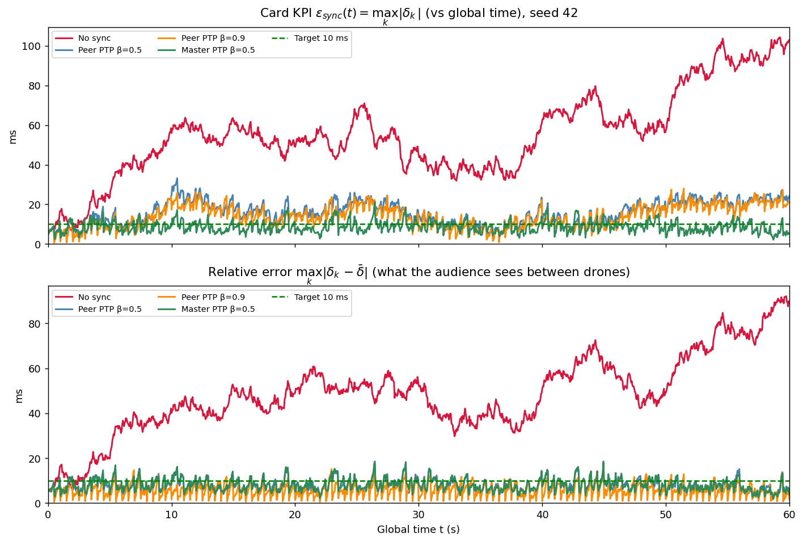
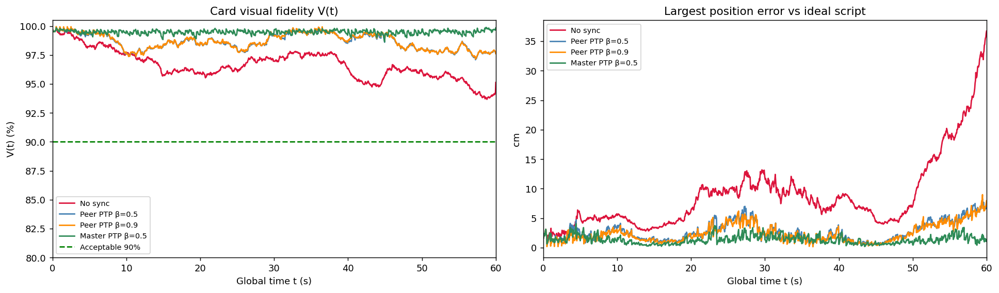
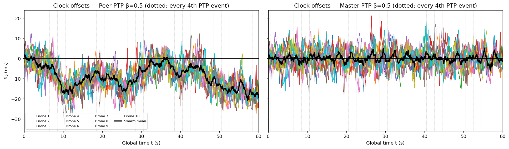
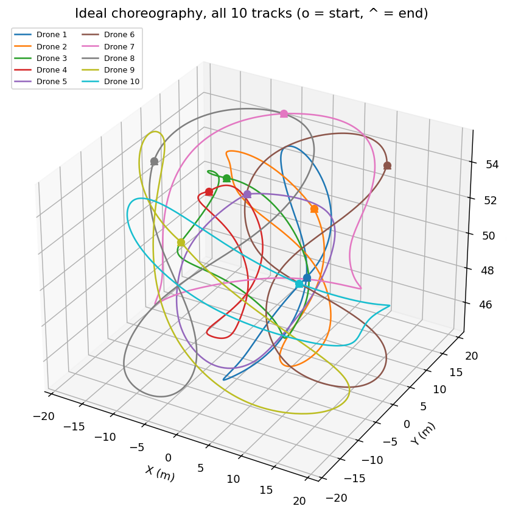
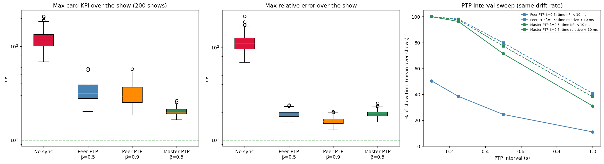
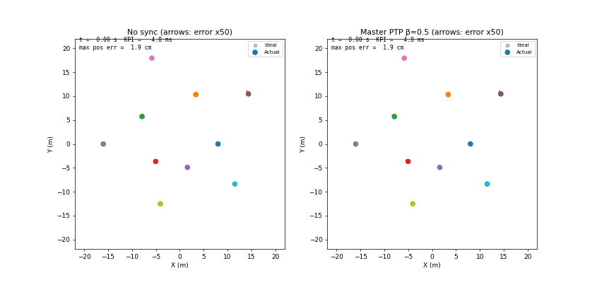

# S098 Swarm Synchronized Dance

**Domain**: Special Ops & Entertainment | **Difficulty**: ⭐⭐⭐ | **Status**: ✅ Completed

---

## Problem Definition

**Setup**: Ten drones fly a 60 s scripted dance at 50 m altitude, on two rings of 8 m and 16 m radius. The rings vary in phase, radius and altitude. Each drone plays its cubic-spline track at its **own local clock**. Every clock drifts as a random walk with a standard deviation of 5 ms per 0.5 s, and the initial offsets are $\mathcal U(-5, 5)$ ms. Every 0.5 s the drones exchange timestamps, each with 1 ms of jitter (added), and correct their clocks.

**Objective** (card): keep $\varepsilon_{sync}(t) = \max_k |t_{local,k} - t_{global}|$ below 10 ms for the whole show. A secondary metric is the visual fidelity $V(t)$, with $V < 90\%$ counted as a visible artefact.

**Strategies** (the same drift and jitter draws for all; CRN):
1. **No sync**: the clocks drift freely.
2. **Peer PTP β = 0.5**: the card's consensus. Each drone takes an exponential moving average (EMA) of the mean offset of its peers and moves its clock by that amount, with the sign corrected.
3. **Peer PTP β = 0.9**: the same with β = 0.9.
4. **Master PTP β = 0.5** (added): each drone corrects toward a GNSS-disciplined ground master clock instead of the peer mean. This is the master–slave form of real IEEE 1588 PTP.

The card's literal update is also run once, to show that it diverges.

---

## Mathematical Model Summary

### Clocks

$$t_{local,k} = t_{global} + \delta_k, \qquad \delta_k \leftarrow \delta_k + \eta_k,\ \eta_k \sim \mathcal N\!\left(0,\ \sigma_{drift}^2\,\tfrac{\Delta t_{sim}}{\Delta t_{ptp}}\right)\ \text{every simulation step.}$$

This is the card's variance of $(5\ \text{ms})^2$ per 0.5 s, spread continuously over each interval, so the drift rate does not change when the PTP interval is swept. Left free for 60 s, each drone drifts with a standard deviation of 54.8 ms. The swarm mean drifts with 17.3 ms, and a peer consensus cannot remove the mean.

### PTP correction (every $\Delta t_{ptp}$)

*Peer*:

$$\Delta_k = \frac{1}{N-1}\sum_{j\ne k}\bigl(\delta_j - \delta_k + \nu_{kj}\bigr).$$

*Master*:

$$\Delta_k = -\delta_k + \nu_k,$$

where $\nu \sim \mathcal N(0, 1\ \text{ms}^2)$ is the timestamp jitter. Both then apply

$$\hat\delta_k \leftarrow (1-\beta)\hat\delta_k + \beta\Delta_k, \qquad \delta_k \leftarrow \delta_k + \hat\delta_k .$$

**Sign of the card's update.** The card writes $\delta_k \leftarrow \delta_k - \hat\delta_k$. Since $\Delta_k$ points *toward* the peers, subtracting it pushes each clock away from them. Take the relative mode $[e_k, \hat\delta_k]$ with $e_k = \delta_k - \bar\delta$. The card's update matrix then has an eigenvalue modulus of **1.774** for β = 0.5 and **2.051** for β = 0.9, which is unstable. The corrected update has moduli of 0.707 and 0.316.

### Playback and fidelity

$$\mathbf p_k^{actual}(t) = \mathrm{CS}_k(t + \delta_k), \qquad \mathbf p_k^{ideal}(t) = \mathrm{CS}_k(t)$$

The splines use the card's not-a-knot cubic splines through 13 waypoints. The visual fidelity is

$$v_k = 1 - \frac{\|\mathbf p_k^{actual} - \mathbf p_k^{ideal}\|}{\max_j\|\dot{\mathbf p}_j^{ideal}\|\,\Delta t_{ptp}}, \qquad V = \tfrac{1}{N}\sum_k v_k .$$

The fastest track moves at 4.07 m/s, so a 10 ms clock error is at most 4.1 cm of position error.

Two error measures are reported:
- the card KPI $\max_k|\delta_k|$ (absolute, against global time);
- the **relative** error $\max_k|\delta_k - \bar\delta|$, which is what the audience sees between drones.

---

## Key Parameters

| Parameter | Value |
|-----------|-------|
| Drones / show length / show altitude | 10 / 60 s / 50 m (±5 m modulation) |
| Ring radii | 8 m, 16 m (±3 m modulation) |
| Waypoints / interpolation | 13 per drone / cubic spline (not-a-knot, as in the card's code) |
| $\Delta t_{sim}$ / $\Delta t_{ptp}$ | 0.05 s / 0.5 s |
| Drift std $\sigma_{drift}$ | 5 ms per 0.5 s (continuous random walk) |
| Initial offsets | $\mathcal U(-5, 5)$ ms |
| PTP gains β | 0.5, 0.9 |
| Timestamp jitter (added) | 1 ms per message |
| Sync target / fidelity threshold | 10 ms / 90% |
| Demo seed / Monte Carlo | 42 / 200 shows (seeds 1000–1199) |
| PTP interval sweep (added) | 0.1, 0.25, 0.5, 1.0 s, 100 shows each |

---

## Implementation

```
src/05_special_entertainment/s098_synchronized_dance.py   # Main simulation script
```

```bash
conda activate drones
python src/05_special_entertainment/s098_synchronized_dance.py
```

Runtime: 2.9–3.2 min, measured while other simulations shared the machine (the independent review measured 1.7 min). Most of the time goes into writing the GIF.

---

## Results

### Seed 42

| Strategy | Max card KPI | Max relative | Time KPI < 10 ms | Mean V | Min V | Max position error | Final mean offset |
|---|---:|---:|---:|---:|---:|---:|---:|
| No sync | 104.3 ms | 92.1 ms | 2.4% | 96.65% | 93.7% | 36.7 cm | −22.6 ms |
| Peer PTP β=0.5 | 33.2 ms | 18.6 ms | 18.2% | 98.65% | 97.1% | 8.3 cm | −19.5 ms |
| Peer PTP β=0.9 | 28.0 ms | 17.6 ms | 28.4% | 98.68% | 97.2% | 9.0 cm | −19.5 ms |
| **Master PTP β=0.5** | **21.2 ms** | 18.2 ms | **72.4%** | **99.48%** | **98.6%** | **4.1 cm** | −1.3 ms |

The card's literal update diverges: its KPI reaches 2.95e+03 ms at 5 s and 7.03e+30 ms by the end.

### Monte Carlo (200 shows)

Per-show maximum = the largest value within one 60 s show. The table gives its mean ± std over the 200 shows and, in brackets, the worst show.

| Strategy | Per-show max KPI (ms) | Per-show max relative (ms) | RMS offset | Time KPI < 10 ms | Time relative < 10 ms | Shows always < 10 ms | Mean V | Min V | Max pos. error |
|---|---|---|---:|---:|---:|---:|---:|---:|---:|
| No sync | 120.8 ± 26.6 (209.47) | 114.4 ± 25.1 (217.23) | 38.45 ms | 1.0% | 1.2% | 0 | 95.86% | 88.4% | 75.2 cm |
| Peer PTP β=0.5 | 33.5 ± 8.1 (57.89) | 19.0 ± 1.6 (23.93) | 11.70 ms | 24.7% | 80.0% | 0 | 98.61% | 93.5% | 18.5 cm |
| Peer PTP β=0.9 | 31.3 ± 8.0 (57.12) | **16.0 ± 1.5 (20.23)** | 11.28 ms | 37.0% | **93.6%** | 0 | 98.65% | 93.6% | 18.1 cm |
| Master PTP β=0.5 | **20.2 ± 1.8 (26.30)** | 19.3 ± 1.7 (25.03) | **4.67 ms** | **71.6%** | 77.5% | 0 | **99.48%** | **98.5%** | **7.5 cm** |

With $V$ normalised by each drone's own speed (as in the card's code) instead of the fastest drone (card text): mean / min $V$ = 94.14% / 85.1% (no sync), 98.03% / 90.9% (peer β=0.5), 98.09% / 90.9% (peer β=0.9), 99.27% / 98.0% (master). The ranking is the same.

Per show: β = 0.9 had a smaller maximum relative error than β = 0.5 in **193/200** shows. The master clock had a smaller maximum KPI than peer β = 0.5 in **195/200** shows.

**PTP interval sweep** (100 shows each, same drift rate). Percentages are the mean fraction of show time below 10 ms, printed to 0.1%, so 100.0% can be a rounded 99.95% or more. Per-show max KPI is given as the mean over shows / the worst show, followed by the number of shows that stay below 10 ms throughout:

| Interval | Peer β=0.5: time KPI / time relative / per-show max KPI (mean / worst) / shows always < 10 ms | Master β=0.5: same columns |
|---|---|---|
| 0.10 s | 50.4% / 100.0% / 26.7 / 47.21 ms / 0 | **100.0% / 100.0% / 8.7 / 10.69 ms / 96** |
| 0.25 s | 38.5% / 98.2% / 30.3 / 49.99 ms / 0 | 96.3% / 97.6% / 14.4 / 18.34 ms / 0 |
| 0.50 s | 24.5% / 79.8% / 34.4 / 51.75 ms / 0 | 71.5% / 77.4% / 20.2 / 25.40 ms / 0 |
| 1.00 s | 11.0% / 40.8% / 39.5 / 63.49 ms / 0 | 31.1% / 38.1% / 27.8 / 42.45 ms / 0 |

**Key findings**:

- **The card's 10 ms target is not met at a 0.5 s interval, by any strategy, in any of the 200 shows.** The drift in a single interval already has a 5 ms standard deviation per drone. Over ten drones and 120 intervals, the worst draw is about 3.5 σ ≈ 17 ms (a back-of-envelope estimate, not printed by the script), even if every correction were perfect. The card's "PTP < 10 ms / β = 0.9 < 8 ms" expectation does not hold (X6). The no-sync expectation of "~50 ms" is also low: the per-show maximum averages 120.8 ms, and the worst show reaches 209.47 ms.
- **A peer consensus cannot fix absolute time.** It aligns the clocks with each other, while their mean keeps drifting (std 17.3 ms over 60 s; −19.5 ms at the end of seed 42). The card's absolute KPI therefore stays at 31–34 ms for both β, even though the relative error is about 16–19 ms. A master reference removes the common drift: RMS offset 4.67 ms against 11.70 ms, and 71.6% of the time below 10 ms against 24.7%.
- **β = 0.9 is better than β = 0.5 here**, with a smaller relative error in 193/200 shows. With only 1 ms of timestamp jitter against 5 ms of drift per interval, faster correction wins; the noise sensitivity the card expects does not appear at this jitter level.
- **The PTP interval is the real lever.** A master clock at 0.1 s keeps 96 of 100 shows below 10 ms for the whole show. The per-show maximum averages 8.7 ms, and the worst show reaches 10.69 ms. At 0.25 s and longer, no show stays below 10 ms throughout. Peer PTP keeps the relative error below 10 ms at 0.1 s (100.0% of the time, rounded), but its absolute KPI still drifts (per-show maximum 26.7 ms on average, 47.21 ms worst).
- **Visual fidelity barely separates the strategies**: mean $V$ is 95.86–99.48%, and only no-sync dips below 90% (min 88.4%). The card's "~75%" for no-sync does not appear. With a 0.5 s normaliser, 10 ms of error costs only about 2% of $V$. The largest position error is more telling: 75.2 cm without sync against 7.5 cm with the master clock.

### Synchronisation Error

Top: the card's absolute KPI. Bottom: the relative error between drones (seed 42).



### Visual Fidelity



### Clock Offsets

Per-drone offsets and the swarm mean (black). With peer PTP the clocks stay together, but the mean wanders away from zero. With the master clock the mean stays near zero.



### Choreography



### Monte Carlo and Interval Sweep



### Animation

Top-down view: no sync (left) against master PTP (right). Grey = ideal positions, coloured = actual; the arrows show the position error magnified 50×. 301 frames at 10 fps, i.e. 2x real time (every 4th of 1201 samples).



### Deviations from the scenario card

| Card | Implementation | Reason |
|------|----------------|--------|
| $\delta_k \leftarrow \delta_k - \hat\delta_k$ | $\delta_k \leftarrow \delta_k + \hat\delta_k$; the literal version is run once for comparison | With $\Delta_k$ = peers minus self, subtracting it moves each clock away from the peers. The relative-mode eigenvalue modulus is 1.774 (β = 0.5) and the simulated KPI reaches 7.03e+30 ms. Card fixed. |
| Card code: peer mean over $N$ (includes itself) | Mean over the $N-1$ peers | Matches the card's equation. |
| Drift applied as one jump per PTP interval, inside the correction step | Continuous random walk with the same variance per 0.5 s | The drift rate does not depend on the PTP interval (needed for the sweep), and the error between corrections is visible. |
| No measurement noise; "β = 0.9 amplifies noise" | 1 ms timestamp jitter per message | Without noise the trade-off the card describes cannot appear. |
| Three strategies | Added a master-referenced PTP | The KPI is measured against global time, and a peer consensus cannot control the common drift. |
| "Natural cubic spline" (text) | Not-a-knot spline (the card's code) | The code was followed; the difference is negligible for the timing analysis. |
| $V$ normaliser: fastest drone's speed (card text) vs each drone's own speed (card code) | Card text used for $V$; the card-code variant is also printed | Same ranking either way: the no-sync minimum is 88.4% with the text version and 85.1% with the code version. |
| Expected: PTP < 10 ms, β = 0.9 < 8 ms, no sync ~50 ms / ~75% V | Not reproduced; see the key findings | Reported as measured (X6). |
| — | Absolute and relative error, max position error, interval sweep | Make the comparison discriminative. |

---

## Extensions

1. **Two-way PTP with path delay**: model the propagation delay and asymmetry, and estimate offset and delay from a two-way exchange.
2. **Drift-rate (frequency) estimation**: a two-state clock filter (offset and rate) that predicts the drift between exchanges, the way real PTP servos do.
3. **Packet loss and a faulty clock**: drop 20% of messages and add one Byzantine peer; compare mean and median consensus.
4. **Adaptive interval**: shorten the exchange interval during the fastest parts of the choreography, where a clock error costs the most position error.
5. **Perceptual metric**: replace $V$ with the angular position error seen from the audience.

---

## Related Scenarios

- Prerequisites: [S088 Formation Geometric Shape Morphing](../../../scenarios/05_special_entertainment/S088_formation_morphing.md), [S085 Drone Light Matrix Positioning](../../../scenarios/05_special_entertainment/S085_light_matrix.md)
- Follow-ups: [S089 Large-Scale Swarm Collision Avoidance Test](../../../scenarios/05_special_entertainment/S089_collision_avoidance.md)
- Cross-reference: [S051 Post-Disaster Communication Network Restoration](../../../scenarios/03_environmental_sar/S051_post_disaster_comm.md), [S049 Dynamic Zone Search](../../../scenarios/03_environmental_sar/S049_dynamic_zone.md)
- Scenario card: [S098 Swarm Synchronized Dance](../../../scenarios/05_special_entertainment/S098_synchronized_dance.md)
