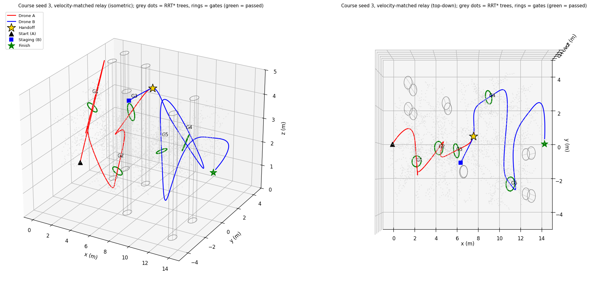
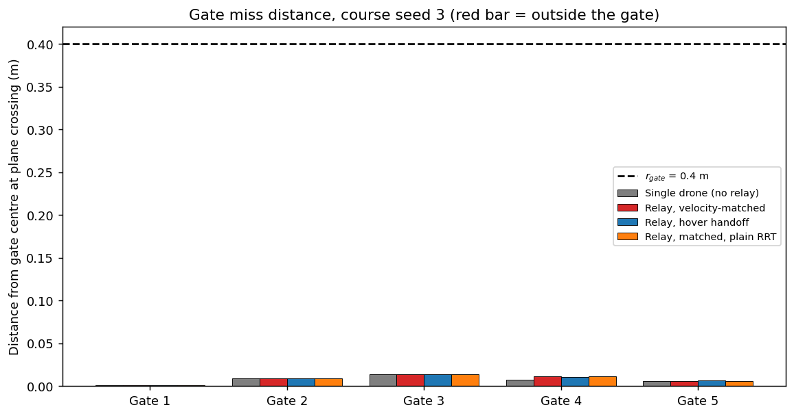
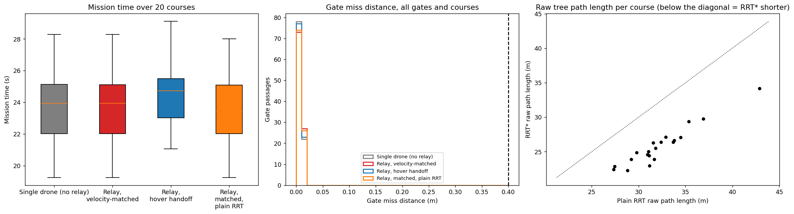
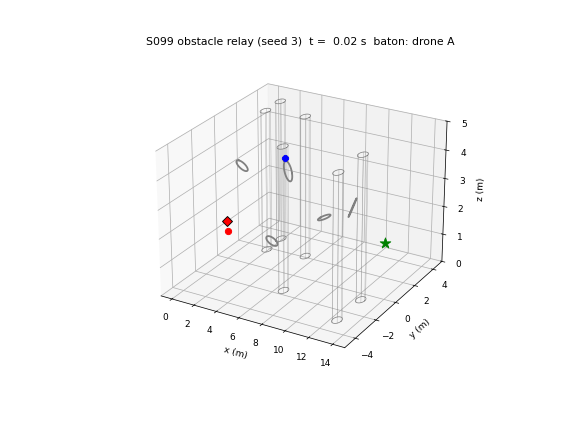

# S099 Cross-Obstacle Relay Pass

**Domain**: Special Ops & Entertainment | **Difficulty**: ⭐⭐⭐⭐ | **Status**: ✅ Completed

---

## Problem Definition

**Setup**: Two drones carry a virtual baton through a random 5-gate course.
- **Gates**: placed at $x \in [2, 12]$, $y \in [-3, 3]$, $z \in [1, 4]$ m, at least 1.5 m apart in $x$. Each gate is a disc of radius $r_{gate} = 0.4$ m with a random normal ($|n_z| > 0.5$) and a 0.3 m frame around the opening.
- **Obstacles**: six vertical pillars of radius 0.35 m (added).
- **Route**: drone A starts at $(0, 0, 1)$ m, threads gates 1–3, and hands the baton to drone B mid-air near the gate-3 exit ($\|\Delta\mathbf p\| \le \epsilon_p = 0.10$ m and $\|\Delta\mathbf v\| \le \epsilon_v = 0.15$ m/s). B then threads gates 4–5 to the finish at $(14, 0, 2)$ m.

**Objective**: minimise the mission time with every gate passed, using the card's cost $J = T + \lambda\sum_k \max(0, \|\mathbf p(t_k) - \mathbf g_k\| - r_{gate})^2$ with $\lambda = 50$.

**Strategies** (on the same 20 random courses, with the same disturbance draws on each course; CRN):
1. **Single drone (no relay)**: A flies all five gates. This is the reference time.
2. **Relay, velocity-matched** (card): B waits at a staging mark and launches $T_{lead} = 2.5$ s before the handoff, on a min-snap curve to A's planned state there. It then flies the rest of the planned course.
3. **Relay, hover handoff**: A stops at a waypoint after gate 3, and B, hovering there, takes the baton and starts from rest.
4. **Relay, matched, plain RRT**: the same as 2, but the planner never rewires (RRT instead of RRT*).

---

## Mathematical Model Summary

### Gates and waypoints

For gate $k$ with centre $\mathbf g_k$ and normal $\hat{\mathbf n}_k$, the normal's sign is chosen to point along the course. The mandatory waypoints are an entry point $\mathbf g_k - 0.6\hat{\mathbf n}_k$, the centre, and an exit point $\mathbf g_k + 0.6\hat{\mathbf n}_k$, so every gate is flown straight through along its normal.

A gate counts as passed when the carrier crosses its plane within $r_{gate}$ of the centre (the **miss distance**). At a plane crossing the axial offset is zero by definition, so the card's $\delta_{tol}$ adds nothing.

### RRT* (between each exit point and the next entry point)

- Samples: biased toward the target with $p_{bias} = 0.2$ (Gaussian with σ = 0.3 m around it), otherwise uniform in the box $[-1, 15] \times [-5, 5] \times [0.3, 5]$ m.
- Steering: step of 0.20 m.
- Rewiring radius: $r = \min\bigl(\gamma(\log n/n)^{1/3},\ 1.5\bigr)$ with $\gamma = 2.5$.
- Edge cost: Euclidean length.
- Collision check: pillars inflated by 0.3 m, the gate frames (crossing a plane at $r_{gate} - 0.1 < r < r_{gate} + 0.3$), and the box limits.
- Budget: 3000 iterations per course, split equally over the six free segments.
- Each segment's path is then shortened greedily (shortcutting).

### Trajectory

Each waypoint-to-waypoint segment is a degree-7 polynomial per axis. Position and velocity are fixed at both ends; acceleration and jerk are zero there.
- **Knot velocities**: 2 m/s along the gate normal at gate points, along the Catmull-Rom direction elsewhere, and 0 at the start and the finish.
- **Segment time**: starts at length / 2 m/s and is stretched by 8% steps until the speed is at most 3 m/s and the acceleration at most $0.8\,a_{max}$ = 4 m/s².
- **Shape check**: if a segment dips below 0.3 m or comes within 0.1 m of a pillar, the knot speeds at both of its ends are cut by 30% and the trajectory is rebuilt.

### Handoff (velocity-matched)

The planned handoff is at $t_h = t_{gate3} + 1$ s, at the state $(\mathbf p_H, \mathbf v_H)$ of the full plan. B starts from rest at $\mathbf p_H - \mathbf v_H T_{lead}/2$ (height clamped to 0.8–4.5 m) at $t_h - T_{lead}$. It flies a rest-to-$\mathbf v_H$ min-snap of duration $T_{lead}$, whose peak acceleration is $1.875\,v/T_{lead}$ = 1.50 m/s² at 2.0 m/s, and then follows the rest of the plan.

The handoff succeeds when $\|\Delta\mathbf p\| \le 0.10$ m and $\|\Delta\mathbf v\| \le 0.15$ m/s hold for 0.2 s continuously. After the pass, A hovers where it is.

### Tracking

Each drone is a point mass with $\mathbf u = 8(\mathbf p_{ref} - \mathbf p) + 4(\mathbf v_{ref} - \mathbf v) + \mathbf a_{ref}$, limited to $\|\mathbf u\| \le 5$ m/s². The speed is capped at 3 m/s, and a Gaussian disturbance with σ = 0.3 m/s² is added.

---

## Key Parameters

| Parameter | Value |
|-----------|-------|
| Gate radius $r_{gate}$ / frame width (added) | 0.4 m / 0.3 m |
| Gate placement | $x \in [2, 12]$ (≥ 1.5 m apart), $y \in [-3, 3]$, $z \in [1, 4]$ m; $\|n_z\| > 0.5$ |
| Entry / exit offset along the normal (added) | 0.6 m |
| Pillars (added) | 6, radius 0.35 m, planning clearance 0.3 m |
| RRT* iterations / bias / step / γ | 3000 per course / 0.2 / 0.20 m / 2.5 |
| Polynomial degree | 7 |
| Knot speed (added) / $v_{max}$ / $a_{max}$ / planned peak acceleration | 2.0 m/s / 3.0 m/s / 5.0 m/s² / 4.0 m/s² |
| $\epsilon_p$ / $\epsilon_v$ / hold time (added) | 0.10 m / 0.15 m/s / 0.2 s |
| $T_{lead}$ / handoff time after gate 3 (added) | 2.5 s / 1.0 s |
| Gate-miss penalty λ | 50 |
| Tracking gains / disturbance (added) | 8, 4 / σ = 0.3 m/s² |
| Start / finish | (0, 0, 1) m / (14, 0, 2) m (reached within 0.3 m) |
| $\Delta t$ / courses | 0.02 s / 20 (seeds 100–119); demo course seed 3 |

---

## Implementation

```
src/05_special_entertainment/s099_obstacle_relay.py   # Main simulation script
```

```bash
conda activate drones
python src/05_special_entertainment/s099_obstacle_relay.py
```

Runtime: about 4 min, measured while about ten other simulations shared the 12-thread machine, so it is shorter when the script runs alone. The script asserts that both drones stay above the ground; any pillar contact makes a run fail (clearance > 0 is required for success).

---

## Results

The card's code computes `T_total = path_a.duration + path_b.duration`, which counts the overlap of the two flights twice. Here the mission time is the moment the baton reaches the finish.

### Demo course (seed 3)

Gates at (2.5, −1.0, 3.8), (4.3, −0.2, 1.1), (6.0, −0.4, 3.8), (8.9, 2.7, 2.0) and (10.8, −2.3, 3.2) m.

Both planners grew trees of 2665 nodes, and both ended with 18 waypoints after shortcutting. The raw tree path was 35.01 m for RRT* and 41.90 m for plain RRT. The planned gate-3 crossing is at 13.44 s, the handoff target at 14.44 s, and the planned single-drone time is 29.55 s.

| Strategy | Mission time | Gates | Max miss | J | Handoff | Path A / B | Pillar clearance |
|---|---:|:-:|---:|---:|---|---|---:|
| Single drone | 28.78 s | 5/5 | 0.014 m | 28.78 | — | 45.7 / 0 m | 0.72 m |
| **Relay, matched** | **28.78 s** | 5/5 | 0.014 m | 28.78 | 14.60 s; 0.011 m, 0.051 m/s | 21.1 / 27.4 m | 0.19 m |
| Relay, hover | 30.84 s | 5/5 | 0.014 m | 30.84 | 16.66 s; 0.020 m, 0.052 m/s | 24.2 / 23.0 m | 0.72 m |
| Relay, matched, RRT | 28.68 s | 5/5 | 0.014 m | 28.68 | 14.60 s; 0.011 m, 0.051 m/s | 21.1 / 27.0 m | 0.19 m |

### Monte Carlo (20 courses)

| Strategy | Success | Mission time | Gates passed | Max / mean miss | Handoff $\|dp\|$ / $\|dv\|$ |
|---|---:|---|---:|---|---|
| Single drone | 20/20 | 23.74 ± 2.57 s | 100/100 | 0.016 / 0.007 m | — |
| **Relay, matched** | 20/20 | **23.74 ± 2.58 s** | 100/100 | 0.015 / 0.007 m | 0.015 m / 0.041 m/s |
| Relay, hover | 20/20 | 24.52 ± 2.15 s | 100/100 | 0.017 / 0.007 m | 0.017 m / 0.039 m/s |
| Relay, matched, RRT | 20/20 | 23.50 ± 2.37 s | 100/100 | 0.015 / 0.007 m | 0.015 m / 0.042 m/s |

- Hover minus matched: **0.78 ± 0.88 s**; matched was faster on 16/20 courses.
- Matched minus single: −0.00 ± 0.01 s.
- Plain RRT minus RRT*, both as matched relays: −0.24 ± 0.65 s (RRT* faster on only 2/20 courses). The raw RRT* tree path was shorter on 20/20 courses (25.80 m against 32.21 m).

**Key findings**:

- **All strategies thread every gate**: 100/100 passages, with miss distances of 0.017 m at most against $r_{gate} = 0.4$ m, so $J = T$. With entry and exit points along each normal and a 3 m/s speed cap, the gate constraint is easy. The miss distance does not separate the strategies (X3).
- **The velocity-matched handoff costs nothing.** B launches 2.5 s early and joins A's planned state; the pass errors are 0.015 m and 0.041 m/s against tolerances of 0.10 m and 0.15 m/s. Mission time equals the single drone's (difference −0.00 ± 0.01 s): the relay keeps the single-drone time while each drone flies only part of the course (21.1 / 27.4 m on the demo course against 45.7 m alone).
- **A relay of identical drones does not make the mission faster.** The baton moves along the same planned path at the same speed limits either way. The card's "minimum total time" objective therefore gains nothing from the relay as such, only from avoiding a stop.
- **A hover handoff costs 0.78 s on average**, because A must stop and B must restart from rest. On 4/20 courses the hover version was nevertheless faster. Splitting the course at a waypoint rebuilds both trajectories, and the rebuilt time-scaling can come out shorter than the single plan. Those courses reflect the trajectory generator, not the handoff.
- **RRT\*'s shorter tree paths do not survive shortcutting.** Raw RRT* paths are about 20% shorter (25.80 vs 32.21 m). After greedy shortcutting both planners give similar waypoint sets, and plain RRT was even 0.24 s faster on average. The card's RRT* rewiring is not what sets the mission time here.
- **The tightest pillar clearance comes from B's launch curve** (0.19 m on the demo course). The staging point is computed from A's velocity and is not collision-checked by the planner; the clearance is reported and a run fails if it reaches 0.

### Course Overview

Seed 3, velocity-matched relay: isometric (left) and top-down (right) views. Grey dots are the RRT* tree nodes, grey cylinders the pillars, and green rings the gates that were passed. Drone A is red, drone B blue, and the gold star marks the handoff.



### Gate Miss Distance

Miss distance at each gate plane for every strategy on the demo course; the dashed line is $r_{gate}$.



### Monte Carlo

Mission time per strategy, miss distances over all gates and courses, and raw tree path length (RRT* against plain RRT; below the diagonal means RRT* was shorter).



### Animation

Both drones fly at once; the baton marker turns from red to blue at the handoff, and each ring turns green once its gate is passed. 481 frames at 30 fps (every 3rd of 1439 samples).



### Deviations from the scenario card

| Card | Implementation | Reason |
|------|----------------|--------|
| No obstacles listed (RRT* in "$\mathcal C_{free}$") | Six pillars and gate frames | Without obstacles RRT* only reproduces straight lines. |
| One tree with a moving mandatory target | One RRT* per free segment (exit → next entry), 3000 iterations split equally | Same mandatory gate order; simpler and deterministic. |
| Gate normal "z-component > 0.5" | $\|n_z\| > 0.5$, sign chosen along the course direction | With $n_z > 0$ every gate would have to be flown upward; choosing the sign along the course lets the drone enter each gate from the side it approaches. |
| Axial tolerance $\delta_{tol} = 0.05$ m | Not used | At the plane crossing the axial offset is 0 by construction (X3). |
| Per-segment time proportional to distance | Proportional to distance, then stretched until $v \le 3$ m/s and $a \le 4$ m/s², plus the bulge check | Keeps the planned trajectory feasible and clear of the ground and pillars. |
| `T_total = path_a.duration + path_b.duration` | Mission time = when the baton reaches the finish | The card's sum counts the overlap twice. |
| B's staging position not specified | $\mathbf p_H - \mathbf v_H T_{lead}/2$ (height clamped to 0.8–4.5 m) | The start point of a symmetric rest-to-$v$ min-snap of duration $T_{lead}$. |
| Single strategy | Single drone, matched relay, hover relay, plain-RRT relay | Gives the card's objective something to compare against. |
| No disturbance | σ = 0.3 m/s² acceleration disturbance | Makes miss distances and handoff errors non-zero. |
| Handoff condition at one instant | Must hold for 0.2 s | Avoids passing the baton on a single noisy sample. |
| Point drones | Unchanged; drone-drone collision is not modelled | The card's $\epsilon_p = 0.10$ m treats the drones as points. |

---

## Extensions

1. **Battery-limited relay**: give each drone a range shorter than the course, so the relay becomes necessary, and optimise the handoff location.
2. **Joint minimum-snap**: solve all segments in one QP with free knot derivatives instead of fixed knot speeds.
3. **Collision-checked staging**: plan B's launch curve with RRT* as well, with a minimum separation from A.
4. **Faster course**: raise $v_{max}$ and tighten $r_{gate}$ until the miss distance starts to separate the planners.
5. **Dynamic gates** (card): gates oscillate and the plan is redone every 0.5 s.

---

## Related Scenarios

- Prerequisites: [S082 FPV Racing Circuit](../../../scenarios/05_special_entertainment/S082_fpv_racing.md), [S090 Racing Drone Optimal Path](../../../scenarios/05_special_entertainment/S090_racing_optimal.md), [S096 Drone Relay Race](../../../scenarios/05_special_entertainment/S096_relay_race.md)
- Next: [S100 Ultimate Grand Challenge — Multi-Domain Integration](../../../scenarios/05_special_entertainment/S100_grand_challenge.md)
- Scenario card: [S099 Cross-Obstacle Relay Pass](../../../scenarios/05_special_entertainment/S099_obstacle_relay.md)
