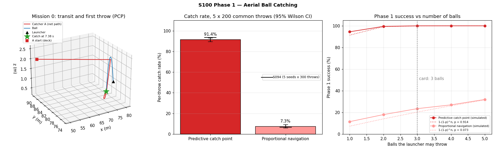
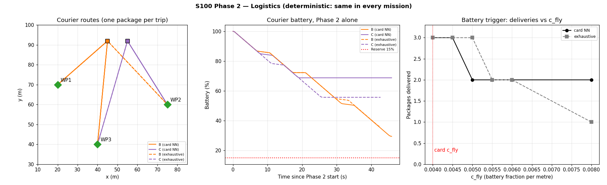
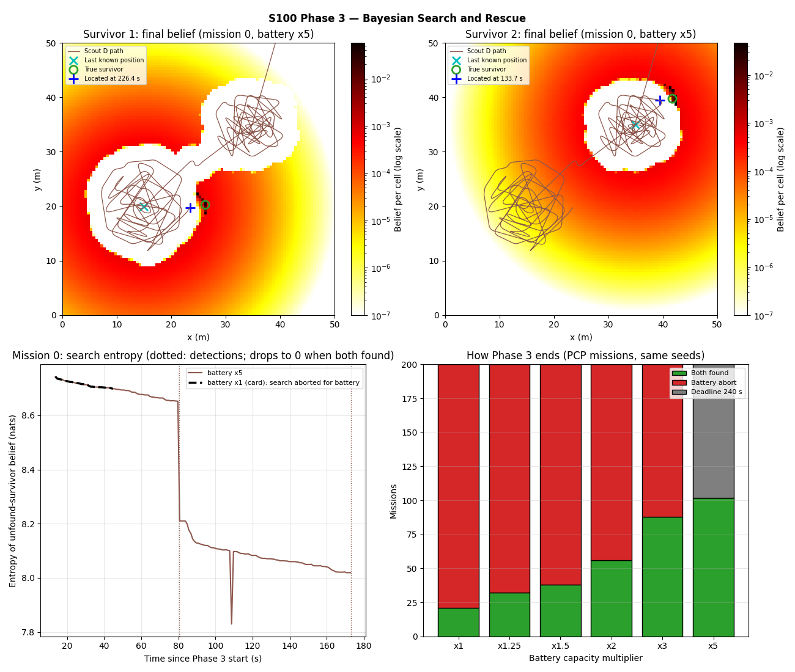
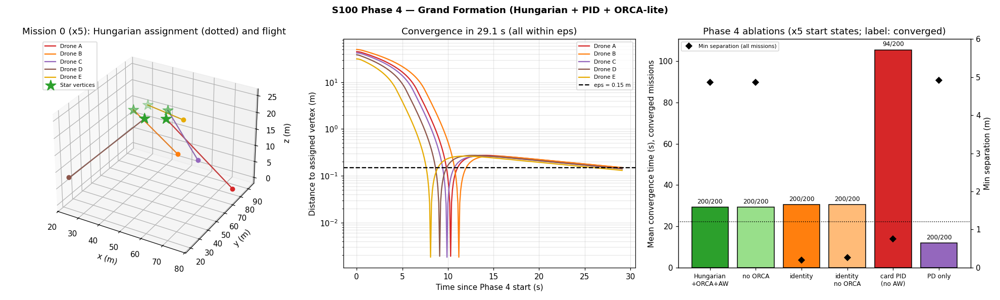
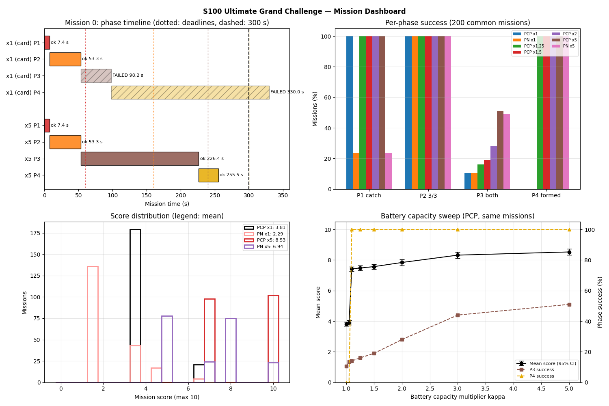
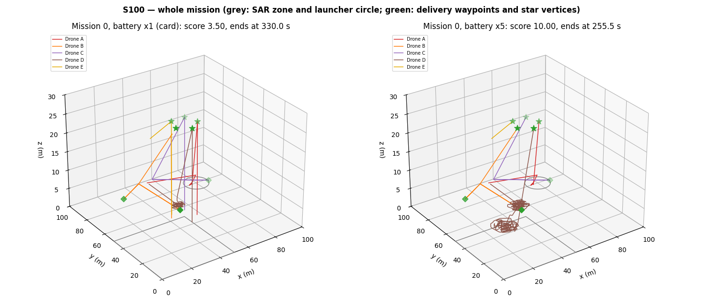
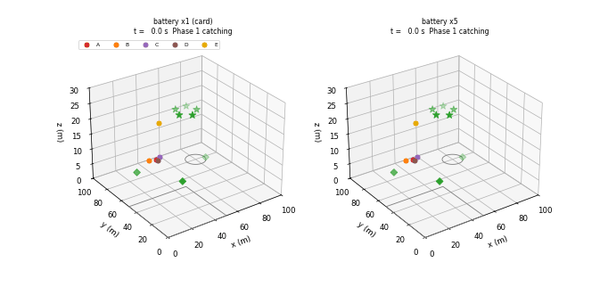

# S100 Ultimate Grand Challenge — Multi-Domain Integration

**Domain**: Special Ops & Entertainment | **Difficulty**: ⭐⭐⭐⭐⭐ | **Status**: ✅ Completed

---

## Problem Definition

**Setup**: Five drones share a 100 × 100 × 30 m arena and fly four phases one after another. A mission sequencer on Drone E starts each phase when the previous one is reported complete or its deadline passes. The whole mission has a 300 s budget. Each phase reuses a module from another part of the project:

| Phase | Actor | Task | Module | Deadline (absolute) |
|-------|-------|------|--------|---------|
| 1 Aerial ball catching | A (catcher) | A launcher throws up to 3 tennis balls; catch one | S094 predictive catch point and EKF (imported unchanged) | 60 s |
| 2 Logistics | B, C (couriers) | Deliver 3 packages, one package per trip | Nearest-neighbour split + battery trigger | 160 s |
| 3 Search and rescue | D (scout) | Locate 2 survivors in a 50 × 50 m zone | Bayesian belief maps + greedy max-belief frontier (as in S042) | 240 s |
| 4 Grand formation | all five | Form a 5-pointed star at 25 m | Hungarian assignment + PID + ORCA-lite (as in S085) | 300 s |

All five drones use one battery model in every phase and must never fly on an empty battery. They exchange state over an 80 m broadcast network with multi-hop relaying. The sequencer learns of an event only when the sender is connected to Drone E.

**Score** (card): $S = 2 s_1 + n_{deliv} + 3 s_3 + 2 s_4 - 0.05 \max(0, t_{end} - 300)$. Here $s_p = 1$ if phase $p$ achieved its goal by its deadline, and $n_{deliv}$ is the number of packages delivered by 160 s. A perfect score is 10. The mission loop stops at 330 s (card code), so a formation that never converges also costs the full 1.5-point overtime penalty.

**Compared variants**. All variants fly the same 200 missions: the throws, the mocap noise, the survivor positions and the sensor draws depend only on the seed (common random numbers).

1. **Phase 1 guidance law**: predictive catch point (PCP, the card's law) vs proportional navigation (PN, the card's comparison law).
2. **Battery capacity**: the card's battery (×1) and capacity multipliers ×1.05, ×1.1, ×1.25, ×1.5, ×2, ×3 and ×5.
3. **Phase 2 split**: the card's nearest-neighbour heuristic vs an exhaustive minimum-makespan split.
4. **×1 factorial probe**: Phase 2 split {NN, exhaustive} × Phase 4 controller {card PID with anti-windup, PD only} × hover accounting {hover costs $c_{hover}$ (main), the original card code's accounting (only $c_{fly}\|\mathbf{v}\|$ while flying, plus the delivery dwell; printed as "card-code accounting"; the card code has since been fixed to charge hover)}, and the failsafe margin (0.03, 0.01, 0.005).
5. **Other probes**: no landing reserve (×1), sequential instead of joint SAR search (×5), and Phase 4 ablations (no ORCA, identity assignment, the card's PID without anti-windup, PD only).

---

## Mathematical Model Summary

### Battery (all drones, all phases)

$$\dot E = -\frac{1}{\kappa}\max\!\left(c_{hover},\; c_{fly}\,\|\mathbf{v}\|\right) \ \text{while airborne}, \qquad \dot E = 0 \ \text{on the ground}$$

$c_{fly} = 0.004$ m⁻¹ gives the card's cruise cost ($\dot E = -c_{fly} v$, a 250 m range at κ = 1), and $c_{hover} = 0.003$ s⁻¹ gives its delivery-dwell cost (333 s of hover). The capacity multiplier κ is 1 for the card's battery. Every step asserts $E \ge 0$.

**Landing reserve (battery failsafe)**: an airborne drone with $E < c_{fly} z/\kappa + 0.03$ brakes to a hold and lands vertically. It drops out of the mission, so Phase 4 cannot converge without it.

### Motion

- Phase 1 runs at 2 ms with S094's double-integrator catcher ($\|\mathbf{v}\| \le 8$ m/s, $\|\mathbf{u}\| \le 10$ m/s², altitude window [0.3, 4.0] m).
- Phases 2–4 run at the card's 0.1 s tick. Every drone has $\|\mathbf{a}\| \le 10$ m/s² and a braking-curve go-to: $v_{des} = \min(v_{max}, \sqrt{2 \cdot 5 \cdot D}, D/\Delta t)$, with descent limited to $\sqrt{2 \cdot 5 \cdot z}$ near the ground.

### Phase 1 — aerial ball catching (S094, imported)

The script imports `s094_ball_catching.py` and uses its throw sampler, ball model ($k = 0.0202$ m⁻¹ quadratic drag), 100 Hz mocap with 2 cm noise and 20 ms latency, EKF, PCP planner, PN law and segment closest-approach catch check unchanged. The launcher circle is centred at (80, 80) m.

Drone A takes off from the deck, flies to a random station within 4 m of the centre at 2 m and settles to within 1 mm and 1 mm/s. The launcher then throws. After a lost ball the launcher waits until A is back on a new station and at least $T_{reload} = 5$ s have passed.

Phase 1 ends at the first tick after the first catch, or after the third lost ball. A then brakes to a hold and lands. Each mission simulates 5 throws, so the success for any number of balls $n$ can be read off exactly. With independent throws, the success probability is $P_1 = 1 - (1-p)^n$.

### Phase 2 — logistics

Each courier carries one package per trip: pad → waypoint (dwell 3 s) → pad → reload 3 s. Before each trip it applies the card's battery trigger:

$$E - c_{fly}\, d_{out} - c_{fly}\, d_{back} - c_{hover}\,\tau_{deliver} \ge E_{reserve} = 0.15$$

If the check fails, the courier aborts its remaining deliveries.

- **Card heuristic**: give the remaining waypoint nearest to a courier to that courier. With round trips, this sends each waypoint to the courier with the nearest pad.
- **Exhaustive split**: minimum makespan over all $2^3$ splits.

### Phase 3 — Bayesian search

There are two independent Gaussian priors ($\sigma_0 = 8$ m, LKPs (15, 20) and (35, 35) m) on a 100 × 100 grid of 0.5 m cells. At $h = 8$ m the scout takes one binary reading per survivor per 0.1 s tick, with footprint radius 3 m, $P_d = 0.85$ and $P_{fa} = 0.01$:

$$B^{(s)}_{t+1}(\mathbf{x}) \propto P(z \mid \mathbf{x})\, B^{(s)}_t(\mathbf{x})$$

The script multiplies the likelihood ratio into the 13 × 13 cells around the scout and keeps a running normaliser per map. This is exactly the card's update.

**Greedy target** (card): $\arg\max_{\mathbf{x}} \sum_s \alpha_s B^{(s)}(\mathbf{x})$, with ties broken by proximity. It is recomputed every tick.

A survivor counts as located when:

- the card's "physical hit" happens: a detection while the survivor really is in the footprint (operator-confirmed); false alarms only update the belief; or
- a 3 × 3 patch of its belief reaches 0.6.

The scout uses the card's battery trigger with "home" = the farthest star vertex plus the landing: it stops searching when $E_D - c_{fly}(d_{far} + z_{show})/\kappa < 0.15$.

### Phase 4 — formation

Drone E solves the Hungarian assignment of the five drones to the star tips $\mathbf{g}_k = (50 + 8\cos\theta_k, 50 + 8\sin\theta_k, 25)$ with $\theta_k = 2\pi k/5 - \pi/2$, using the last broadcast positions.

The PID velocity command $\mathbf{u} = K_p\mathbf{e} + K_i\int\mathbf{e} + K_d\dot{\mathbf{e}}$ uses the card's gains (1.2, 0.05, 0.4) and conditional-integration anti-windup (as in S085). The integral is frozen while $\|\mathbf{u}\| > 6$ m/s, and there is no derivative kick at the start.

The card's ORCA-lite term $k_{rep}(1/d - 1/r_{safe})\hat{\mathbf{n}}/d^2$ is added for $d < r_{safe} = 1.2$ m. The command is then capped at 6 m/s and 10 m/s². The phase ends when all five drones are within 0.15 m of their tips.

### Communication

Drones are linked when they are at most 80 m apart. Connectivity to Drone E is the transitive closure of these links (every drone relays). Phase-complete events and the assignment broadcast wait until the sender or receiver is connected.

---

## Key Parameters

| Parameter | Value |
|-----------|-------|
| Arena / total budget / mission tick | 100 × 100 × 30 m / 300 s (loop stops at 330 s) / 0.1 s |
| Phase deadlines (absolute) | 60 / 160 / 240 / 300 s |
| Phase weights / overtime penalty | (2, 3, 3, 2), Phase 2 prorated 1 point per package / 0.05 per s |
| Start positions A, B, C, D, E | (50, 90, 2), (45, 92, 2), (55, 92, 2), (50, 88, 2), (50, 86, 15) m; E holds by hovering |
| Communication range | 80 m, multi-hop relay, sequencer on E |
| Battery c_fly / c_hover / reserve | 0.004 m⁻¹ / 0.003 s⁻¹ / 15 %; failsafe margin 0.03 above $c_{fly} z$ |
| Capacity multiplier κ | 1 (card), 1.05, 1.1, 1.25, 1.5, 2, 3, 5 |
| Failsafe margin probe | 0.03 (main), 0.01, 0.005 |
| Fleet acceleration limit / go-to braking | 10 m/s² / 5 m/s² (phases 2–4) |
| Phase 1 catch-zone centre / launcher radius | (80, 80, 0) m / 8 m |
| Phase 1 throws | S094: U(7, 13) m/s, U(35°, 60°), ±30°, release 1.5 m |
| Phase 1 catcher | 8 m/s, 10 m/s², window [0.3, 4.0] m, net radius 0.15 m, $t_{react}$ 0.15 s, sub-step 2 ms |
| Phase 1 balls / reload / settle tolerance | 3 (5 simulated) / 5 s / 1 mm and 1 mm/s |
| Phase 1 mocap / PCP / PN | 100 Hz, 0.02 m, 20 ms / 20 Hz re-plan, 0.1 s margin / N = 3 |
| Phase 2 courier speed / dwell / reload | 5 m/s / 3 s / 3 s |
| Delivery waypoints | (20, 70, 5), (75, 60, 5), (40, 40, 5) m |
| Phase 3 zone / grid | x, y ∈ [0, 50] m / 100 × 100 cells of 0.5 m |
| Phase 3 scout | 4 m/s, h = 8 m (sensor on within 0.5 m of h), r_s = 3 m, P_d 0.85, P_fa 0.01 |
| Phase 3 priors / threshold | σ_0 = 8 m at (15, 20) and (35, 35) m / 3 × 3 patch ≥ 0.6 |
| Phase 4 star | centre (50, 50, 25) m, circumradius 8 m |
| Phase 4 PID / speed / ORCA | (1.2, 0.05, 0.4), anti-windup / 6 m/s / k_rep 2, r_safe 1.2 m / ε 0.15 m |
| Monte Carlo | 200 missions (seeds 0–199), common random numbers across every variant |
| c_fly sweep (Phase 2 alone) | 0.004, 0.0045, 0.005, 0.0055, 0.006, 0.008 |
| T_reload sweep (Phase 1 timing) | 2, 5, 10, 15, 20, 25 s |

---

## Implementation

```
src/05_special_entertainment/s100_grand_challenge.py   # Main simulation script (imports s094_ball_catching.py)
```

```bash
conda activate drones
python src/05_special_entertainment/s100_grand_challenge.py
```

Runtime 373 s on an otherwise idle machine; 466 s while another job loaded the CPU, and up to about 14 min when several other simulations share the CPU. The 200 missions are vectorised. Stdout and every output file are byte-identical across two single-threaded runs and one run with default threading.

---

## Results

### Mission results (200 common missions)

| Variant | P1 caught | P2 3/3 delivered | P3 both located | P4 formed | Ended ≤ 300 s | Perfect | Score |
|---------|------:|------:|------:|------:|------:|------:|------:|
| **PCP, battery ×1 (card)** | 100.0 % | 100.0 % | 10.5 % | **0.0 %** | 0/200 | 0/200 | **3.81 ± 0.92** |
| PN, battery ×1 | 23.5 % | 100.0 % | 10.5 % | 0.0 % | 0/200 | 0/200 | 2.29 ± 1.23 |
| PCP, ×1, exhaustive Phase 2 | 100.0 % | 100.0 % | 10.5 % | 0.0 % | 0/200 | 0/200 | 3.81 ± 0.92 |
| PCP, ×1, no landing reserve (probe) | 100.0 % | 100.0 % | 10.5 % | 100.0 % | 200/200 | 21/200 | 7.32 ± 0.92 |
| PCP, battery ×1.05 | 100.0 % | 100.0 % | 13.5 % | 0.0 % | 0/200 | 0/200 | 3.90 ± 1.03 |
| PCP, battery ×1.1 | 100.0 % | 100.0 % | 14.0 % | 100.0 % | 200/200 | 28/200 | 7.42 ± 1.04 |
| PCP, battery ×1.25 | 100.0 % | 100.0 % | 16.0 % | 100.0 % | 200/200 | 32/200 | 7.48 ± 1.10 |
| PCP, battery ×1.5 | 100.0 % | 100.0 % | 19.0 % | 100.0 % | 200/200 | 38/200 | 7.57 ± 1.18 |
| PCP, battery ×2 | 100.0 % | 100.0 % | 28.0 % | 100.0 % | 200/200 | 56/200 | 7.84 ± 1.35 |
| PCP, battery ×3 | 100.0 % | 100.0 % | 44.0 % | 100.0 % | 200/200 | 88/200 | 8.32 ± 1.49 |
| PCP, battery ×5 | 100.0 % | 100.0 % | 51.0 % | 100.0 % | 200/200 | 102/200 | 8.53 ± 1.50 |
| PN, battery ×5 | 23.5 % | 100.0 % | 49.0 % | 100.0 % | 200/200 | 23/200 | 6.94 ± 1.73 |
| PCP, ×5, sequential SAR (probe) | 100.0 % | 100.0 % | 54.5 % | 100.0 % | 200/200 | 109/200 | 8.63 ± 1.50 |

Score distributions: ×1 PCP gives 3.5 in 179 missions and 6.5 in 21. ×5 PCP gives 7 in 98 and 10 in 102. Phase 2 is deterministic (fixed waypoints, no noise), so its 100 % is the same in every mission and does not discriminate between variants.

### Key findings

- **With the card's battery and the card's Phase 2 heuristic, no mission completes.**
  - With the main configuration (card NN split, card PID with anti-windup, hover costs $c_{hover}$), every one of the 200 missions fails Phase 4 and runs to 330 s, so the score is 3.81 ± 0.92 (3.5 in 179 missions, 6.5 in 21).
  - **The first drone to give up is always courier B**, in all 200 missions, 7.60 s after Phase 4 starts. Its two trips in Phase 2 (171.5 m) leave it 29.5 %. The climb to its 25 m star tip then reaches the point where it can just still land ($c_{fly} z + 3$ %).
  - **The card's NN split fails in every combination tried; with the exhaustive split, the Phase 4 controller and the hover accounting decide the outcome.** The card's battery alone is not the cause. The ×1 factorial probe (200 missions each; Phase 4 converged, courier B's final battery mean / min):

    | Phase 2 split | Phase 4 controller | Hover costs $c_{hover}$ (main) | Original card-code accounting |
    |------|------|------:|------:|
    | Card NN | Card PID + anti-windup | 0/200 | 0/200 |
    | Card NN | PD only | 0/200 | 0/200 |
    | Exhaustive | Card PID + anti-windup | 0/200 | **200/200** (B 16.1 % / 16.1 %) |
    | Exhaustive | PD only | **200/200** (B 15.8 % / 15.7 %) | **200/200** (B 16.3 % / 16.3 %) |

    - With the card's NN split, B fails in every combination tried: it flies 171.5 m in Phase 2 and lands with 29.5 %.
    - With the exhaustive split (B flies 154.8 m, 36.1 % left), the mission completes in all 200 missions if either the formation converges fast (PD: 11.9 s instead of 29.3 s, so B hovers less at its tip) or hovering is free as in the original card code. Only the main configuration, which has both the integral term's slow tail and the hover charge, fails. Every converged combination scores 7.32 ± 0.92 (21 perfect), and B ends above the 15 % reserve.
    - The failsafe margin matters for the exhaustive split with the card PID: margin 0.01 still gives 0/200, margin 0.005 gives 143/200 (B lands on its failsafe in 57).
  - **Probe**: without the landing reserve, all 200 NN-split formations converge (21 perfect scores). But B then ends the show with 3.9 % on average (minimum 3.5 %), less than the 10.0 % it needs to land from 25 m.
  - **Capacity threshold** (main configuration): ×1.05 still gives 0/200 formed, ×1.1 gives 200/200. The card's battery is about 5–10 % short for the card's NN split with the card's PID.
- **The battery also limits the search.**
  - At ×1 the scout ends Phase 3 with a battery abort in 179 of 200 missions, after a search path of 142.32 ± 17.93 m. It locates both survivors in 21 missions (10.5 %).
  - Phase 3 success rises with capacity: 10.5 → 13.5 → 14.0 → 16.0 → 19.0 → 28.0 → 44.0 → 51.0 % for ×1, ×1.05, ×1.1, ×1.25, ×1.5, ×2, ×3, ×5.
  - At ×5 no battery rule binds: the scout ends with 60.27 ± 17.66 % and no drone needs a failsafe landing. The 240 s deadline then ends the search in 98 of 200 missions (102 find both).
  - Phase 4 converges in every mission from ×1.1 on (main configuration).
- **PCP is the right Phase 1 law.**
  - Per throw, PCP catches 91.4 % (914/1000, 95 % CI [89.5, 93.0]) and PN 7.3 % (73/1000), on the same 1000 throws. That is PCP only 841, neither or both 159, PN only 0.
  - These rates match S094 (93.5 ± 1.6 % and 6.7 ± 1.3 %).
  - With three balls, PCP completes Phase 1 in 200/200 missions (189 on the first ball) and PN in 47/200 (23.5 %). The independent-throw formula predicts 22.1 % for PN.
  - PN missions also leave Phase 1 later: 19.04 ± 4.50 s against 8.00 ± 1.62 s.
  - PCP has the higher or equal mission score in every mission: 153 better, 47 ties, 0 worse at ×1 (p = 1.75e-46), and 154 / 46 / 0 at ×5.
- **The 60 s Phase 1 deadline never binds.** PCP's latest Phase 1 end is 19.5 s with a 5 s reload, and still 59.5 s with a 25 s reload. For PN, a 25 s reload would push 157/200 missions past 60 s.
- **The greedy search does not ping-pong between the two survivors.**
  - The greedy target moved from one survivor's prior to the other's while both were unfound a median of 0 times (max 7) at ×5.
  - Searching one survivor at a time (sequential) locates both in 54.5 % against 51.0 % for the card's joint greedy rule. Sequential is better in 17 missions and worse in 10 (p = 0.248), so this is not a significant difference.
- **The card's PID integral slows Phase 4; ORCA does not engage.**
  - With the Hungarian assignment, the closest two drones ever get in Phase 4 is 4.87 m, and the 1.2 m ORCA zone is never entered. Removing ORCA changes nothing.
  - **Probe**: the PD controller ($K_i = 0$) converges in 11.9 s, against 29.3 s with the card's PID plus anti-windup. The integral term overshoots the show plane by 0.155 m and decays slowly.
  - Without anti-windup (the card's PID as written), 94/200 formations converge, after 105.5 ± 0.3 s (max 108.2 s), with a 3.93 m overshoot and pairs as close as 0.75 m. The other 106 do not diverge: they are cut off by the standalone horizon (330 s minus the end of Phase 3, 90.74 ± 2.73 s, at most 103.7 s), which is shorter than the slowest convergence; none with a longer horizon failed.
- **The Hungarian assignment prevents near-collisions that the identity assignment creates, and ORCA-lite does not fix them.**
  - With the identity assignment, paths cross: 25 of 200 missions bring a pair within 1.2 m.
  - ORCA-lite barely changes this. In those 25 missions it raises the minimum separation in 16 and lowers it in 1, but the mean only moves from 0.76 m to 0.77 m. Pairs closer than 0.5 m: 4 missions without ORCA, 4 with it. The overall minimum even drops from 0.26 m to 0.19 m.
  - A hypothesis, not tested here: at a 12 m/s closing speed a pair crosses the 1.2 m zone in about one 0.1 s tick, too fast for a repulsion that only acts inside it.
- **Communication matters only for the scout.**
  - At ×5 the scout leaves the 80 m range of Drone E in 80 of 200 missions while searching the far south-west.
  - Its Phase 3 report is delayed in 23 missions, by at most 1.6 s. No other drone ever loses the link.
- **Physical invariants hold.**
  - Asserted every step: speed (peak 8.00 m/s), acceleration (peak 10.00 m/s²), 0 ≤ z ≤ 30 m, inside the arena, and battery ≥ 0.
  - Inside Phase 1, S094's own asserts apply.
  - Minimum separation between any two drones with at least one airborne: 1.81 m (Phase 1), 5.36 m, 6.44 m and 4.87 m (×5) per phase.

### Phase 1 — aerial ball catching

Left: mission 0 — A takes off from the deck, settles on its station and catches the first ball 7.38 s into the mission. Centre: per-throw catch rate with 95 % Wilson intervals; the black ticks are S094's rates. Right: Phase 1 success against the number of balls the launcher may throw, simulated (solid) and $1-(1-p)^n$ (dotted).

- Success vs number of balls: PCP 94.5 / 99.5 / 100.0 / 100.0 / 100.0 %; PN 11.5 / 18.0 / 23.5 / 27.0 / 32.0 % for 1–5 balls.
- Per-throw rate by throw index: PCP 94.5, 93.0, 90.5, 90.5, 88.5 %. A chi-square test finds no difference between the throw indices (PCP p = 0.227, PN p = 0.100); the throws are independent draws.
- A flies 38.47 ± 5.96 m in Phase 1 and uses 16.04 ± 2.52 % of its battery.



### Phase 2 — logistics

| Split | B | C | Planned makespan / distance | Simulated duration | Flown B / C | Battery left B / C |
|-------|---|---|------:|------:|------:|------:|
| Card nearest-neighbour | WP1, WP3 | WP2 | 43.3 s / 247.2 m | 45.9 s | 171.5 / 75.7 m | 29.5 / 68.8 % |
| Exhaustive min-makespan | WP1, WP2 | WP3 | 40.0 s / 263.2 m | 42.7 s | 154.8 / 108.4 m | 36.1 / 55.7 % |

The card heuristic minimises total distance (247.2 m) but gives B two trips totalling 171.5 m. The exhaustive split flies 16.0 m more in total, finishes 3.2 s earlier and leaves B 6.6 percentage points more battery. In the full mission at ×1 with the main configuration this alone does not change the outcome (Phase 4 still fails in all 200), but combined with a PD controller or the original card code's hover accounting it does (all 200 converge; see the factorial probe in the key findings).

The battery trigger is exercised by the c_fly sweep (Phase 2 alone):

| c_fly (m⁻¹) | 0.004 | 0.0045 | 0.005 | 0.0055 | 0.006 | 0.008 |
|------|---:|---:|---:|---:|---:|---:|
| Card NN: delivered (B aborts) | 3 | 3 | 2 (1) | 2 (1) | 2 (1) | 2 (1) |
| Exhaustive: delivered (aborts B/C) | 3 | 3 | 3 | 2 (1/0) | 2 (1/0) | 1 (1/1) |

Left: routes (solid NN, dashed exhaustive). Centre: battery during Phase 2. Right: deliveries vs c_fly:



### Phase 3 — Bayesian search and rescue

| Battery | Both found | Battery abort | Deadline (240 s) | Survivors found 0 / 1 / 2 |
|---------|---:|---:|---:|---:|
| ×1 (card) | 21 | 179 | 0 | 124 / 55 / 21 |
| ×5 | 102 | 0 | 98 | 46 / 52 / 102 |
| ×5, sequential | 109 | 0 | 91 | 37 / 54 / 109 |

At ×5, 245 survivors were located by a confirmed hit and 11 by the 3 × 3 patch rule. All 11 patch declarations put the survivor more than r_s = 3 m from its true position (up to 24.58 m). The belief rule can therefore declare a survivor at the wrong place, and the sequencer cannot tell. A confirmed hit is within 3 m by construction (the estimate is the scout position). The scout sees 19.73 ± 11.80 false alarms per mission at ×5.

Top: final belief maps of mission 0 at ×5 (log colour scale) with the scout's path, the LKP (cyan ×), the true survivor (green ○) and the declared location (blue +). Bottom left: entropy of the belief of the survivors not yet found, for mission 0 at ×1 and ×5, logged every 1 s while the scout is searching (dotted lines: detections). The curve stops when the search ends, so it does not drop to 0 after the last detection. Bottom right: how Phase 3 ends for each capacity:



### Phase 4 — grand formation

Ablations from the ×5 Phase 4 start states (standalone, all five drones receive the assignment at once; the standalone baseline reproduces the in-mission duration to 0.01 s on average, at most 0.80 s):

| Variant | Converged | Time | Min separation (missions < 1.2 m) | ORCA ticks | Path (5 drones) | Max height above 25 m |
|---------|---:|---:|---:|---:|---:|---:|
| **Hungarian + ORCA + anti-windup (main)** | 200/200 | 29.3 ± 0.3 s | 4.87 m (0) | 0 | 212.2 m | 0.155 m |
| No ORCA | 200/200 | 29.3 ± 0.3 s | 4.87 m (0) | 0 | 212.2 m | 0.155 m |
| Identity assignment | 200/200 | 30.4 ± 0.3 s | 0.19 m (25) | 54 | 236.0 m | 0.146 m |
| Identity, no ORCA | 200/200 | 30.4 ± 0.3 s | 0.26 m (25) | 0 | 236.0 m | 0.146 m |
| Card PID without anti-windup | 94/200 | 105.5 ± 0.3 s | 0.75 m (48) | 817 | 270.8 m | 3.931 m |
| PD only ($K_i = 0$) | 200/200 | 11.9 ± 0.1 s | 4.91 m (0) | 0 | 210.0 m | 0.000 m |

Left: mission 0 at ×5, assignment (dotted) and flight. Centre: distance of each drone to its tip. Read from the plot: every drone first reaches its tip after 8–11 s, the integral term then pushes it about 0.25 m back out, and the last error falls below 0.15 m only at the end of the phase (Phase 4 runs from 226.4 s to 255.5 s in this mission). Right: ablation convergence times (label: converged missions) and minimum separations:



### Mission dashboard

Top left: phase timeline of mission 0 at ×1 (Phase 3 aborted for battery at 98.2 s, Phase 4 failed) and ×5 (all four phases succeed, ends at 255.5 s). Top right: per-phase success. Bottom left: score distributions. Bottom right: mean score (95 % CI) and Phase 3 / 4 success against battery capacity:



### Whole mission in 3D

Mission 0 at ×1 (left) and ×5 (right):



### Animation

Mission 0 at ×1 (left) and ×5 (right) side by side, one frame per 1.5 s of mission time, 221 frames up to 330 s. The ball is blue. At ×1 the formation fails, and the drones hover until they land on their battery failsafe:



### Deviations from the scenario card

| Card | Implementation | Reason |
|------|----------------|--------|
| Phase 1: aerial ball catching with S094's predictive catch point, PN as the comparison law | As in the card (Phase 1 was revised to ball catching by user decision in a separate commit before this build) | — |
| Show altitude $z_{show} = 50$ m | 25 m (card fixed) | The arena ceiling is 30 m. |
| SAR zone "the southern half of the arena, $y \in [0, 50]$" | $x, y \in [0, 50]$ m, the south-west quadrant (card fixed) | The card's own grid is 50 × 50 m, a quarter of the arena. |
| $r_{comm} = 80$ m "effectively the entire arena" | Multi-hop 80 m links; events wait for a connection to E (card fixed) | The arena diagonal is 141 m. The scout leaves E's range in 80/200 missions at ×5. |
| $c_{fly}$ in s⁻¹m⁻¹; battery described for Phase 2 only; the card code charged only $c_{fly}\|\mathbf{v}\|$ to the scout and the formation and nothing to E's hover | $c_{fly}$ in m⁻¹; one model $\max(c_{hover}, c_{fly}\|\mathbf{v}\|)$ for every drone in every phase, hover costs energy (card text and code fixed); the original card code's accounting is kept as a probe | Units; hovering is not free, and a drone must not fly on an empty battery. The choice is decisive at ×1 with the exhaustive split (0/200 vs 200/200). |
| One package per courier per leg, but the card code delivers several packages per route without reloading, and both couriers land on one base point | One package per trip, round trips from each courier's own pad, 3 s reload (card fixed) | Capacity limit (X4) and no two drones landing on the same spot. |
| NN heuristic "alternating assignments" | Global nearest (waypoint, courier) pair; with round trips this is nearest pad | "Alternating" is not defined, and the card code does not alternate. |
| Phase 2 binary in the card code, prorated in the text | Prorated: 1 point per package delivered by 160 s (card code fixed) | Follows the text and $w_2 = 3$. |
| FSM ends Phase 4 on the mean error $\varepsilon_f \le 0.15$ | All five within 0.15 m (card fixed) | The text and the card code use all five. |
| Card code leaves catcher A airborne after Phase 1, uncharged | A brakes to a hold, lands below it and takes off again for Phase 4 (card code fixed) | A drone with no task should not hover on its battery, and hovering is not free. |
| No battery rule for the scout | Card's battery trigger with "home" = farthest star tip plus the landing (card updated) | Otherwise the card's 80 s search alone would use 1.28 of a battery at 4 m/s. |
| — | Battery failsafe: land when $E < c_{fly} z + 0.03$; probes without it and with margins 0.01 and 0.005 | Every drone must be able to land. The ×1 result depends on this rule (no reserve: 200/200 converge with NN; margin 0.005: 143/200 with the exhaustive split). |
| PID as written | Conditional-integration anti-windup and no derivative kick (as in S085); card PID and PD only printed as ablations | Without anti-windup only 94/200 formations converge, with 3.93 m overshoot. |
| "Holding orbit" for E | Station-keeping hover at (50, 86, 15) m | The orbit is not specified; hovering costs $c_{hover}$. |
| Velocity-only kinematics | Fleet acceleration limit 10 m/s², braking-curve go-to, descent limited near the ground; Phase 1 at S094's 2 ms | No unbounded acceleration or ground penetration (X4); S094's catch model needs 2 ms. |
| Sensor reading at every step | Readings only within 0.5 m of the 8 m scan altitude | The footprint radius is defined at h = 8 m. |
| "5-pointed star" | Five drones on the five tips (a regular pentagon) | Five drones can only mark the tips. |
| Output files `s100_phase1_catching.png` … `s100_grand_challenge.gif`, one mission per figure; Phase 1 right panel = ball-to-net distance | `phase1_catching.png`, `phase2_logistics.png`, `phase3_sar.png`, `phase4_formation.png`, `mission_dashboard.png`, `mission_3d.png`, `animation.gif`; panels for one representative mission plus Monte Carlo panels (Phase 1 right panels = catch rates and success vs number of balls) | Project naming convention; a single-mission figure cannot show the comparisons. |
| One mission (seed 42) | 200 missions, capacity sweep, PN, exhaustive split and SAR / formation probes, all with common random numbers | The card's question (can the integrated mission score 10?) needs a distribution, and each conclusion needs its own probe. |
| Added parameters | Catch-zone centre, reload time, settle tolerance, pads, reload on pad, fleet acceleration, failsafe margin, sensor altitude tolerance, κ | Listed in Key Parameters. The ×1 conclusion is tested by the κ sweep and the landing-reserve probe; the Phase 1 deadline by the T_reload sweep; the trigger by the c_fly sweep. |

---

## Extensions

1. **Energy-aware task allocation across phases**: choose the Phase 2 split, the Phase 4 assignment and the scout's search budget jointly, so that the drone with the least battery gets the nearest star tip. At ×1 the exhaustive split combined with a faster formation controller already keeps B in the show; a joint optimisation could also leave the scout more search time.
2. **Re-planning after a failure**: when a drone lands on its failsafe, re-solve the assignment for a four-drone figure instead of failing Phase 4.
3. **Better search policies**: a coverage pattern or expected-information-gain policy instead of the greedy maximum, and a guard against the patch rule's wrong declarations (11 of 256 at ×5).
4. **Formation tuning**: PD or a smaller $K_i$ halves the time spent in Phase 4 (11.9 s vs 29.3 s).
5. **Wind and 6-DOF dynamics** in every phase, as in the card's third extension.

---

## Related Scenarios

- Phase modules: [S094 Aerial Ball Catching](../../../scenarios/05_special_entertainment/S094_ball_catching.md), [S042 Missing Person Localization](../../../scenarios/03_environmental_sar/S042_missing_person.md), [S085 Drone Light Matrix Positioning](../../../scenarios/05_special_entertainment/S085_light_matrix.md), [S021 Point Delivery](../../../scenarios/02_logistics_delivery/S021_point_delivery.md)
- Cross-reference: [S008 Stochastic Pursuit — Kalman Filter Tracking](../../../scenarios/01_pursuit_evasion/S008_stochastic_pursuit.md), [S068 Large-Scale Farmland Cooperative Spraying](../../../scenarios/04_industrial_agriculture/S068_large_field_spray.md), [S066 Cooperative Crane Simulation](../../../scenarios/04_industrial_agriculture/S066_cooperative_crane.md)
- Scenario card: [S100 Ultimate Grand Challenge — Multi-Domain Integration](../../../scenarios/05_special_entertainment/S100_grand_challenge.md)
